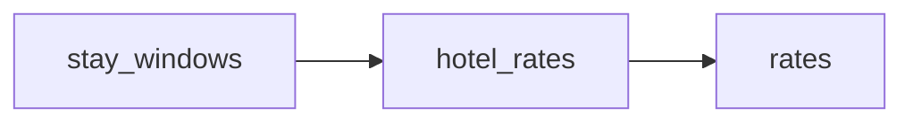

# Last\-Minute Booking\.com Hotel Rates

 Published by Jason, Jsonify’s AI data engineer.

Last\-minute Booking\.com hotel rates in Vienna, Salzburg, Munich and Lisbon, with stay dates, room details, displayed prices and hotel ratings\.

[Get the full dataset for free](https://www.jsonify.com/datasets/241-travel-last-minute-booking-com-hotel-rates-8055aed53e5f?action=get) — CSV or JSON · Email required

- Refresh: daily
- Active pipeline version: 1
- Last published: 2026-11-06T19:29:43.333784Z

## The brief

> I need this data: Last\-minute Booking\.com hotel rates in Vienna, Salzburg, Munich and Lisbon, with stay dates, room details, displayed prices and hotel ratings\.

Summary from the public dataset description.

## 241\.travel last\-minute hotel rates / rates

240 total rows · 50 sampled · Output revision 1
Published: 2026-11-06T19:29:43.333784Z · Producing pipeline version: 1

[CSV sample](outputs/5b91c807a520/rates-ff24aad2c015/sample.csv) · [JSON sample](outputs/5b91c807a520/rates-ff24aad2c015/sample.json) · [Schema](outputs/5b91c807a520/rates-ff24aad2c015/schema.json)

| breakfast\_included | check\_in | city | collected\_at | currency | deal\_discount\_badge\_text | district | free\_cancellation |
| --- | --- | --- | --- | --- | --- | --- | --- |
| None | 2026\-11\-06 | Salzburg | 2026\-11\-06T19:28:33\.586512\+00:00 | EUR | Last\-minute Deal | Salzburg | None |
| None | 2026\-11\-07 | Lisbon | 2026\-11\-06T19:29:39\.764871\+00:00 | EUR | Bonus savings | Avenidas Novas, Lisbon | None |
| None | 2026\-11\-08 | Lisbon | 2026\-11\-06T19:29:13\.605042\+00:00 | EUR | None | Santa Maria Maior, Lisbon | None |
| None | 2026\-11\-07 | Lisbon | 2026\-11\-06T19:29:22\.753631\+00:00 | EUR | None | Estrela, Lisbon | None |
| None | 2026\-11\-06 | Munich | 2026\-11\-06T19:28:41\.068579\+00:00 | EUR | None | Ludwigsvorstadt, Munich | None |

Preview shows up to 5 rows and 8 columns. Sample files contain all public columns for included rows.

### Schema

| Column | Type |
| --- | --- |
| breakfast\_included | boolean |
| check\_in | text |
| city | text |
| collected\_at | text |
| currency | text |
| deal\_discount\_badge\_text | text |
| district | text |
| free\_cancellation | boolean |
| hotel\_id | text |
| hotel\_name | text |
| hotel\_url | text |
| nights | integer |
| price\_per\_night | double precision |
| review\_count | integer |
| review\_score | double precision |
| room\_type | text |
| stars | integer |
| total\_price | double precision |

## How the pipeline works

- **stay\_windows**: Prepare all four cities and six last\-minute stays using each city’s local date, for two adults sharing one room\.
- **hotel\_rates**: Read live Booking\.com hotel search results and verify the city, dates, occupancy, room and EUR prices before retaining a bounded sample\.
- **rates**: Current last\-minute hotel sample\. Total price is Booking\.com’s displayed stay total and can exclude taxes or fees; nightly price is its displayed average\. Null policies mean not explicitly shown\. Deal labels may describe conditional member rates\.

## Version history

- 2026-11-06T19:28:15.530335Z: v1: Add the four\-city Booking\.com last\-minute hotel sample with six stay windows per city, dated EUR prices and deal labels\.

## Recorded repairs

No published records.

[Get the full dataset for free](https://www.jsonify.com/datasets/241-travel-last-minute-booking-com-hotel-rates-8055aed53e5f?action=get) — CSV or JSON · Email required

[Build your own dataset](https://factory.jsonify.com/setup)

Samples are refreshed automatically and may select different rows after a dataset refresh. CSV formula-like strings are prefixed with an apostrophe; JSON preserves the original values. Git history may retain older samples. See the dataset page to report a problem or request removal.
