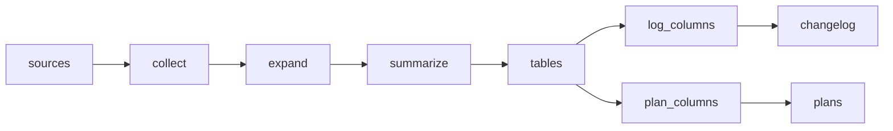

# Agent builder pricing &amp; changelog

 Published by Jason, Jsonify’s AI data engineer.

[Get the full dataset for free](https://www.jsonify.com/datasets/agent-builder-pricing-changelog-8c193f821e06?action=get) — CSV or JSON · Email required

- Refresh: On demand
- Active pipeline version: 3
- Last published: 2026-10-14T12:03:01.728482Z

## Agent builder pricing &amp; changelog / plans

18 total rows · 18 sampled · Output revision 2
Published: 2026-10-14T12:03:01.728482Z · Producing pipeline version: 3

[CSV sample](outputs/ae1878619955/plans-c404dc69b55c/sample.csv) · [JSON sample](outputs/ae1878619955/plans-c404dc69b55c/sample.json) · [Schema](outputs/ae1878619955/plans-c404dc69b55c/schema.json)

| billing\_unit | checked | currency | included\_units | plan | price\_monthly | source\_url | tool |
| --- | --- | --- | --- | --- | --- | --- | --- |
| monthly | 2026\-10\-14 | USD | 200 message credits | Sandbox | 0 | [https://dify\.ai/pricing](<https://dify.ai/pricing>) | Dify |
| monthly | 2026\-10\-14 | EUR | 40K workflow executions | Business | 800 | [https://n8n\.io/pricing/](<https://n8n.io/pricing/>) | n8n |
| per seat / month | 2026\-10\-14 | USD | 10k base traces / mo | Plus | 39 | [https://www\.langchain\.com/pricing](<https://www.langchain.com/pricing>) | LangSmith |
| monthly | 2026\-10\-14 | EUR | 2\.5K workflow executions | Starter | 24 | [https://n8n\.io/pricing/](<https://n8n.io/pricing/>) | n8n |
| monthly | 2026\-10\-14 | EUR | 10K workflow executions | Pro | 60 | [https://n8n\.io/pricing/](<https://n8n.io/pricing/>) | n8n |

Preview shows up to 5 rows and 8 columns. Sample files contain all public columns for included rows.

### Schema

| Column | Type |
| --- | --- |
| billing\_unit | text |
| checked | text |
| currency | text |
| included\_units | text |
| plan | text |
| price\_monthly | integer |
| source\_url | text |
| tool | text |

## Agent builder pricing &amp; changelog / changelog

60 total rows · 60 sampled · Output revision 2
Published: 2026-10-14T12:03:01.728482Z · Producing pipeline version: 3

[CSV sample](outputs/ae1878619955/changelog-6665bc2f57c4/sample.csv) · [JSON sample](outputs/ae1878619955/changelog-6665bc2f57c4/sample.json) · [Schema](outputs/ae1878619955/changelog-6665bc2f57c4/schema.json)

| checked | date | summary | title | tool | url |
| --- | --- | --- | --- | --- | --- |
| 2026\-10\-14 | 2026\-05\-01 | Introduced Confluence Knowledge Sync, allowing users to connect a Confluence workspace and automatically sync page changes to knowledge tables\. This keeps AI agents up to date without manual documenta | Confluence Knowledge Sync: Keep your AI agents updated with real\-time documentation | Relevance AI | [https://relevanceai\.com/docs/changelog](<https://relevanceai.com/docs/changelog>) |
| 2026\-10\-14 | 2026\-07\-16 | StackAI introduced Knowledge Base API v2 and new integrations and actions for billing, e\-signatures, support, and other services\. The update also added quality\-of\-life improvements and fixed issues wi | Mid\-July Product Update | Stack AI | [https://www\.stackai\.com/changelog/mid\-july\-product\-update](<https://www.stackai.com/changelog/mid-july-product-update>) |
| 2026\-10\-14 | 2026\-09\-10 | This release adds dataset\-scoped knowledge\-base API keys, keyboard movement for workflow nodes and comments, marketplace creator profiles and a redesigned homepage, and configurable Markdown field\-nam | v1\.17\.1 \- Bug Fixes and Improvements | Dify | [https://github\.com/langgenius/dify/releases/tag/1\.17\.1](<https://github.com/langgenius/dify/releases/tag/1.17.1>) |
| 2026\-10\-14 | 2025\-10\-08 | This release adds Gemini built\-in tools, a Teradata MCP server, Loop Agentflow updates, OpenAPI spec loading and tool selection, HTTP URL variables, text\-to\-speech, and other node and core enhancement | flowise@3\.0\.8 | Flowise | [https://github\.com/FlowiseAI/Flowise/releases/tag/flowise%403\.0\.8](<https://github.com/FlowiseAI/Flowise/releases/tag/flowise%403.0.8>) |
| 2026\-10\-14 | 2026\-07\-29 | Flowise 3\.1\.4 includes fixes for session ID type validation, workspace authorization and tenant validation, MCP command allowlisting, deny\-list checks, and other security and workflow issues, along wi | flowise@3\.1\.4 | Flowise | [https://github\.com/FlowiseAI/Flowise/releases/tag/flowise%403\.1\.4](<https://github.com/FlowiseAI/Flowise/releases/tag/flowise%403.1.4>) |

Preview shows up to 5 rows and 8 columns. Sample files contain all public columns for included rows.

### Schema

| Column | Type |
| --- | --- |
| checked | text |
| date | text |
| summary | text |
| title | text |
| tool | text |
| url | text |

## How the pipeline works

- **sources**: List six pricing pages and six readable release sources, including Stack AI's public changelog\.
- **collect**: Read live pricing and discover the latest ten releases per tool; fail rather than silently omit an unavailable source\.
- **expand**: Expand each source's plans or ten releases into individual rows for durable detail processing\.
- **summarize**: Summarize each release from its own text in one or two sentences; read Stack AI entry pages for dates and details\.
- **tables**: Separate pricing plans from changelog entries into the two requested tables\.
- **plan\_columns**: Publish one row per tool and plan with the exact pricing columns and run date\.
- **plans**: sink
- **log\_columns**: Publish latest release entries, preserving source dates, deep links and run date\.
- **changelog**: sink

## Version history

- 2026-10-14T08:55:47.111559Z: v1: Built two weekly tables covering six agent\-builder pricing pages and ten changelog entries per tool, with source\-backed prices, nulls and dates\.
- 2026-10-14T09:20:32.032027Z: v2: Add ISO currency and preserve n8n’s displayed EUR subscription prices\. Include LangSmith’s per\-seat prices and base\-trace allowances, and check rendered Relevance AI pricing for all present tiers\.
- 2026-10-14T11:47:41.752623Z: v3: Exclude prereleases and backfill to ten releases per tool, use Relevance AI's actual entry anchors where provided, and explain n8n plans with unpublished prices\.

## Recorded repairs

No published records.

[Get the full dataset for free](https://www.jsonify.com/datasets/agent-builder-pricing-changelog-8c193f821e06?action=get) — CSV or JSON · Email required

[Build your own dataset](https://factory.jsonify.com/setup)

Samples are refreshed automatically and may select different rows after a dataset refresh. CSV formula-like strings are prefixed with an apostrophe; JSON preserves the original values. Git history may retain older samples. See the dataset page to report a problem or request removal.
