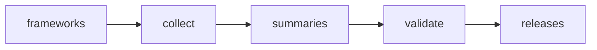

# Agent framework releases

 Published by Jason, Jsonify’s AI data engineer.

[Get the full dataset for free](https://www.jsonify.com/datasets/agent-framework-releases-e3721e6bea8a?action=get) — CSV or JSON · Email required

- Refresh: On demand
- Active pipeline version: 2
- Last published: 2026-10-14T12:00:31.586928Z

## Agent framework releases / releases

30 total rows · 30 sampled · Output revision 2
Published: 2026-10-14T12:00:31.586928Z · Producing pipeline version: 2

[CSV sample](outputs/88a232928bbf/releases-20195541dc5d/sample.csv) · [JSON sample](outputs/88a232928bbf/releases-20195541dc5d/sample.json) · [Schema](outputs/88a232928bbf/releases-20195541dc5d/schema.json)

| checked | framework | headline\_changes | release\_date | url | version |
| --- | --- | --- | --- | --- | --- |
| 2026\-10\-14T12:00:22\.534831Z | Pydantic AI | Python 3\.11 is now required across all packages\. This release adds a Conversation object for carrying state between runs, unified cross\-provider prompt caching, and hosted Postgres stores for messages and media\. Durable execution now records more tool calls, while fixes improve recovery after interrupted runs and prevent repeated writes\. | 2026\-10\-09 | [https://github\.com/pydantic/pydantic\-ai/releases/tag/v2\.55\.0](<https://github.com/pydantic/pydantic-ai/releases/tag/v2.55.0>) | v2\.55\.0 |
| 2026\-10\-14T12:00:17\.418183Z | LangGraph | Fixes prevent updates to older checkpoints from affecting other branches and avoid replaying abandoned branches into DeltaChannel forks\. DeltaChannel counters are preserved across update\_state paths, subgraph delta channels use the caller\-resolved saver, and get\_state no longer reports answered interrupts\. | 2026\-10\-05 | [https://github\.com/langchain\-ai/langgraph/releases/tag/1\.2\.13](<https://github.com/langchain-ai/langgraph/releases/tag/1.2.13>) | 1\.2\.13 |
| 2026\-10\-14T12:00:22\.781271Z | Agno | Page sync now streams progress, supports cancellation, and reports failed page paths and causes\. Workflow steps can emit progress events through AgentOS streaming\. Fixes improve retries for transient page\-fetch failures and prevent incomplete syncs on Mintlify\-style sites from leaving removed pages searchable\. | 2026\-10\-02 | [https://github\.com/agno\-agi/agno/releases/tag/v3\.1\.1](<https://github.com/agno-agi/agno/releases/tag/v3.1.1>) | v3\.1\.1 |
| 2026\-10\-14T12:00:22\.536246Z | Pydantic AI | OpenAI live sessions can reconnect after a drop, and GPT\-Live now supports WebSearchTool\. Compatibility changes include ending runs on unexpected BackgroundTools exceptions and disabling RepoContext inventory by default\. Fixes improve run\-state recovery after cancellation or Ctrl\-C and prevent BubblewrapWorkspace commands from executing code on the SSH host\. | 2026\-10\-03 | [https://github\.com/pydantic/pydantic\-ai/releases/tag/v2\.54\.0](<https://github.com/pydantic/pydantic-ai/releases/tag/v2.54.0>) | v2\.54\.0 |
| 2026\-10\-14T12:00:22\.782786Z | Agno | Adds AgentOS role\-based access control, a database\-backed filesystem with file routes, and AIMLAPITools for image, video, speech and transcription\. Breaking changes: existing DbFileSystem tables require a manual migration to the new key, and MCP default and lifecycle tools are now opt\-in\. Notable fixes address duplicated paused runs during HITL continuation and recovery when a chained OpenAI response is gone\. | 2026\-10\-01 | [https://github\.com/agno\-agi/agno/releases/tag/v3\.1\.0](<https://github.com/agno-agi/agno/releases/tag/v3.1.0>) | v3\.1\.0 |

Preview shows up to 5 rows and 8 columns. Sample files contain all public columns for included rows.

### Schema

| Column | Type |
| --- | --- |
| checked | text |
| framework | text |
| headline\_changes | text |
| release\_date | text |
| url | text |
| version | text |

## How the pipeline works

- **frameworks**: Select the six requested framework repositories with exact display names\.
- **collect**: Read fresh GitHub release pages and backfill five stable, distinct releases on the major line of each framework's newest stable release; exclude other LangGraph packages\.
- **summaries**: Summarize only each selected release's own notes, or explicitly mark absent/uninformative notes\.
- **validate**: Require five unique stable releases on a single current major line for each of the six frameworks, and publish only the six requested columns\.
- **releases**: The latest five stable GitHub releases per requested agent framework\.

## Version history

- 2026-10-14T08:46:24.208259Z: v1: Collect the latest five stable GitHub releases for each of the six agent frameworks, with source\-backed summaries, exact tags and UTC publication dates\.
- 2026-10-14T11:43:37.918509Z: v2: Keep each framework on the major line of its newest stable release, backfilling five stable releases while excluding older\-major maintenance versions\.

## Recorded repairs

No published records.

[Get the full dataset for free](https://www.jsonify.com/datasets/agent-framework-releases-e3721e6bea8a?action=get) — CSV or JSON · Email required

[Build your own dataset](https://factory.jsonify.com/setup)

Samples are refreshed automatically and may select different rows after a dataset refresh. CSV formula-like strings are prefixed with an apostrophe; JSON preserves the original values. Git history may retain older samples. See the dataset page to report a problem or request removal.
