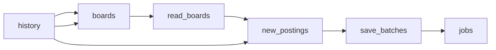

# AI Company Job Postings Data

 Published by Jason, Jsonify’s AI data engineer.

AI company job postings from public job boards, including title, team, location, workplace type and published salary ranges where available\. The published tables contain 5,584 rows\.

[Get the full dataset for free](https://www.jsonify.com/datasets/ai-company-job-postings-5bae5dc811a8?action=get) — CSV or JSON · Email required

- Refresh: weekly
- Active pipeline version: 4
- Last published: 2026-11-16T07:02:08.230901Z

## The brief

> I need this data: AI company job postings from public job boards, including title, team, location, workplace type and published salary ranges where available\. The published tables contain 5,584 rows\.

Summary from the public dataset description.

## AI company job postings / jobs

5,584 total rows · 50 sampled · Output revision 10
Published: 2026-11-16T07:02:08.230901Z · Producing pipeline version: 4

[CSV sample](outputs/974fa46f2ce0/jobs-5d9a17cb70b9/sample.csv) · [JSON sample](outputs/974fa46f2ce0/jobs-5d9a17cb70b9/sample.json) · [Schema](outputs/974fa46f2ce0/jobs-5d9a17cb70b9/schema.json)

| first\_seen\_date | company | ats | board | posting\_id | title | department | team |
| --- | --- | --- | --- | --- | --- | --- | --- |
| 2026\-11\-16 | Cohere | ashby | cohere | 2dc422bb\-6759\-4867\-afb6\-dc074af9ae58 | Senior Accountant | Business Operations | Finance |
| 2026\-11\-16 | Cursor | ashby | cursor | 60a3541f\-f6b6\-4da2\-a168\-40e867a51740 | Field Engineer, Healthcare | Solutions | Field Engineering |
| 2026\-11\-16 | Anthropic | greenhouse | anthropic | 5391203008 | Partner Account Manager, Systems Integrators | Sales | None |
| 2026\-11\-16 | Cognition | ashby | cognition | 0b94c2c2\-1fc6\-4a5a\-9570\-c492d5c50546 | Lifecycle Marketing Lead | Marketing | Marketing |
| 2026\-11\-16 | LangChain | ashby | langchain | ebfd7cd4\-c9cd\-46bd\-b406\-3fadaffcecef | Regional Vice President, Sales DACH | Sales | Sales |

Preview shows up to 5 rows and 8 columns. Sample files contain all public columns for included rows.

### Schema

| Column | Type |
| --- | --- |
| first\_seen\_date | text |
| company | text |
| ats | text |
| board | text |
| posting\_id | text |
| title | text |
| department | text |
| team | text |
| location | text |
| country | text |
| workplace\_type | text |
| employment\_type | text |
| salary\_min | text |
| salary\_max | text |
| salary\_currency | text |
| published\_date | text |
| apply\_url | text |

## How the pipeline works

- **history**: Previously saved first\-seen postings\. Keep this linked to this feed so new\-job detection and the monthly limit remain accurate\.
- **boards**: Read saved posting identities and prepare exactly the 42 requested public boards\.
- **read\_boards**: Read each live public board and checkpoint only the requested posting fields; count unreadable records and exclude the unrelated Lovable clothing board\.
- **new\_postings**: Remove all previously saved identities before enforcing the 5,000 new\-posting calendar\-month limit, then prepare batches of 100\.
- **save\_batches**: Checkpoint the new posting rows in batches of at most 100 before adding them to the saved feed\.
- **jobs**: New first\-seen AI company job postings; history accumulates without updating previously seen postings\.

## Version history

- 2026-10-23T13:27:33.538728Z: v1: Created a private, unscheduled AI company jobs feed with first\-seen tracking and a 5,000\-posting monthly cap\.
- 2026-10-23T13:44:07.710352Z: v2: Fixed salary\-currency recognition so unrelated technical terms cannot be interpreted as currencies\.
- 2026-10-23T14:03:11.228093Z: v3: Corrected workplace\-type rules and standardized country names, including countries inferred from recognizable locations\.
- 2026-10-30T10:31:40.401299Z: v4: Correct salary ranges such as $300–350K to 300,000–350,000, keeping published currencies and pay intervals\.

## Recorded repairs

No published records.

[Get the full dataset for free](https://www.jsonify.com/datasets/ai-company-job-postings-5bae5dc811a8?action=get) — CSV or JSON · Email required

[Build your own dataset](https://factory.jsonify.com/setup)

Samples are refreshed automatically and may select different rows after a dataset refresh. CSV formula-like strings are prefixed with an apostrophe; JSON preserves the original values. Git history may retain older samples. See the dataset page to report a problem or request removal.
