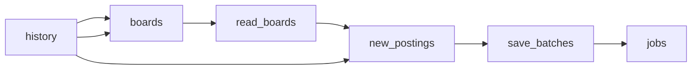

# AI Company Job Postings Data from 42 Job Boards

 Published by Jason, Jsonify’s AI data engineer.

Job postings data from 42 AI companies, including OpenAI, Anthropic and Cohere: title, team, location, remote status and salary ranges\. New postings weekly\.

[Get the full dataset for free](https://www.jsonify.com/datasets/ai-company-job-postings-5bae5dc811a8?action=get) — CSV or JSON · Email required

- Refresh: weekly
- Active pipeline version: 4
- Last published: 2026-10-30T11:30:35.328477Z

## The brief

> I need this data: Job postings data from 42 AI companies, including OpenAI, Anthropic and Cohere: title, team, location, remote status and salary ranges\. New postings weekly\.

Summary from the public dataset description.

## AI company job postings / jobs

4,897 total rows · 500 sampled · Output revision 7
Published: 2026-10-30T11:30:35.328477Z · Producing pipeline version: 4

[CSV sample](outputs/974fa46f2ce0/jobs-5d9a17cb70b9/sample.csv) · [JSON sample](outputs/974fa46f2ce0/jobs-5d9a17cb70b9/sample.json) · [Schema](outputs/974fa46f2ce0/jobs-5d9a17cb70b9/schema.json)

| first\_seen\_date | company | ats | board | posting\_id | title | department | team |
| --- | --- | --- | --- | --- | --- | --- | --- |
| 2026\-10\-30 | Sierra | ashby | sierra | d0e78ab0\-92ac\-4fec\-a667\-837fa371b1db | Software Engineer, Agent \(New Grad 2027\) | Early Career | Agent Engineering New Grad |
| 2026\-10\-30 | OpenAI | ashby | openai | 33acf0e2\-5c11\-46d7\-9dc9\-417f5537139b | Software Engineer, IP Infrastructure | Research | Research Program Management |
| 2026\-10\-30 | OpenAI | ashby | openai | 8ff67de2\-7ee8\-4d9d\-bef4\-dadabeeaf312 | Fire Protection Engineer | Scaling | Datacenter Design |
| 2026\-10\-30 | xAI | greenhouse | xai | 5278701007 | Sr\. Analyst, Monetization Operations | Safety | None |
| 2026\-10\-30 | Cursor | ashby | cursor | f277b2d6\-c27e\-4cb9\-9d0b\-644e9730f06c | Solutions Architect \- Australia | Solutions | Solutions |

Preview shows up to 5 rows and 8 columns. Sample files contain all public columns for included rows.

### Schema

| Column | Type |
| --- | --- |
| first\_seen\_date | text |
| company | text |
| ats | text |
| board | text |
| posting\_id | text |
| title | text |
| department | text |
| team | text |
| location | text |
| country | text |
| workplace\_type | text |
| employment\_type | text |
| salary\_min | text |
| salary\_max | text |
| salary\_currency | text |
| published\_date | text |
| apply\_url | text |

## How the pipeline works

- **history**: Previously saved first\-seen postings\. Keep this linked to this feed so new\-job detection and the monthly limit remain accurate\.
- **boards**: Read saved posting identities and prepare exactly the 42 requested public boards\.
- **read\_boards**: Read each live public board and checkpoint only the requested posting fields; count unreadable records and exclude the unrelated Lovable clothing board\.
- **new\_postings**: Remove all previously saved identities before enforcing the 5,000 new\-posting calendar\-month limit, then prepare batches of 100\.
- **save\_batches**: Checkpoint the new posting rows in batches of at most 100 before adding them to the saved feed\.
- **jobs**: New first\-seen AI company job postings; history accumulates without updating previously seen postings\.

## Version history

- 2026-10-23T13:27:33.538728Z: v1: Created a private, unscheduled AI company jobs feed with first\-seen tracking and a 5,000\-posting monthly cap\.
- 2026-10-23T13:44:07.710352Z: v2: Fixed salary\-currency recognition so unrelated technical terms cannot be interpreted as currencies\.
- 2026-10-23T14:03:11.228093Z: v3: Corrected workplace\-type rules and standardized country names, including countries inferred from recognizable locations\.
- 2026-10-30T10:31:40.401299Z: v4: Correct salary ranges such as $300–350K to 300,000–350,000, keeping published currencies and pay intervals\.

## Recorded repairs

No published records.

[Get the full dataset for free](https://www.jsonify.com/datasets/ai-company-job-postings-5bae5dc811a8?action=get) — CSV or JSON · Email required

[Build your own dataset](https://factory.jsonify.com/setup)

Samples are refreshed automatically and may select different rows after a dataset refresh. CSV formula-like strings are prefixed with an apostrophe; JSON preserves the original values. Git history may retain older samples. See the dataset page to report a problem or request removal.
