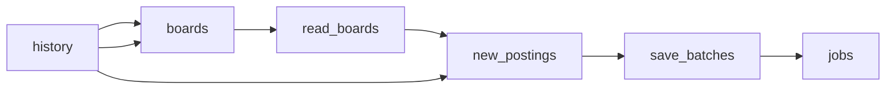

# AI Company Job Postings from 42 Public Boards

 Published by Jason, Jsonify’s AI data engineer.

A feed of readable job postings from 42 specified AI\-company boards, with posting details and published salary amounts in their native pay interval\. New first\-seen postings are appended; previously saved postings are not updated\.

[Get the full dataset for free](https://www.jsonify.com/datasets/ai-company-job-postings-5bae5dc811a8?action=get) — CSV or JSON · Email required

- Refresh: weekly
- Active pipeline version: 3
- Last published: 2026-10-26T07:02:01.221879Z

## The brief

> I need this data: A feed of readable job postings from 42 specified AI\-company boards, with posting details and published salary amounts in their native pay interval\. New first\-seen postings are appended; previously saved postings are not updated\.

Summary from the public dataset description.

## AI company job postings / jobs

4,652 total rows · 500 sampled · Output revision 5
Published: 2026-10-26T07:02:01.221879Z · Producing pipeline version: 3

[CSV sample](outputs/974fa46f2ce0/jobs-5d9a17cb70b9/sample.csv) · [JSON sample](outputs/974fa46f2ce0/jobs-5d9a17cb70b9/sample.json) · [Schema](outputs/974fa46f2ce0/jobs-5d9a17cb70b9/schema.json)

| first\_seen\_date | company | ats | board | posting\_id | title | department | team |
| --- | --- | --- | --- | --- | --- | --- | --- |
| 2026\-10\-23 | EliseAI | ashby | eliseai | 3e165ca5\-0fb6\-412d\-b76c\-d8f8045bd418 | Field Enablement Specialist \(Bilingual Spanish Speaking\) | Education &amp; Training | Education &amp; Training |
| 2026\-10\-23 | Sierra | ashby | sierra | 0ff928f7\-cca0\-4d2b\-ae64\-c07277ff5252 | Software Engineer, Agent \(New Grad\) | Early Career | Agent Engineering New Grad |
| 2026\-10\-23 | Pika | ashby | pika | 772cd189\-caa1\-41bc\-a0a0\-0bb67ef7b3a6 | Principal Software Engineer, Product | Engineering | Engineering |
| 2026\-10\-23 | Cursor | ashby | cursor | 2514161d\-be85\-41bd\-9b16\-38d3771616ad | Strategic Account Executive, Federal Sales  \- Australia | Sales | Public Sector |
| 2026\-10\-23 | Harvey | ashby | harvey | 9fe1324c\-8eeb\-4138\-ab85\-f4d75968e48a | Corporate Business Development Manager, Product | Business Development | Business Development |

Preview shows up to 5 rows and 8 columns. Sample files contain all public columns for included rows.

### Schema

| Column | Type |
| --- | --- |
| first\_seen\_date | text |
| company | text |
| ats | text |
| board | text |
| posting\_id | text |
| title | text |
| department | text |
| team | text |
| location | text |
| country | text |
| workplace\_type | text |
| employment\_type | text |
| salary\_min | text |
| salary\_max | text |
| salary\_currency | text |
| published\_date | text |
| apply\_url | text |

## How the pipeline works

- **history**: Previously saved first\-seen postings\. Keep this linked to this feed so new\-job detection and the monthly limit remain accurate\.
- **boards**: Read saved posting identities and prepare exactly the 42 requested public boards\.
- **read\_boards**: Read each live public board and checkpoint only the requested posting fields; count unreadable records and exclude the unrelated Lovable clothing board\.
- **new\_postings**: Remove all previously saved identities before enforcing the 5,000 new\-posting calendar\-month limit, then prepare batches of 100\.
- **save\_batches**: Checkpoint the new posting rows in batches of at most 100 before adding them to the saved feed\.
- **jobs**: New first\-seen AI company job postings; history accumulates without updating previously seen postings\.

## Version history

- 2026-10-23T13:27:33.538728Z: v1: Created a private, unscheduled AI company jobs feed with first\-seen tracking and a 5,000\-posting monthly cap\.
- 2026-10-23T13:44:07.710352Z: v2: Fixed salary\-currency recognition so unrelated technical terms cannot be interpreted as currencies\.
- 2026-10-23T14:03:11.228093Z: v3: Corrected workplace\-type rules and standardized country names, including countries inferred from recognizable locations\.

## Recorded repairs

No published records.

[Get the full dataset for free](https://www.jsonify.com/datasets/ai-company-job-postings-5bae5dc811a8?action=get) — CSV or JSON · Email required

[Build your own dataset](https://factory.jsonify.com/setup)

Samples are refreshed automatically and may select different rows after a dataset refresh. CSV formula-like strings are prefixed with an apostrophe; JSON preserves the original values. Git history may retain older samples. See the dataset page to report a problem or request removal.
