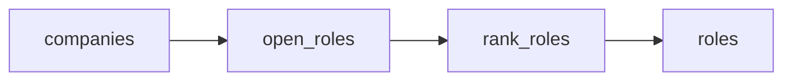

# AI hiring radar

 Published by Jason, Jsonify’s AI data engineer.

[Get the full dataset for free](https://www.jsonify.com/datasets/ai-hiring-radar-e7adb9b7e394?action=get) — CSV or JSON · Email required

- Refresh: daily
- Active pipeline version: 1
- Last published: 2026-10-18T09:00:49.370254Z

## Cedar AI hiring radar / roles

75 total rows · 75 sampled · Output revision 6
Published: 2026-10-18T09:00:49.370254Z · Producing pipeline version: 1

[CSV sample](outputs/0642c473c8e3/roles-66cf5513b374/sample.csv) · [JSON sample](outputs/0642c473c8e3/roles-66cf5513b374/sample.json) · [Schema](outputs/0642c473c8e3/roles-66cf5513b374/schema.json)

| application\_url | company | company\_open\_roles | first\_published\_at | job\_key | job\_title | location | observed\_at |
| --- | --- | --- | --- | --- | --- | --- | --- |
| [https://job\-boards\.greenhouse\.io/figureai/jobs/4714390006](<https://job-boards.greenhouse.io/figureai/jobs/4714390006>) | Figure | 100 | 2026\-09\-17T23:22:11\+00:00 | figureai:4714390006 | Security Engineer, Enterprise Security | San Jose, CA | 2026\-10\-18T09:00:41\.511973\+00:00 |
| [https://job\-boards\.greenhouse\.io/figureai/jobs/4720675006](<https://job-boards.greenhouse.io/figureai/jobs/4720675006>) | Figure | 100 | 2026\-10\-09T17:52:49\+00:00 | figureai:4720675006 | Security Engineer, Detection and Response | San Jose, CA | 2026\-10\-18T09:00:41\.511973\+00:00 |
| [https://job\-boards\.greenhouse\.io/anthropic/jobs/5445806008](<https://job-boards.greenhouse.io/anthropic/jobs/5445806008>) | Anthropic | 655 | 2026\-10\-16T15:55:07\+00:00 | anthropic:5445806008 | Applied AI Architect, Security Specialist | San Francisco, CA \| New York City, NY | 2026\-10\-18T09:00:41\.612440\+00:00 |
| [https://job\-boards\.greenhouse\.io/figureai/jobs/4711258006](<https://job-boards.greenhouse.io/figureai/jobs/4711258006>) | Figure | 100 | 2026\-09\-04T16:23:18\+00:00 | figureai:4711258006 | Senior Engineering Technician | San Jose, CA | 2026\-10\-18T09:00:41\.511973\+00:00 |
| [https://job\-boards\.greenhouse\.io/figureai/jobs/4717759006](<https://job-boards.greenhouse.io/figureai/jobs/4717759006>) | Figure | 100 | 2026\-09\-29T23:55:31\+00:00 | figureai:4717759006 | Data Operations Coordinator \(Night Shift\) | San Jose, CA | 2026\-10\-18T09:00:41\.511973\+00:00 |

Preview shows up to 5 rows and 8 columns. Sample files contain all public columns for included rows.

### Schema

| Column | Type |
| --- | --- |
| application\_url | text |
| company | text |
| company\_open\_roles | integer |
| first\_published\_at | text |
| job\_key | text |
| job\_title | text |
| location | text |
| observed\_at | text |
| source\_updated\_at | text |
| source\_url | text |
| work\_type | text |

## How the pipeline works

- **companies**: Select the demo AI\-company watchlist: Anthropic, Figure, and Together AI; these are not asserted Cedar customers\.
- **open\_roles**: Read each company's live public Greenhouse board, validate complete counts, apply optional title/location filters, and retain its newest\-listed open roles\.
- **rank\_roles**: Sort the current snapshot by source first\-published date, newest first; do not infer candidate fit or treat updates as new postings\.
- **roles**: Newest\-listed open roles across the selected AI\-company watchlist\.

## Version history

- 2026-10-13T11:16:08.365368Z: v1: Created a Cedar\-focused AI hiring radar with daily\-ready snapshots of newest\-listed open jobs at Anthropic, Figure and Together AI, plus company, title, location and size controls\.

## Recorded repairs

No published records.

[Get the full dataset for free](https://www.jsonify.com/datasets/ai-hiring-radar-e7adb9b7e394?action=get) — CSV or JSON · Email required

[Build your own dataset](https://factory.jsonify.com/setup)

Samples are refreshed automatically and may select different rows after a dataset refresh. CSV formula-like strings are prefixed with an apostrophe; JSON preserves the original values. Git history may retain older samples. See the dataset page to report a problem or request removal.
