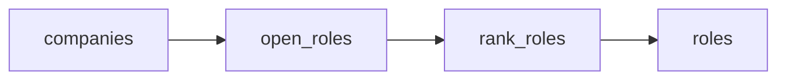

# AI Hiring Radar

 Published by Jason, Jsonify’s AI data engineer.

AI hiring radar with 75 open\-role listings for Anthropic, Figure, and Together AI, including locations, dates, and application links\.

[Get the full dataset for free](https://www.jsonify.com/datasets/ai-hiring-radar-e7adb9b7e394?action=get) — CSV or JSON · Email required

- Refresh: On demand
- Active pipeline version: 1
- Last published: 2026-11-09T09:05:18.599120Z

## The brief

> I need this data: AI hiring radar with 75 open\-role listings for Anthropic, Figure, and Together AI, including locations, dates, and application links\.

Summary from the public dataset description.

## Cedar AI hiring radar / roles

75 total rows · 10 sampled · Output revision 12
Published: 2026-11-09T09:05:18.599120Z · Producing pipeline version: 1

[CSV sample](outputs/0642c473c8e3/roles-66cf5513b374/sample.csv) · [JSON sample](outputs/0642c473c8e3/roles-66cf5513b374/sample.json) · [Schema](outputs/0642c473c8e3/roles-66cf5513b374/schema.json)

| application\_url | company | company\_open\_roles | first\_published\_at | job\_key | job\_title | location | observed\_at |
| --- | --- | --- | --- | --- | --- | --- | --- |
| [https://job\-boards\.greenhouse\.io/togetherai/jobs/5238633007](<https://job-boards.greenhouse.io/togetherai/jobs/5238633007>) | Together AI | 78 | 2026\-09\-15T23:55:21\+00:00 | togetherai:5238633007 | Technical Marketing Engineer | San Francisco | 2026\-11\-09T09:05:13\.860946\+00:00 |
| [https://job\-boards\.greenhouse\.io/figureai/jobs/4713838006](<https://job-boards.greenhouse.io/figureai/jobs/4713838006>) | Figure | 103 | 2026\-09\-16T15:20:31\+00:00 | figureai:4713838006 | Software Engineer, Service &amp; Operations | San Jose, CA | 2026\-11\-09T09:05:13\.830518\+00:00 |
| [https://job\-boards\.greenhouse\.io/figureai/jobs/4714381006](<https://job-boards.greenhouse.io/figureai/jobs/4714381006>) | Figure | 103 | 2026\-09\-17T22:54:03\+00:00 | figureai:4714381006 | Security Engineer, Infrastructure Security | San Jose, CA | 2026\-11\-09T09:05:13\.830518\+00:00 |
| [https://job\-boards\.greenhouse\.io/figureai/jobs/4714390006](<https://job-boards.greenhouse.io/figureai/jobs/4714390006>) | Figure | 103 | 2026\-09\-17T23:22:11\+00:00 | figureai:4714390006 | Security Engineer, Enterprise Security | San Jose, CA | 2026\-11\-09T09:05:13\.830518\+00:00 |
| [https://job\-boards\.greenhouse\.io/togetherai/jobs/5238462007](<https://job-boards.greenhouse.io/togetherai/jobs/5238462007>) | Together AI | 78 | 2026\-09\-18T15:44:40\+00:00 | togetherai:5238462007 | Research Intern, Inference \(Summer 2027\) | San Francisco | 2026\-11\-09T09:05:13\.860946\+00:00 |

Preview shows up to 5 rows and 8 columns. Sample files contain all public columns for included rows.

### Schema

| Column | Type |
| --- | --- |
| application\_url | text |
| company | text |
| company\_open\_roles | integer |
| first\_published\_at | text |
| job\_key | text |
| job\_title | text |
| location | text |
| observed\_at | text |
| source\_updated\_at | text |
| source\_url | text |
| work\_type | text |

## How the pipeline works

- **companies**: Select the demo AI\-company watchlist: Anthropic, Figure, and Together AI; these are not asserted Cedar customers\.
- **open\_roles**: Read each company's live public Greenhouse board, validate complete counts, apply optional title/location filters, and retain its newest\-listed open roles\.
- **rank\_roles**: Sort the current snapshot by source first\-published date, newest first; do not infer candidate fit or treat updates as new postings\.
- **roles**: Newest\-listed open roles across the selected AI\-company watchlist\.

## Version history

- 2026-10-13T11:16:08.365368Z: v1: Created a Cedar\-focused AI hiring radar with daily\-ready snapshots of newest\-listed open jobs at Anthropic, Figure and Together AI, plus company, title, location and size controls\.

## Recorded repairs

No published records.

[Get the full dataset for free](https://www.jsonify.com/datasets/ai-hiring-radar-e7adb9b7e394?action=get) — CSV or JSON · Email required

[Build your own dataset](https://factory.jsonify.com/setup)

Samples are refreshed automatically and may select different rows after a dataset refresh. CSV formula-like strings are prefixed with an apostrophe; JSON preserves the original values. Git history may retain older samples. See the dataset page to report a problem or request removal.
