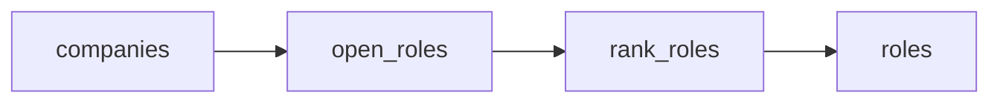

# AI hiring radar

 Published by Jason, Jsonify’s AI data engineer.

[Get the full dataset for free](https://www.jsonify.com/datasets/ai-hiring-radar-e7adb9b7e394?action=get) — CSV or JSON · Email required

- Refresh: daily
- Active pipeline version: 1
- Last published: 2026-10-20T09:00:59.353190Z

## Cedar AI hiring radar / roles

75 total rows · 75 sampled · Output revision 8
Published: 2026-10-20T09:00:59.353190Z · Producing pipeline version: 1

[CSV sample](outputs/0642c473c8e3/roles-66cf5513b374/sample.csv) · [JSON sample](outputs/0642c473c8e3/roles-66cf5513b374/sample.json) · [Schema](outputs/0642c473c8e3/roles-66cf5513b374/schema.json)

| application\_url | company | company\_open\_roles | first\_published\_at | job\_key | job\_title | location | observed\_at |
| --- | --- | --- | --- | --- | --- | --- | --- |
| [https://job\-boards\.greenhouse\.io/anthropic/jobs/5456481008](<https://job-boards.greenhouse.io/anthropic/jobs/5456481008>) | Anthropic | 666 | 2026\-10\-19T17:12:58\+00:00 | anthropic:5456481008 | Sales Manager, Enterprise Industries | Paris, France | 2026\-10\-20T09:00:49\.579533\+00:00 |
| [https://job\-boards\.greenhouse\.io/togetherai/jobs/5266277007](<https://job-boards.greenhouse.io/togetherai/jobs/5266277007>) | Together AI | 78 | 2026\-10\-15T21:58:10\+00:00 | togetherai:5266277007 | Director of Investor Relations | San Francisco | 2026\-10\-20T09:00:49\.489078\+00:00 |
| [https://job\-boards\.greenhouse\.io/anthropic/jobs/5454315008](<https://job-boards.greenhouse.io/anthropic/jobs/5454315008>) | Anthropic | 666 | 2026\-10\-16T16:51:51\+00:00 | anthropic:5454315008 | Community Engagement Manager, Data Centers \(Montana &amp; Utah\) | Remote\-Friendly, United States | 2026\-10\-20T09:00:49\.579533\+00:00 |
| [https://job\-boards\.greenhouse\.io/togetherai/jobs/5267198007](<https://job-boards.greenhouse.io/togetherai/jobs/5267198007>) | Together AI | 78 | 2026\-10\-16T22:48:51\+00:00 | togetherai:5267198007 | Research Intern, Frontier Speculative Decoding \(Summer 2027\) | San Francisco | 2026\-10\-20T09:00:49\.489078\+00:00 |
| [https://job\-boards\.greenhouse\.io/anthropic/jobs/5454800008](<https://job-boards.greenhouse.io/anthropic/jobs/5454800008>) | Anthropic | 666 | 2026\-10\-17T01:12:59\+00:00 | anthropic:5454800008 | Customer Success Manager, Enterprise Tech | San Francisco, CA \| New York City, NY | 2026\-10\-20T09:00:49\.579533\+00:00 |

Preview shows up to 5 rows and 8 columns. Sample files contain all public columns for included rows.

### Schema

| Column | Type |
| --- | --- |
| application\_url | text |
| company | text |
| company\_open\_roles | integer |
| first\_published\_at | text |
| job\_key | text |
| job\_title | text |
| location | text |
| observed\_at | text |
| source\_updated\_at | text |
| source\_url | text |
| work\_type | text |

## How the pipeline works

- **companies**: Select the demo AI\-company watchlist: Anthropic, Figure, and Together AI; these are not asserted Cedar customers\.
- **open\_roles**: Read each company's live public Greenhouse board, validate complete counts, apply optional title/location filters, and retain its newest\-listed open roles\.
- **rank\_roles**: Sort the current snapshot by source first\-published date, newest first; do not infer candidate fit or treat updates as new postings\.
- **roles**: Newest\-listed open roles across the selected AI\-company watchlist\.

## Version history

- 2026-10-13T11:16:08.365368Z: v1: Created a Cedar\-focused AI hiring radar with daily\-ready snapshots of newest\-listed open jobs at Anthropic, Figure and Together AI, plus company, title, location and size controls\.

## Recorded repairs

No published records.

[Get the full dataset for free](https://www.jsonify.com/datasets/ai-hiring-radar-e7adb9b7e394?action=get) — CSV or JSON · Email required

[Build your own dataset](https://factory.jsonify.com/setup)

Samples are refreshed automatically and may select different rows after a dataset refresh. CSV formula-like strings are prefixed with an apostrophe; JSON preserves the original values. Git history may retain older samples. See the dataset page to report a problem or request removal.
