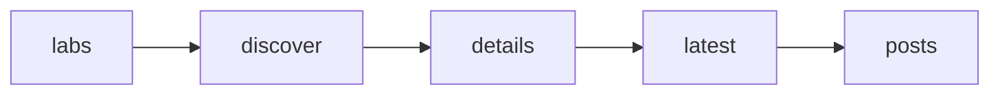

# AI lab research feed

 Published by Jason, Jsonify’s AI data engineer.

[Get the full dataset for free](https://www.jsonify.com/datasets/ai-lab-research-feed-a1cdaf829fb3?action=get) — CSV or JSON · Email required

- Refresh: On demand
- Active pipeline version: 2
- Last published: 2026-10-14T11:41:35.348891Z

## AI lab research feed / posts

40 total rows · 40 sampled · Output revision 2
Published: 2026-10-14T11:41:35.348891Z · Producing pipeline version: 2

[CSV sample](outputs/a21ded1032f3/posts-a44f1b975171/sample.csv) · [JSON sample](outputs/a21ded1032f3/posts-a44f1b975171/sample.json) · [Schema](outputs/a21ded1032f3/posts-a44f1b975171/schema.json)

| lab | title | url | snippet | published\_date | checked |
| --- | --- | --- | --- | --- | --- |
| OpenAI | The EU’s next chapter in AI is agentic | [https://openai\.com/index/the\-eus\-next\-chapter\-in\-ai\-is\-agentic](<https://openai.com/index/the-eus-next-chapter-in-ai-is-agentic>) | New analysis shows how agentic AI adoption is growing across EU enterprises and small businesses—and where deeper use could unlock more value\. | 2026\-10\-14 | 2026\-10\-14T11:41:23\.925012Z |
| OpenAI | Helping teens learn, plan, and shape the future of AI | [https://openai\.com/index/teens\-learn\-and\-plan](<https://openai.com/index/teens-learn-and-plan>) | College Planner is coming to ChatGPT for Teens to help students manage college applications, alongside new flashcards, quizzes, and a teen AI council\. | 2026\-10\-07 | 2026\-10\-14T11:41:23\.968184Z |
| OpenAI | Pollo AI turns creative ideas into campaigns with OpenAI | [https://openai\.com/index/pollo\-ai](<https://openai.com/index/pollo-ai>) | With GPT\-5\.6, GPT\-6 Astra, and GPT‑Image‑2\.5, Pollo AI helps creators turn bold ideas into detailed images and cinematic video ads\. | 2026\-10\-08 | 2026\-10\-14T11:41:23\.966829Z |
| Google DeepMind | Gemini 4 Argon for Robotics | [https://deepmind\.google/blog/gemini\-4\-argon\-for\-robotics/](<https://deepmind.google/blog/gemini-4-argon-for-robotics/>) | Discover Gemini 4 Argon for robotics: leading the ERQA benchmark with physical reasoning, zero\-shot control, Real2Sim, and agentic workflows\. | 2026\-10\-13 | 2026\-10\-14T11:41:24\.569534Z |
| Meta AI | Introducing Muse Image and Muse Video | [https://ai\.meta\.com/blog/introducing\-muse\-image\-muse\-video\-msl/](<https://ai.meta.com/blog/introducing-muse-image-muse-video-msl/>) | Muse Image follows instructions faithfully, edits with precision, composes from multiple references, and draws on Instagram for social context\. Muse Video delivers exceptional visual fidelity with native audio support\. | 2026\-07\-07 | 2026\-10\-14T11:41:31\.620056Z |

Preview shows up to 5 rows and 8 columns. Sample files contain all public columns for included rows.

### Schema

| Column | Type |
| --- | --- |
| lab | text |
| title | text |
| url | text |
| snippet | text |
| published\_date | text |
| checked | text |

## How the pipeline works

- **labs**: Select the four exact lab news sources requested for the feed\.
- **discover**: Read live RSS feeds and news listings, deduplicate post cards, and rank dated posts before selection\.
- **details**: Fill absent published summaries and dates from post metadata; confirm Meta post dates and canonical links\.
- **latest**: Keep ten unique posts per lab and sort the complete 40\-row snapshot newest first\.
- **posts**: Latest ten published posts per AI lab, ordered newest first\.

## Version history

- 2026-10-14T08:44:02.089456Z: v1: Added the latest ten posts from each of the four requested AI labs, with published summaries, dates and canonical links\.
- 2026-10-14T09:23:26.123168Z: v2: Ignore Anthropic’s generic site\-wide description, keeping news\-card teasers where available and using “No summary published” when no post summary is published\.

## Recorded repairs

No published records.

[Get the full dataset for free](https://www.jsonify.com/datasets/ai-lab-research-feed-a1cdaf829fb3?action=get) — CSV or JSON · Email required

[Build your own dataset](https://factory.jsonify.com/setup)

Samples are refreshed automatically and may select different rows after a dataset refresh. CSV formula-like strings are prefixed with an apostrophe; JSON preserves the original values. Git history may retain older samples. See the dataset page to report a problem or request removal.
