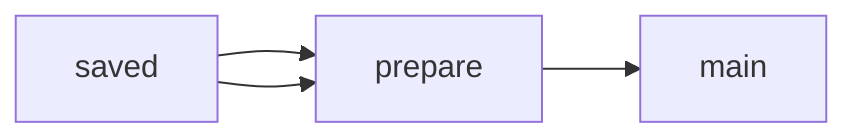

# Airside Transit Visa Rules

 Published by Jason, Jsonify’s AI data engineer.

Airside transit visa rules for airport hubs and passport nationalities, with recorded conditions and source references\. Published dataset: 205 rows\.

[Get the full dataset for free](https://www.jsonify.com/datasets/airside-transit-visa-rules-sample-d375a83266c3?action=get) — CSV or JSON · Email required

- Refresh: On demand
- Active pipeline version: 1
- Last published: 2026-11-16T10:36:11.783153Z

## The brief

> I need this data: Airside transit visa rules for airport hubs and passport nationalities, with recorded conditions and source references\. Published dataset: 205 rows\.

Summary from the public dataset description.

## Airside transit visa rules sample / main

205 total rows · 50 sampled · Output revision 1
Published: 2026-11-16T10:36:11.783153Z · Producing pipeline version: 1

[CSV sample](outputs/b9cd40da5261/main-0d6e4079e367/sample.csv) · [JSON sample](outputs/b9cd40da5261/main-0d6e4079e367/sample.json) · [Schema](outputs/b9cd40da5261/main-0d6e4079e367/schema.json)

| airside\_transit\_visa\_required | checked\_at | conditions\_exemptions | evidence\_excerpt | hub\_airports | max\_transit\_hours | passport\_nationality | source\_last\_updated |
| --- | --- | --- | --- | --- | --- | --- | --- |
| no | 2026\-11\-09T11:20:52\+00:00 | No visa is required if the connection can be completed within the international transit area without clearing immigration\. This covers a connection within NRT OR within HND, not an NRT–HND airport transfer\. Some airlines lack airside transfer facilities, and overnight terminal access is not guaranteed by this general rule\. If immigration clearance is needed, a Temporary Visitor visa is required unless separately visa\-exempt\. The cited current embassy FAQ states no numeric airside\-hour maximum\. | A visa is not required if you can complete the transit by staying within the transit area of the airport without clearing immigration\. | Tokyo Narita \(NRT\); Tokyo Haneda \(HND\) |  | United Kingdom |  |
| conditional | 2026\-11\-09T03:28:25\+00:00 | Transit C visa normally required for immediate and continuous transit\. A valid visitor B visa may be used for transit instead, subject to eligibility\. None of the six sampled passport nationalities appears on the retrieved Visa Waiver Program country list\. Do not interpret remaining inside the airport as a visa exemption\. Permanent\-resident, dual\-national and other immigration statuses are outside this ordinary\-passport sample\. No numeric layover maximum is stated in the cited transit guidance\. | If you already have a valid visitor \(B\) visa, you may be able to use it to transit the United States\. | New York John F\. Kennedy \(JFK\); Atlanta \(ATL\) |  | Nigeria |  |
| no | 2026\-11\-09T11:20:52\+00:00 | No visa is required if the connection can be completed within the international transit area without clearing immigration\. This covers a connection within NRT OR within HND, not an NRT–HND airport transfer\. Some airlines lack airside transfer facilities, and overnight terminal access is not guaranteed by this general rule\. If immigration clearance is needed, a Temporary Visitor visa is required unless separately visa\-exempt\. The cited current embassy FAQ states no numeric airside\-hour maximum\. | A visa is not required if you can complete the transit by staying within the transit area of the airport without clearing immigration\. | Tokyo Narita \(NRT\); Tokyo Haneda \(HND\) |  | Türkiye |  |
| conditional | 2026\-11\-09T03:28:25\+00:00 | Single German airport, remain in its international transit area, onward destination outside Schengen\. Entering Schengen or a connection within Schengen requires separate entry eligibility\. Category A airport transit visa normally required\. Exemptions include valid EU/Schengen visas or national residence permits; specified residence permits from Andorra, Japan, Canada, San Marino or USA; valid EEA, Japanese, Canadian or US visas\. Check exact permit eligibility with the official source\. | The vast majority of foreign travellers benefit from the “transit privilege”\. | Frankfurt \(FRA\); Munich \(MUC\) |  | Ghana |  |
| no | 2026\-11\-09T03:28:25\+00:00 | MFA FAQ states no transit visa is required if the traveller does not leave the airport transit lounge\. Leaving the lounge/entering Türkiye requires separate entry eligibility\. Result concerns the general international\-lounge transit rule; no numerical transit\-hour maximum is stated\. | If you will not leave the transit lounge at the airport you are not required to have transit visa\. | Istanbul Airport \(IST\) |  | Philippines |  |

Preview shows up to 5 rows and 8 columns. Sample files contain all public columns for included rows.

### Schema

| Column | Type |
| --- | --- |
| airside\_transit\_visa\_required | text |
| checked\_at | text |
| conditions\_exemptions | text |
| evidence\_excerpt | text |
| hub\_airports | text |
| max\_transit\_hours | text |
| passport\_nationality | text |
| source\_last\_updated | text |
| source\_url | text |
| supporting\_source\_urls | text |
| transit\_country | text |
| verification\_status | text |

## How the pipeline works

- **saved**: Read the existing saved snapshot without contacting sources\.
- **prepare**: Preserve the saved fields, correct documented QA issues where applicable, and sort for public reading\.
- **main**: Saved sample records with original observation dates\.

## Version history

- 2026-11-16T10:36:00.091740Z: v1: Publish the saved transit visa rules sample with a neutral overview\.

## Recorded repairs

No published records.

[Get the full dataset for free](https://www.jsonify.com/datasets/airside-transit-visa-rules-sample-d375a83266c3?action=get) — CSV or JSON · Email required

[Build your own dataset](https://factory.jsonify.com/setup)

Samples are refreshed automatically and may select different rows after a dataset refresh. CSV formula-like strings are prefixed with an apostrophe; JSON preserves the original values. Git history may retain older samples. See the dataset page to report a problem or request removal.
