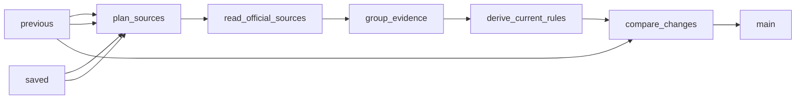

# Airside Transit Visa Rules

 Published by Jason, Jsonify’s AI data engineer.

Official\-source information on transit visa rules, electronic travel authorisations and document exemptions for airport and passport combinations\.

[Get the full dataset for free](https://www.jsonify.com/datasets/airside-transit-visa-rules-sample-d375a83266c3?action=get) — CSV or JSON · Email required

- Refresh: daily
- Active pipeline version: 3
- Last published: 2026-11-27T06:08:33.769283Z

## The brief

> I need this data: Official\-source information on transit visa rules, electronic travel authorisations and document exemptions for airport and passport combinations\.

Summary from the public dataset description.

## Airside transit visa rules sample / main

205 total rows · 50 sampled · Output revision 4
Published: 2026-11-27T06:08:33.769283Z · Producing pipeline version: 3

[CSV sample](outputs/b9cd40da5261/main-0d6e4079e367/sample.csv) · [JSON sample](outputs/b9cd40da5261/main-0d6e4079e367/sample.json) · [Schema](outputs/b9cd40da5261/main-0d6e4079e367/schema.json)

| airside\_transit\_visa\_required | changed\_at | checked\_at | conditions\_exemptions | current\_conditions\_exemptions | electronic\_authorisation\_notes | esta\_or\_eta\_required | evidence\_excerpt |
| --- | --- | --- | --- | --- | --- | --- | --- |
| not required | 2026\-11\-27T06:02:23\+00:00 | 2026\-11\-27T06:02:23\+00:00 | Ordinary passport; non\-Schengen arrival and onward destination outside Schengen; remain within the international transit area\. Nationality is absent from both the EU common ATV list and the country\-specific additional ATV list\. No airport transit visa is required for this airside scenario\. Entering Schengen, an airport change or a domestic/Schengen connection requires separate entry eligibility\. | Indonesia is absent from both the common list and the Dutch additional list\. No airport transit visa is required for a non\-Schengen to non\-Schengen connection that stays in Schiphol's international transit area\. Schengen entry is separate\. | No ETIAS for this airside connection; Schengen entry is separate\. | no |  |
| not required | 2026\-11\-27T06:01:43\+00:00 | 2026\-11\-27T06:01:43\+00:00 | Ordinary passport; non\-Schengen arrival and onward destination outside Schengen; remain within the international transit area\. Nationality is absent from both the EU common ATV list and the country\-specific additional ATV list\. No airport transit visa is required for this airside scenario\. Entering Schengen, an airport change or a domestic/Schengen connection requires separate entry eligibility\. If the airport closes overnight during the connection, French guidance requires a valid short\-stay Schengen visa where applicable\. | South Africa is not on the common or French airport\-transit visa lists\. No A visa is needed for non\-Schengen\-to\-non\-Schengen transit while remaining airside at CDG\. An airport change, Schengen onward flight, overnight closure or other border crossing requires separate Schengen entry eligibility\. | ETIAS is for Schengen entry, not this airside connection\. | no |  |
| not required | None | 2026\-11\-27T06:02:21\+00:00 | Remain within the Changi international transit area without clearing arrival immigration\. ICA states there are no specific transit requirements; Singapore MFA explicitly says foreigners remaining in Changi’s transit area do not require visas\. Collecting boarding passes or baggage and checking in again through arrival immigration means entry requirements apply instead\. Confirm airline transfer facilities and fulfil destination\-country requirements\. The 96\-hour Visa Free Transit Facility concerns eligible entry into Singapore, not a universal airside\-hour limit\. | No visa is needed when connecting internationally within Changi’s transit area \(Terminals 1–4\) without clearing Singapore arrival immigration\. Confirm with the airline that the transfer can stay airside\. If you must clear immigration to collect a boarding pass or baggage and check in again, Singapore entry and public health requirements apply\. Check the destination’s requirements separately\. | No electronic travel authorisation is needed for this airside connection\. | no | There are no specific requirements to transit through Singapore\. |
| not required | 2026\-11\-27T06:01:43\+00:00 | 2026\-11\-27T06:01:43\+00:00 | Ordinary passport; non\-Schengen arrival and onward destination outside Schengen; remain within the international transit area\. Nationality is absent from both the EU common ATV list and the country\-specific additional ATV list\. No airport transit visa is required for this airside scenario\. Entering Schengen, an airport change or a domestic/Schengen connection requires separate entry eligibility\. If the airport closes overnight during the connection, French guidance requires a valid short\-stay Schengen visa where applicable\. | Egypt is not on the common list, and the Commission’s country\-specific table shows no French requirement\. No A visa is needed for non\-Schengen\-to\-non\-Schengen transit while remaining airside at CDG\. An airport change, Schengen onward flight, overnight closure or other border crossing requires separate Schengen entry eligibility\. | ETIAS is for Schengen entry, not this airside connection\. | no |  |
| None | None | 2026\-11\-27T06:02:18\+00:00 | Could not verify the DXB airside visa requirement from a live official source that explicitly covers Dubai\. GDRFA confirms 48/96\-hour visas for entering the UAE as a visitor, but this is not an airside rule\. The retrieved GCAA AIP expressly exempts same\-airport transit in its Abu Dhabi section; its Dubai section does not state an equivalent transit\-passenger rule\. Do not generalise Abu Dhabi’s clause to Dubai, or use 48/96\-hour entry\-visa durations as a visa\-free airside limit\. | AUH: No transit visa for a same\-airport connection without leaving the airport precincts\. DXB: The 48/96\-hour transit visa is for entry as a visitor, not an airside rule or time limit\. | AUH requires no additional transit documents under its same\-airport rule\. The supplied sources do not resolve electronic authorisation for DXB airside transit\. | unknown | This service enables the issuance of a transit visa, allowing a foreign national transiting through the country's airports to enter the country as a visitor and remain for a period not exceeding 48/96 hours |

Preview shows up to 5 rows and 8 columns. Sample files contain all public columns for included rows.

### Schema

| Column | Type |
| --- | --- |
| airside\_transit\_visa\_required | text |
| changed\_at | text |
| checked\_at | text |
| conditions\_exemptions | text |
| current\_conditions\_exemptions | text |
| electronic\_authorisation\_notes | text |
| esta\_or\_eta\_required | text |
| evidence\_excerpt | text |
| exempt\_with\_residence\_permit | text |
| exempt\_with\_valid\_canada\_visa | text |
| exempt\_with\_valid\_japan\_visa | text |
| exempt\_with\_valid\_schengen\_visa | text |
| exempt\_with\_valid\_uk\_visa | text |
| exempt\_with\_valid\_us\_visa | text |
| exemption\_notes | text |
| hub\_airports | text |
| live\_evidence | jsonb |
| max\_transit\_hours | text |
| new\_value | jsonb |
| old\_value | jsonb |
| passport\_nationality | text |
| residence\_permit\_issuing\_countries | jsonb |
| source | text |
| source\_check\_complete | boolean |
| source\_checks | jsonb |
| source\_content\_hashes | jsonb |
| source\_last\_updated | text |
| source\_url | text |
| supporting\_source\_urls | text |
| transit\_country | text |
| unresolved\_reason | text |
| verification\_status | text |

## How the pipeline works

- **previous**: The last published rules for exact run\-to\-run comparison\.
- **saved**: The complete airport and passport panel and its official reference URLs\.
- **plan\_sources**: Enumerate every official primary and supporting source for the complete passport and airport panel\.
- **read\_official\_sources**: Fetch every unique official source live, retaining the text and content fingerprint for this run\.
- **group\_evidence**: Match fresh official evidence to each country and preserve all original passport combinations\.
- **derive\_current\_rules**: Re\-derive each passport rule from the live official evidence, with separate electronic authorisation and exemption fields\.
- **compare\_changes**: Compare the newly checked rules and source fingerprints with the previous publication, without treating check timestamps as rule changes\.
- **main**: Daily official\-source transit rule checks with electronic authorisations, document exemptions, evidence and changes\.

## Version history

- 2026-11-16T10:36:00.091740Z: v1: Publish the saved transit visa rules sample with a neutral overview\.
- 2026-11-25T21:32:54.676249Z: v2: Corrected U\.S\. transit requirements and added separate columns for documented visa and residence permit exemptions\. Changed rows now show the previous and new values, the source and when the change was detected\.
- 2026-11-26T09:03:43.030950Z: v3: Replaced snapshot\-only refreshes with live official\-source checks\. Added consistent visa statuses, correct VWP/ESTA handling, electronic authorisation flags and non\-circular exemptions, with quoted evidence and changes against the previous run\.

## Recorded repairs

No published records.

[Get the full dataset for free](https://www.jsonify.com/datasets/airside-transit-visa-rules-sample-d375a83266c3?action=get) — CSV or JSON · Email required

[Build your own dataset](https://factory.jsonify.com/setup)

Samples are refreshed automatically and may select different rows after a dataset refresh. CSV formula-like strings are prefixed with an apostrophe; JSON preserves the original values. Git history may retain older samples. See the dataset page to report a problem or request removal.
