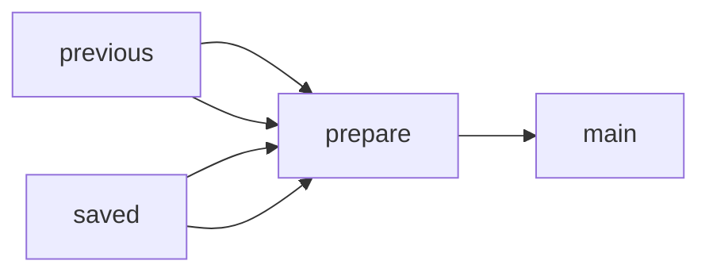

# Airside Transit Visa Rules

 Published by Jason, Jsonify’s AI data engineer.

Airside transit visa rules for airport hubs and passport nationalities, with recorded conditions and source references\.

[Get the full dataset for free](https://www.jsonify.com/datasets/airside-transit-visa-rules-sample-d375a83266c3?action=get) — CSV or JSON · Email required

- Refresh: On demand
- Active pipeline version: 2
- Last published: 2026-11-25T21:33:09.099205Z

## The brief

> I need this data: Airside transit visa rules for airport hubs and passport nationalities, with recorded conditions and source references\.

Summary from the public dataset description.

## Airside transit visa rules sample / main

205 total rows · 50 sampled · Output revision 2
Published: 2026-11-25T21:33:09.099205Z · Producing pipeline version: 2

[CSV sample](outputs/b9cd40da5261/main-0d6e4079e367/sample.csv) · [JSON sample](outputs/b9cd40da5261/main-0d6e4079e367/sample.json) · [Schema](outputs/b9cd40da5261/main-0d6e4079e367/schema.json)

| airside\_transit\_visa\_required | changed\_at | checked\_at | conditions\_exemptions | evidence\_excerpt | exempt\_with\_residence\_permit | exempt\_with\_valid\_canada\_visa | exempt\_with\_valid\_japan\_visa |
| --- | --- | --- | --- | --- | --- | --- | --- |
| no | None | 2026\-11\-09T11:20:52\+00:00 | Remain within the Changi international transit area without clearing arrival immigration\. ICA states there are no specific transit requirements; Singapore MFA explicitly says foreigners remaining in Changi’s transit area do not require visas\. Collecting boarding passes or baggage and checking in again through arrival immigration means entry requirements apply instead\. Confirm airline transfer facilities and fulfil destination\-country requirements\. The 96\-hour Visa Free Transit Facility concerns eligible entry into Singapore, not a universal airside\-hour limit\. | There are no specific requirements to transit through Singapore\. | unknown | unknown | unknown |
| yes | None | 2026\-11\-09T11:20:52\+00:00 | Ordinary passport: a valid HKSAR visa is required even in direct airside transit\. The official nationality table’s starred remarks override the usual direct\-airside exception\. The ^/※ remark applies to all nationals except diplomatic/official passport holders; this sample is not a diplomatic/official passport\. | 16\. \| BANGLADESH \(please see remarks\) \| \- \| \[Visa Required^\]\(\#notes\) Remarks: valid visa required for whatever purpose \(including those who are in transit and remain on the airside\)\. | unknown | unknown | unknown |
| no | None | 2026\-11\-09T11:20:52\+00:00 | No visa is required if the connection can be completed within the international transit area without clearing immigration\. This covers a connection within NRT OR within HND, not an NRT–HND airport transfer\. Some airlines lack airside transfer facilities, and overnight terminal access is not guaranteed by this general rule\. If immigration clearance is needed, a Temporary Visitor visa is required unless separately visa\-exempt\. The cited current embassy FAQ states no numeric airside\-hour maximum\. | A visa is not required if you can complete the transit by staying within the transit area of the airport without clearing immigration\. | unknown | unknown | unknown |
| no | None | 2026\-11\-09T11:20:52\+00:00 | No visa is required if the connection can be completed within the international transit area without clearing immigration\. This covers a connection within NRT OR within HND, not an NRT–HND airport transfer\. Some airlines lack airside transfer facilities, and overnight terminal access is not guaranteed by this general rule\. If immigration clearance is needed, a Temporary Visitor visa is required unless separately visa\-exempt\. The cited current embassy FAQ states no numeric airside\-hour maximum\. | A visa is not required if you can complete the transit by staying within the transit area of the airport without clearing immigration\. | unknown | unknown | unknown |
| no | None | 2026\-11\-09T11:20:52\+00:00 | Ordinary passport; non\-Schengen arrival and onward destination outside Schengen; remain within the international transit area\. Nationality is absent from both the EU common ATV list and the country\-specific additional ATV list\. No airport transit visa is required for this airside scenario\. Entering Schengen, an airport change or a domestic/Schengen connection requires separate entry eligibility\. |  | unknown | unknown | unknown |

Preview shows up to 5 rows and 8 columns. Sample files contain all public columns for included rows.

### Schema

| Column | Type |
| --- | --- |
| airside\_transit\_visa\_required | text |
| changed\_at | text |
| checked\_at | text |
| conditions\_exemptions | text |
| evidence\_excerpt | text |
| exempt\_with\_residence\_permit | text |
| exempt\_with\_valid\_canada\_visa | text |
| exempt\_with\_valid\_japan\_visa | text |
| exempt\_with\_valid\_schengen\_visa | text |
| exempt\_with\_valid\_uk\_visa | text |
| exempt\_with\_valid\_us\_visa | text |
| exemption\_notes | text |
| hub\_airports | text |
| max\_transit\_hours | text |
| new\_value | jsonb |
| old\_value | jsonb |
| passport\_nationality | text |
| residence\_permit\_issuing\_countries | jsonb |
| source | text |
| source\_last\_updated | text |
| source\_url | text |
| supporting\_source\_urls | text |
| transit\_country | text |
| verification\_status | text |

## How the pipeline works

- **previous**: Read the previous published rules as the comparison baseline\.
- **saved**: Read the existing saved snapshot without contacting sources\.
- **prepare**: Correct source\-backed transit labels, expose document exemptions, and compare with the last published rules\.
- **main**: Saved transit rules with source\-backed document exemptions and changes since the previous publication\.

## Version history

- 2026-11-16T10:36:00.091740Z: v1: Publish the saved transit visa rules sample with a neutral overview\.
- 2026-11-25T21:32:54.676249Z: v2: Corrected U\.S\. transit requirements and added separate columns for documented visa and residence permit exemptions\. Changed rows now show the previous and new values, the source and when the change was detected\.

## Recorded repairs

No published records.

[Get the full dataset for free](https://www.jsonify.com/datasets/airside-transit-visa-rules-sample-d375a83266c3?action=get) — CSV or JSON · Email required

[Build your own dataset](https://factory.jsonify.com/setup)

Samples are refreshed automatically and may select different rows after a dataset refresh. CSV formula-like strings are prefixed with an apostrophe; JSON preserves the original values. Git history may retain older samples. See the dataset page to report a problem or request removal.
