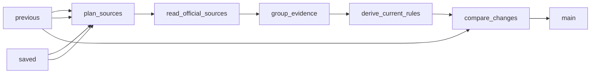

# Airside Transit Visa Rules

 Published by Jason, Jsonify’s AI data engineer.

Information on transit visa rules, electronic travel authorisations and document exemptions for airport and passport combinations\.

[Get the full dataset for free](https://www.jsonify.com/datasets/airside-transit-visa-rules-sample-d375a83266c3?action=get) — CSV or JSON · Email required

- Refresh: daily
- Active pipeline version: 3
- Last published: 2026-11-28T06:09:51.921901Z

## The brief

> I need this data: Information on transit visa rules, electronic travel authorisations and document exemptions for airport and passport combinations\.

Summary from the public dataset description.

## Airside transit visa rules sample / main

205 total rows · 50 sampled · Output revision 5
Published: 2026-11-28T06:09:51.921901Z · Producing pipeline version: 3

[CSV sample](outputs/b9cd40da5261/main-0d6e4079e367/sample.csv) · [JSON sample](outputs/b9cd40da5261/main-0d6e4079e367/sample.json) · [Schema](outputs/b9cd40da5261/main-0d6e4079e367/schema.json)

| airside\_transit\_visa\_required | changed\_at | checked\_at | conditions\_exemptions | current\_conditions\_exemptions | electronic\_authorisation\_notes | esta\_or\_eta\_required | evidence\_excerpt |
| --- | --- | --- | --- | --- | --- | --- | --- |
| not required | None | 2026\-11\-28T06:02:31\+00:00 | Remain within Istanbul Airport’s international transit lounge; do not clear Turkish immigration\. The general MFA FAQ says no transit visa is required without leaving the transit lounge\. Entry into Türkiye or an airport change requires separate entry eligibility\. No numeric airside limit is stated in the FAQ\. | No transit visa is required while remaining in Istanbul Airport’s international transit lounge\. A connection that requires entering Türkiye is subject to separate entry rules\. | No electronic authorisation applies to this airside connection\. | no | If you will not leave the transit lounge at the airport you are not required to have transit visa\. |
| required | None | 2026\-11\-28T06:02:24\+00:00 | Transit C visa normally required for immediate and continuous transit through the United States; an existing valid visitor B visa may be used for transit in appropriate cases instead\. This passport nationality is not on the retrieved Visa Waiver Program list\. Airport\-only travel is not a general visa\-free exemption: the TWOV/International\-to\-International programs were suspended\. Separate US residence or citizenship is outside this ordinary\-passport baseline\. No numeric airside\-hour maximum is stated in the State Department transit guidance\. | Egypt is not on the U\.S\. Visa Waiver Program list\. At JFK, immediate and continuous transit requires a C visa or a suitable valid U\.S\. visitor \(B\) visa\. Staying in the airport does not waive the visa requirement\. A transit itinerary must be prearranged, with no unreasonable layover\. | ESTA is not available on this passport under the Visa Waiver Program\. | no | If you already have a valid visitor \(B\) visa, you may be able to use it to transit the United States\. |
| not required | 2026\-11\-28T06:02:31\+00:00 | 2026\-11\-28T06:02:31\+00:00 | Ordinary passport; non\-Schengen arrival and onward destination outside Schengen; remain within the international transit area\. Nationality is absent from both the EU common ATV list and the country\-specific additional ATV list\. No airport transit visa is required for this airside scenario\. Entering Schengen, an airport change or a domestic/Schengen connection requires separate entry eligibility\. | Egypt is not on the common list and has no Dutch requirement in Annex 7B\. No airport transit visa is required for the stated non\-Schengen\-to\-non\-Schengen connection within Schiphol’s international transit area\. Schengen entry is subject to separate rules\. | No electronic travel authorisation applies to this airside connection\. | no |  |
| required | None | 2026\-11\-28T06:02:24\+00:00 | Remain airside at the same airport; no UK border crossing or airport change\. Travel to/from the Common Travel Area is outside this airside rule\. DATV normally required\. Exemptions include valid entry visas for Australia, Canada, New Zealand or USA; certain return journeys within six months of entry to those countries; qualifying permanent residence permits from those countries; common\-format EEA/Swiss residence permits or category D visas; qualifying Irish BC/BC BIVS visas; specified Schengen ADS journeys\. Document\-format and issue\-date restrictions apply, including verification of other countries’ electronic documents\. Airside TWOV requires arrival/departure by air, confirmed same\-day onward departure from the same airport, and destination documents\. Existing valid UK Visitor/Marriage Visitor visa, ETA, EU Settlement Scheme family permit or Home Office travel document also removes the DATV requirement\. See official pages for exact documentary criteria\. Sample is an ordinary passport: diplomatic, service or official passport exceptions are outside this baseline\. | DATV required unless exempt\. Airside TWOV: arrive and depart by air, confirmed same\-day Heathrow onward flight, destination documents; excludes Common Travel Area routes\. Visa exceptions below\. Valid permanent residence: Australia/New Zealand; Canada issued after 28 June 2002; US issued after 21 April 1998, or arrival\-stamped immigrant visa \(no wet\-ink/ADIT\), expired I\-551 with valid I\-797 extension, or Form 155A/155B attached to a sealed brown envelope\. Valid common\-format EEA/Swiss residence permits, UK Standard/Marriage Visitor visas, ETA, EUSS family permit or Home Office travel document also qualify\. | No ETA required without UK border control\. Foreign e\-visas or e\-residence permits qualify only if the airline can verify them with the issuer\. | no | National countries and territories who need a visa to enter or transit the UK listed above need a visa to transit ‘airside’ unless they hold one of the following: |
| not required | None | 2026\-11\-28T06:02:31\+00:00 | MFA FAQ states no transit visa is required if the traveller does not leave the airport transit lounge\. Leaving the lounge/entering Türkiye requires separate entry eligibility\. Result concerns the general international\-lounge transit rule; no numerical transit\-hour maximum is stated\. | No transit visa is required while remaining in Istanbul Airport’s international transit lounge\. A connection that requires entering Türkiye is subject to separate entry rules\. | No electronic authorisation applies to this airside connection\. | no | If you will not leave the transit lounge at the airport you are not required to have transit visa\. |

Preview shows up to 5 rows and 8 columns. Sample files contain all public columns for included rows.

### Schema

| Column | Type |
| --- | --- |
| airside\_transit\_visa\_required | text |
| changed\_at | text |
| checked\_at | text |
| conditions\_exemptions | text |
| current\_conditions\_exemptions | text |
| electronic\_authorisation\_notes | text |
| esta\_or\_eta\_required | text |
| evidence\_excerpt | text |
| exempt\_with\_residence\_permit | text |
| exempt\_with\_valid\_canada\_visa | text |
| exempt\_with\_valid\_japan\_visa | text |
| exempt\_with\_valid\_schengen\_visa | text |
| exempt\_with\_valid\_uk\_visa | text |
| exempt\_with\_valid\_us\_visa | text |
| exemption\_notes | text |
| hub\_airports | text |
| live\_evidence | jsonb |
| max\_transit\_hours | text |
| new\_value | jsonb |
| old\_value | jsonb |
| passport\_nationality | text |
| residence\_permit\_issuing\_countries | jsonb |
| source | text |
| source\_check\_complete | boolean |
| source\_checks | jsonb |
| source\_content\_hashes | jsonb |
| source\_last\_updated | text |
| source\_url | text |
| supporting\_source\_urls | text |
| transit\_country | text |
| unresolved\_reason | text |
| verification\_status | text |

## How the pipeline works

- **previous**: The last published rules for exact run\-to\-run comparison\.
- **saved**: The complete airport and passport panel and its official reference URLs\.
- **plan\_sources**: Enumerate every official primary and supporting source for the complete passport and airport panel\.
- **read\_official\_sources**: Fetch every unique official source live, retaining the text and content fingerprint for this run\.
- **group\_evidence**: Match fresh official evidence to each country and preserve all original passport combinations\.
- **derive\_current\_rules**: Re\-derive each passport rule from the live official evidence, with separate electronic authorisation and exemption fields\.
- **compare\_changes**: Compare the newly checked rules and source fingerprints with the previous publication, without treating check timestamps as rule changes\.
- **main**: Daily official\-source transit rule checks with electronic authorisations, document exemptions, evidence and changes\.

## Version history

- 2026-11-16T10:36:00.091740Z: v1: Publish the saved transit visa rules sample with a neutral overview\.
- 2026-11-25T21:32:54.676249Z: v2: Corrected U\.S\. transit requirements and added separate columns for documented visa and residence permit exemptions\. Changed rows now show the previous and new values, the source and when the change was detected\.
- 2026-11-26T09:03:43.030950Z: v3: Replaced snapshot\-only refreshes with live official\-source checks\. Added consistent visa statuses, correct VWP/ESTA handling, electronic authorisation flags and non\-circular exemptions, with quoted evidence and changes against the previous run\.

## Recorded repairs

No published records.

[Get the full dataset for free](https://www.jsonify.com/datasets/airside-transit-visa-rules-sample-d375a83266c3?action=get) — CSV or JSON · Email required

[Build your own dataset](https://factory.jsonify.com/setup)

Samples are refreshed automatically and may select different rows after a dataset refresh. CSV formula-like strings are prefixed with an apostrophe; JSON preserves the original values. Git history may retain older samples. See the dataset page to report a problem or request removal.
