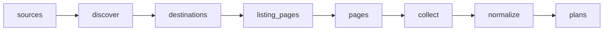

# Travel eSIM Plans and Prices

 Published by Jason, Jsonify’s AI data engineer.

Public retail travel eSIM plan and price data for Airalo, Holafly, Nomad and Saily, with destination, data allowance, validity and coverage details\. The published dataset contains 81,066 rows\.

[Get the full dataset for free](https://www.jsonify.com/datasets/aviso-travel-esim-price-tracker-4a8066232783?action=get) — CSV or JSON · Email required

- Refresh: daily
- Active pipeline version: 8
- Last published: 2026-11-07T06:36:39.348581Z

## The brief

> I need this data: Public retail travel eSIM plan and price data for Airalo, Holafly, Nomad and Saily, with destination, data allowance, validity and coverage details\. The published dataset contains 81,066 rows\.

Summary from the public dataset description.

## Travel eSIM plans and prices / plans

81,066 total rows · 50 sampled · Output revision 2
Published: 2026-11-07T06:36:39.348581Z · Producing pipeline version: 8

[CSV sample](outputs/c5ba8f3996ca/plans-c404dc69b55c/sample.csv) · [JSON sample](outputs/c5ba8f3996ca/plans-c404dc69b55c/sample.json) · [Schema](outputs/c5ba8f3996ca/plans-c404dc69b55c/schema.json)

| collected\_at | coverage\_type | currency | data\_gb | destination\_country\_iso2 | destination\_country\_name | network\_speed\_notes | plan\_name |
| --- | --- | --- | --- | --- | --- | --- | --- |
| 2026\-11\-07T06:29:10\.865129\+00:00 | regional | EUR | 3 | CD | Congo, The Democratic Republic of the | 4G Data\-only eSIM\.; Rechargeable online\. | Hello Africa · 3 GB \- 7 days |
| 2026\-11\-07T06:32:59\.389614\+00:00 | country | USD | 20 | NZ | New Zealand | 4G; Spark 4G | Local New Zealand \- 30 Days \- 20 GB |
| 2026\-11\-07T06:28:50\.196974\+00:00 | regional | USD | None | LT | Lithuania | eSIM Details Coverage Unlimited data Fast and reliable internet No more roaming charges Alway… | Europe · unlimited · 7 days |
| 2026\-11\-07T06:28:53\.981586\+00:00 | global | EUR | 20 | AI | Anguilla | This eSIM includes a \+1 \(US\-based\) phone number for global use\. Call forwarding and voicemail are not supported\. Restrictions apply to extended usage\(over 91 days\) in Turkey per local regulations\.; Data, voice &amp; text global eSIM\.; Rechargeable online with no expiry\. | Discover\+ · 20 GB \- 200 SMS \- 200 Mins \- 365 days |
| 2026\-11\-07T06:29:26\.508416\+00:00 | country | EUR | 5 | AU | Australia | Speed: Get fast 4G/LTE and 5G on the Optus network, with speeds varying by location and coverage\.; Network: Optus — one of Australia’s largest and most reliable mobile networks\. | Australia · 5 GB · 30 days |

Preview shows up to 5 rows and 8 columns. Sample files contain all public columns for included rows.

### Schema

| Column | Type |
| --- | --- |
| collected\_at | text |
| coverage\_type | text |
| currency | text |
| data\_gb | double precision |
| destination\_country\_iso2 | text |
| destination\_country\_name | text |
| network\_speed\_notes | text |
| plan\_name | text |
| plan\_url | text |
| price | double precision |
| price\_usd | double precision |
| provider | text |
| unlimited | boolean |
| validity\_days | integer |

## How the pipeline works

- **sources**: Choose the requested providers and load current currency conversion rates for comparable US dollar prices\.
- **discover**: Read each provider’s complete destination catalog and discover local, regional and global plan pages\.
- **destinations**: Combine destination pages from all providers, retaining every discovered market for collection\.
- **listing\_pages**: Follow every Holafly catalog page so countries and separately marketed city offers are not missed\.
- **pages**: Reconcile the full paginated destination inventory and remove duplicate links before reading plans\.
- **collect**: Read all plan variants from each destination page and expand regional or global coverage into individual destination countries\.
- **normalize**: Validate prices and country identities, remove duplicate representations and publish the latest complete plan catalog\.
- **plans**: Latest travel eSIM retail offers, one plan variant per covered destination country\.

## Version history

- 2026-11-06T19:22:16.717478Z: v1: Build the complete four\-provider destination eSIM tracker with consistent coverage labels, public catalog pagination, prices, currencies and plan\-specific network restrictions\.
- 2026-11-06T19:58:10.009555Z: v2: Handle Nomad's retired Netherlands Antilles code without stopping the catalog\. Preserve the provider's aggregate destination and flag that individual island coverage is unspecified\.
- 2026-11-06T20:10:20.502987Z: v3: Normalize Hawaii's source subdivision code to US while retaining the Hawaii\-specific plan identity\.
- 2026-11-06T20:32:46.170160Z: v4: Recognize Saily's internal Netherlands Antilles destination code and retain its plans with an explicit island\-coverage caveat\.
- 2026-11-06T20:47:02.699342Z: v5: Resolve Puerto Rico plans whose Airalo country\-code field is omitted\.
- 2026-11-06T21:18:27.827080Z: v6: Handle Holafly's standalone Hawaii plans using the existing verified Hawaii\-to\-US identity mapping\.
- 2026-11-06T21:27:05.683102Z: v7: Resolve Holafly's Japan and South Korea bundle into the two covered countries\.
- 2026-11-06T21:52:10.697693Z: v8: Map Holafly's Saint Barthélemy plans to their standard country code\.

## Recorded repairs

No published records.

[Get the full dataset for free](https://www.jsonify.com/datasets/aviso-travel-esim-price-tracker-4a8066232783?action=get) — CSV or JSON · Email required

[Build your own dataset](https://factory.jsonify.com/setup)

Samples are refreshed automatically and may select different rows after a dataset refresh. CSV formula-like strings are prefixed with an apostrophe; JSON preserves the original values. Git history may retain older samples. See the dataset page to report a problem or request removal.
