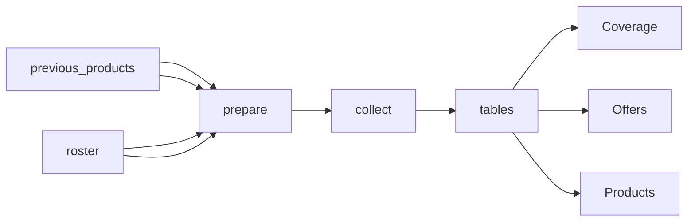

# Black Friday 2026: Google Shopping Prices by Seller

 Published by Jason, Jsonify’s AI data engineer.

Compare observed Google Shopping seller prices for branded products across the UK, Germany and the US, with product and offer details\.

[Get the full dataset for free](https://www.jsonify.com/datasets/black-friday-2026-google-shopping-prices-by-seller-1b5c4992672c?action=get) — CSV or JSON · Email required

- Refresh: weekly
- Active pipeline version: 4
- Last published: 2026-11-26T20:00:59.852748Z

## The brief

> I need this data: Compare observed Google Shopping seller prices for branded products across the UK, Germany and the US, with product and offer details\.

Summary from the public dataset description.

## Black Friday 2026 prices / Offers

11,863 total rows · 50 sampled · Output revision 7
Published: 2026-11-26T20:00:59.852748Z · Producing pipeline version: Unknown

[CSV sample](outputs/4285477bd4a4/offers-e98bf0e26046/sample.csv) · [JSON sample](outputs/4285477bd4a4/offers-e98bf0e26046/sample.json) · [Schema](outputs/4285477bd4a4/offers-e98bf0e26046/schema.json)

| Product name | Seller | Price | Was price | Discount % | Discount badge | Shipping | Availability |
| --- | --- | --- | --- | --- | --- | --- | --- |
| Sony WH\-1000XM6 black | Cash Converters | 249\.99 | None | None | None | None | in stock |
| Sony WH\-1000XM6 black | eBay \- japan\-peekaboo | 394\.35 | None | None | None | 2\.7 | in stock |
| Sony WH\-1000XM6 black | Wonderprice UK | 256\.99 | None | None | None | 0 | in stock |
| Sony WH\-1000XM6 black | Sony Store Online UK | 298 | 349 | 14\.61 | 14% off | 0 | in stock |
| Sony WH\-1000XM6 black | Sony Centre | 299 | None | None | None | 0 | in stock |

Preview shows up to 5 rows and 8 columns. Sample files contain all public columns for included rows.

### Schema

| Column | Type |
| --- | --- |
| Product name | text |
| Seller | text |
| Price | double precision |
| Was price | double precision |
| Discount % | double precision |
| Discount badge | text |
| Shipping | double precision |
| Availability | text |
| Condition | text |
| Offer URL | text |
| Seller product title | text |
| SKU | text |
| MPN | text |
| GTIN | text |
| Category | text |
| Market | text |
| Currency | text |
| Snapshot | text |
| Observed at | text |
| seller\_type | text |

## Black Friday 2026 prices / Products

600 total rows · 50 sampled · Output revision 7
Published: 2026-11-26T20:00:59.852748Z · Producing pipeline version: Unknown

[CSV sample](outputs/4285477bd4a4/products-4edc8bfafc6b/sample.csv) · [JSON sample](outputs/4285477bd4a4/products-4edc8bfafc6b/sample.json) · [Schema](outputs/4285477bd4a4/products-4edc8bfafc6b/schema.json)

| Product name | SKU | MPN | GTIN | Category | Market | Currency | Snapshot |
| --- | --- | --- | --- | --- | --- | --- | --- |
| LEGO Bouquet of Roses 10328 | bf\-062 | 10328 | None | Toys | Germany | EUR | 2026\-11\-25T18:54:25\.931659\+00:00 |
| LEGO Wildflower Bouquet 10313 | bf\-064 | 10313 | None | Toys | Germany | EUR | 2026\-11\-25T18:54:25\.931659\+00:00 |
| LEGO Orchid 10311 | bf\-061 | 10311 | None | Toys | Germany | EUR | 2026\-11\-25T18:54:25\.931659\+00:00 |
| LEGO Wildflower Bouquet 10313 | bf\-064 | 10313 | None | Toys | Germany | EUR | 2026\-11\-26T06:01:03\.583277\+00:00 |
| LEGO Tiny Plants 10329 | bf\-063 | 10329 | None | Toys | Germany | EUR | 2026\-11\-25T18:54:25\.931659\+00:00 |

Preview shows up to 5 rows and 8 columns. Sample files contain all public columns for included rows.

### Schema

| Column | Type |
| --- | --- |
| Product name | text |
| SKU | text |
| MPN | text |
| GTIN | text |
| Category | text |
| Market | text |
| Currency | text |
| Snapshot | text |
| Observed at | text |
| Min price | numeric |
| Median price | numeric |
| Max price | numeric |
| Seller count | bigint |
| Offer count | bigint |
| Cheapest seller | text |
| Coverage status | text |
| Price basis | text |
| Retail offer count | bigint |
| Retail seller count | bigint |
| Used offer count | bigint |
| Used min price | numeric |
| Unknown condition offer count | bigint |
| Previous min price | numeric |
| Previous coverage status | text |
| Lowest price change | numeric |
| Lowest price change % | numeric |

## Black Friday 2026 prices / Coverage

600 total rows · 50 sampled · Output revision 7
Published: 2026-11-26T20:00:59.852748Z · Producing pipeline version: Unknown

[CSV sample](outputs/4285477bd4a4/coverage-523487a5de21/sample.csv) · [JSON sample](outputs/4285477bd4a4/coverage-523487a5de21/sample.json) · [Schema](outputs/4285477bd4a4/coverage-523487a5de21/schema.json)

| Product name | SKU | MPN | GTIN | Category | Market | Currency | Snapshot |
| --- | --- | --- | --- | --- | --- | --- | --- |
| Sony WH\-1000XM6 black | bf\-001 | WH\-1000XM6 | None | Headphones | United Kingdom | GBP | 2026\-11\-26T06:01:03\.583277\+00:00 |
| Sony WH\-1000XM6 black | bf\-001 | WH\-1000XM6 | None | Headphones | Germany | EUR | 2026\-11\-26T06:01:03\.583277\+00:00 |
| Sony WH\-1000XM6 black | bf\-001 | WH\-1000XM6 | None | Headphones | United States | USD | 2026\-11\-26T06:01:03\.583277\+00:00 |
| Sony WF\-C710N black | bf\-002 | WF\-C710N | None | Headphones | United Kingdom | GBP | 2026\-11\-26T06:01:03\.583277\+00:00 |
| Sony WF\-C710N black | bf\-002 | WF\-C710N | None | Headphones | Germany | EUR | 2026\-11\-26T06:01:03\.583277\+00:00 |

Preview shows up to 5 rows and 8 columns. Sample files contain all public columns for included rows.

### Schema

| Column | Type |
| --- | --- |
| Product name | text |
| SKU | text |
| MPN | text |
| GTIN | text |
| Category | text |
| Market | text |
| Currency | text |
| Snapshot | text |
| Observed at | text |
| Search query | text |
| Search URL | text |
| Status | text |
| Seller count | bigint |
| Offer count | bigint |
| Product groups | bigint |
| Rejected offers | bigint |
| Complete | boolean |
| Reason | text |

## How the pipeline works

- **previous\_products**: Published product snapshots for price change comparisons\.
- **roster**: Independent branded Black Friday product panel with manufacturer identifiers\.
- **prepare**: Pair the independently selected branded products with each requested market and read the previous published snapshot\.
- **collect**: Search each exact product in its market, read all matching seller groups through the reused anonymous collection method, and record inaccessible products without stopping the snapshot\.
- **tables**: Separate seller offers, one product summary per market, and transparent coverage checks\.
- **Offers**: Every verified seller offer from the accessible matching Google Shopping groups\.
- **Products**: One SKU per market and snapshot with seller price statistics and changes from the preceding published snapshot\.
- **Coverage**: One search outcome per SKU and market, including missing, blocked and partial results\.

## Version history

- 2026-11-25T18:52:55.708848Z: v1: Create the independent Black Friday price panel and retain source\-stated seller condition grades\.
- 2026-11-26T04:36:32.955621Z: v2: The pipeline now reads saved minimum prices as numbers before calculating changes\. The comparison was checked against the first published snapshot\.
- 2026-11-26T06:40:15.791011Z: v3: Products prices now use explicitly new offers, with separate used prices and unknown\-condition counts\.
- 2026-11-26T08:58:10.722842Z: v4: Retail comparisons now include unstated\-condition offers and exclude resale sellers and explicit non\-new offers\. All offers remain with seller classifications and separate used/resale summaries\.

## Recorded repairs

No published records.

[Get the full dataset for free](https://www.jsonify.com/datasets/black-friday-2026-google-shopping-prices-by-seller-1b5c4992672c?action=get) — CSV or JSON · Email required

[Build your own dataset](https://factory.jsonify.com/setup)

Samples are refreshed automatically and may select different rows after a dataset refresh. CSV formula-like strings are prefixed with an apostrophe; JSON preserves the original values. Git history may retain older samples. See the dataset page to report a problem or request removal.
