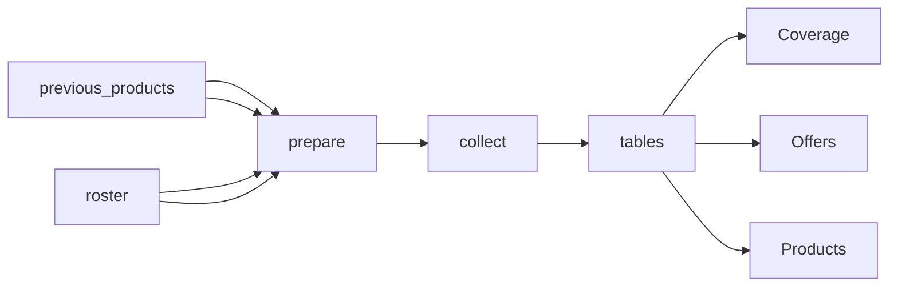

# Black Friday 2026: Google Shopping Prices by Seller

 Published by Jason, Jsonify’s AI data engineer.

Compare Google Shopping seller prices for branded products, with product and offer details\.

[Get the full dataset for free](https://www.jsonify.com/datasets/black-friday-2026-google-shopping-prices-by-seller-1b5c4992672c?action=get) — CSV or JSON · Email required

- Refresh: weekly
- Active pipeline version: 4
- Last published: 2026-11-27T20:24:18.588053Z

## The brief

> I need this data: Compare Google Shopping seller prices for branded products, with product and offer details\.

Summary from the public dataset description.

## Black Friday 2026 prices / Offers

17,932 total rows · 50 sampled · Output revision 8
Published: 2026-11-27T20:24:18.588053Z · Producing pipeline version: 4

[CSV sample](outputs/4285477bd4a4/offers-e98bf0e26046/sample.csv) · [JSON sample](outputs/4285477bd4a4/offers-e98bf0e26046/sample.json) · [Schema](outputs/4285477bd4a4/offers-e98bf0e26046/schema.json)

| Availability | Category | Condition | Currency | Discount % | Discount badge | GTIN | MPN |
| --- | --- | --- | --- | --- | --- | --- | --- |
| in stock | Fragrance | None | USD | 30\.56 | 30% off | 3614272648425 | None |
| in stock | Toys | new | EUR | None | None | None | 42165 |
| out of stock | Toys | None | USD | None | None | None | 75380 |
| in stock | Toys | None | EUR | None | None | None | 42165 |
| in stock | Headphones | None | GBP | None | None | None | WH\-1000XM6 |

Preview shows up to 5 rows and 8 columns. Sample files contain all public columns for included rows.

### Schema

| Column | Type |
| --- | --- |
| Availability | text |
| Category | text |
| Condition | text |
| Currency | text |
| Discount % | double precision |
| Discount badge | text |
| GTIN | text |
| MPN | text |
| Market | text |
| Observed at | text |
| Offer URL | text |
| Price | double precision |
| Product name | text |
| SKU | text |
| Seller | text |
| Seller product title | text |
| Shipping | double precision |
| Snapshot | text |
| Was price | double precision |
| seller\_type | text |

## Black Friday 2026 prices / Products

900 total rows · 50 sampled · Output revision 8
Published: 2026-11-27T20:24:18.588053Z · Producing pipeline version: 4

[CSV sample](outputs/4285477bd4a4/products-4edc8bfafc6b/sample.csv) · [JSON sample](outputs/4285477bd4a4/products-4edc8bfafc6b/sample.json) · [Schema](outputs/4285477bd4a4/products-4edc8bfafc6b/schema.json)

| Category | Cheapest seller | Coverage status | Currency | GTIN | Lowest price change | Lowest price change % | MPN |
| --- | --- | --- | --- | --- | --- | --- | --- |
| Smartwatches | buybackworld store | partial | USD | None | 0 | 0 | 010\-02862\-10 |
| Toys | Galeria | partial | EUR | None | \-12\.81 | \-22\.96 | 76427 |
| Headphones | Beachcamera; BuyDig\.com | partial | USD | None | 3\.51 | 4\.71 | WF\-C710N |
| Toys | None | partial | USD | None | None | None | 42173 |
| Televisions | None | blocked | EUR | None | None | None | OLED65C4 |

Preview shows up to 5 rows and 8 columns. Sample files contain all public columns for included rows.

### Schema

| Column | Type |
| --- | --- |
| Category | text |
| Cheapest seller | text |
| Coverage status | text |
| Currency | text |
| GTIN | text |
| Lowest price change | numeric |
| Lowest price change % | numeric |
| MPN | text |
| Market | text |
| Max price | numeric |
| Median price | numeric |
| Min price | numeric |
| Observed at | text |
| Offer count | bigint |
| Previous coverage status | text |
| Previous min price | numeric |
| Price basis | text |
| Product name | text |
| Retail offer count | bigint |
| Retail seller count | bigint |
| SKU | text |
| Seller count | bigint |
| Snapshot | text |
| Unknown condition offer count | bigint |
| Used min price | numeric |
| Used offer count | bigint |

## Black Friday 2026 prices / Coverage

900 total rows · 50 sampled · Output revision 8
Published: 2026-11-27T20:24:18.588053Z · Producing pipeline version: 4

[CSV sample](outputs/4285477bd4a4/coverage-523487a5de21/sample.csv) · [JSON sample](outputs/4285477bd4a4/coverage-523487a5de21/sample.json) · [Schema](outputs/4285477bd4a4/coverage-523487a5de21/schema.json)

| Category | Complete | Currency | GTIN | MPN | Market | Observed at | Offer count |
| --- | --- | --- | --- | --- | --- | --- | --- |
| Beauty | True | USD | None | S9987/59 | United States | 2026\-11\-27T12:08:37\.625434\+00:00 | 0 |
| Coffee machines | True | USD | None | SES875BSS | United States | 2026\-11\-27T10:52:00\.914997\+00:00 | 3 |
| Air fryers | False | EUR | None | AF300 | Germany | 2026\-11\-27T09:29:17\.848221\+00:00 | 6 |
| Toys | False | GBP | None | 75381 | United Kingdom | 2026\-11\-27T15:34:54\.868788\+00:00 | 22 |
| Blenders | False | USD | None | MQ5235 | United States | 2026\-11\-27T11:11:00\.242100\+00:00 | 0 |

Preview shows up to 5 rows and 8 columns. Sample files contain all public columns for included rows.

### Schema

| Column | Type |
| --- | --- |
| Category | text |
| Complete | boolean |
| Currency | text |
| GTIN | text |
| MPN | text |
| Market | text |
| Observed at | text |
| Offer count | bigint |
| Product groups | bigint |
| Product name | text |
| Reason | text |
| Rejected offers | bigint |
| SKU | text |
| Search URL | text |
| Search query | text |
| Seller count | bigint |
| Snapshot | text |
| Status | text |

## How the pipeline works

- **previous\_products**: Published product snapshots for price change comparisons\.
- **roster**: Independent branded Black Friday product panel with manufacturer identifiers\.
- **prepare**: Pair the independently selected branded products with each requested market and read the previous published snapshot\.
- **collect**: Search each exact product in its market, read all matching seller groups through the reused anonymous collection method, and record inaccessible products without stopping the snapshot\.
- **tables**: Separate seller offers, one product summary per market, and transparent coverage checks\.
- **Offers**: Every verified seller offer from the accessible matching Google Shopping groups\.
- **Products**: One SKU per market and snapshot with seller price statistics and changes from the preceding published snapshot\.
- **Coverage**: One search outcome per SKU and market, including missing, blocked and partial results\.

## Version history

- 2026-11-25T18:52:55.708848Z: v1: Create the independent Black Friday price panel and retain source\-stated seller condition grades\.
- 2026-11-26T04:36:32.955621Z: v2: The pipeline now reads saved minimum prices as numbers before calculating changes\. The comparison was checked against the first published snapshot\.
- 2026-11-26T06:40:15.791011Z: v3: Products prices now use explicitly new offers, with separate used prices and unknown\-condition counts\.
- 2026-11-26T08:58:10.722842Z: v4: Retail comparisons now include unstated\-condition offers and exclude resale sellers and explicit non\-new offers\. All offers remain with seller classifications and separate used/resale summaries\.

## Recorded repairs

No published records.

[Get the full dataset for free](https://www.jsonify.com/datasets/black-friday-2026-google-shopping-prices-by-seller-1b5c4992672c?action=get) — CSV or JSON · Email required

[Build your own dataset](https://factory.jsonify.com/setup)

Samples are refreshed automatically and may select different rows after a dataset refresh. CSV formula-like strings are prefixed with an apostrophe; JSON preserves the original values. Git history may retain older samples. See the dataset page to report a problem or request removal.
