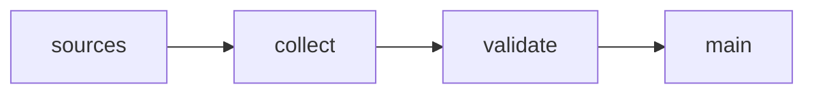

# BLOXOME EU Building and Parcel Sample

 Published by Jason, Jsonify’s AI data engineer.

BLOXOME EU building and parcel sample with address, location, building attributes, and transaction fields\.

[Get the full dataset for free](https://www.jsonify.com/datasets/bloxome-eu-building-and-parcel-sample-023cb9bef779?action=get) — CSV or JSON · Email required

- Refresh: On demand
- Active pipeline version: 1
- Last published: 2026-11-10T12:09:59.030747Z

## The brief

> I need this data: BLOXOME EU building and parcel sample with address, location, building attributes, and transaction fields\.

Summary from the public dataset description.

## BLOXOME EU building and parcel sample / main

400 total rows · 50 sampled · Output revision 2
Published: 2026-11-10T12:09:59.030747Z · Producing pipeline version: 1

[CSV sample](outputs/79ea966c7c60/main-0d6e4079e367/sample.csv) · [JSON sample](outputs/79ea966c7c60/main-0d6e4079e367/sample.json) · [Schema](outputs/79ea966c7c60/main-0d6e4079e367/schema.json)

| address | city | coordinate\_basis | country | floor\_area\_basis | floor\_area\_m2 | footprint\_area\_m2 | last\_transaction\_date |
| --- | --- | --- | --- | --- | --- | --- | --- |
| CL FELIPE III 3 | Madrid | building bounding\-box centre | Spain | grossFloorArea | 202 | None | None |
| CL POSTAS 28 | Madrid | building bounding\-box centre | Spain | grossFloorArea | 847 | None | None |
| 1 RUE DES PYRAMIDES 75001 | Paris | DVF geolocated parcel coordinate | France | None | None | None | 2025\-12\-01 |
| 62 RUE DE L ARBRE SEC 75001 | Paris | DVF geolocated parcel coordinate | France | DVF built local area | 42 | None | 2025\-12\-19 |
| 28 RUE PIERRE LESCOT 75001 | Paris | DVF geolocated parcel coordinate | France | DVF built local area | 19 | None | 2025\-11\-03 |

Preview shows up to 5 rows and 8 columns. Sample files contain all public columns for included rows.

### Schema

| Column | Type |
| --- | --- |
| address | text |
| city | text |
| coordinate\_basis | text |
| country | text |
| floor\_area\_basis | text |
| floor\_area\_m2 | double precision |
| footprint\_area\_m2 | double precision |
| last\_transaction\_date | text |
| last\_transaction\_price\_eur | double precision |
| latitude | double precision |
| longitude | double precision |
| notes | text |
| parcel\_building\_id | text |
| record\_type | text |
| source | text |
| source\_url | text |
| source\_use\_type | text |
| transaction\_coverage | text |
| transaction\_id | text |
| transaction\_price\_scope | text |
| units | integer |
| units\_basis | text |
| use\_type | text |
| year\_built | integer |

## How the pipeline works

- **sources**: Select the four public register sources used in the BLOXOME sample\.
- **collect**: Recollect 100 building or parcel records per source, join register details and normalize the existing sample columns\.
- **validate**: Require 400 unique records, 100 from each source, and validate identifiers, addresses, coordinates and schema before publication\.
- **main**: Private BLOXOME building and parcel sample in the existing 24\-column schema\.

## Version history

- 2026-11-10T12:09:04.299056Z: v1: Saved the four\-source BLOXOME sample as a private collector that recreates 400 records in the existing dataset schema\.

## Recorded repairs

No published records.

[Get the full dataset for free](https://www.jsonify.com/datasets/bloxome-eu-building-and-parcel-sample-023cb9bef779?action=get) — CSV or JSON · Email required

[Build your own dataset](https://factory.jsonify.com/setup)

Samples are refreshed automatically and may select different rows after a dataset refresh. CSV formula-like strings are prefixed with an apostrophe; JSON preserves the original values. Git history may retain older samples. See the dataset page to report a problem or request removal.
