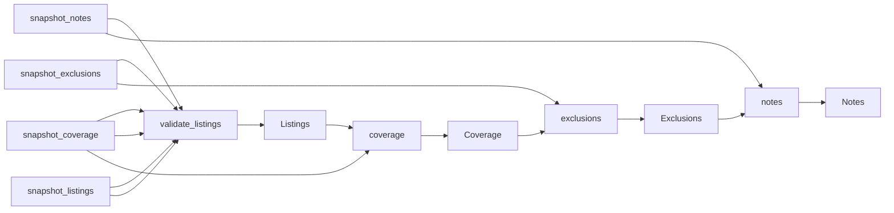

# Lisbon &amp; Cascais €1M\+ Property Listings

 Published by Jason, Jsonify’s AI data engineer.

Residential sale listings in Lisboa and Cascais with asking prices of at least €1 million\. The published Listings table contains 293 rows\.

[Get the full dataset for free](https://www.jsonify.com/datasets/bonte-filipidis-lisbon-cascais-1m-snapshot-c5f15a05fc46?action=get) — CSV or JSON · Email required

- Refresh: On demand
- Active pipeline version: 1
- Last published: 2026-11-08T07:57:29.642535Z

## The brief

> I need this data: Residential sale listings in Lisboa and Cascais with asking prices of at least €1 million\. The published Listings table contains 293 rows\.

Summary from the public dataset description.

## Bonte Filipidis demo \| Lisbon &amp; Cascais €1M\+ \| 7 Nov 2026 / Listings

293 total rows · 50 sampled · Output revision 2
Published: 2026-11-08T07:57:29.642535Z · Producing pipeline version: 1

[CSV sample](outputs/fb075e9d15a0/listings-5009238dba6b/sample.csv) · [JSON sample](outputs/fb075e9d15a0/listings-5009238dba6b/sample.json) · [Schema](outputs/fb075e9d15a0/listings-5009238dba6b/schema.json)

| agency | area\_basis | area\_m2 | asking\_price\_eur | bedrooms | days\_on\_market | first\_listed\_date | history\_note |
| --- | --- | --- | --- | --- | --- | --- | --- |
| JLL Portugal | Source squareMeters \(area definition not specified\) | 316 | 4450000 | 5 | None | None | No explicit first\-listed date or days on market found; source record creation/update dates are not treated as listing age\. |
| RE/MAX Yes | Gross area \(source label: área bruta\) | 443 | 3480000 | 5 | None | None | No explicit first\-listed date or days on market found; source record creation/update dates are not treated as listing age\. |
| Portugal Sotheby's International Realty | Gross Private Area | 264 | 3300000 | 4 | None | None | No explicit first\-listed date or days on market found; source record creation/update dates are not treated as listing age\. |
| JLL Portugal | Gross construction area | 490 | 3390000 | 4 | None | None | No explicit first\-listed date or days on market found; source record creation/update dates are not treated as listing age\. |
| Portugal Sotheby's International Realty | Gross Private Area | 285 | 3950000 | 4 | None | None | No explicit first\-listed date or days on market found; source record creation/update dates are not treated as listing age\. |

Preview shows up to 5 rows and 8 columns. Sample files contain all public columns for included rows.

### Schema

| Column | Type |
| --- | --- |
| agency | text |
| area\_basis | text |
| area\_m2 | double precision |
| asking\_price\_eur | integer |
| bedrooms | integer |
| days\_on\_market | text |
| first\_listed\_date | text |
| history\_note | text |
| listing\_id | text |
| municipality | text |
| parish | text |
| parish\_original | text |
| previous\_price\_eur | integer |
| price\_cut\_amount\_eur | integer |
| price\_per\_m2\_basis | text |
| price\_per\_m2\_eur | double precision |
| property\_type | text |
| snapshot\_date | text |
| source | text |
| source\_reference | text |
| source\_title | text |
| url | text |
| verification\_level | text |

## Bonte Filipidis demo \| Lisbon &amp; Cascais €1M\+ \| 7 Nov 2026 / Coverage

5 total rows · 5 sampled · Output revision 2
Published: 2026-11-08T07:57:29.642535Z · Producing pipeline version: 1

[CSV sample](outputs/fb075e9d15a0/coverage-523487a5de21/sample.csv) · [JSON sample](outputs/fb075e9d15a0/coverage-523487a5de21/sample.json) · [Schema](outputs/fb075e9d15a0/coverage-523487a5de21/schema.json)

| cascais | coverage\_and\_failures | lisboa | listings | price\_cuts\_shown | source | source\_url | unresolved\_access\_failures |
| --- | --- | --- | --- | --- | --- | --- | --- |
| 90 | First three €1M\+ sale\-result pages per municipality\. All 180 listing detail pages checked\. Raw detail requests hit HTTP 429; alternative HTML and readable\-page retrieval recovered every selected listing\. Nine displayed previous prices retained\. | 90 | 180 | 9 | Idealista | [https://www\.idealista\.pt/](<https://www.idealista.pt/>) | 0 |
| 40 | First four sale\-result pages per municipality, retaining individually priced residential homes\. 70 candidates checked; two excluded after detail review as a services\-to\-housing conversion and a development\-land package\. One palace has no explicit total bedroom count\. | 28 | 68 | 0 | Sotheby's Portugal | [https://www\.sothebysrealtypt\.com/](<https://www.sothebysrealtypt.com/>) | 0 |
| 2 | Optional source: four eligible individual residential listings on the initial sale\-results page\. All four detail pages checked\. This is a small supplemental sample\. | 2 | 4 | 0 | Porta da Frente Christie's | [https://www\.portadafrente\.com/en/properties](<https://www.portadafrente.com/en/properties>) | 0 |
| 32 | First six nationwide sale/resale result pages ordered by descending price, then exact municipality and individual residential\-type filtering\. 41 retained detail pages checked\. Eight initial detail timeouts recovered using HTML retrieval\. Development price ranges, land and commercial property excluded\. | 9 | 41 | 0 | JLL Portugal | [https://properties\.jll\.pt/](<https://properties.jll.pt/>) | 0 |
| 0 | Optional source not collected; kept the snapshot lean after the required sources and Christie’s supplement were verified\. Not an access failure\. | 0 | 0 | 0 | Engel &amp; Völkers | [https://www\.engelvoelkers\.com/pt/pt/propriedades/res/venda/sector\-imobiliario/lisboa/cascais](<https://www.engelvoelkers.com/pt/pt/propriedades/res/venda/sector-imobiliario/lisboa/cascais>) | 0 |

Preview shows up to 5 rows and 8 columns. Sample files contain all public columns for included rows.

### Schema

| Column | Type |
| --- | --- |
| cascais | integer |
| coverage\_and\_failures | text |
| lisboa | integer |
| listings | integer |
| price\_cuts\_shown | integer |
| source | text |
| source\_url | text |
| unresolved\_access\_failures | integer |

## Bonte Filipidis demo \| Lisbon &amp; Cascais €1M\+ \| 7 Nov 2026 / Exclusions

2 total rows · 2 sampled · Output revision 2
Published: 2026-11-08T07:57:29.642535Z · Producing pipeline version: 1

[CSV sample](outputs/fb075e9d15a0/exclusions-fcc9f1f92978/sample.csv) · [JSON sample](outputs/fb075e9d15a0/exclusions-fcc9f1f92978/sample.json) · [Schema](outputs/fb075e9d15a0/exclusions-fcc9f1f92978/schema.json)

| listing\_id | reason | source | url |
| --- | --- | --- | --- |
| 75068 | Excluded: services\-to\-housing conversion or development land package, not an individual residential listing | Sotheby's Portugal | [https://www\.sothebysrealtypt\.com/properties/flat\-chiado\-lisboa\_pt1\_75068](<https://www.sothebysrealtypt.com/properties/flat-chiado-lisboa_pt1_75068>) |
| 80480 | Excluded: services\-to\-housing conversion or development land package, not an individual residential listing | Sotheby's Portugal | [https://www\.sothebysrealtypt\.com/properties/detached\-house\-carcavelos\-e\-parede\-cascais\_pt1\_80480](<https://www.sothebysrealtypt.com/properties/detached-house-carcavelos-e-parede-cascais_pt1_80480>) |

Preview shows up to 5 rows and 8 columns. Sample files contain all public columns for included rows.

### Schema

| Column | Type |
| --- | --- |
| listing\_id | text |
| reason | text |
| source | text |
| url | text |

## Bonte Filipidis demo \| Lisbon &amp; Cascais €1M\+ \| 7 Nov 2026 / Notes

11 total rows · 10 sampled · Output revision 2
Published: 2026-11-08T07:57:29.642535Z · Producing pipeline version: 1

[CSV sample](outputs/fb075e9d15a0/notes-8a7525b1492f/sample.csv) · [JSON sample](outputs/fb075e9d15a0/notes-8a7525b1492f/sample.json) · [Schema](outputs/fb075e9d15a0/notes-8a7525b1492f/schema.json)

| note | topic |
| --- | --- |
| Every delivered row was checked against its source detail page\. Required identities, municipality, price and residential type were checked\. Initial access errors were recovered; see Coverage for source\-specific notes\. | Verification |
| One source listing, deduplicated within each source by listing ID\. Counts are listings, not unique homes across agencies; the same property may appear on multiple sources\. No speculative cross\-source matches\. | Unit of observation |
| Source area definitions differ\. area\_basis preserves the distinction between gross area, gross private area, gross construction area and an unspecified source area\. Do not compare values without checking this field\. price\_per\_m2\_basis distinguishes displayed values from calculated asking\-price/area values\. | Area and price per square metre |
| Residential sale listings asking at least EUR 1,000,000 in the municipalities of Lisboa and Cascais\. Fixed sample, not exhaustive inventory or a statistically representative market estimate\. No scheduled refresh\. | Scope |
| No explicit original first\-listed date or days\-on\-market was found in the delivered detail pages\. These columns remain blank\. Last\-updated labels and record\-creation/publication metadata are not treated as first market listing dates\. | Dates |

Preview shows up to 5 rows and 8 columns. Sample files contain all public columns for included rows.

### Schema

| Column | Type |
| --- | --- |
| note | text |
| topic | text |

## How the pipeline works

- **snapshot\_notes**: Interpretation notes and sampling limitations\.
- **snapshot\_exclusions**: Inspected source listings excluded from the residential sample\.
- **snapshot\_coverage**: Source coverage and resolved access failures for the saved snapshot\.
- **snapshot\_listings**: Saved residential listings verified on 7 November 2026\.
- **validate\_listings**: Validate the saved one\-off listing snapshot without revisiting the source websites\.
- **Listings**: Verified source listings in the fixed 7 November 2026 luxury\-property snapshot\.
- **coverage**: Preserve source counts, sampling scope and resolved collection failures\.
- **Coverage**: Coverage and collection notes for each considered source\.
- **exclusions**: Preserve the inspected non\-residential candidates excluded from the sample\.
- **Exclusions**: Source listings excluded after detail inspection\.
- **notes**: Preserve the snapshot date, missing\-history explanation and area definitions\.
- **Notes**: Interpretation notes for using the one\-off sample\.

## Version history

- 2026-11-08T07:57:00.503079Z: v1: Added a one\-off pipeline for the verified Lisbon and Cascais luxury\-property snapshot, keeping all listings and coverage notes in the existing dataset\.

## Recorded repairs

No published records.

[Get the full dataset for free](https://www.jsonify.com/datasets/bonte-filipidis-lisbon-cascais-1m-snapshot-c5f15a05fc46?action=get) — CSV or JSON · Email required

[Build your own dataset](https://factory.jsonify.com/setup)

Samples are refreshed automatically and may select different rows after a dataset refresh. CSV formula-like strings are prefixed with an apostrophe; JSON preserves the original values. Git history may retain older samples. See the dataset page to report a problem or request removal.
