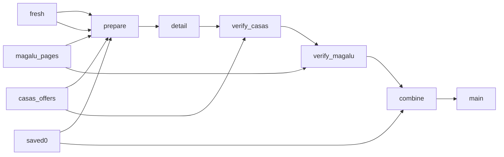

# Brazil Marketplace Brand and SKU Audit Sample

 Published by Jason, Jsonify’s AI data engineer.

Brazilian marketplace product listing dataset with 523 rows in the published main table and fields for brands, sellers, prices, and listing evidence\.

[Get the full dataset for free](https://www.jsonify.com/datasets/brazil-brand-sku-audit-sample-2864ef4fa9cb?action=get) — CSV or JSON · Email required

- Refresh: On demand
- Active pipeline version: 5
- Last published: 2026-11-16T13:29:06.915165Z

## The brief

> I need this data: Brazilian marketplace product listing dataset with 523 rows in the published main table and fields for brands, sellers, prices, and listing evidence\.

Summary from the public dataset description.

## Brazil brand SKU audit sample / main

523 total rows · 50 sampled · Output revision 5
Published: 2026-11-16T13:29:06.915165Z · Producing pipeline version: 5

[CSV sample](outputs/bb2ff34b0191/main-0d6e4079e367/sample.csv) · [JSON sample](outputs/bb2ff34b0191/main-0d6e4079e367/sample.json) · [Schema](outputs/bb2ff34b0191/main-0d6e4079e367/schema.json)

| availability | brand | captured\_at | detail\_captured\_at | evidence\_url | image\_url | key\_attributes | list\_was\_price\_brl |
| --- | --- | --- | --- | --- | --- | --- | --- |
| InStock; local delivery unverified | L’Oréal | 2026\-11\-16T13:08:11\.753560\+00:00 | 2026\-11\-16T13:08:11\.753560\+00:00 | [https://www\.casasbahia\.com\.br/leave\-in\-loreal\-serie\-expert\-nutrioil\-150ml/p/1571868596](<https://www.casasbahia.com.br/leave-in-loreal-serie-expert-nutrioil-150ml/p/1571868596>) | [https://imgs\.casasbahia\.com\.br/1571868596/1xg\.jpg](<https://imgs.casasbahia.com.br/1571868596/1xg.jpg>) | \{"audit\_note": "Exact public storefront product and primary offer joined by product ID and SKU; seller matched to primary offer ID\. No sign\-in\.", "categories": \[\{"id": "1886", "name": "Perfumaria e Cosméticos", "parents": \[782, 3142\], "subCategory": \[\{"id": "782", "name": "Cabelos"}, \{"id": "3142", "name": "Óleo e Tônico Capilar"}\]}\], "product\_id": "83087453", "regular\_offer\_price\_brl": 220} | 220 |
| Em estoque; local delivery unverified | L’Oréal | 2026\-11\-16T11:09:27\.515820\+00:00 | 2026\-11\-16T11:51:39\.713639\+00:00 | [https://www\.amazon\.com\.br/s?k=Loreal](<https://www.amazon.com.br/s?k=Loreal>) | [https://m\.media\-amazon\.com/images/I/61wfwHNv\-NL\.\_AC\_UL320\_\.jpg](<https://m.media-amazon.com/images/I/61wfwHNv-NL._AC_UL320_.jpg>) | \{"audit\_note": "Public search\-card observation; seller not established on card\.", "detail\_status": "Exact public detail verified"} | 247\.9 |
| InStock; local delivery unverified | Samsung | 2026\-11\-16T11:10:08\.410279\+00:00 | 2026\-11\-16T11:52:12\.982620\+00:00 | [https://www\.leroymerlin\.com\.br/search?term=samsung&amp;refinementList%5Battributes\.Marca%5D=Samsung](<https://www.leroymerlin.com.br/search?term=samsung&amp;refinementList%5Battributes.Marca%5D=Samsung>) | [https://cdn\.leroymerlin\.com\.br/products/toner\_samsung\_clt\_c603l\_c\_603l\_ciano\_\|\_c4010\_c4060\_1572723354\_9ca7\_600x600\.jpg](<https://cdn.leroymerlin.com.br/products/toner_samsung_clt_c603l_c_603l_ciano_%7C_c4010_c4060_1572723354_9ca7_600x600.jpg>) | \{"ean": \["191628452224"\], "attributes": \{"Cor": "Ciano", "Marca": \["Samsung"\], "Altura": 15, "Largura": 15, "Produto": "Toners", "Peso do Produto": 250, "Garantia do Fabricante": 3}, "audit\_note": "Public site search response for brand Samsung, region outros\. Seller requires detail confirmation\.", "detail\_status": "Exact public detail verified", "associated\_seller\_ids": \["698a19f376b0dae92a0effc2"\]} | None |
| Orderable on public page; local delivery unverified | Samsung | 2026\-11\-09T13:06:57\.796264\+00:00 | 2026\-11\-16T13:23:16\.382046\+00:00 | [https://www\.magazineluiza\.com\.br/smartphone\-samsung\-galaxy\-a15\-5g\-128gb\-tela\-6\-5\-4gb\-ram\-camera\-tripla\-selfie\-13mp/p/dh003a8bg2/te/ga15/](<https://www.magazineluiza.com.br/smartphone-samsung-galaxy-a15-5g-128gb-tela-6-5-4gb-ram-camera-tripla-selfie-13mp/p/dh003a8bg2/te/ga15/>) | [https://a\-static\.mlcdn\.com\.br/800x800/smartphone\-samsung\-galaxy\-a15\-5g\-128gb\-tela\-6\-5\-4gb\-ram\-camera\-tripla\-selfie\-13mp/oficialamericanas/888607/d1cd0f6cd265733bdeec804458bb1076\.jpg](<https://a-static.mlcdn.com.br/800x800/smartphone-samsung-galaxy-a15-5g-128gb-tela-6-5-4gb-ram-camera-tripla-selfie-13mp/oficialamericanas/888607/d1cd0f6cd265733bdeec804458bb1076.jpg>) | \{"Cor": "Azul Escuro", "size": \["128GB", "4GB"\], "model": \["Galaxy A15"\], "audit\_note": "Exact anonymous public Magalu product page rechecked; primary offer fields refreshed, payment conditions retained\. Local delivery unverified\.", "detail\_status": "Exact public product and primary offer verified", "Armazenamento interno": "128GB"} | None |
| InStock; local delivery unverified | Samsung | 2026\-11\-16T11:10:26\.234321\+00:00 | 2026\-11\-16T11:52:21\.771140\+00:00 | [https://www\.leroymerlin\.com\.br/search?term=samsung&amp;refinementList%5Battributes\.Marca%5D=Samsung](<https://www.leroymerlin.com.br/search?term=samsung&amp;refinementList%5Battributes.Marca%5D=Samsung>) | [https://cdn\.leroymerlin\.com\.br/products/smart\_tv\_samsung\_32\_polegadas\_hd\_h5000f\_2025\_\_som\_em\_movimen\_1572498775\_8e00\_600x600\.jpg](<https://cdn.leroymerlin.com.br/products/smart_tv_samsung_32_polegadas_hd_h5000f_2025__som_em_movimen_1572498775_8e00_600x600.jpg>) | \{"ean": \["7892509138291"\], "attributes": \{"Cor": "Preto", "Marca": \["Samsung"\], "ANATEL": "Sim", "Altura": 50, "Modelo": "UN32H5000FGXZD", "Largura": 80, "Smart TV": \["Com Função Smart TV"\], "Comprimento": 11, "Resolução": \["HD"\], "Tipo da Tela": \["LED"\], "Peso do Produto": 5\.4, "Tamanho da Tela": 32, "Tensão Elétrica": \["Bivolt"\], "Garantia do Fabricante": 12}, "audit\_note": "Public site search response for brand Samsung, region outros\. Seller requires detail confirmation\.", "detail\_status": "Exact public detail verified", "associated\_seller\_ids": \["5efd14beb8190b0e2b4640a0", "63459cbb3542e076e3270652", "5db89829b9c1da103b2e7add", "60116858351a855614642fc2"\]} | 1389\.9 |

Preview shows up to 5 rows and 8 columns. Sample files contain all public columns for included rows.

### Schema

| Column | Type |
| --- | --- |
| availability | text |
| brand | text |
| captured\_at | text |
| detail\_captured\_at | text |
| evidence\_url | text |
| image\_url | text |
| key\_attributes | jsonb |
| list\_was\_price\_brl | double precision |
| listing\_id | text |
| listing\_title | text |
| listing\_url | text |
| marketplace | text |
| observed\_at | text |
| official\_store\_flag | boolean |
| price\_brl | double precision |
| price\_terms | text |
| rating | double precision |
| review\_count | integer |
| review\_count\_basis | text |
| search\_captured\_at | text |
| seller\_id | text |
| seller\_name | text |
| source\_brand | text |

## How the pipeline works

- **fresh**: Public source\-card observations collected for this one\-off sample, with source URL and observation dates\.
- **magalu\_pages**: Dated public Magalu product pages for exact primary\-offer verification\.
- **casas\_offers**: Dated exact public Casas Bahia product and offer observations for the one\-off extension\.
- **saved0**: Retain earlier public sample observations at their original dates, except Mercado Livre which is excluded from this extension\.
- **prepare**: Select the new source observations for public detail checks\.
- **detail**: Check exact public product pages for seller, price, availability, ratings and brand evidence; keep dated card observations when details are blocked\.
- **verify\_casas**: Check exact SKU and primary\-seller matches in the newly observed public Casas Bahia offers, retaining cash\-payment conditions and explicit stock\.
- **verify\_magalu**: Refresh exact reached Magalu products from their primary offer and purchase controls, separating sellers from delivery partners and retaining blocked rows at prior dates\.
- **combine**: Merge earlier and newly collected public observations by site and listing, preserve original dates, and exclude Mercado Livre from this extension\.
- **main**: One row per brand SKU listing and site, with original observations, exact\-detail checks where reachable and honest unknowns\.

## Version history

- 2026-11-13T16:01:20.166347Z: v1: Make the saved sample available for a neutral public page without new collection\.
- 2026-11-16T11:28:21.993258Z: v2: Extends the Brazil public brand audit with new Amazon, Leroy Merlin and reachable Casas Bahia observations, adding availability and dated detail checks\. Keeps older observations dated and omits gated Mercado Livre pages\.
- 2026-11-16T11:51:09.521211Z: v3: Corrected Amazon reference prices to exclude unit prices and monthly installments while preserving genuine crossed\-out prices\.
- 2026-11-16T13:15:28.898729Z: v4: Added 105 current public Casas Bahia offers with exact seller, price and stock evidence, preserving the existing dated sample\.
- 2026-11-16T13:28:25.773209Z: v5: Refreshed31 exact Magalu product pages with current public offer and availability evidence, preserving earlier dates for pages that remained blocked\.

## Recorded repairs

No published records.

[Get the full dataset for free](https://www.jsonify.com/datasets/brazil-brand-sku-audit-sample-2864ef4fa9cb?action=get) — CSV or JSON · Email required

[Build your own dataset](https://factory.jsonify.com/setup)

Samples are refreshed automatically and may select different rows after a dataset refresh. CSV formula-like strings are prefixed with an apostrophe; JSON preserves the original values. Git history may retain older samples. See the dataset page to report a problem or request removal.
