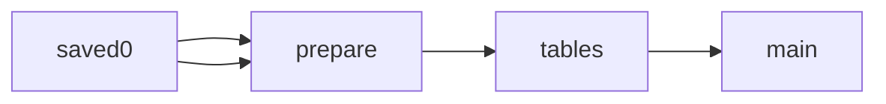

# Brazil State Public Security Secretaries

 Published by Jason, Jsonify’s AI data engineer.

Brazil state public security secretaries dataset with department details, office contacts, source links, and verification fields\.

[Get the full dataset for free](https://www.jsonify.com/datasets/brazil-state-public-security-secretaries-a3af258992e0?action=get) — CSV or JSON · Email required

- Refresh: On demand
- Active pipeline version: 1
- Last published: 2026-11-13T16:00:08.719539Z

## The brief

> I need this data: Brazil state public security secretaries dataset with department details, office contacts, source links, and verification fields\.

Summary from the public dataset description.

## Brazil state public security secretaries / main

27 total rows · 10 sampled · Output revision 1
Published: 2026-11-13T16:00:08.719539Z · Producing pipeline version: 1

[CSV sample](outputs/1704a27f38e4/main-0d6e4079e367/sample.csv) · [JSON sample](outputs/1704a27f38e4/main-0d6e4079e367/sample.json) · [Schema](outputs/1704a27f38e4/main-0d6e4079e367/schema.json)

| checked\_date | contact\_source\_url | country | department | department\_website | leadership\_source\_url | office\_address | office\_email |
| --- | --- | --- | --- | --- | --- | --- | --- |
| 2026\-11\-12 | [https://rondonia\.ro\.gov\.br/sesdec/contato/](<https://rondonia.ro.gov.br/sesdec/contato/>) | Brazil | Secretaria de Estado da Segurança, Defesa e Cidadania \(SESDEC\) | [https://rondonia\.ro\.gov\.br/sesdec/](<https://rondonia.ro.gov.br/sesdec/>) | [https://rondonia\.ro\.gov\.br/sesdec/sobre/quem\-e\-quem/](<https://rondonia.ro.gov.br/sesdec/sobre/quem-e-quem/>) | Av\. Farquar, 2986, Palácio Rio Madeira, Edifício Rio Cautário, Curvo 2, 3º andar, Pedrinhas, Porto Velho/RO, CEP 76801\-470 | gabinete@sesdec\.ro\.gov\.br |
| 2026\-11\-12 | [https://www\.segup\.pa\.gov\.br/](<https://www.segup.pa.gov.br/>) | Brazil | Secretaria de Estado de Segurança Pública e Defesa Social \(SEGUP\) | [https://www\.segup\.pa\.gov\.br/](<https://www.segup.pa.gov.br/>) | [https://www\.pa\.gov\.br/orgao?id\_orgao=25](<https://www.pa.gov.br/orgao?id_orgao=25>) | Avenida Almirante Barroso, 735, Marco, Belém\-PA | segup\.ascom@gmail\.com |
| 2026\-11\-12 | [https://www\.pge\.mt\.gov\.br/en/web/sesp/sesp\-mt](<https://www.pge.mt.gov.br/en/web/sesp/sesp-mt>) | Brazil | Secretaria de Estado de Segurança Pública \(SESP\-MT\) | [https://www\.pge\.mt\.gov\.br/en/web/sesp/sesp\-mt](<https://www.pge.mt.gov.br/en/web/sesp/sesp-mt>) | [https://www\.pge\.mt\.gov\.br/en/web/sesp/sesp\-mt](<https://www.pge.mt.gov.br/en/web/sesp/sesp-mt>) | Centro Político Administrativo, Cuiabá, MT, CEP 78050\-970 | chefiadegabinete@sesp\.mt\.gov\.br |
| 2026\-11\-12 | [https://www\.ssp\.am\.gov\.br/fale\-conosco/](<https://www.ssp.am.gov.br/fale-conosco/>) | Brazil | Secretaria de Estado de Segurança Pública do Amazonas \(SSP\-AM\) | [https://www\.ssp\.am\.gov\.br/](<https://www.ssp.am.gov.br/>) | [https://www\.ssp\.am\.gov\.br/wp\-content/uploads/2026/03/Revista\-Institucional\-Seguranca\-Publica\-do\-Amazonas\-2026\.pdf](<https://www.ssp.am.gov.br/wp-content/uploads/2026/03/Revista-Institucional-Seguranca-Publica-do-Amazonas-2026.pdf>) | Rua Olegário Mariano, nº 99, Santo Agostinho, Manaus\-AM, CEP 69036\-735 | assessoriasspam@gmail\.com |
| 2026\-11\-12 | [https://ssp\.se\.gov\.br/FaleConosco](<https://ssp.se.gov.br/FaleConosco>) | Brazil | Secretaria de Estado da Segurança Pública de Sergipe \(SSP/SE\) | [https://ssp\.se\.gov\.br/](<https://ssp.se.gov.br/>) | [https://redatorchefe\.com\.br/entrevista\-especial\-planejamento\-e\-inteligencia\-garantem\-menor\-taxa\-de\-mortes\-violentas\-em\-se/](<https://redatorchefe.com.br/entrevista-especial-planejamento-e-inteligencia-garantem-menor-taxa-de-mortes-violentas-em-se/>) | Praça Tobias Barreto, n\.º 20, Bairro São José, CEP 49015\-130, Aracaju, Sergipe, Brazil | ouvidoria@ssp\.se\.gov\.br |

Preview shows up to 5 rows and 8 columns. Sample files contain all public columns for included rows.

### Schema

| Column | Type |
| --- | --- |
| checked\_date | text |
| contact\_source\_url | text |
| country | text |
| department | text |
| department\_website | text |
| leadership\_source\_url | text |
| office\_address | text |
| office\_email | text |
| office\_phone | text |
| secretary\_name | text |
| state | text |
| title | text |
| uf | text |
| verification\_note | text |

## How the pipeline works

- **saved0**: Read the existing saved worksheet without contacting any sources\.
- **prepare**: Copy the saved sample and sort it for public reading without refreshing sources\.
- **tables**: Keep the saved worksheets separate in the public workbook\.
- **main**: Existing saved sample records\.

## Version history

- 2026-11-13T15:59:55.513982Z: v1: Make the saved sample available for a neutral public page without new collection\.

## Recorded repairs

No published records.

[Get the full dataset for free](https://www.jsonify.com/datasets/brazil-state-public-security-secretaries-a3af258992e0?action=get) — CSV or JSON · Email required

[Build your own dataset](https://factory.jsonify.com/setup)

Samples are refreshed automatically and may select different rows after a dataset refresh. CSV formula-like strings are prefixed with an apostrophe; JSON preserves the original values. Git history may retain older samples. See the dataset page to report a problem or request removal.
