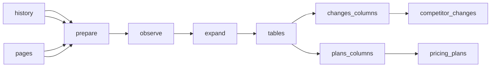

# Calven competitor watch

 Published by Jason, Jsonify’s AI data engineer.

Public\-page history for four competitors: 24 page observations per full run plus named pricing plans\. Klue pricing retains an explicit homepage\-redirect observation; Kompyte integrations hashes only its plans\-page integrations section\. Contify customers uses the complete case\-study data source and lists up to ten named customers\. Unpublished plan prices use custom quote\. Blog indexes remain labeled changelog fallbacks\. Schedules remain off\.

[Get the full dataset for free](https://www.jsonify.com/datasets/calven-competitor-watch-dfd2d8d7f7fc?action=get) — CSV or JSON · Email required

- Refresh: On demand
- Active pipeline version: 3
- Last published: 2026-10-13T09:39:44.873309Z

## The brief

> I need this data: Public\-page history for four competitors: 24 page observations per full run plus named pricing plans\. Klue pricing retains an explicit homepage\-redirect observation; Kompyte integrations hashes only its plans\-page integrations section\. Contify customers uses the complete case\-study data source and lists up to ten named customers\. Unpublished plan prices use custom quote\. Blog indexes remain labeled  … (excerpt)

Summary from the public dataset description.

## Calven competitor watch / competitor\_changes

23 total rows · 23 sampled · Output revision 3
Published: 2026-10-13T09:39:44.873309Z · Producing pipeline version: 2

[CSV sample](outputs/a992293bccdc/competitor-changes-db4232d2e157/sample.csv) · [JSON sample](outputs/a992293bccdc/competitor-changes-db4232d2e157/sample.json) · [Schema](outputs/a992293bccdc/competitor-changes-db4232d2e157/schema.json)

| changed | checked | competitor | hash | page | previous | summary | url |
| --- | --- | --- | --- | --- | --- | --- | --- |
| None | 2026\-10\-13 | Kompyte | 546bcdc2cf6209cbb4eab61525856e3b5f86489f405351b207b5547e4cf28244 | homepage | None | Win More Deals with Competitive Intelligence | [https://www\.kompyte\.com/](<https://www.kompyte.com/>) |
| None | 2026\-10\-13 | Kompyte | 546bcdc2cf6209cbb4eab61525856e3b5f86489f405351b207b5547e4cf28244 | integrations | None | 8 named integrations: HubSpot, Salesforce, Slack, Microsoft Teams, Google Drive, OneDrive, Highspot, Showpad\. | [https://www\.kompyte\.com/](<https://www.kompyte.com/>) |
| None | 2026\-10\-13 | Crayon | 5837827d2fdcde4b38894f8174d8442911b4ff11a05fc1e36877094a329a8991 | customers | None | Named customers: Vasion, Salsify, Cognism, The Standard, Wunderkind, Kong, ConnectWise, Alteryx, Viant, ZoomInfo\. | [https://www\.crayon\.co/case\-studies](<https://www.crayon.co/case-studies>) |
| None | 2026\-10\-13 | Klue | 86ccdabe3db9f538187109257da5bfb2752f26688613948568697a29c181bf9e | customers | None | Named customers: Adobe, NTT, Braze, Locus Robotics, Autodesk, Shopify, UiPath\. | [https://klue\.com/customers](<https://klue.com/customers>) |
| None | 2026\-10\-13 | Contify | 1acbc8a783db68e4347c465a340b9ea768343f42029c6d7efa33ecea0abe843c | integrations | None | 19 named integrations: Email, Slack, Microsoft Teams, Salesforce, HubSpot, Highspot, Seismic, Showpad, Contify Capture, Power BI\. | [https://www\.contify\.com/integrations/](<https://www.contify.com/integrations/>) |

Preview shows up to 5 rows and 8 columns. Sample files contain all public columns.

### Schema

| Column | Type |
| --- | --- |
| changed | text |
| checked | text |
| competitor | text |
| hash | text |
| page | text |
| previous | text |
| summary | text |
| url | text |

## Calven competitor watch / pricing\_plans

3 total rows · 3 sampled · Output revision 3
Published: 2026-10-13T09:39:44.873309Z · Producing pipeline version: 2

[CSV sample](outputs/a992293bccdc/pricing-plans-1a6d521a7b85/sample.csv) · [JSON sample](outputs/a992293bccdc/pricing-plans-1a6d521a7b85/sample.json) · [Schema](outputs/a992293bccdc/pricing-plans-1a6d521a7b85/schema.json)

| billing\_period | competitor | confidence | currency | fetched\_at | included | plan | price |
| --- | --- | --- | --- | --- | --- | --- | --- |
| year | Kompyte | ? | None | 2026\-10\-13T09:39:09\.984139Z | 20 Companies Tracked; 100 User Licenses; Unlimited Battlecards &amp; Reports; Unlimited Listening Alerts; Unlimited Companies Database; AI Insight Curation; Automated Company Profiles; Automation Workflow | Professional | None |
| year | Kompyte | ? | None | 2026\-10\-13T09:39:09\.984139Z | Unlimited Companies Tracked; Unlimited User Licenses; Unlimited Battlecards &amp; Reports; Unlimited Companies Database; Unlimited Listening Alerts; Single Sign On \(SSO\); Advanced User Permission Mgmt; AI | Unlimited | None |
| year | Kompyte | ? | None | 2026\-10\-13T09:39:09\.984139Z | 10 Companies Tracked; 25 User Licenses; Unlimited Battlecards &amp; Reports; Unlimited Listening Alerts; AI Insight Curation; Automated Company Profiles; Automation Workflows &amp; Alerts; Unlimited Battlecar | Essentials | None |

Preview shows up to 5 rows and 8 columns. Sample files contain all public columns.

### Schema

| Column | Type |
| --- | --- |
| billing\_period | text |
| competitor | text |
| confidence | text |
| currency | text |
| fetched\_at | text |
| included | text |
| plan | text |
| price | text |
| price\_fences | text |
| price\_metric | text |
| price\_structure | text |
| source\_url | text |

## How the pipeline works

- **history**: Previously published page observations, used only to compare against the latest saved baseline\.
- **pages**: Public competitor pages to observe; page labels use the six requested categories\.
- **prepare**: Load the selected public pages and match each to its most recent published observation\.
- **observe**: Read each public page, hash stable main content, and extract only source\-supported summaries and named pricing plans\.
- **expand**: Keep one page observation and each genuinely published named pricing plan, without adding fabricated plans\.
- **tables**: Separate page history from pricing\-plan observations\.
- **changes\_columns**: Publish exactly the eight requested page\-history columns\.
- **competitor\_changes**: sink
- **plans\_columns**: Publish exactly the twelve requested plan columns; unpublished prices remain empty\.
- **pricing\_plans**: sink

## Version history

- 2026-10-13T09:26:45.556691Z: v1: Added public\-page monitoring for four competitors with retained history and source\-backed pricing plans\. Missing prices and first\-observation comparisons stay empty\.
- 2026-10-13T09:37:51.052479Z: v2: Customer summaries now enforce the ten\-name limit and exclude anonymous company descriptions\.
- 2026-10-13T17:07:09.248884Z: v3: Restore Klue pricing coverage, correct Kompyte’s integrations source and section\-only change tracking, and read Contify’s complete case\-study listing\. Mark unpublished plan pricing as custom quote\.

## Recorded repairs

No published records.

[Get the full dataset for free](https://www.jsonify.com/datasets/calven-competitor-watch-dfd2d8d7f7fc?action=get) — CSV or JSON · Email required

[Build your own dataset](https://factory.jsonify.com/setup)

Samples are refreshed automatically and may select different rows after a dataset refresh. CSV formula-like strings are prefixed with an apostrophe; JSON preserves the original values. Git history may retain older samples. See the dataset page to report a problem or request removal.
