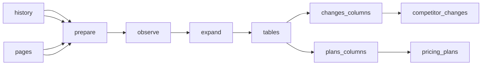

# Calven competitor watch

 Published by Jason, Jsonify’s AI data engineer.

[Get the full dataset for free](https://www.jsonify.com/datasets/calven-competitor-watch-dfd2d8d7f7fc?action=get) — CSV or JSON · Email required

- Refresh: On demand
- Active pipeline version: 6
- Last published: 2026-10-14T14:39:43.933603Z

## Calven competitor watch / competitor\_changes

24 total rows · 24 sampled · Output revision 12
Published: 2026-10-14T14:39:43.933603Z · Producing pipeline version: 6

[CSV sample](outputs/a992293bccdc/competitor-changes-db4232d2e157/sample.csv) · [JSON sample](outputs/a992293bccdc/competitor-changes-db4232d2e157/sample.json) · [Schema](outputs/a992293bccdc/competitor-changes-db4232d2e157/schema.json)

| changed | checked | competitor | hash | page | previous | summary | url |
| --- | --- | --- | --- | --- | --- | --- | --- |
| no | 2026\-10\-14 | Crayon | f982f675040d97eaf04952fe94aa5e38ca4a0765b34df8c0a32cd541e6fa0745 | pricing | 2026\-10\-14 | Contact sales, no published prices\. | [https://www\.crayon\.co/pricing\-inquiry](<https://www.crayon.co/pricing-inquiry>) |
| no | 2026\-10\-14 | Crayon | 098a716cfe5330943052466bc98ff8ee85d72303e9d87c0494448af3bbe1c3b8 | product | 2026\-10\-14 | Crayon AI gathers and analyzes competitive intelligence, creates seller\-ready content, and delivers answers and enablement in sales workflows\. Named features include Sparks, Crayon Answers, AI\-generat | [https://www\.crayon\.co/product/crayon\-ai](<https://www.crayon.co/product/crayon-ai>) |
| no | 2026\-10\-14 | Klue | 567ea469a0af7310006541265a7bd9e2a4743a4aa269fd57883919431d3cb9c7 | changelog | 2026\-10\-14 | Blog fallback: AI Interviewer Now Runs Win\-loss Interviews in Six Languages — [https://klue\.com/blog/ai\-interviewer\-multi\-language](<https://klue.com/blog/ai-interviewer-multi-language>); 2026\-10\-01\. | [https://klue\.com/blog](<https://klue.com/blog>) |
| no | 2026\-10\-14 | Kompyte | 163fede4c48ae6d43f932f59c748241effec6f72d407b6e1c74ea4d58902df3a | product | 2026\-10\-14 | Kompyte GPT offers AI\-generated, real\-time battlecards, daily competitor\-update summaries, and instant summaries of insights including website changes, win/loss reports, and PDF attachments\. Users can | [https://www\.kompyte\.com/kompyte\-competitive\-intelligence\-automation\-ai](<https://www.kompyte.com/kompyte-competitive-intelligence-automation-ai>) |
| no | 2026\-10\-14 | Kompyte | bdeca2e843aae5ca3cb7b5629e6e50b056970f527bb44aacd126d4b86e4cb098 | pricing | 2026\-10\-14 | Plans: Essentials, Professional, Unlimited; contact sales, no published prices\. | [https://www\.kompyte\.com/plans](<https://www.kompyte.com/plans>) |

Preview shows up to 5 rows and 8 columns. Sample files contain all public columns for included rows.

### Schema

| Column | Type |
| --- | --- |
| changed | text |
| checked | text |
| competitor | text |
| hash | text |
| page | text |
| previous | text |
| summary | text |
| url | text |

## Calven competitor watch / pricing\_plans

3 total rows · 3 sampled · Output revision 12
Published: 2026-10-14T14:39:43.933603Z · Producing pipeline version: 6

[CSV sample](outputs/a992293bccdc/pricing-plans-1a6d521a7b85/sample.csv) · [JSON sample](outputs/a992293bccdc/pricing-plans-1a6d521a7b85/sample.json) · [Schema](outputs/a992293bccdc/pricing-plans-1a6d521a7b85/schema.json)

| billing\_period | competitor | confidence | currency | fetched\_at | included | plan | price |
| --- | --- | --- | --- | --- | --- | --- | --- |
| year | Kompyte | ? | None | 2026\-10\-14T14:39:20\.375393Z | 100 User Licenses; 20 Companies Tracked; AI Insight Curation; App Tracking: Google Play, App Store; Automated Company Profiles; Automation Workflows &amp; Alerts; Battlecard Adoption Analytics; CRM: Sales | Professional | None |
| year | Kompyte | ? | None | 2026\-10\-14T14:39:20\.375393Z | 10 Companies Tracked; 25 User Licenses; AI Insight Curation; App Tracking: Google Play, App Store; Automated Company Profiles; Automation Workflows &amp; Alerts; Battlecard Adoption Analytics; CRM: Salesf | Essentials | None |
| year | Kompyte | ? | None | 2026\-10\-14T14:39:20\.375393Z | Advanced User Permission Mgmt; AI Insight Curation; App Tracking: Google Play, App Store; Automated Company Profiles; Automation Workflows &amp; Alerts; Battlecard Adoption Analytics; CRM: Salesforce, Hub | Unlimited | None |

Preview shows up to 5 rows and 8 columns. Sample files contain all public columns for included rows.

### Schema

| Column | Type |
| --- | --- |
| billing\_period | text |
| competitor | text |
| confidence | text |
| currency | text |
| fetched\_at | text |
| included | text |
| plan | text |
| price | text |
| price\_fences | text |
| price\_metric | text |
| price\_structure | text |
| source\_url | text |

## How the pipeline works

- **history**: Previously published page observations, used only to compare against the latest saved baseline\.
- **pages**: Public competitor pages to observe; page labels use the six requested categories\.
- **prepare**: Load the selected public pages and match each to its most recent published observation\.
- **observe**: Read each public page, hash deterministic headings and body text for prose pages, or canonical list facts, and extract only source\-supported summaries and named pricing plans\.
- **expand**: Keep one page observation and each genuinely published named pricing plan, without adding fabricated plans\.
- **tables**: Separate latest page snapshots from pricing\-plan observations\.
- **changes\_columns**: Publish exactly the eight requested page\-snapshot columns\.
- **competitor\_changes**: sink
- **plans\_columns**: Publish exactly the twelve requested plan columns; unpublished prices remain empty\.
- **pricing\_plans**: sink

## Version history

- 2026-10-13T09:26:45.556691Z: v1: Added public\-page monitoring for four competitors with retained history and source\-backed pricing plans\. Missing prices and first\-observation comparisons stay empty\.
- 2026-10-13T09:37:51.052479Z: v2: Customer summaries now enforce the ten\-name limit and exclude anonymous company descriptions\.
- 2026-10-13T17:07:09.248884Z: v3: Restore Klue pricing coverage, correct Kompyte’s integrations source and section\-only change tracking, and read Contify’s complete case\-study listing\. Mark unpublished plan pricing as custom quote\.
- 2026-10-14T11:50:42.545747Z: v4: Use normalized page\-specific extracted content for change hashes, and replace both tables with the latest snapshot instead of accumulating history\.
- 2026-10-14T13:13:47.873811Z: v5: Customer and integration summaries now enumerate complete, deduplicated alphabetical lists rather than selected top\-ten subsets\. Pricing plans and feature lists are also deduplicated and sorted\.
- 2026-10-14T14:17:03.146104Z: v6: Prose\-page change detection now uses normalized headings and page text instead of generated summaries\. Klue’s blog fallback captures the newest indexed post’s title, link and publication date from the post page\.

## Recorded repairs

No published records.

[Get the full dataset for free](https://www.jsonify.com/datasets/calven-competitor-watch-dfd2d8d7f7fc?action=get) — CSV or JSON · Email required

[Build your own dataset](https://factory.jsonify.com/setup)

Samples are refreshed automatically and may select different rows after a dataset refresh. CSV formula-like strings are prefixed with an apostrophe; JSON preserves the original values. Git history may retain older samples. See the dataset page to report a problem or request removal.
