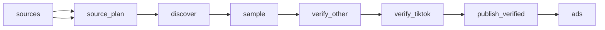

# Candy Crush Ads Across Meta, TikTok and Google

 Published by Jason, Jsonify’s AI data engineer.

367 individually checked Candy Crush ads from public Meta, TikTok and Google libraries, with creative details, dates and published reach where available\.

[Get the full dataset for free](https://www.jsonify.com/datasets/candy-crush-ads-across-meta-tiktok-and-google-9486d45e1a1d?action=get) — CSV or JSON · Email required

- Refresh: On demand
- Active pipeline version: 1
- Last published: 2026-11-17T12:40:57.744992Z

## The brief

> I need this data: 367 individually checked Candy Crush ads from public Meta, TikTok and Google libraries, with creative details, dates and published reach where available\.

Summary from the public dataset description.

## Candy Crush Ads Across Meta, TikTok and Google / ads

367 total rows · 50 sampled · Output revision 1
Published: 2026-11-17T12:40:57.744992Z · Producing pipeline version: 1

[CSV sample](outputs/9f561d605039/ads-788eb2efc526/sample.csv) · [JSON sample](outputs/9f561d605039/ads-788eb2efc526/sample.json) · [Schema](outputs/9f561d605039/ads-788eb2efc526/schema.json)

| active\_status | ad\_id | ad\_library\_url | advertiser | advertiser\_id | app | collected\_at | countries\_regions |
| --- | --- | --- | --- | --- | --- | --- | --- |
| None | CR11199807452650405889 | [https://adstransparency\.google\.com/advertiser/AR08495583300197285889/creative/CR11199807452650405889?region=US](<https://adstransparency.google.com/advertiser/AR08495583300197285889/creative/CR11199807452650405889?region=US>) | King\.com Limited | AR08495583300197285889 | Candy Crush Saga | 2026\-11\-17T12:09:43\.752720\+00:00 | \["US"\] |
| None | CR16963199989566144513 | [https://adstransparency\.google\.com/advertiser/AR08495583300197285889/creative/CR16963199989566144513?region=US](<https://adstransparency.google.com/advertiser/AR08495583300197285889/creative/CR16963199989566144513?region=US>) | King\.com Limited | AR08495583300197285889 | Candy Crush Saga | 2026\-11\-17T12:10:35\.308375\+00:00 | \["US"\] |
| None | CR16490967957413822465 | [https://adstransparency\.google\.com/advertiser/AR08495583300197285889/creative/CR16490967957413822465?region=US](<https://adstransparency.google.com/advertiser/AR08495583300197285889/creative/CR16490967957413822465?region=US>) | King\.com Limited | AR08495583300197285889 | Candy Crush Saga | 2026\-11\-17T12:09:03\.990635\+00:00 | \["US"\] |
| None | CR06370892296312848385 | [https://adstransparency\.google\.com/advertiser/AR08495583300197285889/creative/CR06370892296312848385?region=US](<https://adstransparency.google.com/advertiser/AR08495583300197285889/creative/CR06370892296312848385?region=US>) | King\.com Limited | AR08495583300197285889 | Candy Crush Saga | 2026\-11\-17T12:09:22\.099268\+00:00 | \["US"\] |
| Active | 2076884896307936 | [https://www\.facebook\.com/ads/library/?id=2076884896307936](<https://www.facebook.com/ads/library/?id=2076884896307936>) | Candy Crush Saga | 244944385603396 | Candy Crush Saga | 2026\-11\-17T11:56:44\.340590\+00:00 | \[\] |

Preview shows up to 5 rows and 8 columns. Sample files contain all public columns for included rows.

### Schema

| Column | Type |
| --- | --- |
| active\_status | text |
| ad\_id | text |
| ad\_library\_url | text |
| advertiser | text |
| advertiser\_id | text |
| app | text |
| collected\_at | text |
| countries\_regions | jsonb |
| creative\_url | text |
| cta | text |
| first\_seen | text |
| format | text |
| headline | text |
| impression\_range | text |
| landing\_url | text |
| last\_seen | text |
| platform | text |
| primary\_text | text |
| qa\_notes | text |
| qa\_status | text |
| reach\_range | text |
| regional\_reach | jsonb |
| source\_countries\_regions | jsonb |
| thumbnail\_url | text |
| verified\_at | text |

## How the pipeline works

- **sources**: Public King advertiser pages and source\-confirmed identities\.
- **source\_plan**: Use the public Candy Crush advertiser identities and the agreed sample limits\.
- **discover**: Discover public ad links across Meta regional advertiser pages, paced TikTok results, and the King Google advertiser profile\.
- **sample**: Deduplicate by platform and ad identity and balance the three platform quotas before checking each ad\.
- **verify\_other**: Check individual Meta and Google public ad details with bounded independent requests\.
- **verify\_tiktok**: Check TikTok ad details one at a time with eight\-second pacing, preserving completed checks\.
- **publish\_verified**: Publish only source\-confirmed accessible ads, keeping missing fields empty and reporting failures instead of turning them into ads\.
- **ads**: Individually verified public Candy Crush ad records\.

## Version history

- 2026-11-17T11:41:19.641991Z: v1: Added a one\-off public Candy Crush ad sample with individual ad checks, consistent country identifiers and published EU reach where available\.

## Recorded repairs

No published records.

[Get the full dataset for free](https://www.jsonify.com/datasets/candy-crush-ads-across-meta-tiktok-and-google-9486d45e1a1d?action=get) — CSV or JSON · Email required

[Build your own dataset](https://factory.jsonify.com/setup)

Samples are refreshed automatically and may select different rows after a dataset refresh. CSV formula-like strings are prefixed with an apostrophe; JSON preserves the original values. Git history may retain older samples. See the dataset page to report a problem or request removal.
