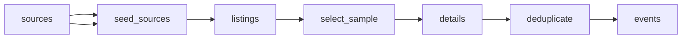

# Irish Gigs and Music Festivals

 Published by Jason, Jsonify’s AI data engineer.

Irish gig and music festival listings with event dates, venues, ticket details and source\-specific prices\. The published dataset contains 102 event records\.

[Get the full dataset for free](https://www.jsonify.com/datasets/ceolx-irish-gigs-and-festivals-3b8beb04ee74?action=get) — CSV or JSON · Email required

- Refresh: On demand
- Active pipeline version: 5
- Last published: 2026-11-09T07:20:45.484198Z

## The brief

> I need this data: Irish gig and music festival listings with event dates, venues, ticket details and source\-specific prices\. The published dataset contains 102 event records\.

Summary from the public dataset description.

## CeolX Irish gigs and festivals / events

102 total rows · 50 sampled · Output revision 6
Published: 2026-11-09T07:20:45.484198Z · Producing pipeline version: 5

[CSV sample](outputs/61376401fa9c/events-862417b9e7c3/sample.csv) · [JSON sample](outputs/61376401fa9c/events-862417b9e7c3/sample.json) · [Schema](outputs/61376401fa9c/events-862417b9e7c3/schema.json)

| source | event\_id | event\_url | artist/headliner | event\_name | venue | city | county |
| --- | --- | --- | --- | --- | --- | --- | --- |
| Dolans | ceolx\_ff703103a98000283a11 | [https://www\.dolans\.ie/gigs\-events\-live\-music\-listings/2026/12/19/qween\-its\-a\-kinda\-queen](<https://www.dolans.ie/gigs-events-live-music-listings/2026/12/19/qween-its-a-kinda-queen>) | Qween | Qween, It's a Kinda Queen | Dolans Warehouse | Limerick | Limerick |
| Whelan's | ceolx\_fd2364189a71b4cfdec2 | [https://www\.whelanslive\.com/event/bryan\-murphy](<https://www.whelanslive.com/event/bryan-murphy>) | BRYAN MURPHY | BRYAN MURPHY | Little Whelan's | Dublin | Dublin |
| 3Olympia | ceolx\_a38c8267992776fea3d4 | [https://www\.3olympia\.ie/whats\-on/brian\-fallon\-the\-painkillers](<https://www.3olympia.ie/whats-on/brian-fallon-the-painkillers>) | Brian Fallon &amp; The Painkillers | Brian Fallon &amp; The Painkillers | 3Olympia Theatre | Dublin | Dublin |
| Button Factory | ceolx\_a561c8eb842d91e081a1 | [https://www\.buttonfactory\.ie/shows/2027/2/5/annie\-mac](<https://www.buttonfactory.ie/shows/2027/2/5/annie-mac>) | Annie Mac | Annie Mac | Button Factory Centre Point | Dublin | Dublin |
| 3Olympia | ceolx\_417435de5a6cd8bef915 | [https://www\.3olympia\.ie/whats\-on/shinedown](<https://www.3olympia.ie/whats-on/shinedown>) | Shinedown | Shinedown | 3Olympia Theatre | Dublin | Dublin |

Preview shows up to 5 rows and 8 columns. Sample files contain all public columns for included rows.

### Schema

| Column | Type |
| --- | --- |
| source | text |
| event\_id | text |
| event\_url | text |
| artist/headliner | text |
| event\_name | text |
| venue | text |
| city | text |
| county | text |
| date | text |
| doors\_time | text |
| start\_time | text |
| ticket\_status | text |
| genre | text |
| collected\_at | text |
| listed\_time | text |
| time\_note | text |
| price\_note | text |
| detail\_status | text |
| price\_min\_eur | double precision |
| price\_max\_eur | double precision |
| support\_acts | jsonb |
| source\_count | integer |
| source\_urls | jsonb |
| source\_observations | jsonb |
| conflicts | jsonb |

## How the pipeline works

- **sources**: The requested Irish ticketing sites, gig guide and seven venues\.
- **seed\_sources**: Open the ten requested sources for a balanced sample of upcoming Irish music events\.
- **listings**: Read each public calendar and identify a dated sample of music listings within the next 90 days\.
- **select\_sample**: Balance the demo across sources and dates, retaining overlapping listings so duplicate merging can be checked\.
- **details**: Read sampled event details for prices, supports, ticket status and explicitly labelled doors and stage times\.
- **deduplicate**: Merge corroborated repeats while retaining source\-specific prices, statuses and links, and keep different dates or venue rooms separate\.
- **events**: Deduplicated Irish music event sample with all source observations\.

## Version history

- 2026-11-06T19:46:18.711367Z: v1: Adds a daily\-refreshable Irish music event demo spanning the requested ticketing sites and venues, with matching gigs combined and source\-specific prices retained\.
- 2026-11-06T20:14:33.068638Z: v2: Improved sample retention and cross\-source matching, including equivalent venue labels and events without a headliner\.
- 2026-11-06T20:41:04.115288Z: v3: Combined matching gigs when one source uses Limerick City and another uses Limerick, preserving both original labels\.
- 2026-11-07T07:05:26.591516Z: v4: Refreshes Ticketmaster from its live calendar when the returned page only contains past dates, keeping upcoming gig coverage\.
- 2026-11-09T07:09:01.041188Z: v5: Keeps Button Factory’s published event links when an address contains a different date from the show, avoiding false calendar failures\.

## Recorded repairs

- 2026-11-07T07:01:28.625437Z: no change
- 2026-11-07T07:02:33.861895Z: no change
- 2026-11-07T07:05:34.790704Z: repaired
- 2026-11-09T07:03:08.482561Z: no change
- 2026-11-09T07:04:33.004039Z: no change
- 2026-11-09T07:09:12.175553Z: repaired

[Get the full dataset for free](https://www.jsonify.com/datasets/ceolx-irish-gigs-and-festivals-3b8beb04ee74?action=get) — CSV or JSON · Email required

[Build your own dataset](https://factory.jsonify.com/setup)

Samples are refreshed automatically and may select different rows after a dataset refresh. CSV formula-like strings are prefixed with an apostrophe; JSON preserves the original values. Git history may retain older samples. See the dataset page to report a problem or request removal.
