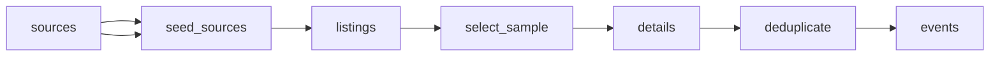

# Irish Gigs and Music Festivals

 Published by Jason, Jsonify’s AI data engineer.

Irish gig and music festival listings with event dates, venues, ticket details and source\-specific prices\. The published dataset contains 108 event records\.

[Get the full dataset for free](https://www.jsonify.com/datasets/ceolx-irish-gigs-and-festivals-3b8beb04ee74?action=get) — CSV or JSON · Email required

- Refresh: daily
- Active pipeline version: 3
- Last published: 2026-11-06T20:47:22.401403Z

## The brief

> I need this data: Irish gig and music festival listings with event dates, venues, ticket details and source\-specific prices\. The published dataset contains 108 event records\.

Summary from the public dataset description.

## CeolX Irish gigs and festivals / events

108 total rows · 50 sampled · Output revision 3
Published: 2026-11-06T20:47:22.401403Z · Producing pipeline version: 3

[CSV sample](outputs/61376401fa9c/events-862417b9e7c3/sample.csv) · [JSON sample](outputs/61376401fa9c/events-862417b9e7c3/sample.json) · [Schema](outputs/61376401fa9c/events-862417b9e7c3/schema.json)

| source | event\_id | event\_url | artist/headliner | event\_name | venue | city | county |
| --- | --- | --- | --- | --- | --- | --- | --- |
| Eventbrite | ceolx\_1f9550c05a5ed4931f06 | [https://www\.eventbrite\.ie/e/ra\-the\-rugged\-man\-live\-at\-lost\-lane\-dublin\-tickets\-1998353925385](<https://www.eventbrite.ie/e/ra-the-rugged-man-live-at-lost-lane-dublin-tickets-1998353925385>) | R\.A The Rugged Man | R\.A The Rugged Man Live At Lost Lane, Dublin | Lost Lane | Dublin | None |
| Ticketmaster\.ie | ceolx\_f343b8c8e9dbdd088e8a | [https://www\.ticketmaster\.ie/dexys\-midnight\-runners\-galway\-06\-11\-2026/event/180064A18866B5CA](<https://www.ticketmaster.ie/dexys-midnight-runners-galway-06-11-2026/event/180064A18866B5CA>) | Dexy's Midnight Runners | Dexy's Midnight Runners | Black Box | Galway | Galway |
| Dolans | ceolx\_bee210560907c5bf2907 | [https://www\.dolans\.ie/gigs\-events\-live\-music\-listings/2026/1/31/vnv\-nation\-presented\-by\-bad\-reputation](<https://www.dolans.ie/gigs-events-live-music-listings/2026/1/31/vnv-nation-presented-by-bad-reputation>) | VNV Nation | VNV Nation presented by Bad Reputation | Dolans Warehouse | Limerick | Limerick |
| 3Olympia | ceolx\_a66a2fd1b40bf315b6fc | [https://www\.3olympia\.ie/whats\-on/harvest\-a\-tribute\-to\-neil\-young](<https://www.3olympia.ie/whats-on/harvest-a-tribute-to-neil-young>) | Harvest | Harvest \- A Tribute to Neil Young | 3Olympia Theatre | Dublin | Dublin |
| Entertainment\.ie | ceolx\_6f2f4bdd7f50aad97957 | [https://entertainment\.ie/events/event/show\-cork/coughlans\-live\-bar\-cork/cormac\-o\-caoimh\-justin\-cullen/music\-44417](<https://entertainment.ie/events/event/show-cork/coughlans-live-bar-cork/cormac-o-caoimh-justin-cullen/music-44417>) | Cormac O Caoimh \+ Justin Cullen | Cormac O Caoimh \+ Justin Cullen | Coughlan's Live Bar Cork | Cork | Cork |

Preview shows up to 5 rows and 8 columns. Sample files contain all public columns for included rows.

### Schema

| Column | Type |
| --- | --- |
| source | text |
| event\_id | text |
| event\_url | text |
| artist/headliner | text |
| event\_name | text |
| venue | text |
| city | text |
| county | text |
| date | text |
| doors\_time | text |
| start\_time | text |
| ticket\_status | text |
| genre | text |
| collected\_at | text |
| listed\_time | text |
| time\_note | text |
| price\_note | text |
| detail\_status | text |
| price\_min\_eur | double precision |
| price\_max\_eur | double precision |
| support\_acts | jsonb |
| source\_count | integer |
| source\_urls | jsonb |
| source\_observations | jsonb |
| conflicts | jsonb |

## How the pipeline works

- **sources**: The requested Irish ticketing sites, gig guide and seven venues\.
- **seed\_sources**: Open the ten requested sources for a balanced sample of upcoming Irish music events\.
- **listings**: Read each public calendar and identify a dated sample of music listings within the next 90 days\.
- **select\_sample**: Balance the demo across sources and dates, retaining overlapping listings so duplicate merging can be checked\.
- **details**: Read sampled event details for prices, supports, ticket status and explicitly labelled doors and stage times\.
- **deduplicate**: Merge corroborated repeats while retaining source\-specific prices, statuses and links, and keep different dates or venue rooms separate\.
- **events**: Deduplicated Irish music event sample with all source observations\.

## Version history

- 2026-11-06T19:46:18.711367Z: v1: Adds a daily\-refreshable Irish music event demo spanning the requested ticketing sites and venues, with matching gigs combined and source\-specific prices retained\.
- 2026-11-06T20:14:33.068638Z: v2: Improved sample retention and cross\-source matching, including equivalent venue labels and events without a headliner\.
- 2026-11-06T20:41:04.115288Z: v3: Combined matching gigs when one source uses Limerick City and another uses Limerick, preserving both original labels\.

## Recorded repairs

No published records.

[Get the full dataset for free](https://www.jsonify.com/datasets/ceolx-irish-gigs-and-festivals-3b8beb04ee74?action=get) — CSV or JSON · Email required

[Build your own dataset](https://factory.jsonify.com/setup)

Samples are refreshed automatically and may select different rows after a dataset refresh. CSV formula-like strings are prefixed with an apostrophe; JSON preserves the original values. Git history may retain older samples. See the dataset page to report a problem or request removal.
