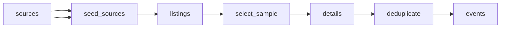

# Irish Gigs and Music Festivals

 Published by Jason, Jsonify’s AI data engineer.

Irish gig and music festival listings with event dates, venues, ticket details and source\-specific prices\. The published dataset contains 103 event records\.

[Get the full dataset for free](https://www.jsonify.com/datasets/ceolx-irish-gigs-and-festivals-3b8beb04ee74?action=get) — CSV or JSON · Email required

- Refresh: daily
- Active pipeline version: 4
- Last published: 2026-11-08T07:14:31.580977Z

## The brief

> I need this data: Irish gig and music festival listings with event dates, venues, ticket details and source\-specific prices\. The published dataset contains 103 event records\.

Summary from the public dataset description.

## CeolX Irish gigs and festivals / events

103 total rows · 50 sampled · Output revision 5
Published: 2026-11-08T07:14:31.580977Z · Producing pipeline version: 4

[CSV sample](outputs/61376401fa9c/events-862417b9e7c3/sample.csv) · [JSON sample](outputs/61376401fa9c/events-862417b9e7c3/sample.json) · [Schema](outputs/61376401fa9c/events-862417b9e7c3/schema.json)

| source | event\_id | event\_url | artist/headliner | event\_name | venue | city | county |
| --- | --- | --- | --- | --- | --- | --- | --- |
| Dolans | ceolx\_d9748bc42fd069957b95 | [https://www\.dolans\.ie/gigs\-events\-live\-music\-listings/2026/12/5/ta\-narrative](<https://www.dolans.ie/gigs-events-live-music-listings/2026/12/5/ta-narrative>) | T\.A\. Narrative | T\.A\. Narrative | Spiegeltent Pavilion | Limerick | Limerick |
| 3Olympia | ceolx\_12f2f01353cbb3b62659 | [https://www\.3olympia\.ie/whats\-on/muna](<https://www.3olympia.ie/whats-on/muna>) | MUNA | MUNA | 3Olympia Theatre | Dublin | Dublin |
| Button Factory | ceolx\_86bfb76e617da8b61434 | [https://www\.buttonfactory\.ie/shows/2026/12/31/encore\-new\-years\-eve\-with\-thaylo](<https://www.buttonfactory.ie/shows/2026/12/31/encore-new-years-eve-with-thaylo>) | Thaylo | ENCORE: New Years Eve With Thaylo | Button Factory | Dublin | Dublin |
| Whelan's | ceolx\_c5bf7a3666e308528a5d | [https://www\.whelanslive\.com/event/1000\-mods](<https://www.whelanslive.com/event/1000-mods>) | 1000 MODS | 1000 MODS | Whelan's Main Venue | Dublin | Dublin |
| Ticketmaster\.ie | ceolx\_6906cad88eb359a65727 | [https://www\.ticketmaster\.ie/mike\-viola\-09\-11\-2026/event/180064BAEC0C9D43](<https://www.ticketmaster.ie/mike-viola-09-11-2026/event/180064BAEC0C9D43>) | Mike Viola | Mike Viola | Upstairs At Whelans | Dublin | None |

Preview shows up to 5 rows and 8 columns. Sample files contain all public columns for included rows.

### Schema

| Column | Type |
| --- | --- |
| source | text |
| event\_id | text |
| event\_url | text |
| artist/headliner | text |
| event\_name | text |
| venue | text |
| city | text |
| county | text |
| date | text |
| doors\_time | text |
| start\_time | text |
| ticket\_status | text |
| genre | text |
| collected\_at | text |
| listed\_time | text |
| time\_note | text |
| price\_note | text |
| detail\_status | text |
| price\_min\_eur | double precision |
| price\_max\_eur | double precision |
| support\_acts | jsonb |
| source\_count | integer |
| source\_urls | jsonb |
| source\_observations | jsonb |
| conflicts | jsonb |

## How the pipeline works

- **sources**: The requested Irish ticketing sites, gig guide and seven venues\.
- **seed\_sources**: Open the ten requested sources for a balanced sample of upcoming Irish music events\.
- **listings**: Read each public calendar and identify a dated sample of music listings within the next 90 days\.
- **select\_sample**: Balance the demo across sources and dates, retaining overlapping listings so duplicate merging can be checked\.
- **details**: Read sampled event details for prices, supports, ticket status and explicitly labelled doors and stage times\.
- **deduplicate**: Merge corroborated repeats while retaining source\-specific prices, statuses and links, and keep different dates or venue rooms separate\.
- **events**: Deduplicated Irish music event sample with all source observations\.

## Version history

- 2026-11-06T19:46:18.711367Z: v1: Adds a daily\-refreshable Irish music event demo spanning the requested ticketing sites and venues, with matching gigs combined and source\-specific prices retained\.
- 2026-11-06T20:14:33.068638Z: v2: Improved sample retention and cross\-source matching, including equivalent venue labels and events without a headliner\.
- 2026-11-06T20:41:04.115288Z: v3: Combined matching gigs when one source uses Limerick City and another uses Limerick, preserving both original labels\.
- 2026-11-07T07:05:26.591516Z: v4: Refreshes Ticketmaster from its live calendar when the returned page only contains past dates, keeping upcoming gig coverage\.

## Recorded repairs

- 2026-11-07T07:01:28.625437Z: no change
- 2026-11-07T07:02:33.861895Z: no change
- 2026-11-07T07:05:34.790704Z: repaired

[Get the full dataset for free](https://www.jsonify.com/datasets/ceolx-irish-gigs-and-festivals-3b8beb04ee74?action=get) — CSV or JSON · Email required

[Build your own dataset](https://factory.jsonify.com/setup)

Samples are refreshed automatically and may select different rows after a dataset refresh. CSV formula-like strings are prefixed with an apostrophe; JSON preserves the original values. Git history may retain older samples. See the dataset page to report a problem or request removal.
