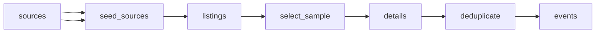

# Irish Music Events for Web Summit

 Published by Jason, Jsonify’s AI data engineer.

Irish music events for Web Summit, with event details, listed prices, source observations and reported conflicts\. The published table contains 300 event rows\.

[Get the full dataset for free](https://www.jsonify.com/datasets/ceolx-web-summit-one-off-snapshot-bcb68c9e2f16?action=get) — CSV or JSON · Email required

- Refresh: On demand
- Active pipeline version: 1
- Last published: 2026-11-09T13:20:39.971583Z

## The brief

> I need this data: Irish music events for Web Summit, with event details, listed prices, source observations and reported conflicts\. The published table contains 300 event rows\.

Summary from the public dataset description.

## CeolX · Web Summit expanded snapshot / events

300 total rows · 50 sampled · Output revision 1
Published: 2026-11-09T13:20:39.971583Z · Producing pipeline version: 1

[CSV sample](outputs/68b15c6d11d1/events-862417b9e7c3/sample.csv) · [JSON sample](outputs/68b15c6d11d1/events-862417b9e7c3/sample.json) · [Schema](outputs/68b15c6d11d1/events-862417b9e7c3/schema.json)

| source | event\_id | event\_url | artist/headliner | event\_name | venue | city | county |
| --- | --- | --- | --- | --- | --- | --- | --- |
| Entertainment\.ie | ceolx\_8f90afad2f5ba0196428 | [https://entertainment\.ie/events/event/show\-cork/coughlans\-live\-bar\-cork/woah\-mama/music\-44957](<https://entertainment.ie/events/event/show-cork/coughlans-live-bar-cork/woah-mama/music-44957>) | Woah\! Mama\! | Woah\! Mama\! | Coughlan's Live Bar Cork | Cork | Cork |
| Dolans | ceolx\_7b652937a274c37e98cc | [https://www\.dolans\.ie/gigs\-events\-live\-music\-listings/2026/11/27/pa\-sheehy](<https://www.dolans.ie/gigs-events-live-music-listings/2026/11/27/pa-sheehy>) | Pa Sheehy | Pa Sheehy | Dolans Warehouse | Limerick | Limerick |
| Róisín Dubh | ceolx\_a2a9b5823d16bd459e25 | [https://roisindubh\.net/listings/bounce\-2026\-11\-09\-200000\-81587](<https://roisindubh.net/listings/bounce-2026-11-09-200000-81587>) | Bounce | Bounce | Róisín Dubh | Galway | Galway |
| Cyprus Avenue \| Entertainment\.ie | ceolx\_7c2529b9d344d52bdc58 | [https://www\.cyprusavenue\.ie/gigs/highstool\-prophets\-11195881](<https://www.cyprusavenue.ie/gigs/highstool-prophets-11195881>) | Highstool Prophets | Highstool Prophets | Cyprus Avenue | Cork | Cork |
| Cyprus Avenue | ceolx\_711c166a8448fb643ae9 | [https://www\.cyprusavenue\.ie/gigs/dj\-jean\-11195791](<https://www.cyprusavenue.ie/gigs/dj-jean-11195791>) | DJ Jean | DJ Jean | Cyprus Avenue | Cork | Cork |

Preview shows up to 5 rows and 8 columns. Sample files contain all public columns for included rows.

### Schema

| Column | Type |
| --- | --- |
| source | text |
| event\_id | text |
| event\_url | text |
| artist/headliner | text |
| event\_name | text |
| venue | text |
| city | text |
| county | text |
| date | text |
| doors\_time | text |
| start\_time | text |
| ticket\_status | text |
| genre | text |
| collected\_at | text |
| listed\_time | text |
| time\_note | text |
| price\_note | text |
| detail\_status | text |
| price\_min\_eur | double precision |
| price\_max\_eur | double precision |
| support\_acts | jsonb |
| source\_count | integer |
| source\_urls | jsonb |
| source\_observations | jsonb |
| conflicts | jsonb |

## How the pipeline works

- **sources**: The requested Irish ticketing sites, gig guide and seven venues\.
- **seed\_sources**: Open the ten requested sources for a balanced sample of upcoming Irish music events\.
- **listings**: Read each public calendar and identify a dated sample of music listings within the next 90 days\.
- **select\_sample**: Balance the demo across sources and dates, retaining overlapping listings so duplicate merging can be checked\.
- **details**: Read sampled event details for prices, supports, ticket status and explicitly labelled doors and stage times\.
- **deduplicate**: Merge corroborated repeats while retaining source\-specific prices, statuses and links, and keep different dates or venue rooms separate\.
- **events**: Deduplicated Irish music event sample with all source observations\.

## Version history

- 2026-11-09T12:57:21.510036Z: v1: Added a separate 300\-event Irish music snapshot with expanded venue and festival coverage, source comparisons and published prices\.

## Recorded repairs

No published records.

[Get the full dataset for free](https://www.jsonify.com/datasets/ceolx-web-summit-one-off-snapshot-bcb68c9e2f16?action=get) — CSV or JSON · Email required

[Build your own dataset](https://factory.jsonify.com/setup)

Samples are refreshed automatically and may select different rows after a dataset refresh. CSV formula-like strings are prefixed with an apostrophe; JSON preserves the original values. Git history may retain older samples. See the dataset page to report a problem or request removal.
