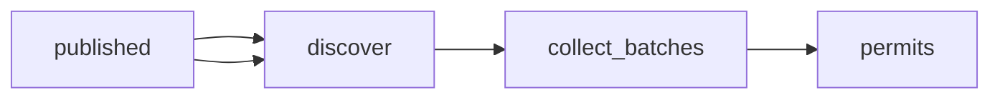

# Chicago Building Permits Data: Permits Issued

 Published by Jason, Jsonify’s AI data engineer.

Chicago building permits data with permit type, work description, reported cost, fees, address, ward and coordinates\. The published dataset contains 1,451 permit records\.

[Get the full dataset for free](https://www.jsonify.com/datasets/chicago-building-permits-e1c447fbcc9c?action=get) — CSV or JSON · Email required

- Refresh: weekly
- Active pipeline version: 2
- Last published: 2026-11-05T06:00:35.454704Z

## The brief

> I need this data: Chicago building permits data with permit type, work description, reported cost, fees, address, ward and coordinates\. The published dataset contains 1,451 permit records\.

Summary from the public dataset description.

## Chicago Building Permits / permits

1,451 total rows · 50 sampled · Output revision 4
Published: 2026-11-05T06:00:35.454704Z · Producing pipeline version: 2

[CSV sample](outputs/c9ef3e98e123/permits-f9b6938a67e1/sample.csv) · [JSON sample](outputs/c9ef3e98e123/permits-f9b6938a67e1/sample.json) · [Schema](outputs/c9ef3e98e123/permits-f9b6938a67e1/schema.json)

| address | application\_start\_date | city | community\_area | issue\_date | latitude | longitude | permit\_number |
| --- | --- | --- | --- | --- | --- | --- | --- |
| 3730 N LAKE SHORE DR | 2026\-11\-03 | Chicago | 6 | 2026\-11\-03 | 41\.9513080135466 | \-87\.64508865644889 | B200518529 |
| 37 S WABASH AVE | 2026\-10\-22 | Chicago | 32 | 2026\-11\-03 | 41\.88114721565142 | \-87\.6260347352098 | B200517060 |
| 2917 W 24TH BLVD | 2026\-07\-17 | Chicago | 30 | 2026\-11\-03 | 41\.84773300487438 | \-87\.69836553442839 | 101086102 |
| 358 S LARAMIE AVE | 2026\-11\-02 | Chicago | 25 | 2026\-11\-02 | 41\.874889043269825 | \-87\.75500825084832 | B200518417 |
| 176 N RACINE AVE | 2026\-11\-02 | Chicago | 28 | 2026\-11\-03 | 41\.88526960432706 | \-87\.65693588005684 | B200518406 |

Preview shows up to 5 rows and 8 columns. Sample files contain all public columns for included rows.

### Schema

| Column | Type |
| --- | --- |
| address | text |
| application\_start\_date | text |
| city | text |
| community\_area | bigint |
| issue\_date | text |
| latitude | double precision |
| longitude | double precision |
| permit\_number | text |
| permit\_status | text |
| permit\_type | text |
| processing\_time\_days | bigint |
| reported\_cost\_usd | double precision |
| residential\_unit\_change | text |
| review\_type | text |
| source\_url | text |
| total\_fee\_usd | double precision |
| ward | bigint |
| work\_description | text |
| work\_type | text |

## How the pipeline works

- **published**: Already saved permits; used to add only unseen permit numbers\.
- **discover**: Find unseen issued permit numbers and reserve room within the monthly limit\.
- **collect\_batches**: Save batches of up to 100 permits, preserving source values and counting unreadable or privacy\-sensitive records\.
- **permits**: One row per issued Chicago building permit; no contact columns\.

## Version history

- 2026-11-03T07:58:52.490899Z: v1: Add a private Chicago building permit collection with source\-matched fields, new\-permit\-only updates, batch saving and a monthly limit\. Scheduling remains off\.
- 2026-11-03T08:09:06.157277Z: v2: Use the latest saved permit issue date as the strict cutoff for future updates, preserving the existing fields, exclusions and monthly cap\.

## Recorded repairs

No published records.

[Get the full dataset for free](https://www.jsonify.com/datasets/chicago-building-permits-e1c447fbcc9c?action=get) — CSV or JSON · Email required

[Build your own dataset](https://factory.jsonify.com/setup)

Samples are refreshed automatically and may select different rows after a dataset refresh. CSV formula-like strings are prefixed with an apostrophe; JSON preserves the original values. Git history may retain older samples. See the dataset page to report a problem or request removal.
