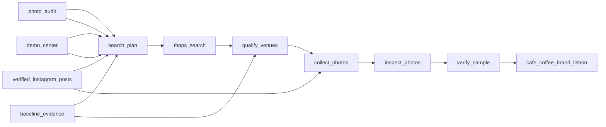

# Lisbon Coffee Brands at Street Venues

 Published by Jason, Jsonify’s AI data engineer.

Dataset of 116 Lisbon venue records with coffee brand identifications, listing details, and available photo evidence\.

[Get the full dataset for free](https://www.jsonify.com/datasets/coffee-brand-on-the-street-lisbon-poc-823f5bfb06bb?action=get) — CSV or JSON · Email required

- Refresh: On demand
- Active pipeline version: 3
- Last published: 2026-11-03T20:52:27.565877Z

## The brief

> I need this data: Dataset of 116 Lisbon venue records with coffee brand identifications, listing details, and available photo evidence\.

Summary from the public dataset description.

## cafe\_coffee\_brand\_lisbon / cafe\_coffee\_brand\_lisbon

116 total rows · 50 sampled · Output revision 2
Published: 2026-11-03T20:52:27.565877Z · Producing pipeline version: 2

[CSV sample](outputs/b39c541a129d/cafe-coffee-brand-lisbon-bbe279b222b1/sample.csv) · [JSON sample](outputs/b39c541a129d/cafe-coffee-brand-lisbon-bbe279b222b1/sample.json) · [Schema](outputs/b39c541a129d/cafe-coffee-brand-lisbon-bbe279b222b1/schema.json)

| address | baseline\_audit\_notes | baseline\_audit\_status | baseline\_brand | baseline\_supporting\_photos | best\_photo\_url | brand\_text | category |
| --- | --- | --- | --- | --- | --- | --- | --- |
| R\. Silva Carvalho 137 B, 1250\-248, Lisbon, Portugal |  | not\_audited | unknown | 0 | None |  | Bar |
| Estr\. dos Prazeres 9, 1350\-254, Lisbon, Portugal |  | not\_audited | unknown | 0 | None |  | Thai restaurant |
| Av\. Eng\. Duarte Pacheco, 1070\-103, Lisbon, Portugal |  | not\_audited | unknown | 0 | None |  | Espresso bar |
| R\. Tomás da Anunciação 1 Lj A, 1350\-321, Lisbon, Portugal |  | not\_audited | unknown | 0 | None |  | Japanese restaurant |
| R\. Silva Carvalho 209, Lisbon, Portugal |  | not\_audited | unknown | 0 | None |  | Bakery |

Preview shows up to 5 rows and 8 columns. Sample files contain all public columns for included rows.

### Schema

| Column | Type |
| --- | --- |
| address | text |
| baseline\_audit\_notes | text |
| baseline\_audit\_status | text |
| baseline\_brand | text |
| baseline\_supporting\_photos | integer |
| best\_photo\_url | text |
| brand\_text | text |
| category | text |
| center\_latitude | double precision |
| center\_longitude | double precision |
| center\_maps\_url | text |
| center\_name | text |
| center\_source\_url | text |
| coffee\_brand | text |
| confidence | text |
| conflicting\_brands | text |
| coordinate\_source | text |
| coverage\_radius\_m | integer |
| distance\_m | integer |
| evidence\_types | text |
| gallery\_candidate\_count | integer |
| latitude | double precision |
| longitude | double precision |
| maps\_url | text |
| observation\_limitations | text |
| observed\_at | text |
| photo\_evidence | jsonb |
| photo\_status | text |
| photos\_checked | integer |
| place\_id | text |
| rating | double precision |
| review\_count | integer |
| scope | text |
| source\_errors | jsonb |
| source\_summary | text |
| supplier\_status | text |
| supporting\_photos | integer |
| validation\_method | text |
| venue\_name | text |

## How the pipeline works

- **verified\_instagram\_posts**: Public posts independently matched to an exact venue by full address and visible branding; Instagram coordinates are not used\.
- **photo\_audit**: Independent direct\-pixel audit of the original 24 photos, keyed by content hash; does not assert current supply contracts\.
- **demo\_center**: Beato campus entrance matched to the official campus address and exact Maps listing\.
- **baseline\_evidence**: Preserved published Campo de Ourique version\-one rows, exact source coordinates, original photos and independent photo audit\.
- **search\_plan**: Prepare category searches near the verified Beato entrance and retain the immutable Campo de Ourique baseline\.
- **maps\_search**: Read public Maps places around Beato, retaining source coordinates, identities, ratings and photo links\.
- **qualify\_venues**: Measure source coordinates from the Beato center, keep the nearest in\-radius food venues, and preserve baseline records with explicit audit status\.
- **collect\_photos**: Add public review\-gallery photos and the verified Praça Beato bakery gallery, preferring exterior and coffee captions without retaining reviewer identities\.
- **inspect\_photos**: Inspect up to ten unique photos, require a second blind visual reading for positive brands, and retain exact photo\-level evidence, failures and dates\.
- **verify\_sample**: Check unique venue identities, preserved baseline fields and actual usable photo evidence before publication\.
- **cafe\_coffee\_brand\_lisbon**: Versioned coffee\-brand observations with source coordinates, explicit baseline audit, and nested exact photo evidence; not verified current supply contracts\.

## Version history

- 2026-11-03T20:02:37.109536Z: v1: Created a Campo de Ourique coffee\-brand sample with public Maps venue details and visual photo evidence\.
- 2026-11-03T20:43:46.790395Z: v2: Adds deeper photo evidence and a bounded Beato sample with map coordinates\. Separates unresolved photo checks from images with no visible brand and preserves the original Campo de Ourique audit\.
- 2026-11-03T21:00:19.365792Z: v3: Adds verified public Instagram cup photos to the Beato evidence and keeps stable post links alongside expiring image links\. Preserves the ten\-photo limit and source\-backed map coordinates\.

## Recorded repairs

No published records.

[Get the full dataset for free](https://www.jsonify.com/datasets/coffee-brand-on-the-street-lisbon-poc-823f5bfb06bb?action=get) — CSV or JSON · Email required

[Build your own dataset](https://factory.jsonify.com/setup)

Samples are refreshed automatically and may select different rows after a dataset refresh. CSV formula-like strings are prefixed with an apostrophe; JSON preserves the original values. Git history may retain older samples. See the dataset page to report a problem or request removal.
