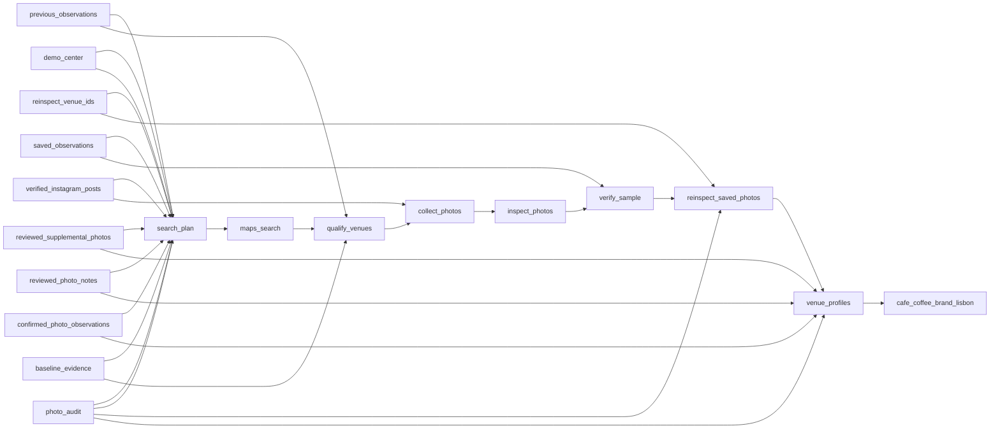

# Lisbon Coffee Brands at Street Venues

 Published by Jason, Jsonify’s AI data engineer.

Dataset with 810 rows across published tables, including 405 venue records with observed coffee brands, listing details, and photo evidence fields\.

[Get the full dataset for free](https://www.jsonify.com/datasets/coffee-brand-on-the-street-lisbon-poc-823f5bfb06bb?action=get) — CSV or JSON · Email required

- Refresh: On demand
- Active pipeline version: 17
- Last published: 2026-11-04T02:32:30.185539Z

## The brief

> I need this data: Dataset with 810 rows across published tables, including 405 venue records with observed coffee brands, listing details, and photo evidence fields\.

Summary from the public dataset description.

## Coffee brand on the street — Lisbon PoC / raw\_observations

405 total rows · 50 sampled · Output revision 6
Published: 2026-11-04T00:19:09.994141Z · Producing pipeline version: 10

[CSV sample](outputs/aa237b99a777/raw-observations-f951fd3fe3cc/sample.csv) · [JSON sample](outputs/aa237b99a777/raw-observations-f951fd3fe3cc/sample.json) · [Schema](outputs/aa237b99a777/raw-observations-f951fd3fe3cc/schema.json)

| venue\_name | address | category | rating | review\_count | maps\_url | latitude | longitude |
| --- | --- | --- | --- | --- | --- | --- | --- |
| Copenhagen Coffee Lab \- Campo de Ourique | R\. Coelho da Rocha 108, 1350\-007, Lisbon, Portugal | Coffee shop | 3\.7 | 149 | [https://www\.google\.com/maps/place/?q=place\_id:ChIJn0s4myIzGQ0RmrgYP\_9sVBE](<https://www.google.com/maps/place/?q=place_id:ChIJn0s4myIzGQ0RmrgYP_9sVBE>) | 38\.7165684 | \-9\.1670675 |
| Brasa Lisboa | R\. Castelo Branco Saraiva 95, Lisbon, 1170\-085, PT | Barbecue restaurant | 4\.9 | 346 | [https://www\.google\.com/maps/place/?q=place\_id:ChIJGfiKVQAzGQ0Rox7\-YPdLb9g](<https://www.google.com/maps/place/?q=place_id:ChIJGfiKVQAzGQ0Rox7-YPdLb9g>) | 38\.7263421 | \-9\.1241124 |
| Focaccia in Giro | Focaccia in Giro, Campo de Santa Clara 141, Lisbon, 1100\-474, PT | Ligurian restaurant, Brunch restaurant, Italian restaurant | 4\.7 | 626 | [https://www\.google\.com/maps/place/?q=place\_id:ChIJl9UL64ozGQ0R4EYkgxv\-cr0](<https://www.google.com/maps/place/?q=place_id:ChIJl9UL64ozGQ0R4EYkgxv-cr0>) | 38\.7160242 | \-9\.1251684 |
| Restaurante Peão\. | R\. Coelho da Rocha 63, 1350\-302, Lisbon, Portugal | Portuguese restaurant | 4\.3 | 69 | [https://www\.google\.com/maps/place/?q=place\_id:ChIJe0c5z24zGQ0Rfp1VJtw8FLE](<https://www.google.com/maps/place/?q=place_id:ChIJe0c5z24zGQ0Rfp1VJtw8FLE>) | 38\.716468 | \-9\.1641637 |
| Há Tapas no Mercado | PVP9\+232 Mercado de Arroios, R\. Ângela Pinto, Lisbon, 1900\-067, PT | Tapas restaurant | 4\.9 | 1346 | [https://www\.google\.com/maps/place/?q=place\_id:ChIJPxmrfL0zGQ0Rzisx5fU4fHI](<https://www.google.com/maps/place/?q=place_id:ChIJPxmrfL0zGQ0Rzisx5fU4fHI>) | 38\.7349939 | \-9\.1324003 |

Preview shows up to 5 rows and 8 columns. Sample files contain all public columns for included rows.

### Schema

| Column | Type |
| --- | --- |
| venue\_name | text |
| address | text |
| category | text |
| rating | double precision |
| review\_count | integer |
| maps\_url | text |
| latitude | double precision |
| longitude | double precision |
| place\_id | text |
| scope | text |
| distance\_m | integer |
| baseline\_brand | text |
| baseline\_audit\_status | text |
| baseline\_audit\_notes | text |
| batch\_coverage | jsonb |
| latest\_batch\_coverage | jsonb |
| gallery\_candidate\_count | integer |
| source\_errors | jsonb |
| center\_name | text |
| center\_latitude | double precision |
| center\_longitude | double precision |
| center\_maps\_url | text |
| center\_source\_url | text |
| coverage\_radius\_m | integer |
| supplier\_status | text |
| observation\_limitations | text |
| coordinate\_source | text |
| coffee\_brand | text |
| confidence | text |
| brand\_text | text |
| evidence\_types | text |
| supporting\_photos | integer |
| conflicting\_brands | text |
| best\_photo\_url | text |
| photos\_checked | integer |
| photo\_status | text |
| photo\_evidence | jsonb |
| source\_summary | text |
| observed\_at | text |
| validation\_method | text |
| baseline\_supporting\_photos | integer |
| direct\_audit\_scope | text |
| direct\_audit\_status | text |
| reviewed\_photo\_notes | jsonb |
| correction\_checked\_at | text |
| direct\_photo\_audit | jsonb |
| archived\_photo\_evidence | jsonb |
| supplemental\_source\_note | text |

## cafe\_coffee\_brand\_lisbon / cafe\_coffee\_brand\_lisbon

405 total rows · 50 sampled · Output revision 23
Published: 2026-11-04T02:32:30.185539Z · Producing pipeline version: 16

[CSV sample](outputs/b39c541a129d/cafe-coffee-brand-lisbon-bbe279b222b1/sample.csv) · [JSON sample](outputs/b39c541a129d/cafe-coffee-brand-lisbon-bbe279b222b1/sample.json) · [Schema](outputs/b39c541a129d/cafe-coffee-brand-lisbon-bbe279b222b1/schema.json)

| address | area | audit | branding\_status | category | confidence | conflicting\_brands | distance\_from\_beato\_m |
| --- | --- | --- | --- | --- | --- | --- | --- |
| R\. Custódio Vieira C, 1250\-096, Lisbon, Portugal | Campo de Ourique | \{"scope": "Campo de Ourique baseline", "rating": 4\.7, "address": "R\. Custódio Vieira C, 1250\-096, Lisbon, Portugal", "category": "Cafe", "latitude": 38\.720434499999996, "maps\_url": "[https://www\.google\.com/maps/place/?q=place\_id:ChIJQU8XoGUzGQ0Rja6\_eLcYFQE](<https://www.google.com/maps/place/?q=place_id:ChIJQU8XoGUzGQ0Rja6_eLcYFQE>)", "place\_id": "ChIJQU8XoGUzGQ0Rja6\_eLcYFQE", "longitude": \-9\.159675, "brand\_text": "CHAVE D'OURO, CHAVE D’OURO", "confidence": "medium", "distance\_m": 4681, "venue\_name": "Café D\. João V", "center\_name": "Unicorn Factory Lisboa – Beato Innovation District, entrance 1", "observed\_at": "2026\-11\-03T21:20:32\.681064\+00:00", "coffee\_brand": "other", "photo\_status": "brand\_detected", "review\_count": 95, "source\_errors": \[\], "baseline\_brand": "Nicola", "best\_photo\_url": "[https://lh3\.googleusercontent\.com/grass\-cs/AABkmLcKypGA1YQh0EpP0xWjL5HNHXSD\_IymBnE2Rlr2U8aO4xl5UbScBNGwhdpDI3qeayt2KrHU2SyMgXtupDb3XHPljlcja4Iy\-PGDGDozNT6f42LEPoGQT8eepGWi0OchFT\-gjg4E=w1200\-h1200\-k\-no](<https://lh3.googleusercontent.com/grass-cs/AABkmLcKypGA1YQh0EpP0xWjL5HNHXSD_IymBnE2Rlr2U8aO4xl5UbScBNGwhdpDI3qeayt2KrHU2SyMgXtupDb3XHPljlcja4Iy-PGDGDozNT6f42LEPoGQT8eepGWi0OchFT-gjg4E=w1200-h1200-k-no>)", "evidence\_types": "sign", "photo\_evidence": \[\{"scene": "exterior", "sha256": "03b4b8c4276ff7a38a8f13c4ffd8b6f56d5f87aa0c171505060330c59832bee0", "source": "Google Maps listing", "status": "brand\_detected", "caption": "", "photo\_url": "[https://lh3\.googleusercontent\.com/grass\-cs/AABkmLcKypGA1YQh0EpP0xWjL5HNHXSD\_IymBnE2Rlr2U8aO4xl5UbScBNGwhdpDI3qeayt2KrHU2SyMgXtupDb3XHPljlcja4Iy\-PGDGDozNT6f42LEPoGQT8eepGWi0OchFT\-gjg4E=w1200\-h1200\-k\-no](<https://lh3.googleusercontent.com/grass-cs/AABkmLcKypGA1YQh0EpP0xWjL5HNHXSD_IymBnE2Rlr2U8aO4xl5UbScBNGwhdpDI3qeayt2KrHU2SyMgXtupDb3XHPljlcja4Iy-PGDGDozNT6f42LEPoGQT8eepGWi0OchFT-gjg4E=w1200-h1200-k-no>)", "photo\_date": null, "attribution": "Photo linked by the exact venue's public Maps listing or review gallery", "source\_page": "[https://www\.google\.com/maps/place/?q=place\_id:ChIJQU8XoGUzGQ0Rja6\_eLcYFQE](<https://www.google.com/maps/place/?q=place_id:ChIJQU8XoGUzGQ0Rja6_eLcYFQE>)", "date\_meaning": "not supplied", "published\_at": null, "independent\_audit": \{"audit\_note": "Multiple readable coffee brands appear in the same photo\. Retail selection or historical signage is not proof of current supply\.", "audit\_method": "Independent direct source\-photo inspection by host \(Café D\. João V\) or Jason \(Kiosk\)", "audit\_status": "confirmed", "visible\_text": "Nicola, CHAVE D’OURO"}, "first\_observations": \[\{"brand": "Nicola", "clarity": "clear", "brand\_text": "Nicola", "identity\_type": "coffee\_brand", "evidence\_types": \["umbrella"\]}, \{"brand": "other", "clarity": "clear", "brand\_text": "Café\-Bar D\. João V", "identity\_type": "venue\_brand", "evidence\_types": \["sign", "awning"\]}\], "second\_observations": \[\{"brand": "Nicola", "clarity": "clear", "brand\_text": "Nicola", "identity\_type": "coffee\_brand", "evidence\_types": \["umbrella"\]}, \{"brand": "other", "clarity": "clear", "brand\_text": "CHAVE D'OURO", "identity\_type": "coffee\_brand", "evidence\_types": \["sign"\]}\], "accepted\_observations": \[\{"brand": "Nicola", "clarity": "clear", "brand\_text": "Nicola", "identity\_type": "coffee\_brand", "evidence\_types": \["umbrella"\]}, \{"brand": "other", "clarity": "clear", "brand\_text": "CHAVE D’OURO", "identity\_type": "coffee\_brand", "evidence\_types": \["sign"\]}\], "automated\_accepted\_observations": \[\{"brand": "Nicola", "clarity": "clear", "brand\_text": "Nicola", "identity\_type": "coffee\_brand", "evidence\_types": \["umbrella"\]}\]}, \{"scene": "exterior", "sha256": "5b9f1da6f0142475393dbac25e10a0dd836b4793320e51690a10fed78f04ba9b", "source": "Google Maps review photo", "status": "ambiguous\_or\_non\_supplier\_brand", "caption": "Fachada de Café D\. João V", "photo\_url": "[https://lh3\.googleusercontent\.com/grass\-cs/AABkmLeejIOUgUbBZXmdokjhTAeqPvs3c5DARhYeJ4h2LkBDIEypT\-\_WKDxPi2hqlqqiMy43E8W57T\-HU4h\-7zey3iF4FcG0WVyNjVSl6N1crKOBTSjhfFZ4Z4aK\-gr6YH15MgYghIupqAROcn8D=w1600\-h1600\-k\-no](<https://lh3.googleusercontent.com/grass-cs/AABkmLeejIOUgUbBZXmdokjhTAeqPvs3c5DARhYeJ4h2LkBDIEypT-_WKDxPi2hqlqqiMy43E8W57T-HU4h-7zey3iF4FcG0WVyNjVSl6N1crKOBTSjhfFZ4Z4aK-gr6YH15MgYghIupqAROcn8D=w1600-h1600-k-no>)", "photo\_date": null, "attribution": "Photo linked by the exact venue's public Maps listing or review gallery", "source\_page": "[https://www\.google\.com/maps/reviews/data=\!4m8\!14m7\!1m6\!2m5\!1sCi9DQUlRQUNvZENodHljRjlvT2tsQ05sSkxRVXA1TjBWTFZFbE9kMjV2U0RWdlNGRRAB\!2m1\!1s0x0:0x11518b778bfae8d\!3m1\!1s2@1:CAIQACodChtycF9oOklCNlJLQUp5N0VLVElOd25vSDVvSFE%7C%7C?hl=en\-US](<https://www.google.com/maps/reviews/data=!4m8!14m7!1m6!2m5!1sCi9DQUlRQUNvZENodHljRjlvT2tsQ05sSkxRVXA1TjBWTFZFbE9kMjV2U0RWdlNGRRAB!2m1!1s0x0:0x11518b778bfae8d!3m1!1s2@1:CAIQACodChtycF9oOklCNlJLQUp5N0VLVElOd25vSDVvSFE%7C%7C?hl=en-US>)", "date\_meaning": "review publication, not photo capture", "published\_at": "2026\-09\-26T17:01:48\.808Z", "first\_observations": \[\{"brand": "other", "clarity": "clear", "brand\_text": "D João V", "identity\_type": "venue\_brand", "evidence\_types": \["sign"\]}\], "second\_observations": \[\], "accepted\_observations": \[\]}, \{"scene": "food", "sha256": "4dfdc3fdb8ed8174300a56fabe318ef3b83b6a1884806fd7bce6ad158536cc85", "source": "Google Maps review photo", "status": "no\_visible\_brand", "caption": "", "photo\_url": "[https://lh3\.googleusercontent\.com/grass\-cs/AABkmLf7RgBbh4rUytyt9mMGb2AsyxHyMsJVBaM\_mhAFAfkrkQqpLP80fxwZ3prb7mnLgkKFf\-Urnl5R157wKlumfdo4olcKb0dfYOXLw1kD6LKIer\_tPW4MpY5ffrNzXTNS6o4\-zT\-8CIi7FxH\_=w1600\-h1600\-k\-no](<https://lh3.googleusercontent.com/grass-cs/AABkmLf7RgBbh4rUytyt9mMGb2AsyxHyMsJVBaM_mhAFAfkrkQqpLP80fxwZ3prb7mnLgkKFf-Urnl5R157wKlumfdo4olcKb0dfYOXLw1kD6LKIer_tPW4MpY5ffrNzXTNS6o4-zT-8CIi7FxH_=w1600-h1600-k-no>)", "photo\_date": null, "attribution": "Photo linked by the exact venue's public Maps listing or review gallery", "source\_page": "[https://www\.google\.com/maps/reviews/data=\!4m8\!14m7\!1m6\!2m5\!1sCi9DQUlRQUNvZENodHljRjlvT21reVJFRnRWemxQV1RGRmNGUnNPRFJLTkVSdE9VRRAB\!2m1\!1s0x0:0x11518b778bfae8d\!3m1\!1s2@1:CAIQACodChtycF9oOmkyREFtVzlPWTFFcFRsODRKNERtOUE%7C%7C?hl=en\-US](<https://www.google.com/maps/reviews/data=!4m8!14m7!1m6!2m5!1sCi9DQUlRQUNvZENodHljRjlvT21reVJFRnRWemxQV1RGRmNGUnNPRFJLTkVSdE9VRRAB!2m1!1s0x0:0x11518b778bfae8d!3m1!1s2@1:CAIQACodChtycF9oOmkyREFtVzlPWTFFcFRsODRKNERtOUE%7C%7C?hl=en-US>)", "date\_meaning": "review publication, not photo capture", "published\_at": "2025\-10\-01T13:50:09\.624Z", "first\_observations": \[\], "second\_observations": \[\], "accepted\_observations": \[\]}, \{"scene": "food", "sha256": "d4ef4506041eb5ea9ccf8309d1f6c95987772367a66de696decaa9462ef7d2ab", "source": "Google Maps review photo", "status": "no\_visible\_brand", "caption": "", "photo\_url": "[https://lh3\.googleusercontent\.com/grass\-cs/AABkmLfmNBp9cGL3ptZxjpDC6GwPZqS0l8jZaz1ZPPw7\_SVnyPmDNg9G1r32pFn2z8ojNh0YwFzbc7mZm9Jj9\-8cuM2dP\_IiNlh0c1YesnyYEZNWUfg\-pFLvTgFH\-BdFlg\_Feh79RYr46JczU37o=w1600\-h1600\-k\-no](<https://lh3.googleusercontent.com/grass-cs/AABkmLfmNBp9cGL3ptZxjpDC6GwPZqS0l8jZaz1ZPPw7_SVnyPmDNg9G1r32pFn2z8ojNh0YwFzbc7mZm9Jj9-8cuM2dP_IiNlh0c1YesnyYEZNWUfg-pFLvTgFH-BdFlg_Feh79RYr46JczU37o=w1600-h1600-k-no>)", "photo\_date": null, "attribution": "Photo linked by the exact venue's public Maps listing or review gallery", "source\_page": "[https://www\.google\.com/maps/reviews/data=\!4m8\!14m7\!1m6\!2m5\!1sCi9DQUlRQUNvZENodHljRjlvT2xwNGRGcG9aMVI0WnpGaWNGWm9kRXBOTTFOUk0zYxAB\!2m1\!1s0x0:0x11518b778bfae8d\!3m1\!1s2@1:CAIQACodChtycF9oOlp4dFpoZ1R4ZzFicFZodEpNM1NRM3c%7C%7C?hl=en\-US](<https://www.google.com/maps/reviews/data=!4m8!14m7!1m6!2m5!1sCi9DQUlRQUNvZENodHljRjlvT2xwNGRGcG9aMVI0WnpGaWNGWm9kRXBOTTFOUk0zYxAB!2m1!1s0x0:0x11518b778bfae8d!3m1!1s2@1:CAIQACodChtycF9oOlp4dFpoZ1R4ZzFicFZodEpNM1NRM3c%7C%7C?hl=en-US>)", "date\_meaning": "review publication, not photo capture", "published\_at": "2026\-06\-19T15:51:13\.787Z", "first\_observations": \[\], "second\_observations": \[\], "accepted\_observations": \[\]}, \{"scene": "other", "sha256": "799014049bb5920d1c04b3e8d5521bdb9e709cfe67b03cdf4eae9077ee8d4faa", "source": "Google Maps review photo", "status": "no\_visible\_brand", "caption": "", "photo\_url": "[https://lh3\.googleusercontent\.com/grass\-cs/AABkmLcNdGb1oJUKfCHMH6\-W8LVwikO1vAzU3gABb\-iXDNa33ThTm4Xyq1ukeJ\_vWtLWtxCl2eHVajfrdVnnQoYQ7AjXFB11wHVmraewQZ\_cyXi7mwBbF4\-MlYoY1nGwQTwfUtouH75y=w1600\-h1600\-k\-no](<https://lh3.googleusercontent.com/grass-cs/AABkmLcNdGb1oJUKfCHMH6-W8LVwikO1vAzU3gABb-iXDNa33ThTm4Xyq1ukeJ_vWtLWtxCl2eHVajfrdVnnQoYQ7AjXFB11wHVmraewQZ_cyXi7mwBbF4-MlYoY1nGwQTwfUtouH75y=w1600-h1600-k-no>)", "photo\_date": null, "attribution": "Photo linked by the exact venue's public Maps listing or review gallery", "source\_page": "[https://www\.google\.com/maps/reviews/data=\!4m8\!14m7\!1m6\!2m5\!1sChdDSUhNMG9nS0VJQ0FnSUNSMmEzbHRRRRAB\!2m1\!1s0x0:0x11518b778bfae8d\!3m1\!1s2@1:CIHM0ogKEICAgICR2a3ltQE%7C%7C?hl=en\-US](<https://www.google.com/maps/reviews/data=!4m8!14m7!1m6!2m5!1sChdDSUhNMG9nS0VJQ0FnSUNSMmEzbHRRRRAB!2m1!1s0x0:0x11518b778bfae8d!3m1!1s2@1:CIHM0ogKEICAgICR2a3ltQE%7C%7C?hl=en-US>)", "date\_meaning": "review publication, not photo capture", "published\_at": "2023\-04\-05T18:19:07\.788Z", "first\_observations": \[\], "second\_observations": \[\], "accepted\_observations": \[\]}, \{"scene": "coffee", "sha256": "d742d97dee650eedc9eb360a10313be465cc910c9ad59a6375fc91de321ccef6", "source": "Google Maps review photo", "status": "no\_visible\_brand", "caption": "", "photo\_url": "[https://lh3\.googleusercontent\.com/grass\-cs/AABkmLe4KDow5vf8Kvxahosj4MnXpSNtMPQBPmKvEn0FHvWlJMWJmhF0vSbKSUh2wCYGPE6u2HjqAT4PKxIjAnktFWByZ09egsuIUR5kqUM9JGnRrNP3EfwYVNB5BfZ04eeaRxUr\-8MK=w1600\-h1600\-k\-no](<https://lh3.googleusercontent.com/grass-cs/AABkmLe4KDow5vf8Kvxahosj4MnXpSNtMPQBPmKvEn0FHvWlJMWJmhF0vSbKSUh2wCYGPE6u2HjqAT4PKxIjAnktFWByZ09egsuIUR5kqUM9JGnRrNP3EfwYVNB5BfZ04eeaRxUr-8MK=w1600-h1600-k-no>)", "photo\_date": null, "attribution": "Photo linked by the exact venue's public Maps listing or review gallery", "source\_page": "[https://www\.google\.com/maps/reviews/data=\!4m8\!14m7\!1m6\!2m5\!1sChdDSUhNMG9nS0VJQ0FnSURfM2JxOXRBRRAB\!2m1\!1s0x0:0x11518b778bfae8d\!3m1\!1s2@1:CIHM0ogKEICAgID\_3bq9tAE%7C%7C?hl=en\-US](<https://www.google.com/maps/reviews/data=!4m8!14m7!1m6!2m5!1sChdDSUhNMG9nS0VJQ0FnSURfM2JxOXRBRRAB!2m1!1s0x0:0x11518b778bfae8d!3m1!1s2@1:CIHM0ogKEICAgID_3bq9tAE%7C%7C?hl=en-US>)", "date\_meaning": "review publication, not photo capture", "published\_at": "2025\-01\-26T10:53:02\.569Z", "first\_observations": \[\], "second\_observations": \[\], "accepted\_observations": \[\]}, \{"scene": "exterior", "sha256": "478816b87aafa5f655d8cefa010255e488157fe6764ffe4c33756375c17f380a", "source": "Google Maps review photo", "status": "brand\_detected", "caption": "", "photo\_url": "[https://lh3\.googleusercontent\.com/grass\-cs/AABkmLcGIAwehVhyxhTMs\-6\-Ol4WLFqJXjaSMxgxKkm0gT2ktrHui5r1YpzfQoaAjpBj7pvrROQ0boLpsCSIaTvR1V\_FCwQ4E\_93RQF4brQnWuuRDGwqh8gBBxGB4r7Fj8ALnejfMlE6=w1600\-h1600\-k\-no](<https://lh3.googleusercontent.com/grass-cs/AABkmLcGIAwehVhyxhTMs-6-Ol4WLFqJXjaSMxgxKkm0gT2ktrHui5r1YpzfQoaAjpBj7pvrROQ0boLpsCSIaTvR1V_FCwQ4E_93RQF4brQnWuuRDGwqh8gBBxGB4r7Fj8ALnejfMlE6=w1600-h1600-k-no>)", "photo\_date": null, "attribution": "Photo linked by the exact venue's public Maps listing or review gallery", "source\_page": "[https://www\.google\.com/maps/reviews/data=\!4m8\!14m7\!1m6\!2m5\!1sChdDSUhNMG9nS0VJQ0FnSUNKcDZ1M3lBRRAB\!2m1\!1s0x0:0x11518b778bfae8d\!3m1\!1s2@1:CIHM0ogKEICAgICJp6u3yAE%7C%7C?hl=en\-US](<https://www.google.com/maps/reviews/data=!4m8!14m7!1m6!2m5!1sChdDSUhNMG9nS0VJQ0FnSUNKcDZ1M3lBRRAB!2m1!1s0x0:0x11518b778bfae8d!3m1!1s2@1:CIHM0ogKEICAgICJp6u3yAE%7C%7C?hl=en-US>)", "date\_meaning": "review publication, not photo capture", "published\_at": "2023\-07\-06T12:54:28\.009Z", "first\_observations": \[\{"brand": "other", "clarity": "clear", "brand\_text": "CHAVE D'OURO", "identity\_type": "coffee\_brand", "evidence\_types": \["sign"\]}\], "second\_observations": \[\{"brand": "other", "clarity": "clear", "brand\_text": "CHAVE D'OURO", "identity\_type": "coffee\_brand", "evidence\_types": \["sign"\]}\], "accepted\_observations": \[\{"brand": "other", "clarity": "clear", "brand\_text": "CHAVE D'OURO", "identity\_type": "coffee\_brand", "evidence\_types": \["sign"\]}\]}\], "photos\_checked": 7, "source\_summary": "Google Maps listing, Google Maps review photo", "center\_latitude": 38\.730336, "center\_maps\_url": "[https://www\.google\.com/maps/place/?q=place\_id:ChIJv5GKfQ8zGQ0R0XMOOEmL1\_Q](<https://www.google.com/maps/place/?q=place_id:ChIJv5GKfQ8zGQ0R0XMOOEmL1_Q>)", "supplier\_status": "unverified", "center\_longitude": \-9\.1072324, "center\_source\_url": "[https://en\.beato\.unicornfactorylisboa\.com/](<https://en.beato.unicornfactorylisboa.com/>)", "coordinate\_source": "Google Maps exact place listing", "coverage\_radius\_m": 1000, "supporting\_photos": 2, "validation\_method": "Photo\-level human correction with exact source URL, venue identity and content hash; original automated readings retained", "conflicting\_brands": "Nicola", "direct\_audit\_scope": "Selected photo only; does not independently validate every supporting photo or current supplier\.", "direct\_photo\_audit": \{"audit\_note": "Multiple readable coffee brands appear in the same photo\. Retail selection or historical signage is not proof of current supply\.", "audit\_method": "Independent direct source\-photo inspection by host \(Café D\. João V\) or Jason \(Kiosk\)", "audit\_status": "confirmed", "visible\_text": "Nicola, CHAVE D’OURO"}, "direct\_audit\_status": "confirmed\_selected\_photo", "baseline\_audit\_notes": "Nicola umbrella and venue name both visible", "reviewed\_photo\_notes": \[\{"sha256": "03b4b8c4276ff7a38a8f13c4ffd8b6f56d5f87aa0c171505060330c59832bee0", "place\_id": "ChIJQU8XoGUzGQ0Rja6\_eLcYFQE", "photo\_url": "[https://lh3\.googleusercontent\.com/grass\-cs/AABkmLcKypGA1YQh0EpP0xWjL5HNHXSD\_IymBnE2Rlr2U8aO4xl5UbScBNGwhdpDI3qeayt2KrHU2SyMgXtupDb3XHPljlcja4Iy\-PGDGDozNT6f42LEPoGQT8eepGWi0OchFT\-gjg4E=w1200\-h1200\-k\-no](<https://lh3.googleusercontent.com/grass-cs/AABkmLcKypGA1YQh0EpP0xWjL5HNHXSD_IymBnE2Rlr2U8aO4xl5UbScBNGwhdpDI3qeayt2KrHU2SyMgXtupDb3XHPljlcja4Iy-PGDGDozNT6f42LEPoGQT8eepGWi0OchFT-gjg4E=w1200-h1200-k-no>)", "evidence\_note": "Nicola umbrella and Chave d’Ouro door sign are visible in the same historical photo\.", "named\_roaster": null}\], "baseline\_audit\_status": "confirmed", "correction\_checked\_at": "2026\-11\-04T02:32:24\.996417\+00:00", "latest\_batch\_coverage": \{"radius\_m": 3500, "new\_discovered": 18, "in\_radius\_discovered": 303, "target\_nearby\_venues": 300, "discovery\_is\_exhaustive": false, "new\_selected\_this\_batch": 18, "previous\_nearby\_retained": 285, "remaining\_discovered\_unprocessed": 0}, "gallery\_candidate\_count": 7, "observation\_limitations": "Observed branding in public imagery, not a verified current supplier contract\. Photo capture dates unknown unless explicitly sourced\. Review dates are publication dates, not capture dates\. Ranked discovery and bounded photo selection are not exhaustive\.", "baseline\_supporting\_photos": 1} | branding\_observed | Cafe | medium | Nicola | 4681 |
| R\. Ferreira Borges 47, 1350\-126, Lisbon, Portugal | Campo de Ourique | \{"scope": "Campo de Ourique baseline", "rating": 4\.7, "address": "R\. Ferreira Borges 47, 1350\-126, Lisbon, Portugal", "category": "Portuguese restaurant, Brewpub, Family restaurant, Fast food restaurant, Hamburger restaurant, Lunch restaurant", "latitude": 38\.7164295, "maps\_url": "[https://www\.google\.com/maps/place/?q=place\_id:ChIJC2UyOsgzGQ0RwyHHLg\_Uduk](<https://www.google.com/maps/place/?q=place_id:ChIJC2UyOsgzGQ0RwyHHLg_Uduk>)", "place\_id": "ChIJC2UyOsgzGQ0RwyHHLg\_Uduk", "longitude": \-9\.164178699999999, "brand\_text": "", "confidence": "low", "distance\_m": 5177, "venue\_name": "Taberna Londrina Lisboa, Campo de Ourique", "center\_name": "Unicorn Factory Lisboa – Beato Innovation District, entrance 1", "observed\_at": "2026\-11\-03T21:32:06\.861711\+00:00", "coffee\_brand": "unknown", "photo\_status": "no\_visible\_brand", "review\_count": 358, "source\_errors": \[\], "baseline\_brand": "unknown", "best\_photo\_url": null, "evidence\_types": "", "photo\_evidence": \[\{"scene": "interior", "sha256": "ed3e749c0fc1518eb5ed7c5b079c3fab1950056d2e0f26998375c468028699b6", "source": "Google Maps listing", "status": "no\_visible\_brand", "caption": "", "photo\_url": "[https://lh3\.googleusercontent\.com/grass\-cs/AABkmLcr\_PGwY4yIi0GShoLh5tz7GC9DKNH98np6mac6mj1QQ\-n\_sAkIyYSb1nqNci7my4jEfEtl7SAzDmux0fIx2wPPAFwawp\-8TRTEulxgKKb8KdNFytaVIBzUXyR1tURb1ruH\-OrtbHAvM5s=w1200\-h1200\-k\-no](<https://lh3.googleusercontent.com/grass-cs/AABkmLcr_PGwY4yIi0GShoLh5tz7GC9DKNH98np6mac6mj1QQ-n_sAkIyYSb1nqNci7my4jEfEtl7SAzDmux0fIx2wPPAFwawp-8TRTEulxgKKb8KdNFytaVIBzUXyR1tURb1ruH-OrtbHAvM5s=w1200-h1200-k-no>)", "photo\_date": null, "attribution": "Photo linked by the exact venue's public Maps listing or review gallery", "source\_page": "[https://www\.google\.com/maps/place/?q=place\_id:ChIJC2UyOsgzGQ0RwyHHLg\_Uduk](<https://www.google.com/maps/place/?q=place_id:ChIJC2UyOsgzGQ0RwyHHLg_Uduk>)", "date\_meaning": "not supplied", "published\_at": null, "first\_observations": \[\], "second\_observations": \[\], "accepted\_observations": \[\]}, \{"scene": "food", "sha256": "1208ac21a10eefbd0933950ddbfa5a09ff892ee6e31ae50ac4b8e39f2f0f4264", "source": "Google Maps listing", "status": "no\_visible\_brand", "caption": "", "photo\_url": "[https://lh3\.googleusercontent\.com/grass\-cs/AABkmLc6WO\-Tgfh6BudNSUwlv8hEA04gSllMSAqQSF8XvrHycb98S6la9b\-kEObOhXWXgw1zx7x8LVW1aOWMLSDY\_OmyydeWDBwnwaXBpw22UQ2QfK55EtgsoaEYh1oAO4u5K36p5c19E5UMCW8=w1200\-h1200\-k\-no](<https://lh3.googleusercontent.com/grass-cs/AABkmLc6WO-Tgfh6BudNSUwlv8hEA04gSllMSAqQSF8XvrHycb98S6la9b-kEObOhXWXgw1zx7x8LVW1aOWMLSDY_OmyydeWDBwnwaXBpw22UQ2QfK55EtgsoaEYh1oAO4u5K36p5c19E5UMCW8=w1200-h1200-k-no>)", "photo\_date": null, "attribution": "Photo linked by the exact venue's public Maps listing or review gallery", "source\_page": "[https://www\.google\.com/maps/place/?q=place\_id:ChIJC2UyOsgzGQ0RwyHHLg\_Uduk](<https://www.google.com/maps/place/?q=place_id:ChIJC2UyOsgzGQ0RwyHHLg_Uduk>)", "date\_meaning": "not supplied", "published\_at": null, "first\_observations": \[\], "second\_observations": \[\], "accepted\_observations": \[\]}, \{"scene": "food", "sha256": "1bd53c27e9eebab0bf7609a402080f6f66ba6596b1b6bd3ffebb3a48d5d41722", "source": "Google Maps listing", "status": "no\_visible\_brand", "caption": "", "photo\_url": "[https://lh3\.googleusercontent\.com/grass\-cs/AABkmLcJuflDALPIxBJl\-dgq7mXSp50ole5WbeY6I5sr2gYp\_gwBBJapIBPZl0DPg8UZGPhYmRAFoJzf0j5prL8s5W6qPhCMWO\_GMtDhkVseMkIVc07NitNrWhWuSVMy8kbqMeCrMBkSOWja\-bRQ=w1200\-h1200\-k\-no](<https://lh3.googleusercontent.com/grass-cs/AABkmLcJuflDALPIxBJl-dgq7mXSp50ole5WbeY6I5sr2gYp_gwBBJapIBPZl0DPg8UZGPhYmRAFoJzf0j5prL8s5W6qPhCMWO_GMtDhkVseMkIVc07NitNrWhWuSVMy8kbqMeCrMBkSOWja-bRQ=w1200-h1200-k-no>)", "photo\_date": null, "attribution": "Photo linked by the exact venue's public Maps listing or review gallery", "source\_page": "[https://www\.google\.com/maps/place/?q=place\_id:ChIJC2UyOsgzGQ0RwyHHLg\_Uduk](<https://www.google.com/maps/place/?q=place_id:ChIJC2UyOsgzGQ0RwyHHLg_Uduk>)", "date\_meaning": "not supplied", "published\_at": null, "first\_observations": \[\], "second\_observations": \[\], "accepted\_observations": \[\]}, \{"scene": "interior", "sha256": "16bcb57d40bc6f5b8b779531247cf8f0a0d22a991cb03c8d4af8764b5d2869cc", "source": "Google Maps review photo", "status": "no\_visible\_brand", "caption": "", "photo\_url": "[https://lh3\.googleusercontent\.com/grass\-cs/AABkmLdiyz2Xa07e3IH5mN\_fA2ppANYXvTsL3w9KFCuXf3D8b20gHCsiJAAvxCFdzy8PKkZSyrA3yBM\-q3cO73a86jeCgUm9FDhEsQbjzOz\-Rm2XMBe9\_I4ZEWuTP8HIo7NJQyHFtTV\_NlHZ3dnG=w1600\-h1600\-k\-no](<https://lh3.googleusercontent.com/grass-cs/AABkmLdiyz2Xa07e3IH5mN_fA2ppANYXvTsL3w9KFCuXf3D8b20gHCsiJAAvxCFdzy8PKkZSyrA3yBM-q3cO73a86jeCgUm9FDhEsQbjzOz-Rm2XMBe9_I4ZEWuTP8HIo7NJQyHFtTV_NlHZ3dnG=w1600-h1600-k-no>)", "photo\_date": null, "attribution": "Photo linked by the exact venue's public Maps listing or review gallery", "source\_page": "[https://www\.google\.com/maps/reviews/data=\!4m8\!14m7\!1m6\!2m5\!1sCi9DQUlRQUNvZENodHljRjlvT2xkRVVHbGZMVkpDWmt0RlkxaFFiSFZHUjI1NlVsRRAB\!2m1\!1s0x0:0xe976d40f2ec721c3\!3m1\!1s2@1:CAIQACodChtycF9oOldEUGlfLVJCZktFY1hQbHVGR256UlE%7C%7C?hl=en\-US](<https://www.google.com/maps/reviews/data=!4m8!14m7!1m6!2m5!1sCi9DQUlRQUNvZENodHljRjlvT2xkRVVHbGZMVkpDWmt0RlkxaFFiSFZHUjI1NlVsRRAB!2m1!1s0x0:0xe976d40f2ec721c3!3m1!1s2@1:CAIQACodChtycF9oOldEUGlfLVJCZktFY1hQbHVGR256UlE%7C%7C?hl=en-US>)", "date\_meaning": "review publication, not photo capture", "published\_at": "2026\-05\-31T19:10:33\.932Z", "first\_observations": \[\], "second\_observations": \[\], "accepted\_observations": \[\]}, \{"scene": "food", "sha256": "66920e1192366637a1d85daa4f5d11bdd6823f79964621e3904973fb443981e8", "source": "Google Maps review photo", "status": "no\_visible\_brand", "caption": "", "photo\_url": "[https://lh3\.googleusercontent\.com/grass\-cs/AABkmLctF2N8PsL60NrWbvWGyJwaBgC2VkapKQQbhvILBZ5geUU5MW3LvCX\_7ttSoS1aVLrA4rkqBykt7uJ08G\-rLWYHAF4z3Bzf0FvQ0SEqWkOvRdRdcpqDiKJgSUvUDHgbr4\_DgJWA7DqOCROW=w1600\-h1600\-k\-no](<https://lh3.googleusercontent.com/grass-cs/AABkmLctF2N8PsL60NrWbvWGyJwaBgC2VkapKQQbhvILBZ5geUU5MW3LvCX_7ttSoS1aVLrA4rkqBykt7uJ08G-rLWYHAF4z3Bzf0FvQ0SEqWkOvRdRdcpqDiKJgSUvUDHgbr4_DgJWA7DqOCROW=w1600-h1600-k-no>)", "photo\_date": null, "attribution": "Photo linked by the exact venue's public Maps listing or review gallery", "source\_page": "[https://www\.google\.com/maps/reviews/data=\!4m8\!14m7\!1m6\!2m5\!1sCi9DQUlRQUNvZENodHljRjlvT2xkRVVHbGZMVkpDWmt0RlkxaFFiSFZHUjI1NlVsRRAB\!2m1\!1s0x0:0xe976d40f2ec721c3\!3m1\!1s2@1:CAIQACodChtycF9oOldEUGlfLVJCZktFY1hQbHVGR256UlE%7C%7C?hl=en\-US](<https://www.google.com/maps/reviews/data=!4m8!14m7!1m6!2m5!1sCi9DQUlRQUNvZENodHljRjlvT2xkRVVHbGZMVkpDWmt0RlkxaFFiSFZHUjI1NlVsRRAB!2m1!1s0x0:0xe976d40f2ec721c3!3m1!1s2@1:CAIQACodChtycF9oOldEUGlfLVJCZktFY1hQbHVGR256UlE%7C%7C?hl=en-US>)", "date\_meaning": "review publication, not photo capture", "published\_at": "2026\-05\-31T19:10:33\.932Z", "first\_observations": \[\], "second\_observations": \[\], "accepted\_observations": \[\]}, \{"scene": "food", "sha256": "4af0c61ac95c6d5146aee21bf2a7c43325bc6fbd3b5efe959f7bde6e99fcae9d", "source": "Google Maps review photo", "status": "no\_visible\_brand", "caption": "", "photo\_url": "[https://lh3\.googleusercontent\.com/grass\-cs/AABkmLfrGOVRSVaRhuJ\_9QYhlLhQOWYdeg\_gtHW\_FnsZu26Syk5JyKK2kOPvIY\_dQFhcycYBQeQ0w4YGpu1NZAGdL5RlTmtE57yqnduyrlIRuCBVr58\-Wpx6D5z5pg2K8s1\_vGb09uC0MdC8R\-s=w1600\-h1600\-k\-no](<https://lh3.googleusercontent.com/grass-cs/AABkmLfrGOVRSVaRhuJ_9QYhlLhQOWYdeg_gtHW_FnsZu26Syk5JyKK2kOPvIY_dQFhcycYBQeQ0w4YGpu1NZAGdL5RlTmtE57yqnduyrlIRuCBVr58-Wpx6D5z5pg2K8s1_vGb09uC0MdC8R-s=w1600-h1600-k-no>)", "photo\_date": null, "attribution": "Photo linked by the exact venue's public Maps listing or review gallery", "source\_page": "[https://www\.google\.com/maps/reviews/data=\!4m8\!14m7\!1m6\!2m5\!1sCi9DQUlRQUNvZENodHljRjlvT2xkRVVHbGZMVkpDWmt0RlkxaFFiSFZHUjI1NlVsRRAB\!2m1\!1s0x0:0xe976d40f2ec721c3\!3m1\!1s2@1:CAIQACodChtycF9oOldEUGlfLVJCZktFY1hQbHVGR256UlE%7C%7C?hl=en\-US](<https://www.google.com/maps/reviews/data=!4m8!14m7!1m6!2m5!1sCi9DQUlRQUNvZENodHljRjlvT2xkRVVHbGZMVkpDWmt0RlkxaFFiSFZHUjI1NlVsRRAB!2m1!1s0x0:0xe976d40f2ec721c3!3m1!1s2@1:CAIQACodChtycF9oOldEUGlfLVJCZktFY1hQbHVGR256UlE%7C%7C?hl=en-US>)", "date\_meaning": "review publication, not photo capture", "published\_at": "2026\-05\-31T19:10:33\.932Z", "first\_observations": \[\], "second\_observations": \[\], "accepted\_observations": \[\]}, \{"scene": "food", "sha256": "a790fdda52f542f3211fce20ecd42de364e90922a494e9ac02b9a65fd4859e95", "source": "Google Maps review photo", "status": "no\_visible\_brand", "caption": "Egg supreme", "photo\_url": "[https://lh3\.googleusercontent\.com/grass\-cs/AABkmLfkwbHihxNoHDXL7IEsWXzDAqANSCHYt7rMyn8uQvKAYqLJz88adajmIsKrGlgz3xd53NU4SNM\_t9EPBpo4IuX0YMmrEH3\_kCiLWJ\-3BqQrF7kUUUJku3XSyq199m5W5enXMqldS3BwdQhB=w1600\-h1600\-k\-no](<https://lh3.googleusercontent.com/grass-cs/AABkmLfkwbHihxNoHDXL7IEsWXzDAqANSCHYt7rMyn8uQvKAYqLJz88adajmIsKrGlgz3xd53NU4SNM_t9EPBpo4IuX0YMmrEH3_kCiLWJ-3BqQrF7kUUUJku3XSyq199m5W5enXMqldS3BwdQhB=w1600-h1600-k-no>)", "photo\_date": null, "attribution": "Photo linked by the exact venue's public Maps listing or review gallery", "source\_page": "[https://www\.google\.com/maps/reviews/data=\!4m8\!14m7\!1m6\!2m5\!1sCi9DQUlRQUNvZENodHljRjlvT21scVFuWnRkWGxLVGxaMGNscGFha0UyYkc1dE1YYxAB\!2m1\!1s0x0:0xe976d40f2ec721c3\!3m1\!1s2@1:CAIQACodChtycF9oOmlqQnZtdXlKTlZ0clpaakE2bG5tMXc%7C%7C?hl=en\-US](<https://www.google.com/maps/reviews/data=!4m8!14m7!1m6!2m5!1sCi9DQUlRQUNvZENodHljRjlvT21scVFuWnRkWGxLVGxaMGNscGFha0UyYkc1dE1YYxAB!2m1!1s0x0:0xe976d40f2ec721c3!3m1!1s2@1:CAIQACodChtycF9oOmlqQnZtdXlKTlZ0clpaakE2bG5tMXc%7C%7C?hl=en-US>)", "date\_meaning": "review publication, not photo capture", "published\_at": "2026\-09\-29T19:54:18\.737Z", "first\_observations": \[\], "second\_observations": \[\], "accepted\_observations": \[\]}, \{"scene": "food", "sha256": "64ef4126be791ab8f311091aeb45df25c7a647f4a3d5c687d35eb4178f6a6445", "source": "Google Maps review photo", "status": "no\_visible\_brand", "caption": "", "photo\_url": "[https://lh3\.googleusercontent\.com/grass\-cs/AABkmLcTTAIFJwvCotUTneT4yIeQaHJEoxyH8fk\_Lo3Vr\_NEZmpSu5CTysbY9Asg3xCf3LWIVVBb\-rc3fbXCUBai3qh45HGAIFQwqYgMLoALCjTAL1zrY9\-6xH9byjMPmPF9KungVjTJd7A8fDK0=w1600\-h1600\-k\-no](<https://lh3.googleusercontent.com/grass-cs/AABkmLcTTAIFJwvCotUTneT4yIeQaHJEoxyH8fk_Lo3Vr_NEZmpSu5CTysbY9Asg3xCf3LWIVVBb-rc3fbXCUBai3qh45HGAIFQwqYgMLoALCjTAL1zrY9-6xH9byjMPmPF9KungVjTJd7A8fDK0=w1600-h1600-k-no>)", "photo\_date": null, "attribution": "Photo linked by the exact venue's public Maps listing or review gallery", "source\_page": "[https://www\.google\.com/maps/reviews/data=\!4m8\!14m7\!1m6\!2m5\!1sCi9DQUlRQUNvZENodHljRjlvT21scVFuWnRkWGxLVGxaMGNscGFha0UyYkc1dE1YYxAB\!2m1\!1s0x0:0xe976d40f2ec721c3\!3m1\!1s2@1:CAIQACodChtycF9oOmlqQnZtdXlKTlZ0clpaakE2bG5tMXc%7C%7C?hl=en\-US](<https://www.google.com/maps/reviews/data=!4m8!14m7!1m6!2m5!1sCi9DQUlRQUNvZENodHljRjlvT21scVFuWnRkWGxLVGxaMGNscGFha0UyYkc1dE1YYxAB!2m1!1s0x0:0xe976d40f2ec721c3!3m1!1s2@1:CAIQACodChtycF9oOmlqQnZtdXlKTlZ0clpaakE2bG5tMXc%7C%7C?hl=en-US>)", "date\_meaning": "review publication, not photo capture", "published\_at": "2026\-09\-29T19:54:18\.737Z", "first\_observations": \[\], "second\_observations": \[\], "accepted\_observations": \[\]}, \{"scene": "food", "sha256": "d415e9deef1fc479b7e4b8d9904efef3c6b5b76132a9a1fa89560f4fb0310826", "source": "Google Maps review photo", "status": "no\_visible\_brand", "caption": "Francesinha and grilled salmon ", "photo\_url": "[https://lh3\.googleusercontent\.com/grass\-cs/AABkmLe44QzCud7CxeYCyQzqzIlNxlMyR8VhXT\_bVqNhuIYXHVFha1TptbIqlGDpP83FeFpVIU5a7ht3WNyNwjjAvvLmW5BY6pALQktHOuDpMKq1WOgWsUbJFB5mOz\-INSuNy4Ht94F1rzZZ0fs=w1600\-h1600\-k\-no](<https://lh3.googleusercontent.com/grass-cs/AABkmLe44QzCud7CxeYCyQzqzIlNxlMyR8VhXT_bVqNhuIYXHVFha1TptbIqlGDpP83FeFpVIU5a7ht3WNyNwjjAvvLmW5BY6pALQktHOuDpMKq1WOgWsUbJFB5mOz-INSuNy4Ht94F1rzZZ0fs=w1600-h1600-k-no>)", "photo\_date": null, "attribution": "Photo linked by the exact venue's public Maps listing or review gallery", "source\_page": "[https://www\.google\.com/maps/reviews/data=\!4m8\!14m7\!1m6\!2m5\!1sCi9DQUlRQUNvZENodHljRjlvT21jMVZtdE5kbWd3TjBaWmVWWk5RbFZLUkRaNFQxRRAB\!2m1\!1s0x0:0xe976d40f2ec721c3\!3m1\!1s2@1:CAIQACodChtycF9oOmc1VmtNdmgwN0ZZeVZNQlVKRDZ4T1E%7C%7C?hl=en\-US](<https://www.google.com/maps/reviews/data=!4m8!14m7!1m6!2m5!1sCi9DQUlRQUNvZENodHljRjlvT21jMVZtdE5kbWd3TjBaWmVWWk5RbFZLUkRaNFQxRRAB!2m1!1s0x0:0xe976d40f2ec721c3!3m1!1s2@1:CAIQACodChtycF9oOmc1VmtNdmgwN0ZZeVZNQlVKRDZ4T1E%7C%7C?hl=en-US>)", "date\_meaning": "review publication, not photo capture", "published\_at": "2026\-07\-08T19:50:05\.860Z", "first\_observations": \[\], "second\_observations": \[\], "accepted\_observations": \[\]}, \{"scene": "food", "sha256": "cd116266e216e4d4236bffae657a68254a212c5c5ba54fd184b06fbb97792f88", "source": "Google Maps review photo", "status": "no\_visible\_brand", "caption": "", "photo\_url": "[https://lh3\.googleusercontent\.com/grass\-cs/AABkmLek1KAnHFTvraVVtjUuTeeW4SetiCUX4bVlhD\-MOBSClUrUf9x91vVTBOfnNzfOn25On\-QArQuSUSuB07VCUBGJ2GtuW64sFEvrdeQr8HNuncDoKrmbuPvZ8Nm\_8JFxc5MbMGBJ8X5sjTAv=w1600\-h1600\-k\-no](<https://lh3.googleusercontent.com/grass-cs/AABkmLek1KAnHFTvraVVtjUuTeeW4SetiCUX4bVlhD-MOBSClUrUf9x91vVTBOfnNzfOn25On-QArQuSUSuB07VCUBGJ2GtuW64sFEvrdeQr8HNuncDoKrmbuPvZ8Nm_8JFxc5MbMGBJ8X5sjTAv=w1600-h1600-k-no>)", "photo\_date": null, "attribution": "Photo linked by the exact venue's public Maps listing or review gallery", "source\_page": "[https://www\.google\.com/maps/reviews/data=\!4m8\!14m7\!1m6\!2m5\!1sCi9DQUlRQUNvZENodHljRjlvT2pSSFEyaGxSMUJmWm01UVFWZFhlalJGWTFScWNtYxAB\!2m1\!1s0x0:0xe976d40f2ec721c3\!3m1\!1s2@1:CAIQACodChtycF9oOjRHQ2hlR1BfZm5QQVdXejRFY1Rqcmc%7C%7C?hl=en\-US](<https://www.google.com/maps/reviews/data=!4m8!14m7!1m6!2m5!1sCi9DQUlRQUNvZENodHljRjlvT2pSSFEyaGxSMUJmWm01UVFWZFhlalJGWTFScWNtYxAB!2m1!1s0x0:0xe976d40f2ec721c3!3m1!1s2@1:CAIQACodChtycF9oOjRHQ2hlR1BfZm5QQVdXejRFY1Rqcmc%7C%7C?hl=en-US>)", "date\_meaning": "review publication, not photo capture", "published\_at": "2026\-05\-25T21:19:56\.776Z", "first\_observations": \[\], "second\_observations": \[\], "accepted\_observations": \[\]}\], "photos\_checked": 10, "source\_summary": "Google Maps listing, Google Maps review photo", "center\_latitude": 38\.730336, "center\_maps\_url": "[https://www\.google\.com/maps/place/?q=place\_id:ChIJv5GKfQ8zGQ0R0XMOOEmL1\_Q](<https://www.google.com/maps/place/?q=place_id:ChIJv5GKfQ8zGQ0R0XMOOEmL1_Q>)", "supplier\_status": "unverified", "center\_longitude": \-9\.1072324, "center\_source\_url": "[https://en\.beato\.unicornfactorylisboa\.com/](<https://en.beato.unicornfactorylisboa.com/>)", "coordinate\_source": "Google Maps exact place listing", "coverage\_radius\_m": 1000, "supporting\_photos": 0, "validation\_method": "Summary recomputed from previously accepted photo observations using reviewed exact brand aliases; original readings retained", "conflicting\_brands": "", "direct\_audit\_scope": "Selected photo only; does not independently validate every supporting photo or current supplier\.", "direct\_audit\_status": "unknown\_not\_supplier\_claim", "baseline\_audit\_notes": "", "reviewed\_photo\_notes": \[\], "baseline\_audit\_status": "not\_audited", "correction\_checked\_at": "2026\-11\-04T02:32:25\.162158\+00:00", "latest\_batch\_coverage": \{"radius\_m": 3500, "new\_discovered": 18, "in\_radius\_discovered": 303, "target\_nearby\_venues": 300, "discovery\_is\_exhaustive": false, "new\_selected\_this\_batch": 18, "previous\_nearby\_retained": 285, "remaining\_discovered\_unprocessed": 0}, "gallery\_candidate\_count": 37, "observation\_limitations": "Observed branding in public imagery, not a verified current supplier contract\. Photo capture dates unknown unless explicitly sourced\. Review dates are publication dates, not capture dates\. Ranked discovery and bounded photo selection are not exhaustive\.", "baseline\_supporting\_photos": 0} | no\_visible\_branding | Portuguese restaurant, Brewpub, Family restaurant, Fast food restaurant, Hamburger restaurant, Lunch restaurant | low | None | 5177 |
| R\. Coelho da Rocha 104, 1350\-075, Lisbon, Portugal | Campo de Ourique | \{"scope": "Campo de Ourique baseline", "rating": 4\.6, "address": "R\. Coelho da Rocha 104, 1350\-075, Lisbon, Portugal", "category": "Portuguese restaurant", "latitude": 38\.7165764, "maps\_url": "[https://www\.google\.com/maps/place/?q=place\_id:ChIJn2RjTGczGQ0Rlshx34xSTgI](<https://www.google.com/maps/place/?q=place_id:ChIJn2RjTGczGQ0Rlshx34xSTgI>)", "place\_id": "ChIJn2RjTGczGQ0Rlshx34xSTgI", "longitude": \-9\.1667835, "brand\_text": "", "confidence": "low", "distance\_m": 5388, "venue\_name": "Coelho da Rocha", "center\_name": "Unicorn Factory Lisboa – Beato Innovation District, entrance 1", "observed\_at": "2026\-11\-03T21:18:07\.985874\+00:00", "coffee\_brand": "unknown", "photo\_status": "no\_visible\_brand", "review\_count": 562, "source\_errors": \[\], "baseline\_brand": "illy", "best\_photo\_url": null, "evidence\_types": "", "photo\_evidence": \[\{"scene": "interior", "sha256": "09ea55636da605f3c8d52c86a83aaddaa0a9fb229856f8ae9fa9817a363db37e", "source": "Google Maps listing", "status": "no\_visible\_brand", "caption": "", "photo\_url": "[https://lh3\.googleusercontent\.com/grass\-cs/AABkmLdd8c5i71l7oB80mXFly\_nRx8NaGVwqEVRgAA0MVMktj9XapLbdtMhqeGXWWThmY\_CQSCMuf5aM\-JzTMHYodQzLAJ8woTBAR3M80ApH1scpOx\_I97z6rq48t8e8wZTHU0hIRXMF=w1200\-h1200\-k\-no](<https://lh3.googleusercontent.com/grass-cs/AABkmLdd8c5i71l7oB80mXFly_nRx8NaGVwqEVRgAA0MVMktj9XapLbdtMhqeGXWWThmY_CQSCMuf5aM-JzTMHYodQzLAJ8woTBAR3M80ApH1scpOx_I97z6rq48t8e8wZTHU0hIRXMF=w1200-h1200-k-no>)", "photo\_date": null, "attribution": "Photo linked by the exact venue's public Maps listing or review gallery", "source\_page": "[https://www\.google\.com/maps/place/?q=place\_id:ChIJn2RjTGczGQ0Rlshx34xSTgI](<https://www.google.com/maps/place/?q=place_id:ChIJn2RjTGczGQ0Rlshx34xSTgI>)", "date\_meaning": "not supplied", "published\_at": null, "independent\_audit": \{"audit\_note": "Dining tables; restaurant branded bags", "audit\_method": "Independent direct pixel inspection by Jason, not reuse of pipeline classifier output", "audit\_status": "no\_visible\_brand", "visible\_text": ""}, "first\_observations": \[\], "second\_observations": \[\], "accepted\_observations": \[\]}, \{"scene": "interior", "sha256": "d7f4540090847929aad49e263bfbd62f3a27c3faf66a20fe9171d020fff8c3bd", "source": "Google Maps listing", "status": "audit\_rejected", "caption": "", "photo\_url": "[https://lh3\.googleusercontent\.com/grass\-cs/AABkmLfwKr1MRMLqOoPa6rnUXYnN2Sy9X\-AGJ2xe4DzWsMw7VyA8YbN\_yQs3M60eVhvoMdZTHOAgSvl1kv3G4vns7j0n5fB2ZoGJPtu2lVWXRN\-h25swLJZmfwR6Kyb4HcBwHhVVhLU=w1200\-h1200\-k\-no](<https://lh3.googleusercontent.com/grass-cs/AABkmLfwKr1MRMLqOoPa6rnUXYnN2Sy9X-AGJ2xe4DzWsMw7VyA8YbN_yQs3M60eVhvoMdZTHOAgSvl1kv3G4vns7j0n5fB2ZoGJPtu2lVWXRN-h25swLJZmfwR6Kyb4HcBwHhVVhLU=w1200-h1200-k-no>)", "photo\_date": null, "attribution": "Photo linked by the exact venue's public Maps listing or review gallery", "source\_page": "[https://www\.google\.com/maps/place/?q=place\_id:ChIJn2RjTGczGQ0Rlshx34xSTgI](<https://www.google.com/maps/place/?q=place_id:ChIJn2RjTGczGQ0Rlshx34xSTgI>)", "date\_meaning": "not supplied", "published\_at": null, "independent\_audit": \{"audit\_note": "Published illy claim unsupported: no readable illy word/logo on machine; visible Coelho da Rocha is venue branding", "audit\_method": "Independent direct pixel inspection by Jason, not reuse of pipeline classifier output", "audit\_status": "incorrect", "visible\_text": ""}, "first\_observations": \[\], "second\_observations": \[\], "accepted\_observations": \[\]}, \{"scene": "food", "sha256": "b33fac43531e905ff1fbaf2e1cd6d3a4d87c9b40056a0814d3915f832f6b4b6a", "source": "Google Maps listing", "status": "no\_visible\_brand", "caption": "", "photo\_url": "[https://lh3\.googleusercontent\.com/grass\-cs/AABkmLezgW\_htkrfiCBi3d\_wjI8PqwE1GP4URV4zvOwAxeiD4whwA\-3FsejYES3\_Q80MgnL1WCg3aEqMQbKNYXbiA7Wl\-\-QoJxHsRcgjhvxf0kexXZ\-p2n5Mw0waVk9ebUxaMhbKJ60=w1200\-h1200\-k\-no](<https://lh3.googleusercontent.com/grass-cs/AABkmLezgW_htkrfiCBi3d_wjI8PqwE1GP4URV4zvOwAxeiD4whwA-3FsejYES3_Q80MgnL1WCg3aEqMQbKNYXbiA7Wl--QoJxHsRcgjhvxf0kexXZ-p2n5Mw0waVk9ebUxaMhbKJ60=w1200-h1200-k-no>)", "photo\_date": null, "attribution": "Photo linked by the exact venue's public Maps listing or review gallery", "source\_page": "[https://www\.google\.com/maps/place/?q=place\_id:ChIJn2RjTGczGQ0Rlshx34xSTgI](<https://www.google.com/maps/place/?q=place_id:ChIJn2RjTGczGQ0Rlshx34xSTgI>)", "date\_meaning": "not supplied", "published\_at": null, "independent\_audit": \{"audit\_note": "Dining tables and venue window logo", "audit\_method": "Independent direct pixel inspection by Jason, not reuse of pipeline classifier output", "audit\_status": "no\_visible\_brand", "visible\_text": ""}, "first\_observations": \[\], "second\_observations": \[\], "accepted\_observations": \[\]}, \{"scene": "exterior", "sha256": "27efa3d735a540a15f572065cbff02e985ff13cc6f3808f528bd7d62e64ed81b", "source": "Google Maps review photo", "status": "no\_visible\_brand", "caption": "", "photo\_url": "[https://lh3\.googleusercontent\.com/grass\-cs/AABkmLeBmf0alJomdmLriWo8P55IV\_9xfu0IGWiO7G07ihip91ksjGjW92qY4tfUrj4\_CAJDXsE2CVRySOtWDA7ErhTMoDh9Ld\-yM442GH2brQde0rIzZK0jdnGzOXhE1pjMk\_PipcaVcWvfXujv=w1600\-h1600\-k\-no](<https://lh3.googleusercontent.com/grass-cs/AABkmLeBmf0alJomdmLriWo8P55IV_9xfu0IGWiO7G07ihip91ksjGjW92qY4tfUrj4_CAJDXsE2CVRySOtWDA7ErhTMoDh9Ld-yM442GH2brQde0rIzZK0jdnGzOXhE1pjMk_PipcaVcWvfXujv=w1600-h1600-k-no>)", "photo\_date": null, "attribution": "Photo linked by the exact venue's public Maps listing or review gallery", "source\_page": "[https://www\.google\.com/maps/reviews/data=\!4m8\!14m7\!1m6\!2m5\!1sCi9DQUlRQUNvZENodHljRjlvT2xGNlpWWndhVWR6ZG5Kek1tbHhTblY2WlZWU1MzYxAB\!2m1\!1s0x0:0x24e528cdf71c896\!3m1\!1s2@1:CAIQACodChtycF9oOlF6ZVZwaUdzdnJzMmlxSnV6ZVVSS3c%7C%7C?hl=en\-US](<https://www.google.com/maps/reviews/data=!4m8!14m7!1m6!2m5!1sCi9DQUlRQUNvZENodHljRjlvT2xGNlpWWndhVWR6ZG5Kek1tbHhTblY2WlZWU1MzYxAB!2m1!1s0x0:0x24e528cdf71c896!3m1!1s2@1:CAIQACodChtycF9oOlF6ZVZwaUdzdnJzMmlxSnV6ZVVSS3c%7C%7C?hl=en-US>)", "date\_meaning": "review publication, not photo capture", "published\_at": "2026\-07\-08T13:35:38\.068Z", "first\_observations": \[\], "second\_observations": \[\], "accepted\_observations": \[\]}, \{"scene": "food", "sha256": "b36491ad4cbfd8c5ff8482b1d055126f918d05a34f65d79905172f09a40ca933", "source": "Google Maps review photo", "status": "no\_visible\_brand", "caption": "", "photo\_url": "[https://lh3\.googleusercontent\.com/grass\-cs/AABkmLcRR1BNj4d9zkkXW2XAF3f8VmnBZo3\_g4Re1LMJlgp\_rgEQEX4djbrDaoG2DCnNAsbYEF1mzgDC2kq6x2Wxy9LIXGTEO7XFAAOm4kJSEjoXchm7PUc6ZwSlJTuxnNSiGd7gTyGXMmnIJpm\-=w1600\-h1600\-k\-no](<https://lh3.googleusercontent.com/grass-cs/AABkmLcRR1BNj4d9zkkXW2XAF3f8VmnBZo3_g4Re1LMJlgp_rgEQEX4djbrDaoG2DCnNAsbYEF1mzgDC2kq6x2Wxy9LIXGTEO7XFAAOm4kJSEjoXchm7PUc6ZwSlJTuxnNSiGd7gTyGXMmnIJpm-=w1600-h1600-k-no>)", "photo\_date": null, "attribution": "Photo linked by the exact venue's public Maps listing or review gallery", "source\_page": "[https://www\.google\.com/maps/reviews/data=\!4m8\!14m7\!1m6\!2m5\!1sCi9DQUlRQUNvZENodHljRjlvT2xGNlpWWndhVWR6ZG5Kek1tbHhTblY2WlZWU1MzYxAB\!2m1\!1s0x0:0x24e528cdf71c896\!3m1\!1s2@1:CAIQACodChtycF9oOlF6ZVZwaUdzdnJzMmlxSnV6ZVVSS3c%7C%7C?hl=en\-US](<https://www.google.com/maps/reviews/data=!4m8!14m7!1m6!2m5!1sCi9DQUlRQUNvZENodHljRjlvT2xGNlpWWndhVWR6ZG5Kek1tbHhTblY2WlZWU1MzYxAB!2m1!1s0x0:0x24e528cdf71c896!3m1!1s2@1:CAIQACodChtycF9oOlF6ZVZwaUdzdnJzMmlxSnV6ZVVSS3c%7C%7C?hl=en-US>)", "date\_meaning": "review publication, not photo capture", "published\_at": "2026\-07\-08T13:35:38\.068Z", "first\_observations": \[\], "second\_observations": \[\], "accepted\_observations": \[\]}, \{"scene": "food", "sha256": "22946967b4491ad94921014ee8386a163d5be92aa88bf80c27998da5375bb286", "source": "Google Maps review photo", "status": "no\_visible\_brand", "caption": "", "photo\_url": "[https://lh3\.googleusercontent\.com/grass\-cs/AABkmLfqSkjxnbp1M0hmE7piu8oZfQPFwTVbGh6xCiX1LEEV2QiSvZA2FghcPPIcwFpLSH\_gJVJSaRH5xUzd47ca0IxSCLWgt5HUjmkiwicZWL9MnESPSQJLDXFoHuO\-KibvZ31O6pB4\-PRe0Dg=w1600\-h1600\-k\-no](<https://lh3.googleusercontent.com/grass-cs/AABkmLfqSkjxnbp1M0hmE7piu8oZfQPFwTVbGh6xCiX1LEEV2QiSvZA2FghcPPIcwFpLSH_gJVJSaRH5xUzd47ca0IxSCLWgt5HUjmkiwicZWL9MnESPSQJLDXFoHuO-KibvZ31O6pB4-PRe0Dg=w1600-h1600-k-no>)", "photo\_date": null, "attribution": "Photo linked by the exact venue's public Maps listing or review gallery", "source\_page": "[https://www\.google\.com/maps/reviews/data=\!4m8\!14m7\!1m6\!2m5\!1sCi9DQUlRQUNvZENodHljRjlvT2xGNlpWWndhVWR6ZG5Kek1tbHhTblY2WlZWU1MzYxAB\!2m1\!1s0x0:0x24e528cdf71c896\!3m1\!1s2@1:CAIQACodChtycF9oOlF6ZVZwaUdzdnJzMmlxSnV6ZVVSS3c%7C%7C?hl=en\-US](<https://www.google.com/maps/reviews/data=!4m8!14m7!1m6!2m5!1sCi9DQUlRQUNvZENodHljRjlvT2xGNlpWWndhVWR6ZG5Kek1tbHhTblY2WlZWU1MzYxAB!2m1!1s0x0:0x24e528cdf71c896!3m1!1s2@1:CAIQACodChtycF9oOlF6ZVZwaUdzdnJzMmlxSnV6ZVVSS3c%7C%7C?hl=en-US>)", "date\_meaning": "review publication, not photo capture", "published\_at": "2026\-07\-08T13:35:38\.068Z", "first\_observations": \[\], "second\_observations": \[\], "accepted\_observations": \[\]}, \{"scene": "food", "sha256": "c63173cef03d8d4e551585b5ce03d8c35ed4d22b83b510b2fc72de6bd4d29a2d", "source": "Google Maps review photo", "status": "no\_visible\_brand", "caption": "", "photo\_url": "[https://lh3\.googleusercontent\.com/grass\-cs/AABkmLdU99yQaXbNqZOsm\-5gdokvzZOkIj7iwUxMbkoLeBp8Px1AnMUnmkMel3wdW\-X4UeoUEeZdsnYgoG5XLwsh4Zt4\_XMLfqRIV8FlXWkFGvob\_NYRB21R5BW\_LnM4N0oB7e4WLNgVuDXb\-Tkc=w1600\-h1600\-k\-no](<https://lh3.googleusercontent.com/grass-cs/AABkmLdU99yQaXbNqZOsm-5gdokvzZOkIj7iwUxMbkoLeBp8Px1AnMUnmkMel3wdW-X4UeoUEeZdsnYgoG5XLwsh4Zt4_XMLfqRIV8FlXWkFGvob_NYRB21R5BW_LnM4N0oB7e4WLNgVuDXb-Tkc=w1600-h1600-k-no>)", "photo\_date": null, "attribution": "Photo linked by the exact venue's public Maps listing or review gallery", "source\_page": "[https://www\.google\.com/maps/reviews/data=\!4m8\!14m7\!1m6\!2m5\!1sCi9DQUlRQUNvZENodHljRjlvT2xGNlpWWndhVWR6ZG5Kek1tbHhTblY2WlZWU1MzYxAB\!2m1\!1s0x0:0x24e528cdf71c896\!3m1\!1s2@1:CAIQACodChtycF9oOlF6ZVZwaUdzdnJzMmlxSnV6ZVVSS3c%7C%7C?hl=en\-US](<https://www.google.com/maps/reviews/data=!4m8!14m7!1m6!2m5!1sCi9DQUlRQUNvZENodHljRjlvT2xGNlpWWndhVWR6ZG5Kek1tbHhTblY2WlZWU1MzYxAB!2m1!1s0x0:0x24e528cdf71c896!3m1!1s2@1:CAIQACodChtycF9oOlF6ZVZwaUdzdnJzMmlxSnV6ZVVSS3c%7C%7C?hl=en-US>)", "date\_meaning": "review publication, not photo capture", "published\_at": "2026\-07\-08T13:35:38\.068Z", "first\_observations": \[\], "second\_observations": \[\], "accepted\_observations": \[\]}, \{"scene": "food", "sha256": "b0acf9df70baa48d87b9911c9bee5351cee7eb5b9c690a52f711f9f0d803f5c1", "source": "Google Maps review photo", "status": "no\_visible\_brand", "caption": "", "photo\_url": "[https://lh3\.googleusercontent\.com/grass\-cs/AABkmLe6v2yTLJ\-s4HNm2TdMNOx36tkkRS9Q8wMvtZsAGPaEJnTIcKR9AubwwDrKp6EOUrurq6HLFE\_ctwsnRu\-rKce76Qau6GWP0g\-VEHTMWBg02GQhOtysH8GfyMxMHD\_OtQsqrjypQzhkt4I=w1600\-h1600\-k\-no](<https://lh3.googleusercontent.com/grass-cs/AABkmLe6v2yTLJ-s4HNm2TdMNOx36tkkRS9Q8wMvtZsAGPaEJnTIcKR9AubwwDrKp6EOUrurq6HLFE_ctwsnRu-rKce76Qau6GWP0g-VEHTMWBg02GQhOtysH8GfyMxMHD_OtQsqrjypQzhkt4I=w1600-h1600-k-no>)", "photo\_date": null, "attribution": "Photo linked by the exact venue's public Maps listing or review gallery", "source\_page": "[https://www\.google\.com/maps/reviews/data=\!4m8\!14m7\!1m6\!2m5\!1sCi9DQUlRQUNvZENodHljRjlvT2xGNlpWWndhVWR6ZG5Kek1tbHhTblY2WlZWU1MzYxAB\!2m1\!1s0x0:0x24e528cdf71c896\!3m1\!1s2@1:CAIQACodChtycF9oOlF6ZVZwaUdzdnJzMmlxSnV6ZVVSS3c%7C%7C?hl=en\-US](<https://www.google.com/maps/reviews/data=!4m8!14m7!1m6!2m5!1sCi9DQUlRQUNvZENodHljRjlvT2xGNlpWWndhVWR6ZG5Kek1tbHhTblY2WlZWU1MzYxAB!2m1!1s0x0:0x24e528cdf71c896!3m1!1s2@1:CAIQACodChtycF9oOlF6ZVZwaUdzdnJzMmlxSnV6ZVVSS3c%7C%7C?hl=en-US>)", "date\_meaning": "review publication, not photo capture", "published\_at": "2026\-07\-08T13:35:38\.068Z", "first\_observations": \[\], "second\_observations": \[\], "accepted\_observations": \[\]}, \{"scene": "food", "sha256": "473c34f4e147bd48a6f80b390f1a4e162ec8b826c0e81d58690f9a0ae595365c", "source": "Google Maps review photo", "status": "no\_visible\_brand", "caption": "", "photo\_url": "[https://lh3\.googleusercontent\.com/grass\-cs/AABkmLdCOvgE6IcxYPw9jzgB4UCnkGcjnYTFB9RcyRUvZqYXXpNESYE43rPWESVh\_WXRY2TiMfQMm0\_l0\-sbkyt1E49ayy7F8bRJn0jze5F1C65WRecAnUhfJEhK269mmw9oJbP1DayB2xJJOzMy=w1600\-h1600\-k\-no](<https://lh3.googleusercontent.com/grass-cs/AABkmLdCOvgE6IcxYPw9jzgB4UCnkGcjnYTFB9RcyRUvZqYXXpNESYE43rPWESVh_WXRY2TiMfQMm0_l0-sbkyt1E49ayy7F8bRJn0jze5F1C65WRecAnUhfJEhK269mmw9oJbP1DayB2xJJOzMy=w1600-h1600-k-no>)", "photo\_date": null, "attribution": "Photo linked by the exact venue's public Maps listing or review gallery", "source\_page": "[https://www\.google\.com/maps/reviews/data=\!4m8\!14m7\!1m6\!2m5\!1sCi9DQUlRQUNvZENodHljRjlvT2xGNlpWWndhVWR6ZG5Kek1tbHhTblY2WlZWU1MzYxAB\!2m1\!1s0x0:0x24e528cdf71c896\!3m1\!1s2@1:CAIQACodChtycF9oOlF6ZVZwaUdzdnJzMmlxSnV6ZVVSS3c%7C%7C?hl=en\-US](<https://www.google.com/maps/reviews/data=!4m8!14m7!1m6!2m5!1sCi9DQUlRQUNvZENodHljRjlvT2xGNlpWWndhVWR6ZG5Kek1tbHhTblY2WlZWU1MzYxAB!2m1!1s0x0:0x24e528cdf71c896!3m1!1s2@1:CAIQACodChtycF9oOlF6ZVZwaUdzdnJzMmlxSnV6ZVVSS3c%7C%7C?hl=en-US>)", "date\_meaning": "review publication, not photo capture", "published\_at": "2026\-07\-08T13:35:38\.068Z", "first\_observations": \[\], "second\_observations": \[\], "accepted\_observations": \[\]}, \{"scene": "food", "sha256": "c59e863a88a64b93bbada77ed46187cc4298f1c09f4cc955b3ae7b4d596f8d11", "source": "Google Maps review photo", "status": "no\_visible\_brand", "caption": "", "photo\_url": "[https://lh3\.googleusercontent\.com/grass\-cs/AABkmLegAQvHKuEHg8a82tR\_WlhSd2UAAueyAPbvv6RkI7Jx7lxCfQ7GJo3XdxJFD7Ii4FN1fayc5c\-8pcHP1qCl4bCM3n\-3TRdkqQijjAqve4fBc5njp797iU6oP8JHY2Zm5Q9OwP3Do06PKz4=w1600\-h1600\-k\-no](<https://lh3.googleusercontent.com/grass-cs/AABkmLegAQvHKuEHg8a82tR_WlhSd2UAAueyAPbvv6RkI7Jx7lxCfQ7GJo3XdxJFD7Ii4FN1fayc5c-8pcHP1qCl4bCM3n-3TRdkqQijjAqve4fBc5njp797iU6oP8JHY2Zm5Q9OwP3Do06PKz4=w1600-h1600-k-no>)", "photo\_date": null, "attribution": "Photo linked by the exact venue's public Maps listing or review gallery", "source\_page": "[https://www\.google\.com/maps/reviews/data=\!4m8\!14m7\!1m6\!2m5\!1sCi9DQUlRQUNvZENodHljRjlvT21oc1YwOXNWVTlPV0RFNGRVOW1ha1E0TjJjNFptYxAB\!2m1\!1s0x0:0x24e528cdf71c896\!3m1\!1s2@1:CAIQACodChtycF9oOmhsV09sVU9OWDE4dU9makQ4N2c4Zmc%7C%7C?hl=en\-US](<https://www.google.com/maps/reviews/data=!4m8!14m7!1m6!2m5!1sCi9DQUlRQUNvZENodHljRjlvT21oc1YwOXNWVTlPV0RFNGRVOW1ha1E0TjJjNFptYxAB!2m1!1s0x0:0x24e528cdf71c896!3m1!1s2@1:CAIQACodChtycF9oOmhsV09sVU9OWDE4dU9makQ4N2c4Zmc%7C%7C?hl=en-US>)", "date\_meaning": "review publication, not photo capture", "published\_at": "2026\-01\-26T00:23:54\.446Z", "first\_observations": \[\], "second\_observations": \[\], "accepted\_observations": \[\]}\], "photos\_checked": 10, "source\_summary": "Google Maps listing, Google Maps review photo", "center\_latitude": 38\.730336, "center\_maps\_url": "[https://www\.google\.com/maps/place/?q=place\_id:ChIJv5GKfQ8zGQ0R0XMOOEmL1\_Q](<https://www.google.com/maps/place/?q=place_id:ChIJv5GKfQ8zGQ0R0XMOOEmL1_Q>)", "supplier\_status": "unverified", "center\_longitude": \-9\.1072324, "center\_source\_url": "[https://en\.beato\.unicornfactorylisboa\.com/](<https://en.beato.unicornfactorylisboa.com/>)", "coordinate\_source": "Google Maps exact place listing", "coverage\_radius\_m": 1000, "supporting\_photos": 0, "validation\_method": "Summary recomputed from previously accepted photo observations using reviewed exact brand aliases; original readings retained", "conflicting\_brands": "", "direct\_audit\_scope": "Selected photo only; does not independently validate every supporting photo or current supplier\.", "direct\_audit\_status": "unknown\_not\_supplier\_claim", "baseline\_audit\_notes": "Dining tables; restaurant branded bags \| Published illy claim unsupported: no readable illy word/logo on machine; visible Coelho da Rocha is venue branding \| Dining tables and venue window logo", "reviewed\_photo\_notes": \[\], "baseline\_audit\_status": "incorrect", "correction\_checked\_at": "2026\-11\-04T02:32:24\.948280\+00:00", "latest\_batch\_coverage": \{"radius\_m": 3500, "new\_discovered": 18, "in\_radius\_discovered": 303, "target\_nearby\_venues": 300, "discovery\_is\_exhaustive": false, "new\_selected\_this\_batch": 18, "previous\_nearby\_retained": 285, "remaining\_discovered\_unprocessed": 0}, "gallery\_candidate\_count": 55, "observation\_limitations": "Observed branding in public imagery, not a verified current supplier contract\. Photo capture dates unknown unless explicitly sourced\. Review dates are publication dates, not capture dates\. Ranked discovery and bounded photo selection are not exhaustive\.", "baseline\_supporting\_photos": 1} | no\_visible\_branding | Portuguese restaurant | low | None | 5388 |
| Beco do Recolhimento 5 7\-9, Lisbon, 1100\-244, PT | Beato | \{"scope": "Beato radius sample", "rating": 4\.9, "address": "Beco do Recolhimento 5 7\-9, Lisbon, 1100\-244, PT", "category": "Restaurant, Breakfast restaurant, Brunch restaurant, Cafe, Cocktail bar, Coffee shop, Dessert restaurant, Lunch restaurant, Vegan restaurant, Vegetarian restaurant", "latitude": 38\.7127792, "maps\_url": "[https://www\.google\.com/maps/place/?q=place\_id:ChIJ3RVSTHE1GQ0RsNLBSGeNc5o](<https://www.google.com/maps/place/?q=place_id:ChIJ3RVSTHE1GQ0RsNLBSGeNc5o>)", "place\_id": "ChIJ3RVSTHE1GQ0RsNLBSGeNc5o", "longitude": \-9\.1322867, "brand\_text": "", "confidence": "low", "distance\_m": 2922, "venue\_name": "LUDO'S", "center\_name": "Unicorn Factory Lisboa – Beato Innovation District, entrance 1", "observed\_at": "2026\-11\-03T23:35:37\.296261\+00:00", "coffee\_brand": "unknown", "photo\_status": "no\_visible\_brand", "review\_count": 1586, "source\_errors": \[\], "baseline\_brand": null, "batch\_coverage": \{"radius\_m": 3500, "new\_discovered": 118, "in\_radius\_discovered": 303, "target\_nearby\_venues": 300, "discovery\_is\_exhaustive": false, "new\_selected\_this\_batch": 100, "previous\_nearby\_retained": 185, "remaining\_discovered\_unprocessed": 18}, "best\_photo\_url": null, "evidence\_types": "", "photo\_evidence": \[\{"scene": "food", "sha256": "b3d2ceef84ebaac1e8f25ee14f742f9153018b67a9339f94e1b72aa25f93a17a", "source": "Google Maps listing", "status": "no\_visible\_brand", "caption": "", "photo\_url": "[https://lh3\.googleusercontent\.com/grass\-cs/AABkmLeC\_VcK6JyihoHBfcy7uSNLvVtWJ1sqsiwWZ6AA\_B\_hSCy8NGzDuMw49nXV8P\_BN0uWBaHkPRUACf15tbubhDuezLLsadrGZdWHxfZLHLTGA7fy\_tkCBFB9u8mc358HWKgHTS6Duw=w408\-h306\-k\-no](<https://lh3.googleusercontent.com/grass-cs/AABkmLeC_VcK6JyihoHBfcy7uSNLvVtWJ1sqsiwWZ6AA_B_hSCy8NGzDuMw49nXV8P_BN0uWBaHkPRUACf15tbubhDuezLLsadrGZdWHxfZLHLTGA7fy_tkCBFB9u8mc358HWKgHTS6Duw=w408-h306-k-no>)", "photo\_date": null, "attribution": "Photo linked by the exact venue's public Maps listing or review gallery", "source\_page": "[https://www\.google\.com/maps/place/?q=place\_id:ChIJ3RVSTHE1GQ0RsNLBSGeNc5o](<https://www.google.com/maps/place/?q=place_id:ChIJ3RVSTHE1GQ0RsNLBSGeNc5o>)", "date\_meaning": "not supplied", "published\_at": null, "first\_observations": \[\], "second\_observations": \[\], "accepted\_observations": \[\]}, \{"scene": "interior", "sha256": "4c10b39cc16878882e0346fb51eb227bebb34ab8fa001208d7ad2afa849eeff7", "source": "Google Maps review photo", "status": "no\_visible\_brand", "caption": "Entrance with marble cafe tables", "photo\_url": "[https://lh3\.googleusercontent\.com/grass\-cs/AABkmLf57fECK6zy76\_Twm71GfAGj9AQKIGe9L6YejZP\-M0ImFj0rFv8v\-fhpcHkwAp8CkXDJwOFfCEzkecqZMg4brU\_bO9GizaPhk8pHck5NVlz321WPUjvSLO8FKi8\-oVP3dTdt6q8E3BdBvE=w1600\-h1600\-k\-no](<https://lh3.googleusercontent.com/grass-cs/AABkmLf57fECK6zy76_Twm71GfAGj9AQKIGe9L6YejZP-M0ImFj0rFv8v-fhpcHkwAp8CkXDJwOFfCEzkecqZMg4brU_bO9GizaPhk8pHck5NVlz321WPUjvSLO8FKi8-oVP3dTdt6q8E3BdBvE=w1600-h1600-k-no>)", "photo\_date": null, "attribution": "Photo linked by the exact venue's public Maps listing or review gallery", "source\_page": "[https://www\.google\.com/maps/reviews/data=\!4m8\!14m7\!1m6\!2m5\!1sCi9DQUlRQUNvZENodHljRjlvT25SQ2FESjNVM2c0U2w5WFlVVTVZbDlZTjNwME9FRRAB\!2m1\!1s0x0:0x9a738d6748c1d2b0\!3m1\!1s2@1:CAIQACodChtycF9oOnRCaDJ3U3g4Sl9XYUU5Yl9YN3p0OEE%7C%7C?hl=en\-US](<https://www.google.com/maps/reviews/data=!4m8!14m7!1m6!2m5!1sCi9DQUlRQUNvZENodHljRjlvT25SQ2FESjNVM2c0U2w5WFlVVTVZbDlZTjNwME9FRRAB!2m1!1s0x0:0x9a738d6748c1d2b0!3m1!1s2@1:CAIQACodChtycF9oOnRCaDJ3U3g4Sl9XYUU5Yl9YN3p0OEE%7C%7C?hl=en-US>)", "date\_meaning": "review publication, not photo capture", "published\_at": "2026\-08\-05T20:52:30\.952Z", "first\_observations": \[\], "second\_observations": \[\], "accepted\_observations": \[\]}, \{"scene": "exterior", "sha256": "ee9d95098976900f91852be200000ba0064dfce75ba21fbdf345b0164d02ac22", "source": "Google Maps review photo", "status": "no\_visible\_brand", "caption": "Outside view", "photo\_url": "[https://lh3\.googleusercontent\.com/grass\-cs/AABkmLfeTfGK3lvMKVRFXyI7VSFNpDoFOwx7bXZidEuHdEKNvstn4N\-Bvry\_A4xWPGpsFOtAu3vOgYd1Cg0xCwNcAXuak67q3T\-lU\_HYFeprpBjM5XlUYRz7bLTV1vxblI\_WRh7\-orTa487G\-7lK=w1600\-h1600\-k\-no](<https://lh3.googleusercontent.com/grass-cs/AABkmLfeTfGK3lvMKVRFXyI7VSFNpDoFOwx7bXZidEuHdEKNvstn4N-Bvry_A4xWPGpsFOtAu3vOgYd1Cg0xCwNcAXuak67q3T-lU_HYFeprpBjM5XlUYRz7bLTV1vxblI_WRh7-orTa487G-7lK=w1600-h1600-k-no>)", "photo\_date": null, "attribution": "Photo linked by the exact venue's public Maps listing or review gallery", "source\_page": "[https://www\.google\.com/maps/reviews/data=\!4m8\!14m7\!1m6\!2m5\!1sCi9DQUlRQUNvZENodHljRjlvT25rNWNYZ3pVVk13TmtWalZYZFdaVEYwUzFKVFNYYxAB\!2m1\!1s0x0:0x9a738d6748c1d2b0\!3m1\!1s2@1:CAIQACodChtycF9oOnk5cXgzUVMwNkVjVXdWZTF0S1JTSXc%7C%7C?hl=en\-US](<https://www.google.com/maps/reviews/data=!4m8!14m7!1m6!2m5!1sCi9DQUlRQUNvZENodHljRjlvT25rNWNYZ3pVVk13TmtWalZYZFdaVEYwUzFKVFNYYxAB!2m1!1s0x0:0x9a738d6748c1d2b0!3m1!1s2@1:CAIQACodChtycF9oOnk5cXgzUVMwNkVjVXdWZTF0S1JTSXc%7C%7C?hl=en-US>)", "date\_meaning": "review publication, not photo capture", "published\_at": "2025\-08\-05T17:20:29\.215Z", "first\_observations": \[\], "second\_observations": \[\], "accepted\_observations": \[\]}, \{"scene": "exterior", "sha256": "5d8189bb2f3935e75fb5a6a1a00c07f24df6d99f5d00a30cba29cfcde8b5903b", "source": "Google Maps review photo", "status": "no\_visible\_brand", "caption": "", "photo\_url": "[https://lh3\.googleusercontent\.com/grass\-cs/AABkmLco5MeMbN79jh0FQvClv5miummrlf9OV\-f0pSlP1zSHJxA8bBRT5xphW1SM8DTTEZtOJHWvyeh2rsrGm\-5CkSb1uNMsH1reWn7RcpJBe6yGdouJKCNfYZvANC3CAsiVt2Uz3Y89sEOupztP=w1600\-h1600\-k\-no](<https://lh3.googleusercontent.com/grass-cs/AABkmLco5MeMbN79jh0FQvClv5miummrlf9OV-f0pSlP1zSHJxA8bBRT5xphW1SM8DTTEZtOJHWvyeh2rsrGm-5CkSb1uNMsH1reWn7RcpJBe6yGdouJKCNfYZvANC3CAsiVt2Uz3Y89sEOupztP=w1600-h1600-k-no>)", "photo\_date": null, "attribution": "Photo linked by the exact venue's public Maps listing or review gallery", "source\_page": "[https://www\.google\.com/maps/reviews/data=\!4m8\!14m7\!1m6\!2m5\!1sCi9DQUlRQUNvZENodHljRjlvT25SQ2FESjNVM2c0U2w5WFlVVTVZbDlZTjNwME9FRRAB\!2m1\!1s0x0:0x9a738d6748c1d2b0\!3m1\!1s2@1:CAIQACodChtycF9oOnRCaDJ3U3g4Sl9XYUU5Yl9YN3p0OEE%7C%7C?hl=en\-US](<https://www.google.com/maps/reviews/data=!4m8!14m7!1m6!2m5!1sCi9DQUlRQUNvZENodHljRjlvT25SQ2FESjNVM2c0U2w5WFlVVTVZbDlZTjNwME9FRRAB!2m1!1s0x0:0x9a738d6748c1d2b0!3m1!1s2@1:CAIQACodChtycF9oOnRCaDJ3U3g4Sl9XYUU5Yl9YN3p0OEE%7C%7C?hl=en-US>)", "date\_meaning": "review publication, not photo capture", "published\_at": "2026\-08\-05T20:52:30\.952Z", "first\_observations": \[\], "second\_observations": \[\], "accepted\_observations": \[\]}, \{"scene": "exterior", "sha256": "d096fa44c2de9a918a921e576c3a5ac4c395a8e9b1bbacbfc2572eec3efa49eb", "source": "Google Maps review photo", "status": "no\_visible\_brand", "caption": "Ludo's restaurant entrance with seating", "photo\_url": "[https://lh3\.googleusercontent\.com/grass\-cs/AABkmLdcwEEOUHXYV6m\_ofyfMT\-oRBqmtum2234I8X3c1zM2drftQQQ1jqVlckT830AfOKkuMgX2nRj\_VAn2wrbLdjOUFXrHs7egGEDQ2FHvce3a4pMSRysZmt75tAVt1b5jTq5dTGiHs4mXZiP\_=w1600\-h1600\-k\-no](<https://lh3.googleusercontent.com/grass-cs/AABkmLdcwEEOUHXYV6m_ofyfMT-oRBqmtum2234I8X3c1zM2drftQQQ1jqVlckT830AfOKkuMgX2nRj_VAn2wrbLdjOUFXrHs7egGEDQ2FHvce3a4pMSRysZmt75tAVt1b5jTq5dTGiHs4mXZiP_=w1600-h1600-k-no>)", "photo\_date": null, "attribution": "Photo linked by the exact venue's public Maps listing or review gallery", "source\_page": "[https://www\.google\.com/maps/reviews/data=\!4m8\!14m7\!1m6\!2m5\!1sCi9DQUlRQUNvZENodHljRjlvT25SQ2FESjNVM2c0U2w5WFlVVTVZbDlZTjNwME9FRRAB\!2m1\!1s0x0:0x9a738d6748c1d2b0\!3m1\!1s2@1:CAIQACodChtycF9oOnRCaDJ3U3g4Sl9XYUU5Yl9YN3p0OEE%7C%7C?hl=en\-US](<https://www.google.com/maps/reviews/data=!4m8!14m7!1m6!2m5!1sCi9DQUlRQUNvZENodHljRjlvT25SQ2FESjNVM2c0U2w5WFlVVTVZbDlZTjNwME9FRRAB!2m1!1s0x0:0x9a738d6748c1d2b0!3m1!1s2@1:CAIQACodChtycF9oOnRCaDJ3U3g4Sl9XYUU5Yl9YN3p0OEE%7C%7C?hl=en-US>)", "date\_meaning": "review publication, not photo capture", "published\_at": "2026\-08\-05T20:52:30\.952Z", "first\_observations": \[\], "second\_observations": \[\], "accepted\_observations": \[\]}, \{"scene": "exterior", "sha256": "13ea4f8564a623df6618c1cb5a29c69c6c3363af8d2d00c26da40642ce007209", "source": "Google Maps review photo", "status": "no\_visible\_brand", "caption": "", "photo\_url": "[https://lh3\.googleusercontent\.com/grass\-cs/AABkmLfV4M36PVBst6gMnGMQy3hzPxgKLadsUrdFi3QrcDS\_Xel5hyqYskivcspMqLdChiNRlvA6yyLYIOuSpaiJOfBHdoCIi8MxlKT\_IF\_UAIG5W76jHOTxFBtEoY2Z9o8KfocdS\-534ruAxuQ=w1600\-h1600\-k\-no](<https://lh3.googleusercontent.com/grass-cs/AABkmLfV4M36PVBst6gMnGMQy3hzPxgKLadsUrdFi3QrcDS_Xel5hyqYskivcspMqLdChiNRlvA6yyLYIOuSpaiJOfBHdoCIi8MxlKT_IF_UAIG5W76jHOTxFBtEoY2Z9o8KfocdS-534ruAxuQ=w1600-h1600-k-no>)", "photo\_date": null, "attribution": "Photo linked by the exact venue's public Maps listing or review gallery", "source\_page": "[https://www\.google\.com/maps/reviews/data=\!4m8\!14m7\!1m6\!2m5\!1sCi9DQUlRQUNvZENodHljRjlvT25SQ2FESjNVM2c0U2w5WFlVVTVZbDlZTjNwME9FRRAB\!2m1\!1s0x0:0x9a738d6748c1d2b0\!3m1\!1s2@1:CAIQACodChtycF9oOnRCaDJ3U3g4Sl9XYUU5Yl9YN3p0OEE%7C%7C?hl=en\-US](<https://www.google.com/maps/reviews/data=!4m8!14m7!1m6!2m5!1sCi9DQUlRQUNvZENodHljRjlvT25SQ2FESjNVM2c0U2w5WFlVVTVZbDlZTjNwME9FRRAB!2m1!1s0x0:0x9a738d6748c1d2b0!3m1!1s2@1:CAIQACodChtycF9oOnRCaDJ3U3g4Sl9XYUU5Yl9YN3p0OEE%7C%7C?hl=en-US>)", "date\_meaning": "review publication, not photo capture", "published\_at": "2026\-08\-05T20:52:30\.952Z", "first\_observations": \[\], "second\_observations": \[\], "accepted\_observations": \[\]}, \{"scene": "food", "sha256": "c763e524044d2d704cb5b72c32585da026c26f8de68668875f513e398647a15b", "source": "Google Maps review photo", "status": "no\_visible\_brand", "caption": "Breakfast spread with drinks", "photo\_url": "[https://lh3\.googleusercontent\.com/grass\-cs/AABkmLclcukZ1qGDhgBxlp92KwT5pFkubZlb6NQITK61CB8SRtbJ0kZUov\-FIwo\_iALNR20UXhYC78zRh83QzAcZq3JwAD8mOXDE8LUwAEqN5utA7ok\-YbBNMOhkKhfD9NfbApTELiOxaean8no=w1600\-h1600\-k\-no](<https://lh3.googleusercontent.com/grass-cs/AABkmLclcukZ1qGDhgBxlp92KwT5pFkubZlb6NQITK61CB8SRtbJ0kZUov-FIwo_iALNR20UXhYC78zRh83QzAcZq3JwAD8mOXDE8LUwAEqN5utA7ok-YbBNMOhkKhfD9NfbApTELiOxaean8no=w1600-h1600-k-no>)", "photo\_date": null, "attribution": "Photo linked by the exact venue's public Maps listing or review gallery", "source\_page": "[https://www\.google\.com/maps/reviews/data=\!4m8\!14m7\!1m6\!2m5\!1sCi9DQUlRQUNvZENodHljRjlvT25SQ2FESjNVM2c0U2w5WFlVVTVZbDlZTjNwME9FRRAB\!2m1\!1s0x0:0x9a738d6748c1d2b0\!3m1\!1s2@1:CAIQACodChtycF9oOnRCaDJ3U3g4Sl9XYUU5Yl9YN3p0OEE%7C%7C?hl=en\-US](<https://www.google.com/maps/reviews/data=!4m8!14m7!1m6!2m5!1sCi9DQUlRQUNvZENodHljRjlvT25SQ2FESjNVM2c0U2w5WFlVVTVZbDlZTjNwME9FRRAB!2m1!1s0x0:0x9a738d6748c1d2b0!3m1!1s2@1:CAIQACodChtycF9oOnRCaDJ3U3g4Sl9XYUU5Yl9YN3p0OEE%7C%7C?hl=en-US>)", "date\_meaning": "review publication, not photo capture", "published\_at": "2026\-08\-05T20:52:30\.952Z", "first\_observations": \[\], "second\_observations": \[\], "accepted\_observations": \[\]}, \{"scene": "food", "sha256": "8435fa06ac599e1e1232d335f8f5399bb861cd2b80a622c6330f1707b505c4ab", "source": "Google Maps review photo", "status": "no\_visible\_brand", "caption": "Dragonfruit\-Mocktail", "photo\_url": "[https://lh3\.googleusercontent\.com/grass\-cs/AABkmLc5ExLD\_EVGsHcZSUqN1p3f743vPnsXZd\-F4T4hN\_SDYLQtshYUaj27LhyDS3KLKo434GlVAR7SdVzMdFSEGl\-tvhdr1P4XmWLOyNc5vhMyzaBcNPim4qf7ASs1PWMKhZFFqA\_y\-g6ktiu8=w1600\-h1600\-k\-no](<https://lh3.googleusercontent.com/grass-cs/AABkmLc5ExLD_EVGsHcZSUqN1p3f743vPnsXZd-F4T4hN_SDYLQtshYUaj27LhyDS3KLKo434GlVAR7SdVzMdFSEGl-tvhdr1P4XmWLOyNc5vhMyzaBcNPim4qf7ASs1PWMKhZFFqA_y-g6ktiu8=w1600-h1600-k-no>)", "photo\_date": null, "attribution": "Photo linked by the exact venue's public Maps listing or review gallery", "source\_page": "[https://www\.google\.com/maps/reviews/data=\!4m8\!14m7\!1m6\!2m5\!1sCi9DQUlRQUNvZENodHljRjlvT2pSdGFqWlJaSEZIUWtkemRHUkpUbXg2Ym1ZdGNsRRAB\!2m1\!1s0x0:0x9a738d6748c1d2b0\!3m1\!1s2@1:CAIQACodChtycF9oOjRtajZRZHFHQkdzdGRJTmx6bmYtclE%7C%7C?hl=en\-US](<https://www.google.com/maps/reviews/data=!4m8!14m7!1m6!2m5!1sCi9DQUlRQUNvZENodHljRjlvT2pSdGFqWlJaSEZIUWtkemRHUkpUbXg2Ym1ZdGNsRRAB!2m1!1s0x0:0x9a738d6748c1d2b0!3m1!1s2@1:CAIQACodChtycF9oOjRtajZRZHFHQkdzdGRJTmx6bmYtclE%7C%7C?hl=en-US>)", "date\_meaning": "review publication, not photo capture", "published\_at": "2026\-08\-05T11:59:06\.138Z", "first\_observations": \[\], "second\_observations": \[\], "accepted\_observations": \[\]}, \{"scene": "food", "sha256": "26e4ceaf22eac9d350fc7c819fe91f6bab68cb20b61858e528c41669a38c7191", "source": "Google Maps review photo", "status": "no\_visible\_brand", "caption": "Halloumi ", "photo\_url": "[https://lh3\.googleusercontent\.com/grass\-cs/AABkmLfJilkUMzQyKqqHkmXw\_ixbJ2f3l4brqpTu2mwDtzbqM6Zvlr\-nxFXfdnBteORhNLon6oGRnCBzmV1IFY6NsyNgLDKjlsXFpMxw0BZDmaIZ3h4JMF803QqQbithG7Wp1LSccAIOrQ2kVYKs=w1600\-h1600\-k\-no](<https://lh3.googleusercontent.com/grass-cs/AABkmLfJilkUMzQyKqqHkmXw_ixbJ2f3l4brqpTu2mwDtzbqM6Zvlr-nxFXfdnBteORhNLon6oGRnCBzmV1IFY6NsyNgLDKjlsXFpMxw0BZDmaIZ3h4JMF803QqQbithG7Wp1LSccAIOrQ2kVYKs=w1600-h1600-k-no>)", "photo\_date": null, "attribution": "Photo linked by the exact venue's public Maps listing or review gallery", "source\_page": "[https://www\.google\.com/maps/reviews/data=\!4m8\!14m7\!1m6\!2m5\!1sCi9DQUlRQUNvZENodHljRjlvT2pSdGFqWlJaSEZIUWtkemRHUkpUbXg2Ym1ZdGNsRRAB\!2m1\!1s0x0:0x9a738d6748c1d2b0\!3m1\!1s2@1:CAIQACodChtycF9oOjRtajZRZHFHQkdzdGRJTmx6bmYtclE%7C%7C?hl=en\-US](<https://www.google.com/maps/reviews/data=!4m8!14m7!1m6!2m5!1sCi9DQUlRQUNvZENodHljRjlvT2pSdGFqWlJaSEZIUWtkemRHUkpUbXg2Ym1ZdGNsRRAB!2m1!1s0x0:0x9a738d6748c1d2b0!3m1!1s2@1:CAIQACodChtycF9oOjRtajZRZHFHQkdzdGRJTmx6bmYtclE%7C%7C?hl=en-US>)", "date\_meaning": "review publication, not photo capture", "published\_at": "2026\-08\-05T11:59:06\.138Z", "first\_observations": \[\], "second\_observations": \[\], "accepted\_observations": \[\]}, \{"scene": "exterior", "sha256": "596b29438c55a7370a3701eff743029bfdceb0272af5c459a50094143f52245a", "source": "Google Maps review photo", "status": "no\_visible\_brand", "caption": "", "photo\_url": "[https://lh3\.googleusercontent\.com/grass\-cs/AABkmLciAtuXvO8zavu0QUu4lANxFAYWTf94FXu6muku\-o6Unw3MB9E\-adfMruhLMMwvRsubtigKw3tKdfzMqW2MXIr\-AUx0tFnYc2AgZK71dgt1gXy6aSx0Bb3JGhzhpgjcrDaFdAc9NDn\_L8lk=w1600\-h1600\-k\-no](<https://lh3.googleusercontent.com/grass-cs/AABkmLciAtuXvO8zavu0QUu4lANxFAYWTf94FXu6muku-o6Unw3MB9E-adfMruhLMMwvRsubtigKw3tKdfzMqW2MXIr-AUx0tFnYc2AgZK71dgt1gXy6aSx0Bb3JGhzhpgjcrDaFdAc9NDn_L8lk=w1600-h1600-k-no>)", "photo\_date": null, "attribution": "Photo linked by the exact venue's public Maps listing or review gallery", "source\_page": "[https://www\.google\.com/maps/reviews/data=\!4m8\!14m7\!1m6\!2m5\!1sCi9DQUlRQUNvZENodHljRjlvT2xZelJVcDFhVEpJWDNoWlowUnNaRGxuYjJGcU1uYxAB\!2m1\!1s0x0:0x9a738d6748c1d2b0\!3m1\!1s2@1:CAIQACodChtycF9oOlYzRUp1aTJIX3hZZ0RsZDlnb2FqMnc%7C%7C?hl=en\-US](<https://www.google.com/maps/reviews/data=!4m8!14m7!1m6!2m5!1sCi9DQUlRQUNvZENodHljRjlvT2xZelJVcDFhVEpJWDNoWlowUnNaRGxuYjJGcU1uYxAB!2m1!1s0x0:0x9a738d6748c1d2b0!3m1!1s2@1:CAIQACodChtycF9oOlYzRUp1aTJIX3hZZ0RsZDlnb2FqMnc%7C%7C?hl=en-US>)", "date\_meaning": "review publication, not photo capture", "published\_at": "2026\-04\-23T22:30:47\.468Z", "first\_observations": \[\], "second\_observations": \[\], "accepted\_observations": \[\]}\], "photos\_checked": 10, "source\_summary": "Google Maps listing, Google Maps review photo", "center\_latitude": 38\.730336, "center\_maps\_url": "[https://www\.google\.com/maps/place/?q=place\_id:ChIJv5GKfQ8zGQ0R0XMOOEmL1\_Q](<https://www.google.com/maps/place/?q=place_id:ChIJv5GKfQ8zGQ0R0XMOOEmL1_Q>)", "supplier\_status": "unverified", "center\_longitude": \-9\.1072324, "center\_source\_url": "[https://en\.beato\.unicornfactorylisboa\.com/](<https://en.beato.unicornfactorylisboa.com/>)", "coordinate\_source": "Google Maps exact place listing", "coverage\_radius\_m": 3500, "supporting\_photos": 0, "validation\_method": "Summary recomputed from previously accepted photo observations using reviewed exact brand aliases; original readings retained", "conflicting\_brands": "", "direct\_audit\_scope": "Selected photo only; does not independently validate every supporting photo or current supplier\.", "direct\_audit\_status": "unknown\_not\_supplier\_claim", "baseline\_audit\_notes": "", "reviewed\_photo\_notes": \[\], "baseline\_audit\_status": "not\_baseline", "correction\_checked\_at": "2026\-11\-04T02:32:24\.428347\+00:00", "latest\_batch\_coverage": \{"radius\_m": 3500, "new\_discovered": 18, "in\_radius\_discovered": 303, "target\_nearby\_venues": 300, "discovery\_is\_exhaustive": false, "new\_selected\_this\_batch": 18, "previous\_nearby\_retained": 285, "remaining\_discovered\_unprocessed": 0}, "gallery\_candidate\_count": 129, "observation\_limitations": "Observed branding in public imagery, not a verified current supplier contract\. Photo capture dates unknown unless explicitly sourced\. Review dates are publication dates, not capture dates\. Ranked discovery and bounded photo selection are not exhaustive\.", "baseline\_supporting\_photos": 0} | no\_visible\_branding | Restaurant, Breakfast restaurant, Brunch restaurant, Cafe, Cocktail bar, Coffee shop, Dessert restaurant, Lunch restaurant, Vegan restaurant, Vegetarian restaurant | low | None | 2922 |
| R\. Ten\. Ferreira Durão 55B, 1350\-311, Lisbon, Portugal | Campo de Ourique | \{"scope": "Campo de Ourique baseline", "rating": 4\.2, "address": "R\. Ten\. Ferreira Durão 55B, 1350\-311, Lisbon, Portugal", "category": "Portuguese restaurant", "latitude": 38\.717628, "maps\_url": "[https://www\.google\.com/maps/place/?q=place\_id:ChIJR97o0WgzGQ0RqUHg\-BIg7kU](<https://www.google.com/maps/place/?q=place_id:ChIJR97o0WgzGQ0RqUHg-BIg7kU>)", "place\_id": "ChIJR97o0WgzGQ0RqUHg\-BIg7kU", "longitude": \-9\.1671236, "brand\_text": "", "confidence": "low", "distance\_m": 5384, "venue\_name": "Restaurante Serra da Estrela \- Cantinho Regional", "center\_name": "Unicorn Factory Lisboa – Beato Innovation District, entrance 1", "observed\_at": "2026\-11\-03T21:30:41\.172104\+00:00", "coffee\_brand": "unknown", "photo\_status": "no\_visible\_brand", "review\_count": 186, "source\_errors": \[\], "baseline\_brand": "unknown", "best\_photo\_url": null, "evidence\_types": "", "photo\_evidence": \[\{"scene": "interior", "sha256": "329f7520ca463564eca03e25a7480a3ea392e62f4169eeeb57884e54df97c87e", "source": "Google Maps listing", "status": "no\_visible\_brand", "caption": "", "photo\_url": "[https://lh3\.googleusercontent\.com/grass\-cs/AABkmLd7057Mf87JQZLseNIXfof9yuRAgT9zQoKdBh7Q3D99qCW79JDhL17n32jd\_wihF2PNTwz726CI\_eLfU6NVtbSv\_z8EtEKjwrNdiaYgLGG3fPvpzah99jLzfpVqnxS4dMwYMF4J=w1200\-h1200\-k\-no](<https://lh3.googleusercontent.com/grass-cs/AABkmLd7057Mf87JQZLseNIXfof9yuRAgT9zQoKdBh7Q3D99qCW79JDhL17n32jd_wihF2PNTwz726CI_eLfU6NVtbSv_z8EtEKjwrNdiaYgLGG3fPvpzah99jLzfpVqnxS4dMwYMF4J=w1200-h1200-k-no>)", "photo\_date": null, "attribution": "Photo linked by the exact venue's public Maps listing or review gallery", "source\_page": "[https://www\.google\.com/maps/place/?q=place\_id:ChIJR97o0WgzGQ0RqUHg\-BIg7kU](<https://www.google.com/maps/place/?q=place_id:ChIJR97o0WgzGQ0RqUHg-BIg7kU>)", "date\_meaning": "not supplied", "published\_at": null, "first\_observations": \[\], "second\_observations": \[\], "accepted\_observations": \[\]}, \{"scene": "interior", "sha256": "3987ce05dfa3218d0e32c415368083690694d839d4a2d1a9c62a093c6f50b9f2", "source": "Google Maps listing", "status": "no\_visible\_brand", "caption": "", "photo\_url": "[https://lh3\.googleusercontent\.com/grass\-cs/AABkmLdMApxczKiGGAT7qFA\-065l\_s6i5WDGfEDB5WgKETw0YGDLHuJwaiQjf\-UNLvb3MV75NBcBnroZ5MSGu5UQnB9ItkvsEMYIvKoy3XM\_YYfZM1wGki8eqwFRC8uL8pQp\_V\_DMzU=w1200\-h1200\-k\-no](<https://lh3.googleusercontent.com/grass-cs/AABkmLdMApxczKiGGAT7qFA-065l_s6i5WDGfEDB5WgKETw0YGDLHuJwaiQjf-UNLvb3MV75NBcBnroZ5MSGu5UQnB9ItkvsEMYIvKoy3XM_YYfZM1wGki8eqwFRC8uL8pQp_V_DMzU=w1200-h1200-k-no>)", "photo\_date": null, "attribution": "Photo linked by the exact venue's public Maps listing or review gallery", "source\_page": "[https://www\.google\.com/maps/place/?q=place\_id:ChIJR97o0WgzGQ0RqUHg\-BIg7kU](<https://www.google.com/maps/place/?q=place_id:ChIJR97o0WgzGQ0RqUHg-BIg7kU>)", "date\_meaning": "not supplied", "published\_at": null, "first\_observations": \[\], "second\_observations": \[\], "accepted\_observations": \[\]}, \{"scene": "food", "sha256": "a3d8b2e9923e8cf0047ec600c06bc0e6742c58798e8d639051526889b549602c", "source": "Google Maps review photo", "status": "no\_visible\_brand", "caption": "Rice with beans", "photo\_url": "[https://lh3\.googleusercontent\.com/grass\-cs/AABkmLeRnZEn6AMZFN171\_4W\_CLUo6BwYM5yAgqrzFqeJbZ12KPs\-bacBNPeusRMN5gXxdHemMPbFi1nZ4BLPLfOkVhY\-dmzgd50ylmrbu7QmIdWnbJI4AFT6QsA0EULP1lZNHv1nsH5=w1600\-h1600\-k\-no](<https://lh3.googleusercontent.com/grass-cs/AABkmLeRnZEn6AMZFN171_4W_CLUo6BwYM5yAgqrzFqeJbZ12KPs-bacBNPeusRMN5gXxdHemMPbFi1nZ4BLPLfOkVhY-dmzgd50ylmrbu7QmIdWnbJI4AFT6QsA0EULP1lZNHv1nsH5=w1600-h1600-k-no>)", "photo\_date": null, "attribution": "Photo linked by the exact venue's public Maps listing or review gallery", "source\_page": "[https://www\.google\.com/maps/reviews/data=\!4m8\!14m7\!1m6\!2m5\!1sChdDSUhNMG9nS0VJQ0FnSUNldk9DMndRRRAB\!2m1\!1s0x0:0x45ee2012f8e041a9\!3m1\!1s2@1:CIHM0ogKEICAgICevOC2wQE%7C%7C?hl=en\-US](<https://www.google.com/maps/reviews/data=!4m8!14m7!1m6!2m5!1sChdDSUhNMG9nS0VJQ0FnSUNldk9DMndRRRAB!2m1!1s0x0:0x45ee2012f8e041a9!3m1!1s2@1:CIHM0ogKEICAgICevOC2wQE%7C%7C?hl=en-US>)", "date\_meaning": "review publication, not photo capture", "published\_at": "2022\-09\-08T19:26:19\.663Z", "first\_observations": \[\], "second\_observations": \[\], "accepted\_observations": \[\]}, \{"scene": "food", "sha256": "87bd48c4f5fa1e4c3a0aa51e74fd0030f86d903bafbad0faf7003bf789cea310", "source": "Google Maps review photo", "status": "no\_visible\_brand", "caption": "Pataniscas de bacalhau", "photo\_url": "[https://lh3\.googleusercontent\.com/grass\-cs/AABkmLcSg8W29uk9d4QZnxBaxfqrI\_XscRerhRFqQySnPYJclwGeqMqjnhe2\-CpR8bURGVmtdBxmqmWarJp12bNNyEJvvyPqXV2f\_tdR7K0MV9xK5biDyVMuNDxTB\-H7mDpjOdAc71IXZw=w1600\-h1600\-k\-no](<https://lh3.googleusercontent.com/grass-cs/AABkmLcSg8W29uk9d4QZnxBaxfqrI_XscRerhRFqQySnPYJclwGeqMqjnhe2-CpR8bURGVmtdBxmqmWarJp12bNNyEJvvyPqXV2f_tdR7K0MV9xK5biDyVMuNDxTB-H7mDpjOdAc71IXZw=w1600-h1600-k-no>)", "photo\_date": null, "attribution": "Photo linked by the exact venue's public Maps listing or review gallery", "source\_page": "[https://www\.google\.com/maps/reviews/data=\!4m8\!14m7\!1m6\!2m5\!1sChdDSUhNMG9nS0VJQ0FnSUNldk9DMndRRRAB\!2m1\!1s0x0:0x45ee2012f8e041a9\!3m1\!1s2@1:CIHM0ogKEICAgICevOC2wQE%7C%7C?hl=en\-US](<https://www.google.com/maps/reviews/data=!4m8!14m7!1m6!2m5!1sChdDSUhNMG9nS0VJQ0FnSUNldk9DMndRRRAB!2m1!1s0x0:0x45ee2012f8e041a9!3m1!1s2@1:CIHM0ogKEICAgICevOC2wQE%7C%7C?hl=en-US>)", "date\_meaning": "review publication, not photo capture", "published\_at": "2022\-09\-08T19:26:19\.663Z", "first\_observations": \[\], "second\_observations": \[\], "accepted\_observations": \[\]}, \{"scene": "food", "sha256": "c8435e3914ef2a2407a8a2e1673295159d04bf39d6902fa957b3c425ecaabc04", "source": "Google Maps review photo", "status": "no\_visible\_brand", "caption": "Queijo da serra \(buttery\)", "photo\_url": "[https://lh3\.googleusercontent\.com/grass\-cs/AABkmLe2clc\-xeTFcrMJGdu5rzi33ePIqvkg17tVWDFjDxCP5EI8B7iVPa6xCQxIPX\_PsSG55xg0i4\-3Ox4E1ldXD2ce1O4LC5N6czwjgenzP\_\-pbZT1AtBZi4uZJkosoM3FjjKhq2g=w1600\-h1600\-k\-no](<https://lh3.googleusercontent.com/grass-cs/AABkmLe2clc-xeTFcrMJGdu5rzi33ePIqvkg17tVWDFjDxCP5EI8B7iVPa6xCQxIPX_PsSG55xg0i4-3Ox4E1ldXD2ce1O4LC5N6czwjgenzP_-pbZT1AtBZi4uZJkosoM3FjjKhq2g=w1600-h1600-k-no>)", "photo\_date": null, "attribution": "Photo linked by the exact venue's public Maps listing or review gallery", "source\_page": "[https://www\.google\.com/maps/reviews/data=\!4m8\!14m7\!1m6\!2m5\!1sChdDSUhNMG9nS0VJQ0FnSUNldk9DMndRRRAB\!2m1\!1s0x0:0x45ee2012f8e041a9\!3m1\!1s2@1:CIHM0ogKEICAgICevOC2wQE%7C%7C?hl=en\-US](<https://www.google.com/maps/reviews/data=!4m8!14m7!1m6!2m5!1sChdDSUhNMG9nS0VJQ0FnSUNldk9DMndRRRAB!2m1!1s0x0:0x45ee2012f8e041a9!3m1!1s2@1:CIHM0ogKEICAgICevOC2wQE%7C%7C?hl=en-US>)", "date\_meaning": "review publication, not photo capture", "published\_at": "2022\-09\-08T19:26:19\.663Z", "first\_observations": \[\], "second\_observations": \[\], "accepted\_observations": \[\]}, \{"scene": "food", "sha256": "87a364641967ca963c4971eab5d8993899ca601bde1e9c537b5feb81dd0317f5", "source": "Google Maps review photo", "status": "no\_visible\_brand", "caption": "“Grelos” rice ", "photo\_url": "[https://lh3\.googleusercontent\.com/grass\-cs/AABkmLfpU\-j9QPNhB4Cp5c7zdF8\-jaSdMCrgB0om\_qABZOOQ1Tb5pHLGpiSxh41FSJ\_ZO8jLgFA\_aBZLZl\-DAPvtFxwLV8gpD7FEeYPaHTL\-Bd33cLYQrbH6NljLum9lTmpJV01aKhfMTg=w1600\-h1600\-k\-no](<https://lh3.googleusercontent.com/grass-cs/AABkmLfpU-j9QPNhB4Cp5c7zdF8-jaSdMCrgB0om_qABZOOQ1Tb5pHLGpiSxh41FSJ_ZO8jLgFA_aBZLZl-DAPvtFxwLV8gpD7FEeYPaHTL-Bd33cLYQrbH6NljLum9lTmpJV01aKhfMTg=w1600-h1600-k-no>)", "photo\_date": null, "attribution": "Photo linked by the exact venue's public Maps listing or review gallery", "source\_page": "[https://www\.google\.com/maps/reviews/data=\!4m8\!14m7\!1m6\!2m5\!1sChdDSUhNMG9nS0VJQ0FnSUNldk9DMndRRRAB\!2m1\!1s0x0:0x45ee2012f8e041a9\!3m1\!1s2@1:CIHM0ogKEICAgICevOC2wQE%7C%7C?hl=en\-US](<https://www.google.com/maps/reviews/data=!4m8!14m7!1m6!2m5!1sChdDSUhNMG9nS0VJQ0FnSUNldk9DMndRRRAB!2m1!1s0x0:0x45ee2012f8e041a9!3m1!1s2@1:CIHM0ogKEICAgICevOC2wQE%7C%7C?hl=en-US>)", "date\_meaning": "review publication, not photo capture", "published\_at": "2022\-09\-08T19:26:19\.663Z", "first\_observations": \[\], "second\_observations": \[\], "accepted\_observations": \[\]}, \{"scene": "food", "sha256": "61ebd0b966ff73e67e89ce93982928f4e3fbe19099e3ed44baa19fbf4b52fa65", "source": "Google Maps review photo", "status": "no\_visible\_brand", "caption": "Fried stingray ", "photo\_url": "[https://lh3\.googleusercontent\.com/grass\-cs/AABkmLcAqlls9Av\_pzj0eq\_zLGQbngd8z6BoaTnLCyJUA22OzYAiPHo0smtmQJ7WQB1LlWxJ9aV3uxqU1\-mqv9O9\-Cv18hYHUtui7nfTa2aojqjqg8mN\_wXlCoBKSPGw4KZ6qgPQy9ew=w1600\-h1600\-k\-no](<https://lh3.googleusercontent.com/grass-cs/AABkmLcAqlls9Av_pzj0eq_zLGQbngd8z6BoaTnLCyJUA22OzYAiPHo0smtmQJ7WQB1LlWxJ9aV3uxqU1-mqv9O9-Cv18hYHUtui7nfTa2aojqjqg8mN_wXlCoBKSPGw4KZ6qgPQy9ew=w1600-h1600-k-no>)", "photo\_date": null, "attribution": "Photo linked by the exact venue's public Maps listing or review gallery", "source\_page": "[https://www\.google\.com/maps/reviews/data=\!4m8\!14m7\!1m6\!2m5\!1sChdDSUhNMG9nS0VJQ0FnSUNldk9DMndRRRAB\!2m1\!1s0x0:0x45ee2012f8e041a9\!3m1\!1s2@1:CIHM0ogKEICAgICevOC2wQE%7C%7C?hl=en\-US](<https://www.google.com/maps/reviews/data=!4m8!14m7!1m6!2m5!1sChdDSUhNMG9nS0VJQ0FnSUNldk9DMndRRRAB!2m1!1s0x0:0x45ee2012f8e041a9!3m1!1s2@1:CIHM0ogKEICAgICevOC2wQE%7C%7C?hl=en-US>)", "date\_meaning": "review publication, not photo capture", "published\_at": "2022\-09\-08T19:26:19\.663Z", "first\_observations": \[\], "second\_observations": \[\], "accepted\_observations": \[\]}, \{"scene": "food", "sha256": "8940395f6ec81665afe16bb36b8eb75462b520583525296eb0e1780bd604acec", "source": "Google Maps review photo", "status": "no\_visible\_brand", "caption": "", "photo\_url": "[https://lh3\.googleusercontent\.com/grass\-cs/AABkmLf4LyqqJKIwYxGVhQiN9ceW1FYxEyDJm05yLD66Lsl5UdgGZw0\-pA60mNL8KY\_HlpYEncq59U0ROkwkLSL\_0s0gC6LmhCmpMpVEvdjiTOt5nymGcD1tYNOl\-B2zfAQ0c5mv9BkREQ=w1600\-h1600\-k\-no](<https://lh3.googleusercontent.com/grass-cs/AABkmLf4LyqqJKIwYxGVhQiN9ceW1FYxEyDJm05yLD66Lsl5UdgGZw0-pA60mNL8KY_HlpYEncq59U0ROkwkLSL_0s0gC6LmhCmpMpVEvdjiTOt5nymGcD1tYNOl-B2zfAQ0c5mv9BkREQ=w1600-h1600-k-no>)", "photo\_date": null, "attribution": "Photo linked by the exact venue's public Maps listing or review gallery", "source\_page": "[https://www\.google\.com/maps/reviews/data=\!4m8\!14m7\!1m6\!2m5\!1sChZDSUhNMG9nS0VJQ0FnSUNSN0xlMFRREAE\!2m1\!1s0x0:0x45ee2012f8e041a9\!3m1\!1s2@1:CIHM0ogKEICAgICR7Le0TQ%7C%7C?hl=en\-US](<https://www.google.com/maps/reviews/data=!4m8!14m7!1m6!2m5!1sChZDSUhNMG9nS0VJQ0FnSUNSN0xlMFRREAE!2m1!1s0x0:0x45ee2012f8e041a9!3m1!1s2@1:CIHM0ogKEICAgICR7Le0TQ%7C%7C?hl=en-US>)", "date\_meaning": "review publication, not photo capture", "published\_at": "2023\-07\-17T22:11:24\.452Z", "first\_observations": \[\], "second\_observations": \[\], "accepted\_observations": \[\]}, \{"scene": "food", "sha256": "90f7c90149a69a02852dc14af2f603a397bb5b33cfbb3d10fe6d0db02dcfbd43", "source": "Google Maps review photo", "status": "no\_visible\_brand", "caption": "", "photo\_url": "[https://lh3\.googleusercontent\.com/grass\-cs/AABkmLeNk7SaRKA2BYbHtkbNW2Ag\-JcTkaEMcXkWOlxCh9s61JLyyWgo\_1g677fLabryenApABLX6mV75bXS4v38A4\-Q\_5\-hGRRyy1BJtN2Y8CpTsGkZo0n71EyxSvM9\-qzlPwrR5l8x=w1600\-h1600\-k\-no](<https://lh3.googleusercontent.com/grass-cs/AABkmLeNk7SaRKA2BYbHtkbNW2Ag-JcTkaEMcXkWOlxCh9s61JLyyWgo_1g677fLabryenApABLX6mV75bXS4v38A4-Q_5-hGRRyy1BJtN2Y8CpTsGkZo0n71EyxSvM9-qzlPwrR5l8x=w1600-h1600-k-no>)", "photo\_date": null, "attribution": "Photo linked by the exact venue's public Maps listing or review gallery", "source\_page": "[https://www\.google\.com/maps/reviews/data=\!4m8\!14m7\!1m6\!2m5\!1sChZDSUhNMG9nS0VJQ0FnSUNSN0xlMFRREAE\!2m1\!1s0x0:0x45ee2012f8e041a9\!3m1\!1s2@1:CIHM0ogKEICAgICR7Le0TQ%7C%7C?hl=en\-US](<https://www.google.com/maps/reviews/data=!4m8!14m7!1m6!2m5!1sChZDSUhNMG9nS0VJQ0FnSUNSN0xlMFRREAE!2m1!1s0x0:0x45ee2012f8e041a9!3m1!1s2@1:CIHM0ogKEICAgICR7Le0TQ%7C%7C?hl=en-US>)", "date\_meaning": "review publication, not photo capture", "published\_at": "2023\-07\-17T22:11:24\.452Z", "first\_observations": \[\], "second\_observations": \[\], "accepted\_observations": \[\]}, \{"scene": "food", "sha256": "2e59e2416d183b2414551e4cf691767146f56aa420b5c0f83b0d3b1dccf12212", "source": "Google Maps review photo", "status": "no\_visible\_brand", "caption": "", "photo\_url": "[https://lh3\.googleusercontent\.com/grass\-cs/AABkmLenK4m3A\_u9amICz0OO0uukL0flaXStFawzH3ss92sTztv\_0LAU1RCc7G5GXtRuF8u1V2uUrEaTJYDyhlVRRfksEyxiZsLFHW2jQ6pUkgIqHuYeVut\-gHI4JUh8YPhxzXoK4dB\_og=w1600\-h1600\-k\-no](<https://lh3.googleusercontent.com/grass-cs/AABkmLenK4m3A_u9amICz0OO0uukL0flaXStFawzH3ss92sTztv_0LAU1RCc7G5GXtRuF8u1V2uUrEaTJYDyhlVRRfksEyxiZsLFHW2jQ6pUkgIqHuYeVut-gHI4JUh8YPhxzXoK4dB_og=w1600-h1600-k-no>)", "photo\_date": null, "attribution": "Photo linked by the exact venue's public Maps listing or review gallery", "source\_page": "[https://www\.google\.com/maps/reviews/data=\!4m8\!14m7\!1m6\!2m5\!1sChZDSUhNMG9nS0VJQ0FnSUNSN0xlMFRREAE\!2m1\!1s0x0:0x45ee2012f8e041a9\!3m1\!1s2@1:CIHM0ogKEICAgICR7Le0TQ%7C%7C?hl=en\-US](<https://www.google.com/maps/reviews/data=!4m8!14m7!1m6!2m5!1sChZDSUhNMG9nS0VJQ0FnSUNSN0xlMFRREAE!2m1!1s0x0:0x45ee2012f8e041a9!3m1!1s2@1:CIHM0ogKEICAgICR7Le0TQ%7C%7C?hl=en-US>)", "date\_meaning": "review publication, not photo capture", "published\_at": "2023\-07\-17T22:11:24\.452Z", "first\_observations": \[\], "second\_observations": \[\], "accepted\_observations": \[\]}\], "photos\_checked": 10, "source\_summary": "Google Maps listing, Google Maps review photo", "center\_latitude": 38\.730336, "center\_maps\_url": "[https://www\.google\.com/maps/place/?q=place\_id:ChIJv5GKfQ8zGQ0R0XMOOEmL1\_Q](<https://www.google.com/maps/place/?q=place_id:ChIJv5GKfQ8zGQ0R0XMOOEmL1_Q>)", "supplier\_status": "unverified", "center\_longitude": \-9\.1072324, "center\_source\_url": "[https://en\.beato\.unicornfactorylisboa\.com/](<https://en.beato.unicornfactorylisboa.com/>)", "coordinate\_source": "Google Maps exact place listing", "coverage\_radius\_m": 1000, "supporting\_photos": 0, "validation\_method": "Summary recomputed from previously accepted photo observations using reviewed exact brand aliases; original readings retained", "conflicting\_brands": "", "direct\_audit\_scope": "Selected photo only; does not independently validate every supporting photo or current supplier\.", "direct\_audit\_status": "unknown\_not\_supplier\_claim", "baseline\_audit\_notes": "", "reviewed\_photo\_notes": \[\], "baseline\_audit\_status": "not\_audited", "correction\_checked\_at": "2026\-11\-04T02:32:25\.150625\+00:00", "latest\_batch\_coverage": \{"radius\_m": 3500, "new\_discovered": 18, "in\_radius\_discovered": 303, "target\_nearby\_venues": 300, "discovery\_is\_exhaustive": false, "new\_selected\_this\_batch": 18, "previous\_nearby\_retained": 285, "remaining\_discovered\_unprocessed": 0}, "gallery\_candidate\_count": 67, "observation\_limitations": "Observed branding in public imagery, not a verified current supplier contract\. Photo capture dates unknown unless explicitly sourced\. Review dates are publication dates, not capture dates\. Ranked discovery and bounded photo selection are not exhaustive\.", "baseline\_supporting\_photos": 0} | no\_visible\_branding | Portuguese restaurant | low | None | 5384 |

Preview shows up to 5 rows and 8 columns. Sample files contain all public columns for included rows.

### Schema

| Column | Type |
| --- | --- |
| address | text |
| area | text |
| audit | jsonb |
| branding\_status | text |
| category | text |
| confidence | text |
| conflicting\_brands | text |
| distance\_from\_beato\_m | integer |
| evidence\_note | text |
| evidence\_photo\_url | text |
| evidence\_seen | jsonb |
| last\_checked\_at | text |
| maps\_url | text |
| named\_roaster | text |
| observed\_coffee\_brand | text |
| photo\_captured\_at | text |
| photos\_checked | integer |
| source\_published\_at | text |
| source\_url | text |
| supporting\_photos | integer |
| venue\_name | text |

## How the pipeline works

- **reviewed\_supplemental\_photos**: Public source photos independently matched to exact venue and inspected for readable branding\.
- **reviewed\_photo\_notes**: Exact source\-photo notes distinguishing evidence strength and named roaster from product brand\.
- **reinspect\_venue\_ids**: Exact saved venue identities selected for deeper small\-logo inspection, without new venue discovery\.
- **confirmed\_photo\_observations**: Human\-confirmed photo observations with exact venue, source URL and content hash; retain earlier automated readings\.
- **saved\_observations**: Optional exact saved observations for schema\-only republication without recollecting public sources\.
- **previous\_observations**: Exact prior published observations retained without re\-fetching during staged expansion; bind the last completed dataset version\.
- **verified\_instagram\_posts**: Public posts independently matched to an exact venue by full address and visible branding; Instagram coordinates are not used\.
- **photo\_audit**: Independent direct\-pixel audit of the original 24 photos, keyed by content hash; does not assert current supply contracts\.
- **demo\_center**: Beato campus entrance matched to the official campus address and exact Maps listing\.
- **baseline\_evidence**: Preserved published Campo de Ourique version\-one rows, exact source coordinates, original photos and independent photo audit\.
- **search\_plan**: Prepare category searches near the verified Beato entrance and retain the immutable Campo de Ourique baseline\.
- **maps\_search**: Read public Maps places around Beato, retaining source coordinates, identities, ratings and photo links\.
- **qualify\_venues**: Measure source coordinates from the Beato center, keep the nearest in\-radius food venues, and preserve baseline records with explicit audit status\.
- **collect\_photos**: Add public review\-gallery photos and the verified Praça Beato bakery gallery, preferring exterior and coffee captions without retaining reviewer identities\.
- **inspect\_photos**: Inspect up to ten unique photos, perform two blind visual readings for every photo, and retain exact photo\-level evidence, failures and dates\.
- **verify\_sample**: Check unique venue identities, preserved baseline fields and actual usable photo evidence before publication\.
- **reinspect\_saved\_photos**: Reinspect deliberately selected unknown venues using saved full\-resolution photos, including small background logos and meal\-scene saucers; preserve prior readings\.
- **venue\_profiles**: Publish concise typed venue profiles with one evidence photo, distinct source and capture dates, and complete raw evidence under an expandable audit object\.
- **cafe\_coffee\_brand\_lisbon**: Concise venue profiles of historical coffee branding, with complete raw source and audit evidence in the expandable audit field\.

## Version history

- 2026-11-03T20:02:37.109536Z: v1: Created a Campo de Ourique coffee\-brand sample with public Maps venue details and visual photo evidence\.
- 2026-11-03T20:43:46.790395Z: v2: Adds deeper photo evidence and a bounded Beato sample with map coordinates\. Separates unresolved photo checks from images with no visible brand and preserves the original Campo de Ourique audit\.
- 2026-11-03T21:00:19.365792Z: v3: Adds verified public Instagram cup photos to the Beato evidence and keeps stable post links alongside expiring image links\. Preserves the ten\-photo limit and source\-backed map coordinates\.
- 2026-11-03T21:20:33.049144Z: v4: Venue records now show one canonical evidence photo, specific observed brands and separate source/capture dates\. Complete original records remain in expandable audit evidence\.
- 2026-11-03T22:10:14.477817Z: v5: Adds nearby venues in manageable batches while keeping all saved venues and photo evidence\. Tracks remaining discoveries and independent photo\-audit status\.
- 2026-11-03T23:12:24.086655Z: v6: Corrects Leitaria Tejo’s missed Delta branding and supports targeted small\-logo reinspection with independent audit safeguards\.
- 2026-11-03T23:22:38.212324Z: v7: Adds precise photo evidence notes and named roaster, preserves multiple brands, and incorporates two verified Baobá Instagram photos\.
- 2026-11-03T23:46:01.710608Z: v8: Corrected seven independently inspected missed coffee\-brand observations, preserving exact photos and qualifications\. All expanded venues remain included\.
- 2026-11-03T23:55:10.056595Z: v9: Added independent qualifications for 26 new positive photos and normalized documented brand spellings, preserving original baseline evidence\.
- 2026-11-04T00:07:32.525254Z: v10: Every new photo now receives two independent readings, including when the first sees no brand\. Small logos on meal tableware and promotional objects receive explicit attention while uncertain readings remain unknown\.
- 2026-11-04T00:15:15.487754Z: v11: Added personally verified branding for thirteen previously unknown venues, retaining exact evidence and qualifications for sugar sachets, furniture, packaging and food saucers\.
- 2026-11-04T00:59:58.196043Z: v12: Added personally verified branding at five existing venues, including mixed historical branding at Central do Areeiro and Monte Novo\.
- 2026-11-04T01:15:22.126212Z: v13: Added Camelo at Doce Mila and qualified the additional historical branding at Os Brasileiros and Café Tradicional\. The ambiguous Vitta Roma photo remains unaccepted\.
- 2026-11-04T01:32:59.373418Z: v14: Adds the confirmed cup and mixed\-brand observations and explicitly labels the unreadable Toca photo as unclear\.
- 2026-11-04T02:14:45.229552Z: v15: Adds Segafredo at Com Tradições and Golfstar, Portela retail branding, Delta alongside Camelo at Doce Mila, and literal RUBY alongside Delta at Impacto\.
- 2026-11-04T02:31:26.100492Z: v16: Applies final host\-confirmed sachet, machine, cup and retail observations while preserving mixed branding and explicit evidence limitations\.
- 2026-11-04T02:36:17.157628Z: v17: Clarifies the written rule for explicitly confirmed coffee\-brand equipment evidence; published rows and collection behavior are unchanged\.

## Recorded repairs

No published records.

[Get the full dataset for free](https://www.jsonify.com/datasets/coffee-brand-on-the-street-lisbon-poc-823f5bfb06bb?action=get) — CSV or JSON · Email required

[Build your own dataset](https://factory.jsonify.com/setup)

Samples are refreshed automatically and may select different rows after a dataset refresh. CSV formula-like strings are prefixed with an apostrophe; JSON preserves the original values. Git history may retain older samples. See the dataset page to report a problem or request removal.
