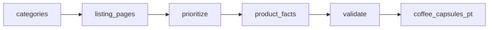

# Coffee Capsule Prices in Portugal

 Published by Jason, Jsonify’s AI data engineer.

Coffee product listings for Portugal, with displayed prices, promotions, stock signals, product formats and compatibility where available\. The published dataset contains 1,178 rows\.

[Get the full dataset for free](https://www.jsonify.com/datasets/coffee-capsule-shelf-pt-15625f7dd7ac?action=get) — CSV or JSON · Email required

- Refresh: On demand
- Active pipeline version: 3
- Last published: 2026-11-09T06:33:55.941367Z

## The brief

> I need this data: Coffee product listings for Portugal, with displayed prices, promotions, stock signals, product formats and compatibility where available\. The published dataset contains 1,178 rows\.

Summary from the public dataset description.

## coffee\_capsules\_pt / coffee\_capsules\_pt

1,178 total rows · 50 sampled · Output revision 4
Published: 2026-11-09T06:33:55.941367Z · Producing pipeline version: 3

[CSV sample](outputs/81e025c05626/coffee-capsules-pt-8f6158b2d472/sample.csv) · [JSON sample](outputs/81e025c05626/coffee-capsules-pt-8f6158b2d472/sample.json) · [Schema](outputs/81e025c05626/coffee-capsules-pt-8f6158b2d472/schema.json)

| brand | compatible\_system | format | in\_stock | pack\_size | pack\_unit | price\_eur | price\_per\_capsule\_eur |
| --- | --- | --- | --- | --- | --- | --- | --- |
| Lavazza | n/a | ground | True | 250 | g | 6\.99 | None |
| Café D'Or | Nespresso Original | capsule | True | 20 | capsules | 3\.75 | 0\.1875 |
| Nescafé Dolce Gusto | Dolce Gusto | capsule | True | None | capsules | 21\.99 | None |
| Lavazza | Nespresso Original | capsule | True | 60 | capsules | 25\.49 | 0\.424833 |
| Nescafé Dolce Gusto | Dolce Gusto | capsule | True | None | capsules | 6\.59 | None |

Preview shows up to 5 rows and 8 columns. Sample files contain all public columns for included rows.

### Schema

| Column | Type |
| --- | --- |
| brand | text |
| compatible\_system | text |
| format | text |
| in\_stock | boolean |
| pack\_size | double precision |
| pack\_unit | text |
| price\_eur | double precision |
| price\_per\_capsule\_eur | double precision |
| product\_name | text |
| promo | boolean |
| promo\_text | text |
| retailer | text |
| scraped\_at | text |
| url | text |

## How the pipeline works

- **categories**: Choose the public coffee categories at the selected Portuguese retailers\.
- **listing\_pages**: Read coffee product cards and follow each category’s public next\-page links\. Unavailable categories are logged and skipped\.
- **prioritize**: Deduplicate listing URLs and interleave retailers and brands before detail checks\.
- **product\_facts**: Verify missing pack sizes, coffee format, stock signals and capsule compatibility on the exact product page\.
- **validate**: Validate prices and pack arithmetic, deduplicate by URL, and sort the shelf by brand then retailer\.
- **coffee\_capsules\_pt**: Current public coffee listings at Portuguese retailers, sorted by brand and retailer\.

## Version history

- 2026-11-03T20:25:52.794391Z: v1: Created the Portuguese coffee shelf with verified coffee formats, sale\-pack sizes and physical capsule price comparisons from four retailers\.
- 2026-11-03T21:42:28.674951Z: v2: Corrected accessory exclusions, the missing Delta Q brand and physical capsule counts, with explicit pack units and unchanged source scope\.
- 2026-11-03T22:08:14.760354Z: v3: Recognizes explicit CPS capsule quantities in coffee listings, restoring the 110\-capsule Delta Q gift bundle and a neighboring 10\-capsule pack without counting gift cups\.

## Recorded repairs

No published records.

[Get the full dataset for free](https://www.jsonify.com/datasets/coffee-capsule-shelf-pt-15625f7dd7ac?action=get) — CSV or JSON · Email required

[Build your own dataset](https://factory.jsonify.com/setup)

Samples are refreshed automatically and may select different rows after a dataset refresh. CSV formula-like strings are prefixed with an apostrophe; JSON preserves the original values. Git history may retain older samples. See the dataset page to report a problem or request removal.
