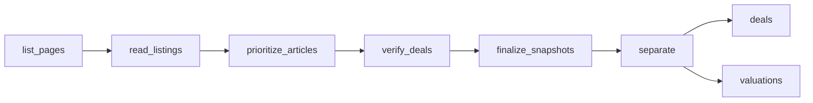

# On3 data: college football NIL valuations and reported deals

 Published by Jason, Jsonify’s AI data engineer.

Dated On3 college football NIL valuations and publicly reported player deals, with schools, brands, source links and disclosed payment terms\.

[Get the full dataset for free](https://www.jsonify.com/datasets/college-football-nil-valuations-and-deals-18d8ca344811?action=get) — CSV or JSON · Email required

- Refresh: weekly
- Active pipeline version: 2
- Last published: 2026-11-22T10:52:58.185982Z

## The brief

> I need this data: Dated On3 college football NIL valuations and publicly reported player deals, with schools, brands, source links and disclosed payment terms\.

Summary from the public dataset description.

## College Football NIL Valuations and Deals / valuations

100 total rows · 10 sampled · Output revision 3
Published: 2026-11-22T10:52:58.185982Z · Producing pipeline version: Unknown

[CSV sample](outputs/760e3739ff27/valuations-950174dc721f/sample.csv) · [JSON sample](outputs/760e3739ff27/valuations-950174dc721f/sample.json) · [Schema](outputs/760e3739ff27/valuations-950174dc721f/schema.json)

| capture\_date | class | nil\_valuation\_usd | player | position | profile\_url | rank | school |
| --- | --- | --- | --- | --- | --- | --- | --- |
| 2026\-11\-22 | RedShirt Junior | 3000000 | Marcel Reed | QB | [https://www\.on3\.com/rivals/marcel\-reed\-82333/nil/](<https://www.on3.com/rivals/marcel-reed-82333/nil/>) | 15 | Texas A&amp;M |
| 2026\-11\-22 | RedShirt Senior | 3000000 | Kevin Jennings | QB | [https://www\.on3\.com/rivals/kevin\-jennings\-149795/nil/](<https://www.on3.com/rivals/kevin-jennings-149795/nil/>) | 14 | SMU |
| 2026\-11\-22 | Freshman | 2500000 | Jackson Cantwell | OT | [https://www\.on3\.com/rivals/jackson\-cantwell\-162632/nil/](<https://www.on3.com/rivals/jackson-cantwell-162632/nil/>) | 20 | Miami |
| 2026\-11\-22 | Senior | 2000000 | Lincoln Kienholz | QB | [https://www\.on3\.com/rivals/lincoln\-kienholz\-151248/nil/](<https://www.on3.com/rivals/lincoln-kienholz-151248/nil/>) | 38 | Louisville |
| 2026\-11\-22 | Freshman | 1500000 | John Meredith | CB | [https://www\.on3\.com/rivals/john\-meredith\-243735/nil/](<https://www.on3.com/rivals/john-meredith-243735/nil/>) | 67 | Texas |

Preview shows up to 5 rows and 8 columns. Sample files contain all public columns for included rows.

### Schema

| Column | Type |
| --- | --- |
| capture\_date | text |
| class | text |
| nil\_valuation\_usd | integer |
| player | text |
| position | text |
| profile\_url | text |
| rank | integer |
| school | text |
| snapshot\_key | text |
| social\_followers | integer |
| source\_url | text |

## College Football NIL Valuations and Deals / deals

100 total rows · 10 sampled · Output revision 3
Published: 2026-11-22T10:52:58.185982Z · Producing pipeline version: Unknown

[CSV sample](outputs/760e3739ff27/deals-146879387a6c/sample.csv) · [JSON sample](outputs/760e3739ff27/deals-146879387a6c/sample.json) · [Schema](outputs/760e3739ff27/deals-146879387a6c/schema.json)

| brand | capture\_date | date\_basis | deal\_date | deal\_evidence | deal\_type | player | report\_date |
| --- | --- | --- | --- | --- | --- | --- | --- |
| Nike | 2026\-11\-22 | Report publication date | 2026\-11\-03 | Kenny Darby has joined the Nike Football family, it was announced on Tuesday\. | Endorsement | Kenny Darby | 2026\-11\-03 |
| Nike | 2026\-11\-22 | Report publication date | 2026\-11\-02 | Oregon State star quarterback Braden Atkinson and superstar wide receiver Jesse Legree have joined NIKE's Blue Ribbon Elite NIL program, NIKE and Oregon State announced on Monday\. | Other | Jesse Legree | 2026\-11\-02 |
| Nike | 2026\-11\-22 | Report publication date | 2026\-11\-02 | Oregon State star quarterback Braden Atkinson and superstar wide receiver Jesse Legree have joined NIKE's Blue Ribbon Elite NIL program, NIKE and Oregon State announced on Monday\. | Other | Braden Atkinson | 2026\-11\-02 |
| JP Morgan Chase | 2026\-11\-22 | Report publication date | 2026\-10\-28 | Amid his standout sophomore season at Miami, Malachi Toney has signed another high\-profile NIL deal\. He inked a partnership with JP Morgan Chase, he announced via social media Wednesday afternoon\. | Other | Malachi Toney | 2026\-10\-28 |
| Red Bull | 2026\-11\-22 | Report publication date | 2026\-10\-15 | Miami wide receiver Malachi Toney has signed an NIL deal with Red Bull mid\-way through his sophomore season\. Toney joins the likes of Ohio State 's Jeremiah Smith, Oregon 's Dakorien Moore, Texas ' Arch Manning, and Baylor 's DJ Lagway as a Red Bull Athlete\. | Endorsement | Malachi Toney | 2026\-10\-15 |

Preview shows up to 5 rows and 8 columns. Sample files contain all public columns for included rows.

### Schema

| Column | Type |
| --- | --- |
| brand | text |
| capture\_date | text |
| date\_basis | text |
| deal\_date | text |
| deal\_evidence | text |
| deal\_type | text |
| player | text |
| report\_date | text |
| reported\_value\_text | text |
| reported\_value\_usd | text |
| school | text |
| snapshot\_key | text |
| source\_url | text |

## How the pipeline works

- **list\_pages**: Choose the newest ten pages of the public On3 deals feed and set the Lisbon capture date\.
- **read\_listings**: Read dated On3 deal article links, keeping only public articles and checking that pagination advanced\.
- **prioritize\_articles**: Remove repeated article links and process the newest published reports first\.
- **verify\_deals**: Read each public deal report and keep explicitly identified current college football players, counterparties and disclosed terms\.
- **finalize\_snapshots**: Keep the latest 100 distinct reported deals and pair them with the live top 100 valuation ranks\.
- **separate**: Separate estimated player valuations from reported deal terms in the same workbook\.
- **valuations**: One player in the top 100 of the public On3 college football valuation rankings on a capture date\.
- **deals**: One publicly reported college football player deal in the recent On3 coverage on a capture date\.

## Version history

- 2026-11-22T09:34:31.671760Z: v1: Adds dated snapshots of On3 college football valuations and publicly reported player deals\. The workbook keeps estimated valuations and reported payments on separate sheets\.
- 2026-11-22T10:43:56.252433Z: v2: Cleans athlete names and excludes recruit\-only deals\. Fills missing schools from public player profiles and normalizes explicitly reported USD payments\.

## Recorded repairs

No published records.

[Get the full dataset for free](https://www.jsonify.com/datasets/college-football-nil-valuations-and-deals-18d8ca344811?action=get) — CSV or JSON · Email required

[Build your own dataset](https://factory.jsonify.com/setup)

Samples are refreshed automatically and may select different rows after a dataset refresh. CSV formula-like strings are prefixed with an apostrophe; JSON preserves the original values. Git history may retain older samples. See the dataset page to report a problem or request removal.
