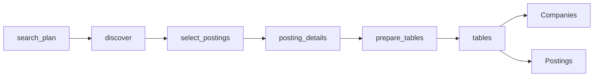

# Companies Hiring at Volume in Mexico and Colombia

 Published by Jason, Jsonify’s AI data engineer.

A Mexico and Colombia hiring snapshot: 1,675 job advertisements and 1,062 country\-scoped employer labels, collected 10 November 2026\.

[Get the full dataset for free](https://www.jsonify.com/datasets/companies-hiring-at-volume-in-mexico-and-colombia-ce27fa3ecd4d?action=get) — CSV or JSON · Email required

- Refresh: On demand
- Active pipeline version: 1
- Last published: 2026-11-17T20:04:35.911297Z

## The brief

> I need this data: A Mexico and Colombia hiring snapshot: 1,675 job advertisements and 1,062 country\-scoped employer labels, collected 10 November 2026\.

Summary from the public dataset description.

## Companies Hiring at Volume in Mexico and Colombia / Postings

1,675 total rows · 50 sampled · Output revision 4
Published: 2026-11-17T20:04:35.911297Z · Producing pipeline version: Unknown

[CSV sample](outputs/8930587ca13b/postings-e7e8cb43f7e2/sample.csv) · [JSON sample](outputs/8930587ca13b/postings-e7e8cb43f7e2/sample.json) · [Schema](outputs/8930587ca13b/postings-e7e8cb43f7e2/schema.json)

| city | company\_key | company\_name | company\_name\_normalized | contract\_type | country | date\_basis | job\_title |
| --- | --- | --- | --- | --- | --- | --- | --- |
| Caldas | d0b9ef620b7edf75385a | T\.H SOLUCIONES GROUP S\.A\.S\. | t\.h soluciones group s\.a\.s\. | Contrato de Obra o labor | Colombia | Source JobPosting datePosted | Operario de producción \- Caldas |
| Zapopan | 788c2b0c016cd130d9d9 | TALINK | talink | Contrato por tiempo indeterminado | Mexico | Source JobPosting datePosted | Asesor de ventas |
| Duitama | 88b2ccd1099746993ef1 | OPL CARGA | opl carga | Tiempo completo; Indefinido | Colombia | Indeed pubDate | Auxiliar de Operaciones IH\-Duitama |
| Iztapalapa | 143efe94d3c089f33dad | COLLECTION MANAGEMENT GROUP | collection management group | Medio tiempo | Mexico | Indeed pubDate | URGE TRABAJADOR PARA ATENDER LLAMADAS TELEFONICAS |
| Nextlalpan | a638b46dc8226e4ceae4 | Adecco | adecco | Tiempo completo | Mexico | Source JobPosting datePosted | Gerente de inventarios |

Preview shows up to 5 rows and 8 columns. Sample files contain all public columns for included rows.

### Schema

| Column | Type |
| --- | --- |
| city | text |
| company\_key | text |
| company\_name | text |
| company\_name\_normalized | text |
| contract\_type | text |
| country | text |
| date\_basis | text |
| job\_title | text |
| possible\_cross\_board\_duplicate | boolean |
| posted\_date | text |
| region | text |
| retrieved\_at | text |
| salary | text |
| salary\_currency | text |
| search\_url | text |
| source | text |
| source\_job\_id | text |
| source\_url | text |
| is\_staffing\_agency | boolean |

## Companies Hiring at Volume in Mexico and Colombia / Companies

1,062 total rows · 50 sampled · Output revision 4
Published: 2026-11-17T20:04:35.911297Z · Producing pipeline version: Unknown

[CSV sample](outputs/8930587ca13b/companies-4923413b40d7/sample.csv) · [JSON sample](outputs/8930587ca13b/companies-4923413b40d7/sample.json) · [Schema](outputs/8930587ca13b/companies-4923413b40d7/schema.json)

| cities\_count | company\_key | company\_name | country | earliest\_posted\_date | example\_posting\_url | latest\_posted\_date | postings\_count |
| --- | --- | --- | --- | --- | --- | --- | --- |
| 4 | d0b9ef620b7edf75385a | T\.H SOLUCIONES GROUP S\.A\.S\. | Colombia | 2026\-10\-14 | [https://co\.computrabajo\.com/ofertas\-de\-trabajo/oferta\-de\-trabajo\-de\-auxiliar\-administrativoa\-bello\-en\-bello\-8B85D4CC38ED8E2A61373E686DCF3405](<https://co.computrabajo.com/ofertas-de-trabajo/oferta-de-trabajo-de-auxiliar-administrativoa-bello-en-bello-8B85D4CC38ED8E2A61373E686DCF3405>) | 2026\-11\-05 | 8 |
| 2 | 788c2b0c016cd130d9d9 | TALINK | Mexico | 2026\-10\-30 | [https://mx\.computrabajo\.com/ofertas\-de\-trabajo/oferta\-de\-trabajo\-de\-asesor\-de\-ventas\-en\-zapopan\-93B15469508B11A361373E686DCF3405](<https://mx.computrabajo.com/ofertas-de-trabajo/oferta-de-trabajo-de-asesor-de-ventas-en-zapopan-93B15469508B11A361373E686DCF3405>) | 2026\-11\-02 | 2 |
| 1 | 88b2ccd1099746993ef1 | OPL CARGA | Colombia | 2026\-11\-06 | [https://co\.indeed\.com/viewjob?jk=3e702fba50873974](<https://co.indeed.com/viewjob?jk=3e702fba50873974>) | 2026\-11\-06 | 1 |
| 2 | 143efe94d3c089f33dad | COLLECTION MANAGEMENT GROUP | Mexico | 2026\-10\-29 | [https://mx\.indeed\.com/viewjob?jk=31dd08cf03df0b1e](<https://mx.indeed.com/viewjob?jk=31dd08cf03df0b1e>) | 2026\-10\-29 | 2 |
| 16 | a638b46dc8226e4ceae4 | Adecco | Mexico | 2026\-10\-20 | [https://mx\.computrabajo\.com/ofertas\-de\-trabajo/oferta\-de\-trabajo\-de\-almacenista\-auxiliar\-de\-almacen\-no\-rolas\-horario\-en\-coacalco\-de\-berriozabal\-4D07186812E9F98261373E686DCF3405](<https://mx.computrabajo.com/ofertas-de-trabajo/oferta-de-trabajo-de-almacenista-auxiliar-de-almacen-no-rolas-horario-en-coacalco-de-berriozabal-4D07186812E9F98261373E686DCF3405>) | 2026\-11\-10 | 21 |

Preview shows up to 5 rows and 8 columns. Sample files contain all public columns for included rows.

### Schema

| Column | Type |
| --- | --- |
| cities\_count | bigint |
| company\_key | text |
| company\_name | text |
| country | text |
| earliest\_posted\_date | text |
| example\_posting\_url | text |
| latest\_posted\_date | text |
| postings\_count | bigint |
| postings\_with\_contract\_type | bigint |
| postings\_with\_salary | bigint |
| sources | text |
| sources\_count | bigint |
| is\_staffing\_agency | boolean |

## How the pipeline works

- **search\_plan**: Prepare the same occupational searches across Computrabajo Mexico and Colombia, OCC Mexico and Indeed in both countries\.
- **discover**: Read live job search pages and extract named employers and posting links or Indeed listing facts\.
- **select\_postings**: Deduplicate posting links and select a balanced country and board sample for detail collection\.
- **posting\_details**: Read job detail pages, validate posting identity and expiry, and preserve source salary and contract wording\.
- **prepare\_tables**: Validate real postings, normalize employer labels within each country and calculate company counts from exactly the delivered postings\.
- **tables**: Separate job postings and company counts into the two worksheets of the same dataset\.
- **Postings**: Real job advertisements from the requested boards in Mexico and Colombia\.
- **Companies**: Country\-scoped company counts derived from the delivered postings\.

## Version history

- 2026-11-10T12:15:03.921811Z: v1: Saved the one\-off collection as a pipeline producing postings and company counts, including salary wording available in job descriptions\.

## Recorded repairs

No published records.

[Get the full dataset for free](https://www.jsonify.com/datasets/companies-hiring-at-volume-in-mexico-and-colombia-ce27fa3ecd4d?action=get) — CSV or JSON · Email required

[Build your own dataset](https://factory.jsonify.com/setup)

Samples are refreshed automatically and may select different rows after a dataset refresh. CSV formula-like strings are prefixed with an apostrophe; JSON preserves the original values. Git history may retain older samples. See the dataset page to report a problem or request removal.
