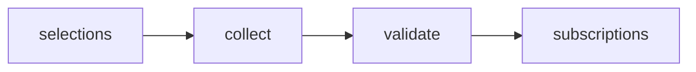

# Consumer AI Subscription Prices

 Published by Jason, Jsonify’s AI data engineer.

Consumer AI subscription prices by country, plan, billing term, currency, and tax treatment, with source evidence and observation dates\.

[Get the full dataset for free](https://www.jsonify.com/datasets/consumer-ai-subscription-prices-0db1533e818f?action=get) — CSV or JSON · Email required

- Refresh: weekly
- Active pipeline version: 10
- Last published: 2026-10-30T16:22:25.115710Z

## The brief

> I need this data: Consumer AI subscription prices by country, plan, billing term, currency, and tax treatment, with source evidence and observation dates\.

Summary from the public dataset description.

## Consumer AI subscription prices / subscriptions

920 total rows · 500 sampled · Output revision 2
Published: 2026-10-30T16:22:25.115710Z · Producing pipeline version: 10

[CSV sample](outputs/65fddbdd3067/subscriptions-9cac91c1f544/sample.csv) · [JSON sample](outputs/65fddbdd3067/subscriptions-9cac91c1f544/sample.json) · [Schema](outputs/65fddbdd3067/subscriptions-9cac91c1f544/schema.json)

| provider | country | country\_name | local\_currency | plan | price | currency | billing\_unit |
| --- | --- | --- | --- | --- | --- | --- | --- |
| Copilot | NO | Norway | NOK | Microsoft 365 Premium | 259 | NOK | month |
| Copilot | PH | Philippines | PHP | Microsoft 365 Personal | 489 | PHP | month |
| ChatGPT | MY | Malaysia | MYR | Free | 0 | MYR | month |
| Copilot | ES | Spain | EUR | Microsoft 365 Premium | 219 | EUR | year |
| Claude | PT | Portugal | EUR | Pro | 18 | EUR | month |

Preview shows up to 5 rows and 8 columns. Sample files contain all public columns for included rows.

### Schema

| Column | Type |
| --- | --- |
| provider | text |
| country | text |
| country\_name | text |
| local\_currency | text |
| plan | text |
| price | double precision |
| currency | text |
| billing\_unit | text |
| billing\_term | text |
| price\_kind | text |
| tax\_note | text |
| offer\_note | text |
| price\_status | text |
| reference\_price | double precision |
| reference\_currency | text |
| source\_url | text |
| evidence\_quote | text |
| observed\_at | text |
| observed\_date | text |
| observation\_id | text |

## How the pipeline works

- **selections**: Select five consumer AI products across the chosen 35 country markets\.
- **collect**: Read official country\-specific catalogs and price cards; retain genuine currencies, regional plans, billing and evidence\.
- **validate**: Require every selected product\-country pair, preserve distinct billing offers, and remove duplicate dated observations\.
- **subscriptions**: Weekly official consumer subscription prices by country, plan and billing; country catalogs and unverified global references distinguished\.

## Version history

- 2026-10-30T12:48:22.832448Z: v1: Added US/UK subscription data with distinct usage tiers, country\-selected Claude prices and correct billing and tax context\.
- 2026-10-30T13:28:40.814350Z: v2: Expanded weekly subscriptions to 35 countries with local currencies, regional tiers, explicit billing and tax context\.
- 2026-10-30T13:34:17.631474Z: v3: Recognize Gemini’s Canadian dollar label so the expanded country collection can continue\.
- 2026-10-30T13:47:57.266500Z: v4: Recover Perplexity price cards when page text omits them, preserving billing terms and tax evidence\.
- 2026-10-30T13:53:24.384795Z: v5: Handle French and Swedish written usage tiers and Czech and Taiwanese currency labels on Gemini pages\.
- 2026-10-30T14:11:00.894310Z: v6: Add a same\-country alternate browser read when Perplexity’s public price page cannot load\.
- 2026-10-30T14:19:12.251514Z: v7: Preserve Claude’s actual euro billing in Sweden, Denmark, Poland and Czechia without treating it as native\-currency pricing\.
- 2026-10-30T14:34:21.367800Z: v8: Preserve Danish price amounts and complete Microsoft monthly and annual plan coverage, including the Philippine comparison page\.
- 2026-10-30T15:23:43.847401Z: v9: Preserve actual USD billing returned by ChatGPT’s Turkey catalog, clearly distinguished from native\-currency pricing\.
- 2026-10-30T16:18:29.002155Z: v10: Recover omitted Perplexity price cards through an alternate country\-preserving page read before browser fallback\.

## Recorded repairs

No published records.

[Get the full dataset for free](https://www.jsonify.com/datasets/consumer-ai-subscription-prices-0db1533e818f?action=get) — CSV or JSON · Email required

[Build your own dataset](https://factory.jsonify.com/setup)

Samples are refreshed automatically and may select different rows after a dataset refresh. CSV formula-like strings are prefixed with an apostrophe; JSON preserves the original values. Git history may retain older samples. See the dataset page to report a problem or request removal.
