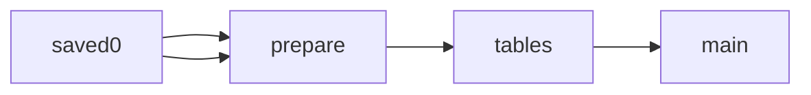

# Data Centre Planning and Permit Records

 Published by Jason, Jsonify’s AI data engineer.

Data centre planning and permit records sample with project, authority, status, dates, site and capacity fields\.

[Get the full dataset for free](https://www.jsonify.com/datasets/data-centre-planning-and-permit-records-sample-6fcb53dc7b71?action=get) — CSV or JSON · Email required

- Refresh: On demand
- Active pipeline version: 1
- Last published: 2026-11-13T15:57:56.750866Z

## The brief

> I need this data: Data centre planning and permit records sample with project, authority, status, dates, site and capacity fields\.

Summary from the public dataset description.

## Data centre planning and permit records sample / main

264 total rows · 50 sampled · Output revision 1
Published: 2026-11-13T15:57:56.750866Z · Producing pipeline version: 1

[CSV sample](outputs/6a65152a76de/main-0d6e4079e367/sample.csv) · [JSON sample](outputs/6a65152a76de/main-0d6e4079e367/sample.json) · [Schema](outputs/6a65152a76de/main-0d6e4079e367/schema.json)

| applicant | application\_reference | authority | collected\_at | country | decision\_date | description | floor\_area |
| --- | --- | --- | --- | --- | --- | --- | --- |
| None | 2026071322101 | Hoogheemraadschap Hollands Noorderkwartier | 2026\-11\-09T11:36:40\+00:00 | Netherlands | None | Permit application to extract groundwater and discharge to surface water for construction of data centres\. | None |
| None | prb\-2025\-16423 \(notice reference\) | Provincial Executive of Drenthe | 2026\-11\-09T18:28:53\.171412\+00:00 | Netherlands | 2025\-10\-03 | Permit granted for the technical building activity of constructing two data centres\. | None |
| Mr Matthew Wright | PL/25/2076/OA | Buckinghamshire Council | 2026\-11\-09T18:28:08\.213138\+00:00 | United Kingdom | 2026\-02\-25 | Outline planning application with all matters reserved, except for the principal points of access from Pinewood Road and Uxbridge Road, to comprise data centre \(Use Class B8\) of up to 55,030 sq m \(592,338 sq ft\) GIA of data hall building floorspace, with additional power sub stations, associated plant, emergency back\-up generators and associated fuel storage, vehicular and pedestrian access, car and cycle parking, landscaping, sustainable drainage system, other associated works, community garden \(including growing space, orchard, informal recreation, learning space and multi\-use site hub building of up to 500 sq m GIA\) all to be delivered in phases \(each phase being a separate and severable part of the development\)\. | Up to 55,030 sq m GIA data hall building; additional community hub up to 500 sq m GIA |
| None | 362935 | Hoogheemraadschap van Rijnland | 2026\-11\-09T11:36:40\+00:00 | Netherlands | None | Water\-activity permit for excavation, temporary construction pits and trenches, and horizontal drains, for installation of stormwater and wastewater sewers associated with data centre AMS11\. | None |
| None | Z\-578805 | Municipality of Hollands Kroon | 2026\-11\-09T18:28:53\.170930\+00:00 | Netherlands | None | Application to construct a data centre \(phase 1\); the application was withdrawn\. | None |

Preview shows up to 5 rows and 8 columns. Sample files contain all public columns for included rows.

### Schema

| Column | Type |
| --- | --- |
| applicant | text |
| application\_reference | text |
| authority | text |
| collected\_at | text |
| country | text |
| decision\_date | text |
| description | text |
| floor\_area | text |
| key\_dates | text |
| mw\_it\_load | text |
| notes | text |
| qualifying\_date | text |
| recency\_basis | text |
| record\_type | text |
| site\_address | text |
| status | text |
| status\_detail | text |
| submitted\_date | text |
| supporting\_url | text |
| url | text |

## How the pipeline works

- **saved0**: Read the existing saved worksheet without contacting any sources\.
- **prepare**: Copy the saved sample and sort it for public reading without refreshing sources\.
- **tables**: Keep the saved worksheets separate in the public workbook\.
- **main**: Existing saved sample records\.

## Version history

- 2026-11-13T15:57:43.085349Z: v1: Make the saved sample available for a neutral public page without new collection\.

## Recorded repairs

No published records.

[Get the full dataset for free](https://www.jsonify.com/datasets/data-centre-planning-and-permit-records-sample-6fcb53dc7b71?action=get) — CSV or JSON · Email required

[Build your own dataset](https://factory.jsonify.com/setup)

Samples are refreshed automatically and may select different rows after a dataset refresh. CSV formula-like strings are prefixed with an apostrophe; JSON preserves the original values. Git history may retain older samples. See the dataset page to report a problem or request removal.
