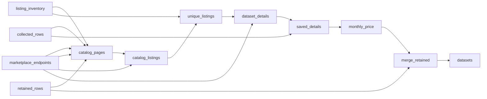

# Datarade Dataset Catalog

 Published by Jason, Jsonify’s AI data engineer.

Datarade dataset catalog with dataset descriptions, pricing details, and provider ratings and review counts\.

[Get the full dataset for free](https://www.jsonify.com/datasets/datasets-for-sale-3fb2e8b82ab2?action=get) — CSV or JSON · Email required

- Refresh: On demand
- Active pipeline version: 15
- Last published: 2026-10-31T12:08:13.007880Z

## The brief

> I need this data: Datarade dataset catalog with dataset descriptions, pricing details, and provider ratings and review counts\.

Summary from the public dataset description.

## Datarade datasets for sale / datasets

14,054 total rows · 500 sampled · Output revision 6
Published: 2026-10-31T12:08:13.007880Z · Producing pipeline version: 15

[CSV sample](outputs/8013588df6ed/datasets-714284abfa95/sample.csv) · [JSON sample](outputs/8013588df6ed/datasets-714284abfa95/sample.json) · [Schema](outputs/8013588df6ed/datasets-714284abfa95/schema.json)

| catalog\_position | categories | collected\_at | countries | coverage | dataset\_name | dataset\_url | description |
| --- | --- | --- | --- | --- | --- | --- | --- |
| 725 | \["Technographic Data", "Alternative Data", "Online Shopping Data", "Online Marketplace Data", "Tickerized Transaction Data"\] | 2026\-10\-31T09:47:15\.280516\+00:00 | \["Algeria", "Angola", "Benin", "Bots… | None | Global Internet KPI Estimates \| 58 KPIs \| 16 Tickers \(Amazon, eBay, Roblox &amp; More\) \| Daily 12\-Hour Lag \| Alternative Data | [https://datarade\.ai/data\-products/global\-internet\-kpi\-estimates\-16\-tickers\-amazon\-coupang\-oxford\-data\-plan](<https://datarade.ai/data-products/global-internet-kpi-estimates-16-tickers-amazon-coupang-oxford-data-plan>) | ✅ Key Data Elements  •	Bloomberg tic… |
| 847 | None | 2026\-10\-31T10:32:39\.582272\+00:00 | None | None | Bed Bath &amp; Beyond dataset | [https://brightdata\.com/products/datasets/bed\-bath\-beyond](<https://brightdata.com/products/datasets/bed-bath-beyond>) | Use our Bed Bath &amp; Beyond Products d… |
| 97 | \["B2C Contact Data", "Property Data", "Real Estate Market Data"\] | 2026\-10\-31T09:45:03\.030101\+00:00 | \["United States of America"\] | None | Professional Data Services \| Custom Pulls, Match\-and\-Append, Normalization &amp; Pipeline Setup \| Managed Delivery | [https://datarade\.ai/data\-products/professional\-data\-services\-custom\-pulls\-match\-and\-append\-batchdata](<https://datarade.ai/data-products/professional-data-services-custom-pulls-match-and-append-batchdata>) | BatchData provides professional data… |
| 4940 | \["Telecommunications Data", "Data Products", "Retail, Location &amp; Marketing Data"\] | 2026\-10\-31T09:27:20\.721398\+00:00 | None | None | Business Data New Zealand/ 814,000 Companies in New Zealand \( Sample\) | [https://aws\.amazon\.com/marketplace/pp/prodview\-4gwbbeoxk5wro](<https://aws.amazon.com/marketplace/pp/prodview-4gwbbeoxk5wro>) | \#\#Techsalerator New Zealand Product … |
| 1479 | \["MARKETING", "BUSINESS", "ECONOMY"\] | 2026\-10\-31T09:39:32\.599875\+00:00 | None | None | Market Watch Trend for Snowflake \(家計簿レシート統計データ/トライアル版） | [https://app\.snowflake\.com/marketplace/listing/GZ1MHZ1PP7A](<https://app.snowflake.com/marketplace/listing/GZ1MHZ1PP7A>) | &lt;p&gt;&lt;br/&gt;&lt;/p&gt;  【データ概要】  Vポイントマーケティング株… |

Preview shows up to 5 rows and 8 columns. Sample files contain all public columns for included rows.

### Schema

| Column | Type |
| --- | --- |
| catalog\_position | integer |
| categories | jsonb |
| collected\_at | text |
| countries | jsonb |
| coverage | text |
| dataset\_name | text |
| dataset\_url | text |
| description | text |
| geography | text |
| history\_length | text |
| listing\_family | text |
| listing\_rating | integer |
| listing\_review\_count | integer |
| offer\_type | text |
| popularity\_metrics | text |
| price | text |
| price\_currencies | text |
| price\_monthly | double precision |
| price\_one\_off | double precision |
| price\_parse\_status | text |
| price\_usage | double precision |
| price\_usage\_unit | text |
| price\_yearly | double precision |
| pricing\_details | text |
| pricing\_options | text |
| pricing\_status | text |
| provider | text |
| provider\_rating | double precision |
| provider\_review\_count | integer |
| refresh\_frequency | jsonb |
| signal\_note | text |
| source | text |
| source\_listing\_id | text |
| source\_metadata | text |

## How the pipeline works

- **collected\_rows**: Optional saved listing details for local price enrichment without fetching pages\.
- **listing\_inventory**: Optional exact previously discovered listing rows to reuse instead of catalog discovery\.
- **retained\_rows**: Optional saved listings to preserve for marketplaces not being refreshed\.
- **marketplace\_endpoints**: Public marketplace catalog and read API endpoints\.
- **catalog\_pages**: Discover source catalog totals and the independent pages or dataset offers to read\.
- **catalog\_listings**: Read independent public catalog pages and preserve source listing metadata\.
- **unique\_listings**: Deduplicate exact source listing URLs and check complete catalog inventories\.
- **dataset\_details**: Keep structured catalog records or read identity\-checked Datarade and Bright Data dataset details\.
- **saved\_details**: Reuse saved listing details when supplied, otherwise keep freshly collected details\.
- **monthly\_price**: Parse source\-specific published prices without converting annual prices or guessing ambiguous terms\. Flag repeated starting prices and Bright Data template pages\.
- **merge\_retained**: Combine refreshed marketplaces with saved listings from other sources, retaining every published field\.
- **datasets**: Public dataset offers across selected marketplaces, with original pricing conditions and clearly labelled source signals\.

## Version history

- 2026-10-30T13:39:40.997478Z: v1: Adds the Datarade catalog collector with published pricing, provider ratings and review counts\.
- 2026-10-30T13:58:59.370371Z: v2: Recovers dataset pages that reject the first reading method, preserving completed work and all requested fields\.
- 2026-10-30T14:55:40.485664Z: v3: Adds a numeric monthly price column from published monthly license prices, leaving unavailable amounts empty\.
- 2026-10-30T14:56:59.430694Z: v4: Adds sortable yearly, one\-off and usage prices alongside monthly prices, retaining currencies and usage units\.
- 2026-10-30T15:00:33.589103Z: v5: Adds Datarade categories, country lists, history length and published delivery frequency for the next collection\.
- 2026-10-30T20:35:32.893771Z: v6: Expand the public dataset catalog across marketplace and vendor sources, preserving existing fields and adding source identities, pricing conditions and coverage\. Exclude live scrapers and skip login\-required catalogs\.
- 2026-10-30T20:41:42.064764Z: v7: Fix Databricks collection to include packaged media datasets and filter out software, connectors and live scraping tools\.
- 2026-10-31T09:26:10.368075Z: v8: Read Snowflake’s complete catalog together before fetching listing details, avoiding failures when listings change between pages\. Retry temporary errors on public Snowflake metadata reads\.
- 2026-10-31T10:08:17.783842Z: v9: Fixed collection of Bright Data dataset pages whose description appears in the product introduction instead of the sample section\.
- 2026-10-31T10:58:12.714539Z: v10: Fixed Bright Data pages with incomplete visible product sections by reading their matching published dataset details and pricing\. Missing sample identifiers stay empty instead of being taken from scraper offers\.
- 2026-10-31T11:16:25.941326Z: v11: Fixed missing Nasdaq publisher names by checking the publisher record linked directly from each dataset when the general directory omits it\.
- 2026-10-31T11:19:20.063881Z: v12: Fixed Nasdaq publisher lookup when direct publisher pages are missing\. Added checks to exclude software tools while retaining genuine real\-time data feeds\.
- 2026-10-31T11:28:07.581095Z: v13: Fixed Microsoft offers omitted from pricing search by checking their direct public product records\. Retains published plans and leaves unavailable prices empty\.
- 2026-10-31T12:05:00.053655Z: v14: Added source\-specific price parsing and price caveat flags\. Bright Data sales template pages can now be grouped separately for counts\.
- 2026-10-31T12:07:26.115412Z: v15: AWS subscriptions with metered add\-on charges now include their published monthly or yearly base fee, with an extra\-usage warning\.

## Recorded repairs

- 2026-10-30T20:50:17.682607Z: no change
- 2026-10-30T20:51:19.962948Z: repaired

[Get the full dataset for free](https://www.jsonify.com/datasets/datasets-for-sale-3fb2e8b82ab2?action=get) — CSV or JSON · Email required

[Build your own dataset](https://factory.jsonify.com/setup)

Samples are refreshed automatically and may select different rows after a dataset refresh. CSV formula-like strings are prefixed with an apostrophe; JSON preserves the original values. Git history may retain older samples. See the dataset page to report a problem or request removal.
