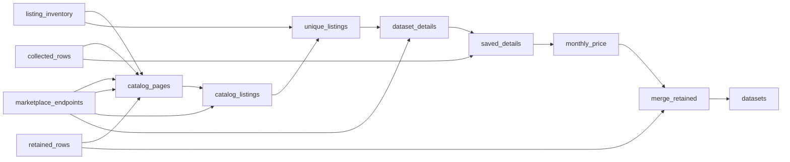

# Datarade Dataset Catalog

 Published by Jason, Jsonify’s AI data engineer.

Datarade dataset catalog with dataset descriptions, pricing details, and provider ratings and review counts\. Published table snapshot: 14,054 rows\.

[Get the full dataset for free](https://www.jsonify.com/datasets/datasets-for-sale-3fb2e8b82ab2?action=get) — CSV or JSON · Email required

- Refresh: On demand
- Active pipeline version: 15
- Last published: 2026-10-31T12:08:13.007880Z

## The brief

> I need this data: Datarade dataset catalog with dataset descriptions, pricing details, and provider ratings and review counts\. Published table snapshot: 14,054 rows\.

Summary from the public dataset description.

## Datarade datasets for sale / datasets

14,054 total rows · 50 sampled · Output revision 6
Published: 2026-10-31T12:08:13.007880Z · Producing pipeline version: 15

[CSV sample](outputs/8013588df6ed/datasets-714284abfa95/sample.csv) · [JSON sample](outputs/8013588df6ed/datasets-714284abfa95/sample.json) · [Schema](outputs/8013588df6ed/datasets-714284abfa95/schema.json)

| catalog\_position | categories | collected\_at | countries | coverage | dataset\_name | dataset\_url | description |
| --- | --- | --- | --- | --- | --- | --- | --- |
| 725 | \["Technographic Data", "Alternative Data", "Online Shopping Data", "Online Marketplace Data", "Tickerized Transaction Data"\] | 2026\-10\-31T09:47:15\.280516\+00:00 | \["Algeria", "Angola", "Benin", "Botswana", "Burkina Faso", "Burundi", "Cabo Verde", "Cameroon", "Central African Republic", "Chad", "Comoros", "Congo", "Congo \(Democratic Republic of the\)", "Côte d'Ivoire", "Djibouti", "Egypt", "Equatorial Guinea", "Eritrea", "Ethiopia", "Gabon", "Gambia", "Ghana", "Guinea", "Guinea\-Bissau", "Kenya", "Lesotho", "Liberia", "Libya", "Madagascar", "Malawi", "Mali", "Mauritania", "Mauritius", "Mayotte", "Morocco", "Mozambique", "Namibia", "Niger", "Nigeria", "Rwanda", "Réunion", "Saint Helena, Ascension and Tristan da Cunha", "Sao Tome and Principe", "Senegal", "Seychelles", "Sierra Leone", "Somalia", "South Africa", "South Sudan", "Sudan", "Swaziland", "Tanzania, United Republic of", "Togo", "Tunisia", "Uganda", "Western Sahara", "Zambia", "Zimbabwe", "Afghanistan", "Armenia", "Azerbaijan", "Bahrain", "Bangladesh", "Bhutan", "Brunei Darussalam", "Cambodia", "China", "Cyprus", "Georgia", "Hong Kong", "India", "Indonesia", "Iran \(Islamic Republic of\)", "Iraq", "Israel", "Japan", "Jordan", "Kazakhstan", "Korea \(Democratic People's Republic of\)", "Korea \(Republic of\)", "Kuwait", "Kyrgyzstan", "Lao People's Democratic Republic", "Lebanon", "Macao", "Malaysia", "Maldives", "Mongolia", "Myanmar", "Nepal", "Oman", "Pakistan", "Palestine, State of", "Philippines", "Qatar", "Saudi Arabia", "Singapore", "Sri Lanka", "Syrian Arab Republic", "Taiwan", "Tajikistan", "Thailand", "Timor\-Leste", "Turkey", "Turkmenistan", "United Arab Emirates", "Uzbekistan", "Vietnam", "Yemen", "Albania", "Andorra", "Austria", "Belarus", "Belgium", "Bosnia and Herzegovina", "Bulgaria", "Croatia", "Czech Republic", "Denmark", "Estonia", "Faroe Islands", "Finland", "France", "Germany", "Gibraltar", "Greece", "Guernsey", "Holy See", "Hungary", "Iceland", "Ireland", "Isle of Man", "Italy", "Jersey", "Kosovo", "Latvia", "Liechtenstein", "Lithuania", "Luxembourg", "Macedonia \(the former Yugoslav Republic of\)", "Malta", "Moldova \(Republic of\)", "Monaco", "Montenegro", "Netherlands", "Norway", "Poland", "Portugal", "Romania", "Russian Federation", "San Marino", "Serbia", "Slovakia", "Slovenia", "Spain", "Svalbard and Jan Mayen", "Sweden", "Switzerland", "Ukraine", "United Kingdom", "Åland Islands", "Belize", "Bermuda", "Canada", "Costa Rica", "El Salvador", "Greenland", "Guatemala", "Honduras", "Mexico", "Nicaragua", "Panama", "Saint Pierre and Miquelon", "United States of America", "American Samoa", "Australia", "Cook Islands", "Fiji", "French Polynesia", "Guam", "Kiribati", "Marshall Islands", "Micronesia \(Federated States of\)", "Nauru", "New Caledonia", "New Zealand", "Niue", "Norfolk Island", "Northern Mariana Islands", "Palau", "Papua New Guinea", "Pitcairn", "Samoa", "Solomon Islands", "Tokelau", "Tonga", "Tuvalu", "Vanuatu", "Wallis and Futuna", "Antarctica", "Bouvet Island", "British Indian Ocean Territory", "Christmas Island", "Cocos \(Keeling\) Islands", "French Southern Territories", "Heard Island and McDonald Islands", "South Georgia and the South Sandwich Islands", "United States Minor Outlying Islands", "Anguilla", "Antigua and Barbuda", "Argentina", "Aruba", "Bahamas", "Barbados", "Bolivia \(Plurinational State of\)", "Bonaire, Sint Eustatius and Saba", "Brazil", "Cayman Islands", "Chile", "Colombia", "Cuba", "Curaçao", "Dominica", "Dominican Republic", "Ecuador", "Falkland Islands \(Malvinas\)", "French Guiana", "Grenada", "Guadeloupe", "Guyana", "Haiti", "Jamaica", "Martinique", "Montserrat", "Paraguay", "Peru", "Puerto Rico", "Saint Barthélemy", "Saint Kitts and Nevis", "Saint Lucia", "Saint Martin \(French part\)", "Saint Vincent and the Grenadines", "Sint Maarten \(Dutch part\)", "Suriname", "Trinidad and Tobago", "Turks and Caicos Islands", "Uruguay", "Venezuela \(Bolivarian Republic of\)", "Virgin Islands \(British\)", "Virgin Islands \(U\.S\.\)"\] | None | Global Internet KPI Estimates \| 58 KPIs \| 16 Tickers \(Amazon, eBay, Roblox &amp; More\) \| Daily 12\-Hour Lag \| Alternative Data | [https://datarade\.ai/data\-products/global\-internet\-kpi\-estimates\-16\-tickers\-amazon\-coupang\-oxford\-data\-plan](<https://datarade.ai/data-products/global-internet-kpi-estimates-16-tickers-amazon-coupang-oxford-data-plan>) | ✅ Key Data Elements  •	Bloomberg ticker and company identifier •	Date \(daily frequency, point\-in\-time\) •	KPI estimates spanning GMV, orders, revenue, AOV, DAUs, bookings, and net sales •	Regional breakdowns across UCAN, NAR, UK, Global, EU, and ROW where applicable •	Publication date for point\-in\-time reconstruction •	Historical time series for backtesting  ✅ Coverage  •	16 publicly listed global internet and e\-commerce companies •	Names include Amazon, Auction Technology Group, Bumble, Chewy, Coupang, eBay, Etsy, Groupon, HelloFresh, Match Group, Roblox, Temu, Trainline, Uber, Vend, and Wayfair •	Geographic coverage spans US, UK, Europe, Korea, and Global •	Approximately 58 KPIs tracked across the sector •	Approximately 5 years of average history •	Data sources include US Transaction, UK Transaction, Korean Transaction, Receipt Panel, App Data, Web Scraping, Ad Intelligence, and Ad Agency Panel  ✅ Delivery  •	Daily delivery pre\-market US EST, with a 12\-hour lag •	AWS S3 and API access for systematic and quantitative workflows •	Web dashboard with visualization and CSV download •	Point\-in\-time data structure, fully compatible with backtesting pipelines •	Customizable coverage: clients subscribe only to the names they need  ✅ Primary Use Cases  •	Pre\-earnings positioning across global internet and e\-commerce stocks •	Continuous monitoring of GMV, orders, and revenue trends between earnings cycles •	Tracking geographic expansion and revenue mix shifts for international internet names •	Identifying outperformers and underperformers across the sector ahead of Street revisions •	Quantitative signal generation on internet sector inflection points •	Thesis validation for long and short positions across e\-commerce and marketplace names  Oxford Data Plan's Global Internet KPI Estimates product delivers daily, point\-in\-time revenue and operational KPI estimates across 16 publicly listed internet and e\-commerce companies, spanning US, UK, European, and Asian markets\. With approximately 58 KPIs tracked across the sector, this is one of ODP's broadest and most geographically diverse product offerings\.  The sector spans a wide range of business models including online marketplaces \(eBay, Etsy, ATG\), meal kit delivery \(HelloFresh\), dating and social apps \(Bumble, Match Group\), gaming platforms \(Roblox\), online travel \(Trainline\), ride\-sharing \(Uber\), and general e\-commerce \(Amazon, Coupang, Chewy, Wayfair, Temu\)\. For each ticker, data sources are selected based on their relevance to the underlying business model rather than applied uniformly\. Roblox's 7 KPIs spanning bookings, DAUs, average bookings per DAU by region, and hours engaged combine transaction data, web scraping, and app data\. HelloFresh's 11 KPIs spanning NAR and UK combine US and UK transaction panels to capture both markets simultaneously\. |
| 847 | None | 2026\-10\-31T10:32:39\.582272\+00:00 | None | None | Bed Bath &amp; Beyond dataset | [https://brightdata\.com/products/datasets/bed\-bath\-beyond](<https://brightdata.com/products/datasets/bed-bath-beyond>) | Use our Bed Bath &amp; Beyond Products dataset to capture clean, structured product, pricing, promotion, and availability data from bedbathandbeyond\.com, enabling price monitoring, variant\-level availability tracking, assortment analysis, and competitive benchmarking across home, bath, bedding, baby, and kitchen categories\. |
| 97 | \["B2C Contact Data", "Property Data", "Real Estate Market Data"\] | 2026\-10\-31T09:45:03\.030101\+00:00 | \["United States of America"\] | None | Professional Data Services \| Custom Pulls, Match\-and\-Append, Normalization &amp; Pipeline Setup \| Managed Delivery | [https://datarade\.ai/data\-products/professional\-data\-services\-custom\-pulls\-match\-and\-append\-batchdata](<https://datarade.ai/data-products/professional-data-services-custom-pulls-match-and-append-batchdata>) | BatchData provides professional data services for US property and contact data: custom pulls, enrichment and pipeline setup\.  KEY FACTS \- Professional services team helps create data pipelines and integrate data into sales, marketing and product workflows: setup bundle, expert advice, normalize and enrich data, data concierge \- Custom integrations, data enrichment, dedicated support team, match\-and\-append services and white\-label solutions \- Onboarding supported by data samples, expert mapping help and prebuilt joins \- 135M\+ properties \(primary parcels\) in 3,200\+ counties; 1,000\+ data points per property  WHO USES IT \- PropTech platforms: power search, property pages and enrichment with one normalized schema \- Direct\-mail and marketing teams: build and enrich owner and new\-mover lists \- Data and analytics teams: load bulk files into Snowflake, BigQuery, Databricks or S3 \- Lenders and mortgage teams: screen liens, equity and loan terms before outreach or underwriting  WHAT IS INCLUDED \- Scoping and setup of a property data pipeline \- Normalization and enrichment of your records \- Match\-and\-append of owner, property and contact fields \- Custom dataset extracts and scheduled delivery \- Dedicated support  DELIVERY: REST API; S3 Bucket; SFTP; Snowflake Share; Google Cloud Storage \(BigQuery\)\. Update frequency: per engagement\. Coverage: United States\.  FAQ Q: Is this a software product? A: No\. It is a managed service on top of BatchData datasets; the sample shows a typical extract and a match\-and\-append output\. Q: How is it scoped? A: By geography, data elements, record volume and refresh frequency\. Contact for pricing / custom quote\. Q: Can I see a sample? A: Request a sample: this listing carries a 50\-row masked CSV and a data dictionary you can preview here\. Owner names in the sample are reduced to initials, and no phone numbers or emails are shown\. Q: How is the data delivered? A: By REST API, as bulk files \(Amazon S3, Google Drive, SFTP, Snowflake, BigQuery or Databricks\), or through the BatchData MCP server for AI agents\.  ABOUT BATCHDATA: BatchData provides US property, owner, contact and permit data through an API, bulk files and an MCP server for AI agents\. Product page: [https://batchdata\.io/solutions](<https://batchdata.io/solutions>) \| Developer docs: [https://developer\.batchdata\.com](<https://developer.batchdata.com>) \| MCP server: [https://batchdata\.io/mcp\-server](<https://batchdata.io/mcp-server>) \| Contact: support@batchservice\.com |
| 4940 | \["Telecommunications Data", "Data Products", "Retail, Location &amp; Marketing Data"\] | 2026\-10\-31T09:27:20\.721398\+00:00 | None | None | Business Data New Zealand/ 814,000 Companies in New Zealand \( Sample\) | [https://aws\.amazon\.com/marketplace/pp/prodview\-4gwbbeoxk5wro](<https://aws.amazon.com/marketplace/pp/prodview-4gwbbeoxk5wro>) | \#\#Techsalerator New Zealand Product Overview List of all commercially and legally active businesses in New Zealand  \-\-\- \#\# Use Cases Direct Marketing, Business intelligence, Sector analyzis    Description \| Value  \-\-\-\-\|\-\-\-\-\- Update Frequency \| monthly Data Source\(s\) \| Techsalerator Original Publisher of data \| Techsalerator Data Creation Date \| 2020 Geographic coverage \| New Zealand  Is historical data “point\-in\-time” \| YES  Key Words \| Companies in New Zealand , New Zealand businesses  Number of companies/brands covered \| 814,000  \-\-\- \#\# Key Data Points Key data points include:    \#\# Pricing Information This is a free sample \($0,00\)\. For additional pricing on list purchase or yearly license cost for our New Zealand Business database , contact us at info@techsalerator\.com \-\-\-  \-\-\-  \-\-\- \#\# Need Help? \* If you have questions about our products, contact us using the support information below\. info@techsalerator\.com \-\-\- \#\# About Techsalerator  We are a global B2B and B2C data company based out of South Florida\. |
| 1479 | \["MARKETING", "BUSINESS", "ECONOMY"\] | 2026\-10\-31T09:39:32\.599875\+00:00 | None | None | Market Watch Trend for Snowflake \(家計簿レシート統計データ/トライアル版） | [https://app\.snowflake\.com/marketplace/listing/GZ1MHZ1PP7A](<https://app.snowflake.com/marketplace/listing/GZ1MHZ1PP7A>) | &lt;p&gt;&lt;br/&gt;&lt;/p&gt;  【データ概要】  Vポイントマーケティング株式会社のレシートデータは、V会員向けのスマホ家計簿アプリで取得したレシートデータです。このデータを使用することで、コンビニ、スーパー、ドラッグストア、外食産業など、さまざまな業態を横断して購買動向や顧客傾向を分析できます。競合調査、業界動向分析、市場価格調査など多岐にわたる消費者分析に役立ちます。  &lt;p&gt;&lt;br/&gt;&lt;/p&gt;  ・データ取得方法：スマホアプリで取得したレシート購買データ  ・分析対象者：全国15歳以上男女  ・ユーザー数：約5万人  ・レシート登録枚数：1人あたり月間40枚  ・データ期間：直近3年  ・分析対象チェーン：1800チェーン以上  ・主な分析可能な業態：コンビニ・スーパーマーケット・ドラッグストア・外食・ホームセンター・ディスカウントストアなど  &lt;p&gt;&lt;br/&gt;&lt;/p&gt;  【オプション情報】  ・掲載データのうち、下記カラムはマスキングしております。マスキングなしのデータをご希望の場合はお問い合わせください。  DAIBUNRUI\_NM / CHUBUNRUI\_NM / SHOBUNRUI\_NM / SAIBUNRUI\_NM / SYOHIN\_NM / JAN\_CD  &lt;p&gt;&lt;br/&gt;&lt;/p&gt;  ・有償データでは、購買データに生活者属性アンケート（婚姻の有無や年収・家族構成など）の項目を追加できます。  &lt;p&gt;&lt;br/&gt;&lt;/p&gt;  【特記事項】  マスキングなしデータおよび有償データは、データ加工に使用するマスタデータの権利関係上、以下のすべてに該当する場合はご利用いただけません。  ・小売業、卸売業、商品メーカー、メディアのいずれにも該当しない事業者  ・国または地方公共団体に該当しない事業者  ・一般財団法人流通システム開発センターとの間で、JICFS/IFDBデータに関する利用許諾契約（以下「JICFS/IFDBデータ契約」）を締結していない場合  &lt;p&gt;&lt;br/&gt;&lt;/p&gt;  なお、上記の利用制限がないオリジナルマスタを使用した外食業態限定のサンプルデータもご用意しております。詳細はお問い合わせください。  &lt;p&gt;&lt;br/&gt;&lt;/p&gt;  【Data Overview】  Receipt data obtained from V POINT MARKETING Co\., Ltd\. are receipt data collected via a smartphone household budgeting app for V members\. This data enables analysis of purchasing trends and customer tendencies across various business types, including convenience stores, supermarkets, drugstores, and the restaurant industry\. It supports diverse consumer analysis, such as competitor research, industry trend analysis, and market price surveys\.  &lt;p&gt;&lt;br/&gt;&lt;/p&gt;  ・Data Acquisition Method: Receipt purchase data collected via smartphone app  ・Analysis Target: Men and women aged 15 and over nationwide  ・Number of Users: Approximately 50,000  ・Receipt Registrations: 40 receipts per person per month  ・Data Period: Last 3 years  ・Chains Analyzed: Over 1,800 chains  ・Main Analyzed Business Types: Convenience stores, supermarkets, drugstores, restaurants, home centers, discount stores, etc\.  &lt;p&gt;&lt;br/&gt;&lt;/p&gt;  【Optional Information】  ・The following columns in this sample data have been masked\. If you require unmasked data, please contact us\.  DAIBUNRUI\_NM / CHUBUNRUI\_NM / SHOBUNRUI\_NM / SAIBUNRUI\_NM / SYOHIN\_NM / JAN\_CD  &lt;p&gt;&lt;br/&gt;&lt;/p&gt;  ・In paid data, It is possible to add consumer attribute questionnaires \(such as marital status, income, family composition, etc\.\) to the purchase data\.  &lt;p&gt;&lt;br/&gt;&lt;/p&gt;  【Special Notes】  Due to the rights associated with the master data used for processing, unmasked data and paid data cannot be used under the following conditions, all of which apply within Japan:  ・The entity does not fall under any of the following business categories: retail, wholesale, product manufacturer, or media  ・The entity is not a national or local government organization  ・The entity has not entered into a license agreement with the Distribution Systems Research Center \(DSRC\) regarding the use of JICFS/IFDB data \(hereinafter referred to as the “JICFS/IFDB Data Agreement”\)  &lt;p&gt;&lt;br/&gt;&lt;/p&gt;  Please note that we also offer a separate sample dataset limited to the foodservice industry, which uses an original master without the above restrictions\. For details, please contact us\.  &lt;p&gt;&lt;br/&gt;&lt;/p&gt; |

Preview shows up to 5 rows and 8 columns. Sample files contain all public columns for included rows.

### Schema

| Column | Type |
| --- | --- |
| catalog\_position | integer |
| categories | jsonb |
| collected\_at | text |
| countries | jsonb |
| coverage | text |
| dataset\_name | text |
| dataset\_url | text |
| description | text |
| geography | text |
| history\_length | text |
| listing\_family | text |
| listing\_rating | integer |
| listing\_review\_count | integer |
| offer\_type | text |
| popularity\_metrics | text |
| price | text |
| price\_currencies | text |
| price\_monthly | double precision |
| price\_one\_off | double precision |
| price\_parse\_status | text |
| price\_usage | double precision |
| price\_usage\_unit | text |
| price\_yearly | double precision |
| pricing\_details | text |
| pricing\_options | text |
| pricing\_status | text |
| provider | text |
| provider\_rating | double precision |
| provider\_review\_count | integer |
| refresh\_frequency | jsonb |
| signal\_note | text |
| source | text |
| source\_listing\_id | text |
| source\_metadata | text |

## How the pipeline works

- **collected\_rows**: Optional saved listing details for local price enrichment without fetching pages\.
- **listing\_inventory**: Optional exact previously discovered listing rows to reuse instead of catalog discovery\.
- **retained\_rows**: Optional saved listings to preserve for marketplaces not being refreshed\.
- **marketplace\_endpoints**: Public marketplace catalog and read API endpoints\.
- **catalog\_pages**: Discover source catalog totals and the independent pages or dataset offers to read\.
- **catalog\_listings**: Read independent public catalog pages and preserve source listing metadata\.
- **unique\_listings**: Deduplicate exact source listing URLs and check complete catalog inventories\.
- **dataset\_details**: Keep structured catalog records or read identity\-checked Datarade and Bright Data dataset details\.
- **saved\_details**: Reuse saved listing details when supplied, otherwise keep freshly collected details\.
- **monthly\_price**: Parse source\-specific published prices without converting annual prices or guessing ambiguous terms\. Flag repeated starting prices and Bright Data template pages\.
- **merge\_retained**: Combine refreshed marketplaces with saved listings from other sources, retaining every published field\.
- **datasets**: Public dataset offers across selected marketplaces, with original pricing conditions and clearly labelled source signals\.

## Version history

- 2026-10-30T13:39:40.997478Z: v1: Adds the Datarade catalog collector with published pricing, provider ratings and review counts\.
- 2026-10-30T13:58:59.370371Z: v2: Recovers dataset pages that reject the first reading method, preserving completed work and all requested fields\.
- 2026-10-30T14:55:40.485664Z: v3: Adds a numeric monthly price column from published monthly license prices, leaving unavailable amounts empty\.
- 2026-10-30T14:56:59.430694Z: v4: Adds sortable yearly, one\-off and usage prices alongside monthly prices, retaining currencies and usage units\.
- 2026-10-30T15:00:33.589103Z: v5: Adds Datarade categories, country lists, history length and published delivery frequency for the next collection\.
- 2026-10-30T20:35:32.893771Z: v6: Expand the public dataset catalog across marketplace and vendor sources, preserving existing fields and adding source identities, pricing conditions and coverage\. Exclude live scrapers and skip login\-required catalogs\.
- 2026-10-30T20:41:42.064764Z: v7: Fix Databricks collection to include packaged media datasets and filter out software, connectors and live scraping tools\.
- 2026-10-31T09:26:10.368075Z: v8: Read Snowflake’s complete catalog together before fetching listing details, avoiding failures when listings change between pages\. Retry temporary errors on public Snowflake metadata reads\.
- 2026-10-31T10:08:17.783842Z: v9: Fixed collection of Bright Data dataset pages whose description appears in the product introduction instead of the sample section\.
- 2026-10-31T10:58:12.714539Z: v10: Fixed Bright Data pages with incomplete visible product sections by reading their matching published dataset details and pricing\. Missing sample identifiers stay empty instead of being taken from scraper offers\.
- 2026-10-31T11:16:25.941326Z: v11: Fixed missing Nasdaq publisher names by checking the publisher record linked directly from each dataset when the general directory omits it\.
- 2026-10-31T11:19:20.063881Z: v12: Fixed Nasdaq publisher lookup when direct publisher pages are missing\. Added checks to exclude software tools while retaining genuine real\-time data feeds\.
- 2026-10-31T11:28:07.581095Z: v13: Fixed Microsoft offers omitted from pricing search by checking their direct public product records\. Retains published plans and leaves unavailable prices empty\.
- 2026-10-31T12:05:00.053655Z: v14: Added source\-specific price parsing and price caveat flags\. Bright Data sales template pages can now be grouped separately for counts\.
- 2026-10-31T12:07:26.115412Z: v15: AWS subscriptions with metered add\-on charges now include their published monthly or yearly base fee, with an extra\-usage warning\.

## Recorded repairs

- 2026-10-30T20:50:17.682607Z: no change
- 2026-10-30T20:51:19.962948Z: repaired

[Get the full dataset for free](https://www.jsonify.com/datasets/datasets-for-sale-3fb2e8b82ab2?action=get) — CSV or JSON · Email required

[Build your own dataset](https://factory.jsonify.com/setup)

Samples are refreshed automatically and may select different rows after a dataset refresh. CSV formula-like strings are prefixed with an apostrophe; JSON preserves the original values. Git history may retain older samples. See the dataset page to report a problem or request removal.
