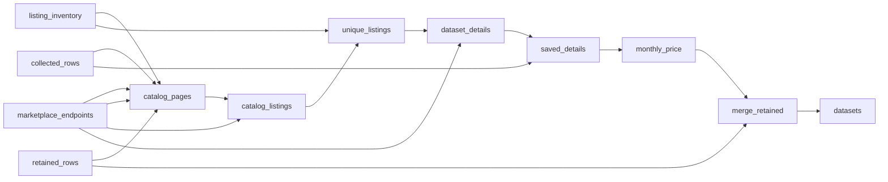

# Datarade Dataset Catalog

 Published by Jason, Jsonify’s AI data engineer.

Datarade dataset catalog with dataset descriptions, pricing details, and provider ratings and review counts\.

[Get the full dataset for free](https://www.jsonify.com/datasets/datasets-for-sale-3fb2e8b82ab2?action=get) — CSV or JSON · Email required

- Refresh: On demand
- Active pipeline version: 7
- Last published: 2026-10-30T14:57:36.549200Z

## The brief

> I need this data: Datarade dataset catalog with dataset descriptions, pricing details, and provider ratings and review counts\.

Summary from the public dataset description.

## Datarade datasets for sale / datasets

2,505 total rows · 500 sampled · Output revision 3
Published: 2026-10-30T14:57:36.549200Z · Producing pipeline version: Unknown

[CSV sample](outputs/8013588df6ed/datasets-714284abfa95/sample.csv) · [JSON sample](outputs/8013588df6ed/datasets-714284abfa95/sample.json) · [Schema](outputs/8013588df6ed/datasets-714284abfa95/schema.json)

| catalog\_position | collected\_at | dataset\_name | dataset\_url | description | price | price\_currencies | pricing\_details |
| --- | --- | --- | --- | --- | --- | --- | --- |
| 1 | 2026\-10\-30T13:46:18\.919811\+00:00 | U\.S\. Federal Contractor Master Vault: SBA Crosswalked Firmographics &amp; Funding Velocity | [https://datarade\.ai/data\-products/u\-s\-federal\-contractor\-master\-vault\-sba\-crosswalked\-firmogr\-apex\-firmographics](<https://datarade.ai/data-products/u-s-federal-contractor-master-vault-sba-crosswalked-firmogr-apex-firmographics>) | The U\.S\. Federal Contractor Master Vault is an enterprise\-grade B2G int… | Yearly License: $85,000 / year | USD | License Starts at One\-off purchase Not available Monthly License Not available Yearly License $85,000 / year Usage\-based Not available Request detailed pricing |
| 2 | 2026\-10\-30T13:46:19\.012280\+00:00 | B2B Email List – Verified Business Contacts &amp; Decision\-Makers | [https://datarade\.ai/data\-products/b2b\-email\-list\-verified\-business\-contacts\-decision\-makers\-avention\-media](<https://datarade.ai/data-products/b2b-email-list-verified-business-contacts-decision-makers-avention-media>) | Avention Media’s B2B Email List is a business contact dataset designed … | None | None | Avention Media has not published pricing information for this product yet\.         You can request detailed pricing information below\. Request detailed pricing |
| 3 | 2026\-10\-30T13:46:19\.182115\+00:00 | Government Contract Awards &amp; Tender Data \| Point\-in\-Time, Linked to Company Identifiers \| 133 Official Sources | [https://datarade\.ai/data\-products/government\-contract\-awards\-tender\-data\-point\-in\-time\-lin\-valan\-io](<https://datarade.ai/data-products/government-contract-awards-tender-data-point-in-time-lin-valan-io>) | Valan collects tender notices, contract awards and sub\-awards that publ… | None | None | License Starts at One\-off purchase Not available Monthly License Not available Yearly License Available Usage\-based Not available Request detailed pricing |
| 4 | 2026\-10\-30T13:46:19\.312455\+00:00 | Synthetic CCTV Weapon Detection Image Data \| Handgun, Rifle, Shotgun \| YOLO \+ COCO Annotations | [https://datarade\.ai/data\-products/synthetic\-cctv\-weapon\-detection\-image\-data\-handgun\-rifle\-simuletic](<https://datarade.ai/data-products/synthetic-cctv-weapon-detection-image-data-handgun-rifle-simuletic>) | Weapon detection models fail in the real world for two reasons: too few… | One\-off purchase: $790 / purchase | USD | License Starts at One\-off purchase $790 / purchase Monthly License Not available Yearly License Not available Usage\-based Not available Request detailed pricing |
| 5 | 2026\-10\-30T13:46:20\.195912\+00:00 | Synthetic Strawberry Dataset for Computer Vision, Object Detection and Segmentation | [https://datarade\.ai/data\-products/synthetic\-strawberry\-dataset\-for\-computer\-vision\-object\-dete\-demcon\-data\-driven\-solutions](<https://datarade.ai/data-products/synthetic-strawberry-dataset-for-computer-vision-object-dete-demcon-data-driven-solutions>) | The Synthetic Strawberry Dataset is a high\-quality computer vision trai… | None | None | License Starts at One\-off purchase Available Monthly License Not available Yearly License Not available Usage\-based Not available Request detailed pricing |

Preview shows up to 5 rows and 8 columns. Sample files contain all public columns for included rows.

### Schema

| Column | Type |
| --- | --- |
| catalog\_position | bigint |
| collected\_at | text |
| dataset\_name | text |
| dataset\_url | text |
| description | text |
| price | text |
| price\_currencies | text |
| pricing\_details | text |
| pricing\_status | text |
| provider | text |
| provider\_rating | double precision |
| provider\_review\_count | bigint |
| signal\_note | text |
| price\_monthly | double precision |
| price\_yearly | double precision |
| price\_one\_off | double precision |
| price\_usage | double precision |
| price\_usage\_unit | text |

## How the pipeline works

- **collected\_rows**: Optional saved listing details for local price enrichment without fetching pages\.
- **listing\_inventory**: Optional exact previously discovered listing rows to reuse instead of catalog discovery\.
- **retained\_rows**: Optional saved listings to preserve for marketplaces not being refreshed\.
- **marketplace\_endpoints**: Public marketplace catalog and read API endpoints\.
- **catalog\_pages**: Discover source catalog totals and the independent pages or dataset offers to read\.
- **catalog\_listings**: Read independent public catalog pages and preserve source listing metadata\.
- **unique\_listings**: Deduplicate exact source listing URLs and check complete catalog inventories\.
- **dataset\_details**: Keep structured catalog records or read identity\-checked Datarade and Bright Data dataset details\.
- **saved\_details**: Reuse saved listing details when supplied, otherwise keep freshly collected details\.
- **monthly\_price**: Separate published monthly, yearly, one\-off and usage amounts into sortable numeric columns in their original currency\.
- **merge\_retained**: Combine refreshed marketplaces with saved listings from other sources, retaining every published field\.
- **datasets**: Public dataset offers across selected marketplaces, with original pricing conditions and clearly labelled source signals\.

## Version history

- 2026-10-30T13:39:40.997478Z: v1: Adds the Datarade catalog collector with published pricing, provider ratings and review counts\.
- 2026-10-30T13:58:59.370371Z: v2: Recovers dataset pages that reject the first reading method, preserving completed work and all requested fields\.
- 2026-10-30T14:55:40.485664Z: v3: Adds a numeric monthly price column from published monthly license prices, leaving unavailable amounts empty\.
- 2026-10-30T14:56:59.430694Z: v4: Adds sortable yearly, one\-off and usage prices alongside monthly prices, retaining currencies and usage units\.
- 2026-10-30T15:00:33.589103Z: v5: Adds Datarade categories, country lists, history length and published delivery frequency for the next collection\.
- 2026-10-30T20:35:32.893771Z: v6: Expand the public dataset catalog across marketplace and vendor sources, preserving existing fields and adding source identities, pricing conditions and coverage\. Exclude live scrapers and skip login\-required catalogs\.
- 2026-10-30T20:41:42.064764Z: v7: Fix Databricks collection to include packaged media datasets and filter out software, connectors and live scraping tools\.

## Recorded repairs

- 2026-10-30T20:50:17.682607Z: no change
- 2026-10-30T20:51:19.962948Z: repaired

[Get the full dataset for free](https://www.jsonify.com/datasets/datasets-for-sale-3fb2e8b82ab2?action=get) — CSV or JSON · Email required

[Build your own dataset](https://factory.jsonify.com/setup)

Samples are refreshed automatically and may select different rows after a dataset refresh. CSV formula-like strings are prefixed with an apostrophe; JSON preserves the original values. Git history may retain older samples. See the dataset page to report a problem or request removal.
