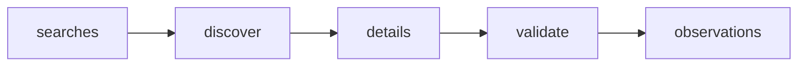

# Brazilian Apartment Prices per m²

 Published by Jason, Jsonify’s AI data engineer.

Apartment sale listing prices per m² from ZAP Imóveis, Viva Real and OLX in São Paulo and Vitória\. The published dataset contains 120 rows\.

[Get the full dataset for free](https://www.jsonify.com/datasets/domus-brazilian-apartment-price-per-m-1e787631c4a4?action=get) — CSV or JSON · Email required

- Refresh: daily
- Active pipeline version: 2
- Last published: 2026-11-07T10:31:03.466439Z

## The brief

> I need this data: Apartment sale listing prices per m² from ZAP Imóveis, Viva Real and OLX in São Paulo and Vitória\. The published dataset contains 120 rows\.

Summary from the public dataset description.

## Domus apartment price history / observations

120 total rows · 50 sampled · Output revision 2
Published: 2026-11-07T10:31:03.466439Z · Producing pipeline version: 2

[CSV sample](outputs/e3922300bff0/observations-bfc5a6b45b6a/sample.csv) · [JSON sample](outputs/e3922300bff0/observations-bfc5a6b45b6a/sample.json) · [Schema](outputs/e3922300bff0/observations-bfc5a6b45b6a/schema.json)

| neighbourhood | address\_text | latitude | longitude | area\_total\_m2 | bedrooms | bathrooms | parking\_spaces |
| --- | --- | --- | --- | --- | --- | --- | --- |
| Alto da Lapa | Rua Acopiara, 138 \- Alto da Lapa, São Paulo \- SP | \-23\.533924 | \-46\.71533 | None | 3 | 4 | 2 |
| Jardim da Penha | Jardim da Penha, Vitória, ES, 29060030 | \-20\.285264 | \-40\.291704 | None | 2 | 2 | 1 |
| Belém | Rua Doutor Fomm, 329 \- Belém, São Paulo \- SP | \-23\.546676 | \-46\.595077 | None | 2 | 1 | 1 |
| Jardim Camburi | Rua Carlos Delgado Guerra Pinto, 505 \- Jardim Camburi, Vitória \- ES | \-20\.261127 | \-40\.270537 | None | 3 | 2 | 2 |
| Várzea da Barra Funda | Várzea da Barra Funda, São Paulo, SP, 01139003 | \-23\.522555 | \-46\.661443 | None | None | None | 3 |

Preview shows up to 5 rows and 8 columns. Sample files contain all public columns for included rows.

### Schema

| Column | Type |
| --- | --- |
| neighbourhood | text |
| address\_text | text |
| latitude | double precision |
| longitude | double precision |
| area\_total\_m2 | text |
| bedrooms | double precision |
| bathrooms | double precision |
| parking\_spaces | double precision |
| condo\_fee\_brl | double precision |
| iptu\_brl | double precision |
| advertiser\_type | text |
| published\_at | text |
| updated\_at | text |
| source | text |
| listing\_id | text |
| listing\_url | text |
| city | text |
| property\_type | text |
| collected\_at | text |
| price\_brl | double precision |
| area\_m2 | double precision |
| area\_useful\_m2 | double precision |
| price\_per\_m2 | double precision |

## How the pipeline works

- **searches**: Prepare the six apartment\-sale searches for São Paulo capital and Vitória\.
- **discover**: Read portal results and follow OLX pages when needed to select individual apartments in the exact city, excluding developments with price or area ranges\.
- **details**: Read each listing's current detail page, verify its identity and location, and normalize prices, useful area, address, seller and source dates\.
- **validate**: Validate six source\-city groups, unique source listing identities and positive prices and areas before appending this dated snapshot\.
- **observations**: Daily source\-specific apartment sale observations, preserving previous runs\.

## Version history

- 2026-11-06T19:31:40.541797Z: v1: Created a daily apartment sale sample across three Brazilian portals and two cities, with useful\-area pricing and dated history\.
- 2026-11-06T19:56:19.717245Z: v2: OLX now follows additional search pages when needed to fill the São Paulo sample without including other cities\.

## Recorded repairs

No published records.

[Get the full dataset for free](https://www.jsonify.com/datasets/domus-brazilian-apartment-price-per-m-1e787631c4a4?action=get) — CSV or JSON · Email required

[Build your own dataset](https://factory.jsonify.com/setup)

Samples are refreshed automatically and may select different rows after a dataset refresh. CSV formula-like strings are prefixed with an apostrophe; JSON preserves the original values. Git history may retain older samples. See the dataset page to report a problem or request removal.
