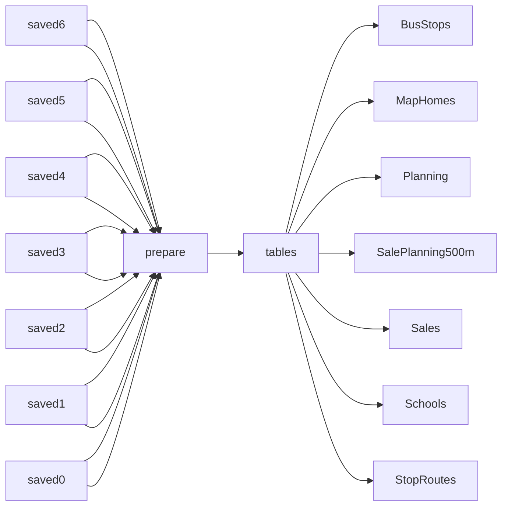

# Dublin D6 and D6W Property and Local Data

 Published by Jason, Jsonify’s AI data engineer.

Dublin D6 and D6W data on property sales, planning records, schools and public transport, with source and licence fields\.

[Get the full dataset for free](https://www.jsonify.com/datasets/dublin-d6-and-d6w-open-data-462fff970ded?action=get) — CSV or JSON · Email required

- Refresh: On demand
- Active pipeline version: 1
- Last published: 2026-11-13T15:59:30.411523Z

## The brief

> I need this data: Dublin D6 and D6W data on property sales, planning records, schools and public transport, with source and licence fields\.

Summary from the public dataset description.

## Dublin D6 and D6W open data / Sales

25 total rows · 10 sampled · Output revision 1
Published: 2026-11-13T15:59:30.411523Z · Producing pipeline version: 1

[CSV sample](outputs/20726e85e98d/sales-8de4e0ea7370/sample.csv) · [JSON sample](outputs/20726e85e98d/sales-8de4e0ea7370/sample.json) · [Schema](outputs/20726e85e98d/sales-8de4e0ea7370/schema.json)

| address | address\_original | attribution | county | eircode | geocode\_licence | geocode\_licence\_url | geocode\_match\_address |
| --- | --- | --- | --- | --- | --- | --- | --- |
| 71 BRIGHTON SQ, RATHGAR, DUBLIN 6 | 71 BRIGHTON SQ, RATHGAR, DUBLIN 6 | Property Services Regulatory Authority; address case/whitespace normalised, prices/dates parsed and context joined by Jsonify | Dublin | D06DK00 | CC BY 4\.0 | [https://creativecommons\.org/licenses/by/4\.0/](<https://creativecommons.org/licenses/by/4.0/>) | 71, Brighton Square, Rathgar, Dublin 6 |
| 30 ANNESLEY PARK, RANELAGH, DUBLIN 6 | 30 ANNESLEY PARK, RANELAGH, DUBLIN 6 | Property Services Regulatory Authority; address case/whitespace normalised, prices/dates parsed and context joined by Jsonify | Dublin | D06V2A8 | CC BY 4\.0 | [https://creativecommons\.org/licenses/by/4\.0/](<https://creativecommons.org/licenses/by/4.0/>) | 30, Annesley Park, Ranelagh, Dublin 6, D06 V2A8 |
| 8 DUNVILLE AVE, RANELAGH DUBLIN 6, DUBLIN | 8 DUNVILLE AVE, RANELAGH DUBLIN 6, DUBLIN | Property Services Regulatory Authority; address case/whitespace normalised, prices/dates parsed and context joined by Jsonify | Dublin | D06E519 | None | None | None |
| 16 THE LAURELS, TERENURE RD WEST, DUBLIN 6W | 16 THE LAURELS, TERENURE RD WEST, DUBLIN 6W | Property Services Regulatory Authority; address case/whitespace normalised, prices/dates parsed and context joined by Jsonify | Dublin | D6WYP60 | None | None | None |
| 3 SUNBURY PARK, DARTRY, DUBLIN 6 | 3 SUNBURY PARK, DARTRY, DUBLIN 6 | Property Services Regulatory Authority; address case/whitespace normalised, prices/dates parsed and context joined by Jsonify | Dublin | D06DK57 | None | None | None |

Preview shows up to 5 rows and 8 columns. Sample files contain all public columns for included rows.

### Schema

| Column | Type |
| --- | --- |
| address | text |
| address\_original | text |
| attribution | text |
| county | text |
| eircode | text |
| geocode\_licence | text |
| geocode\_licence\_url | text |
| geocode\_match\_address | text |
| geocode\_method | text |
| geocode\_planning\_ids | text |
| geocode\_source\_url | text |
| geocode\_status | text |
| latitude | double precision |
| licence | text |
| licence\_url | text |
| longitude | double precision |
| nearest\_bus\_stop\_distance\_m | double precision |
| nearest\_bus\_stop\_id | text |
| nearest\_bus\_stop\_name | text |
| nearest\_school\_distance\_m | double precision |
| nearest\_school\_id | text |
| nearest\_school\_level | text |
| nearest\_school\_name | text |
| not\_full\_market\_price | boolean |
| planning\_count\_500m | integer |
| planning\_scope | text |
| price\_eur | integer |
| property\_condition | text |
| property\_description | text |
| property\_size\_description | text |
| record\_type | text |
| retrieved\_date | text |
| sale\_date | text |
| sale\_id | text |
| sample\_selection | text |
| source\_url | text |
| vat\_exclusive | boolean |

## Dublin D6 and D6W open data / Planning

3,284 total rows · 50 sampled · Output revision 1
Published: 2026-11-13T15:59:30.411523Z · Producing pipeline version: 1

[CSV sample](outputs/20726e85e98d/planning-21cc30509578/sample.csv) · [JSON sample](outputs/20726e85e98d/planning-21cc30509578/sample.json) · [Schema](outputs/20726e85e98d/planning-21cc30509578/schema.json)

| address | application\_type | attribution | council | decision | decision\_date | description | grant\_date |
| --- | --- | --- | --- | --- | --- | --- | --- |
| 22, Parnell Road, Harolds Cross, Dublin 12 | Permission | Department of Housing, Local Government and Heritage; Dublin City Council; filtered and normalised by Jsonify | Dublin City Council | APPLICATION DECLARED INVA | 2023\-10\-18 | PROTECTED STRUCTURE::Permission is sought for the restoration, extension and refurbishment of the existing protected structure comprising of; Demolition of existing two\-storey and single\-storey extension and boiler house to the rear of the existing dwelling, Demolition and reconstruction of boundary wall to the rear of the existing dwelling, Internal alterations and restorative works, Restoration works to front facade, including; reinstatement of parapet wall, adjustment of a first floor window, replacement of existing door and windows, replacement of existing render with traditional lime\-render, Construction of a new three\-storey, two\-storey, single\-storey extension with flat roofs and rooflights to the rear of the existing dwelling\. Demolition and removal of part of rear pitch of existing roof and construction of new flat\-roof, and All associated ancillary site works\. | None |
| Symphony House, Adelaide Road, Dublin 2 | Permission | Department of Housing, Local Government and Heritage; Dublin City Council; filtered and normalised by Jsonify | Dublin City Council | GRANT PERMISSION | 2021\-05\-10 | The development will consist of works to bring the existing building into compliance with a proposed regularised fire safety certificate, including the creation of three new openings to the external wall for automatic openings vents \(AOVs\) and the replacement of four number existing windows with AOVs to the West elevation of the apartment block \(all AOVs are to be opaque\), the installation of an AOV over the staircase at roof level and the installation of a vent from a smoke extract system on the south elevation at basement level\. | 2021\-06\-22 |
| 261, Harolds Cross Road, Dublin 6W, D6WKO99 | Permission | Department of Housing, Local Government and Heritage; Dublin City Council; filtered and normalised by Jsonify | Dublin City Council | GRANT PERMISSION AND RETE | 2023\-10\-05 | PERMISSION &amp; RETENTION: Permission for retention of the following works to the two\-storey building at the rear: 1\. Lowering of the cill height of 4 x No\. rear\-facing windows into French Windows: 2\. A 4sqm extension to the north\-east elevation\. 3\. The extension of the side wall 1\.4M to the south\-west elevation\. 4\. The removal of the timber fascia and construction of a parapet wall and capping 250mm above existing fascia\. 5\. Demolition of the 8\.5sqm single\-storey rear extension and 6\.1sqm outbuilding and replacement with 12\.5sqm single\-storey rear extension\. Planning permission for the following works; 3 x roof dormers to the front, a 1M high 6\.5sqm water tank enclosure on the rear flat roof\. | 2024\-07\-17 |
| 26B, Oakley Road, Ranelagh, Dublin 6 | Permission | Department of Housing, Local Government and Heritage; Dublin City Council; filtered and normalised by Jsonify | Dublin City Council | APPLICATION DECLARED INVA | 2019\-10\-21 | The proposed development will consist of internal alterations to existing ground and first floor levels, the construction of a single\-storey extension to the rear, and dormer extension at roof level of the existing dwelling, all along with associated landscaping, ancillary and site works\. | None |
| 27 Brookfield Kimmage, Dublin 12 | Permission | Department of Housing, Local Government and Heritage; Dublin City Council; filtered and normalised by Jsonify | Dublin City Council | GRANT PERMISSION | 2024\-02\-02 | Permission for a new dormer window to the rear and removing the existing chimney and 2 No rooflights and fit 1 No new rooflight to the front \(east\) elevation\. | 2024\-03\-13 |

Preview shows up to 5 rows and 8 columns. Sample files contain all public columns for included rows.

### Schema

| Column | Type |
| --- | --- |
| address | text |
| application\_type | text |
| attribution | text |
| council | text |
| decision | text |
| decision\_date | text |
| description | text |
| grant\_date | text |
| latitude | double precision |
| licence | text |
| licence\_url | text |
| longitude | double precision |
| planning\_id | text |
| received\_date | text |
| record\_type | text |
| reference | text |
| source\_dataset\_url | text |
| source\_extract\_date | text |
| source\_locations | text |
| source\_point\_count | integer |
| source\_url | text |
| status | text |

## Dublin D6 and D6W open data / Schools

81 total rows · 10 sampled · Output revision 1
Published: 2026-11-13T15:59:30.411523Z · Producing pipeline version: 1

[CSV sample](outputs/20726e85e98d/schools-af2e91296939/sample.csv) · [JSON sample](outputs/20726e85e98d/schools-af2e91296939/sample.json) · [Schema](outputs/20726e85e98d/schools-af2e91296939/schema.json)

| address | attribution | county | eircode | enrolment | enrolment\_census\_date | enrolment\_year | latitude |
| --- | --- | --- | --- | --- | --- | --- | --- |
| Upper Churchtown Road, Churchtown, Dublin 14 | Department of Education and Youth; filtered and normalised by Jsonify | Dublin | D14A0T9 | 463 | 2025\-09\-30 | 2025/2026 | 53\.296986 |
| Teach Feadha Chuileann, Bóthar Oakley, Raghnallach, Baile Átha Cliath 6 | Department of Education and Youth; filtered and normalised by Jsonify | Dublin | D06WF43 | 188 | 2025\-09\-30 | 2025/2026 | 53\.322155 |
| Bushy Park Road, Rathgar, Dublin 6 | Department of Education and Youth; filtered and normalised by Jsonify | Dublin | D06K062 | 91 | 2025\-09\-30 | 2025/2026 | 53\.307955 |
| Whitefriar Street, Dublin 8 | Department of Education and Youth; filtered and normalised by Jsonify | Dublin | D08FW29 | 148 | 2025\-09\-30 | 2025/2026 | 53\.34035 |
| Sandford Road, Ranelagh, Dublin 6 | Department of Education and Youth; filtered and normalised by Jsonify | Dublin | D06FN29 | 437 | 2025\-09\-30 | 2025/2026 | 53\.321874 |

Preview shows up to 5 rows and 8 columns. Sample files contain all public columns for included rows.

### Schema

| Column | Type |
| --- | --- |
| address | text |
| attribution | text |
| county | text |
| eircode | text |
| enrolment | integer |
| enrolment\_census\_date | text |
| enrolment\_year | text |
| latitude | double precision |
| level | text |
| licence | text |
| licence\_evidence\_url | text |
| licence\_url | text |
| longitude | double precision |
| name | text |
| record\_type | text |
| school\_id | text |
| source\_url | text |

## Dublin D6 and D6W open data / BusStops

303 total rows · 50 sampled · Output revision 1
Published: 2026-11-13T15:59:30.411523Z · Producing pipeline version: 1

[CSV sample](outputs/20726e85e98d/busstops-ed7742c8bfc6/sample.csv) · [JSON sample](outputs/20726e85e98d/busstops-ed7742c8bfc6/sample.json) · [Schema](outputs/20726e85e98d/busstops-ed7742c8bfc6/schema.json)

| attribution | latitude | licence | licence\_evidence\_url | licence\_url | longitude | name | record\_type |
| --- | --- | --- | --- | --- | --- | --- | --- |
| National Transport Authority; filtered and stop\-trip\-route joined by Jsonify | 53\.3101 | CC BY 4\.0 | [https://data\.gov\.ie/dataset/nta\-gtfs](<https://data.gov.ie/dataset/nta-gtfs>) | [https://creativecommons\.org/licenses/by/4\.0/](<https://creativecommons.org/licenses/by/4.0/>) | \-6\.282377 | Terenure Rd E | Bus stop |
| National Transport Authority; filtered and stop\-trip\-route joined by Jsonify | 53\.318921 | CC BY 4\.0 | [https://data\.gov\.ie/dataset/nta\-gtfs](<https://data.gov.ie/dataset/nta-gtfs>) | [https://creativecommons\.org/licenses/by/4\.0/](<https://creativecommons.org/licenses/by/4.0/>) | \-6\.281393 | Westfield Rd | Bus stop |
| National Transport Authority; filtered and stop\-trip\-route joined by Jsonify | 53\.334251 | CC BY 4\.0 | [https://data\.gov\.ie/dataset/nta\-gtfs](<https://data.gov.ie/dataset/nta-gtfs>) | [https://creativecommons\.org/licenses/by/4\.0/](<https://creativecommons.org/licenses/by/4.0/>) | \-6\.27492 | Clanbrassil Lwr | Bus stop |
| National Transport Authority; filtered and stop\-trip\-route joined by Jsonify | 53\.332891 | CC BY 4\.0 | [https://data\.gov\.ie/dataset/nta\-gtfs](<https://data.gov.ie/dataset/nta-gtfs>) | [https://creativecommons\.org/licenses/by/4\.0/](<https://creativecommons.org/licenses/by/4.0/>) | \-6\.27538 | Leonard's Corner | Bus stop |
| National Transport Authority; filtered and stop\-trip\-route joined by Jsonify | 53\.3297279908157 | CC BY 4\.0 | [https://data\.gov\.ie/dataset/nta\-gtfs](<https://data.gov.ie/dataset/nta-gtfs>) | [https://creativecommons\.org/licenses/by/4\.0/](<https://creativecommons.org/licenses/by/4.0/>) | \-6\.24888799835488 | Sussex Road | Bus stop |

Preview shows up to 5 rows and 8 columns. Sample files contain all public columns for included rows.

### Schema

| Column | Type |
| --- | --- |
| attribution | text |
| latitude | double precision |
| licence | text |
| licence\_evidence\_url | text |
| licence\_url | text |
| longitude | double precision |
| name | text |
| record\_type | text |
| route\_count | integer |
| routes | text |
| service\_date | text |
| source\_url | text |
| stop\_code | text |
| stop\_id | text |

## Dublin D6 and D6W open data / StopRoutes

1,234 total rows · 50 sampled · Output revision 1
Published: 2026-11-13T15:59:30.411523Z · Producing pipeline version: 1

[CSV sample](outputs/20726e85e98d/stoproutes-b9f8aba80717/sample.csv) · [JSON sample](outputs/20726e85e98d/stoproutes-b9f8aba80717/sample.json) · [Schema](outputs/20726e85e98d/stoproutes-b9f8aba80717/schema.json)

| agency\_id | licence | licence\_url | route\_id | route\_long\_name | route\_short\_name | service\_date | source\_url |
| --- | --- | --- | --- | --- | --- | --- | --- |
| 1 | CC BY 4\.0 | [https://creativecommons\.org/licenses/by/4\.0/](<https://creativecommons.org/licenses/by/4.0/>) | 1 7B c a | Shankill \- Mountjoy Square | 7B | 2026\-11\-11 | [https://www\.transportforireland\.ie/transitData/Data/GTFS\_All\.zip](<https://www.transportforireland.ie/transitData/Data/GTFS_All.zip>) |
| 3 | CC BY 4\.0 | [https://creativecommons\.org/licenses/by/4\.0/](<https://creativecommons.org/licenses/by/4.0/>) | 3 S4 a | Liffey Valley \- UCD | S4 | 2026\-11\-11 | [https://www\.transportforireland\.ie/transitData/Data/GTFS\_All\.zip](<https://www.transportforireland.ie/transitData/Data/GTFS_All.zip>) |
| 1 | CC BY 4\.0 | [https://creativecommons\.org/licenses/by/4\.0/](<https://creativecommons.org/licenses/by/4.0/>) | 1 82 a | Irishtown \- Kiltipper | 82 | 2026\-11\-11 | [https://www\.transportforireland\.ie/transitData/Data/GTFS\_All\.zip](<https://www.transportforireland.ie/transitData/Data/GTFS_All.zip>) |
| 1 | CC BY 4\.0 | [https://creativecommons\.org/licenses/by/4\.0/](<https://creativecommons.org/licenses/by/4.0/>) | 1 F1 a | The Square Tallaght \- IKEA | F1 | 2026\-11\-11 | [https://www\.transportforireland\.ie/transitData/Data/GTFS\_All\.zip](<https://www.transportforireland.ie/transitData/Data/GTFS_All.zip>) |
| 1 | CC BY 4\.0 | [https://creativecommons\.org/licenses/by/4\.0/](<https://creativecommons.org/licenses/by/4.0/>) | 1 44D a | Dundrum \- OCS | 44D | 2026\-11\-11 | [https://www\.transportforireland\.ie/transitData/Data/GTFS\_All\.zip](<https://www.transportforireland.ie/transitData/Data/GTFS_All.zip>) |

Preview shows up to 5 rows and 8 columns. Sample files contain all public columns for included rows.

### Schema

| Column | Type |
| --- | --- |
| agency\_id | text |
| licence | text |
| licence\_url | text |
| route\_id | text |
| route\_long\_name | text |
| route\_short\_name | text |
| service\_date | text |
| source\_url | text |
| stop\_id | text |

## Dublin D6 and D6W open data / SalePlanning500m

6,947 total rows · 50 sampled · Output revision 1
Published: 2026-11-13T15:59:30.411523Z · Producing pipeline version: 1

[CSV sample](outputs/20726e85e98d/saleplanning500m-d3656c309822/sample.csv) · [JSON sample](outputs/20726e85e98d/saleplanning500m-d3656c309822/sample.json) · [Schema](outputs/20726e85e98d/saleplanning500m-d3656c309822/schema.json)

| distance\_m | licence | licence\_url | method | planning\_id | planning\_licence\_url | planning\_source\_url | radius\_m |
| --- | --- | --- | --- | --- | --- | --- | --- |
| 345\.2 | PSRA reuse conditions \(free reuse with attribution and restrictions; not CC BY\); planning: CC BY 4\.0 | [https://www\.psr\.ie/re\-use\-of\-public\-sector\-information/](<https://www.psr.ie/re-use-of-public-sector-information/>) | Haversine straight\-line distance to official planning point; each council/application reference counted once | DCC:2325/19 | [https://creativecommons\.org/licenses/by/4\.0/](<https://creativecommons.org/licenses/by/4.0/>) | [https://services\.arcgis\.com/NzlPQPKn5QF9v2US/arcgis/rest/services/IrishPlanningApplications/FeatureServer/0/query?f=json&amp;objectIds=27724&amp;outFields=\*&amp;outSR=4326](<https://services.arcgis.com/NzlPQPKn5QF9v2US/arcgis/rest/services/IrishPlanningApplications/FeatureServer/0/query?f=json&amp;objectIds=27724&amp;outFields=*&amp;outSR=4326>) | 500 |
| 314\.8 | PSRA reuse conditions \(free reuse with attribution and restrictions; not CC BY\); planning: CC BY 4\.0 | [https://www\.psr\.ie/re\-use\-of\-public\-sector\-information/](<https://www.psr.ie/re-use-of-public-sector-information/>) | Haversine straight\-line distance to official planning point; each council/application reference counted once | DCC:WEB1821/24 | [https://creativecommons\.org/licenses/by/4\.0/](<https://creativecommons.org/licenses/by/4.0/>) | [https://services\.arcgis\.com/NzlPQPKn5QF9v2US/arcgis/rest/services/IrishPlanningApplications/FeatureServer/0/query?f=json&amp;objectIds=70640&amp;outFields=\*&amp;outSR=4326](<https://services.arcgis.com/NzlPQPKn5QF9v2US/arcgis/rest/services/IrishPlanningApplications/FeatureServer/0/query?f=json&amp;objectIds=70640&amp;outFields=*&amp;outSR=4326>) | 500 |
| 256 | PSRA reuse conditions \(free reuse with attribution and restrictions; not CC BY\); planning: CC BY 4\.0 | [https://www\.psr\.ie/re\-use\-of\-public\-sector\-information/](<https://www.psr.ie/re-use-of-public-sector-information/>) | Haversine straight\-line distance to official planning point; each council/application reference counted once | DCC:WEB1313/25 | [https://creativecommons\.org/licenses/by/4\.0/](<https://creativecommons.org/licenses/by/4.0/>) | [https://services\.arcgis\.com/NzlPQPKn5QF9v2US/arcgis/rest/services/IrishPlanningApplications/FeatureServer/0/query?f=json&amp;objectIds=20687&amp;outFields=\*&amp;outSR=4326](<https://services.arcgis.com/NzlPQPKn5QF9v2US/arcgis/rest/services/IrishPlanningApplications/FeatureServer/0/query?f=json&amp;objectIds=20687&amp;outFields=*&amp;outSR=4326>) | 500 |
| 499\.6 | PSRA reuse conditions \(free reuse with attribution and restrictions; not CC BY\); planning: CC BY 4\.0 | [https://www\.psr\.ie/re\-use\-of\-public\-sector\-information/](<https://www.psr.ie/re-use-of-public-sector-information/>) | Haversine straight\-line distance to official planning point; each council/application reference counted once | DCC:WEB1447/22 | [https://creativecommons\.org/licenses/by/4\.0/](<https://creativecommons.org/licenses/by/4.0/>) | [https://services\.arcgis\.com/NzlPQPKn5QF9v2US/arcgis/rest/services/IrishPlanningApplications/FeatureServer/0/query?f=json&amp;objectIds=507846&amp;outFields=\*&amp;outSR=4326](<https://services.arcgis.com/NzlPQPKn5QF9v2US/arcgis/rest/services/IrishPlanningApplications/FeatureServer/0/query?f=json&amp;objectIds=507846&amp;outFields=*&amp;outSR=4326>) | 500 |
| 229\.7 | PSRA reuse conditions \(free reuse with attribution and restrictions; not CC BY\); planning: CC BY 4\.0 | [https://www\.psr\.ie/re\-use\-of\-public\-sector\-information/](<https://www.psr.ie/re-use-of-public-sector-information/>) | Haversine straight\-line distance to official planning point; each council/application reference counted once | DCC:3078/23 | [https://creativecommons\.org/licenses/by/4\.0/](<https://creativecommons.org/licenses/by/4.0/>) | [https://services\.arcgis\.com/NzlPQPKn5QF9v2US/arcgis/rest/services/IrishPlanningApplications/FeatureServer/0/query?f=json&amp;objectIds=27625&amp;outFields=\*&amp;outSR=4326](<https://services.arcgis.com/NzlPQPKn5QF9v2US/arcgis/rest/services/IrishPlanningApplications/FeatureServer/0/query?f=json&amp;objectIds=27625&amp;outFields=*&amp;outSR=4326>) | 500 |

Preview shows up to 5 rows and 8 columns. Sample files contain all public columns for included rows.

### Schema

| Column | Type |
| --- | --- |
| distance\_m | double precision |
| licence | text |
| licence\_url | text |
| method | text |
| planning\_id | text |
| planning\_licence\_url | text |
| planning\_source\_url | text |
| radius\_m | integer |
| sale\_id | text |
| source\_url | text |

## Dublin D6 and D6W open data / MapHomes

20 total rows · 10 sampled · Output revision 1
Published: 2026-11-13T15:59:30.411523Z · Producing pipeline version: 1

[CSV sample](outputs/20726e85e98d/maphomes-38b3a6d3f480/sample.csv) · [JSON sample](outputs/20726e85e98d/maphomes-38b3a6d3f480/sample.json) · [Schema](outputs/20726e85e98d/maphomes-38b3a6d3f480/schema.json)

| address | latitude | licence | licence\_url | longitude | sale\_id | source\_url |
| --- | --- | --- | --- | --- | --- | --- |
| 1 COWPER RD, RATHMINES, DUBLIN 6 | 53\.31540161033141 | PSRA reuse conditions \(free reuse with attribution and restrictions; not CC BY\) | [https://www\.psr\.ie/re\-use\-of\-public\-sector\-information/](<https://www.psr.ie/re-use-of-public-sector-information/>) | \-6\.264635765538276 | sale:2de7223b71900c18 | [https://www\.propertypriceregister\.ie/website/npsra/ppr/npsra\-ppr\.nsf/Downloads/PPR\-ALL\.zip/$FILE/PPR\-ALL\.zip](<https://www.propertypriceregister.ie/website/npsra/ppr/npsra-ppr.nsf/Downloads/PPR-ALL.zip/$FILE/PPR-ALL.zip>) |
| 109 HAROLDS CROSS COTTAGES, HAROLDS CROSS, DUBLIN 6 | 53\.32808243781118 | PSRA reuse conditions \(free reuse with attribution and restrictions; not CC BY\) | [https://www\.psr\.ie/re\-use\-of\-public\-sector\-information/](<https://www.psr.ie/re-use-of-public-sector-information/>) | \-6\.274927688333931 | sale:cbf4ba6105e7235f | [https://www\.propertypriceregister\.ie/website/npsra/ppr/npsra\-ppr\.nsf/Downloads/PPR\-ALL\.zip/$FILE/PPR\-ALL\.zip](<https://www.propertypriceregister.ie/website/npsra/ppr/npsra-ppr.nsf/Downloads/PPR-ALL.zip/$FILE/PPR-ALL.zip>) |
| 30 ANNESLEY PARK, RANELAGH, DUBLIN 6 | 53\.31959704392352 | PSRA reuse conditions \(free reuse with attribution and restrictions; not CC BY\) | [https://www\.psr\.ie/re\-use\-of\-public\-sector\-information/](<https://www.psr.ie/re-use-of-public-sector-information/>) | \-6\.256261780535251 | sale:ac936feccb155de7 | [https://www\.propertypriceregister\.ie/website/npsra/ppr/npsra\-ppr\.nsf/Downloads/PPR\-ALL\.zip/$FILE/PPR\-ALL\.zip](<https://www.propertypriceregister.ie/website/npsra/ppr/npsra-ppr.nsf/Downloads/PPR-ALL.zip/$FILE/PPR-ALL.zip>) |
| 12 TUDOR RD, RATHMINES, DUBLIN 6 | 53\.31704342236232 | PSRA reuse conditions \(free reuse with attribution and restrictions; not CC BY\) | [https://www\.psr\.ie/re\-use\-of\-public\-sector\-information/](<https://www.psr.ie/re-use-of-public-sector-information/>) | \-6\.253159369613501 | sale:e757ff9fd20eaad1 | [https://www\.propertypriceregister\.ie/website/npsra/ppr/npsra\-ppr\.nsf/Downloads/PPR\-ALL\.zip/$FILE/PPR\-ALL\.zip](<https://www.propertypriceregister.ie/website/npsra/ppr/npsra-ppr.nsf/Downloads/PPR-ALL.zip/$FILE/PPR-ALL.zip>) |
| 29 TERENURE ROAD EAST, RATHGAR, DUBLIN 6 | 53\.31119533020577 | PSRA reuse conditions \(free reuse with attribution and restrictions; not CC BY\) | [https://www\.psr\.ie/re\-use\-of\-public\-sector\-information/](<https://www.psr.ie/re-use-of-public-sector-information/>) | \-6\.276112725494448 | sale:bb7fdd84779d14c3 | [https://www\.propertypriceregister\.ie/website/npsra/ppr/npsra\-ppr\.nsf/Downloads/PPR\-ALL\.zip/$FILE/PPR\-ALL\.zip](<https://www.propertypriceregister.ie/website/npsra/ppr/npsra-ppr.nsf/Downloads/PPR-ALL.zip/$FILE/PPR-ALL.zip>) |

Preview shows up to 5 rows and 8 columns. Sample files contain all public columns for included rows.

### Schema

| Column | Type |
| --- | --- |
| address | text |
| latitude | double precision |
| licence | text |
| licence\_url | text |
| longitude | double precision |
| sale\_id | text |
| source\_url | text |

## How the pipeline works

- **saved6**: Read the existing saved worksheet without contacting any sources\.
- **saved5**: Read the existing saved worksheet without contacting any sources\.
- **saved4**: Read the existing saved worksheet without contacting any sources\.
- **saved3**: Read the existing saved worksheet without contacting any sources\.
- **saved2**: Read the existing saved worksheet without contacting any sources\.
- **saved1**: Read the existing saved worksheet without contacting any sources\.
- **saved0**: Read the existing saved worksheet without contacting any sources\.
- **prepare**: Copy the saved sample and sort it for public reading without refreshing sources\.
- **tables**: Keep the saved worksheets separate in the public workbook\.
- **Sales**: Existing saved sample records\.
- **Planning**: Existing saved sample records\.
- **Schools**: Existing saved sample records\.
- **BusStops**: Existing saved sample records\.
- **StopRoutes**: Existing saved sample records\.
- **SalePlanning500m**: Existing saved sample records\.
- **MapHomes**: Existing saved sample records\.

## Version history

- 2026-11-13T15:59:11.695610Z: v1: Make the saved sample available for a neutral public page without new collection\.

## Recorded repairs

No published records.

[Get the full dataset for free](https://www.jsonify.com/datasets/dublin-d6-and-d6w-open-data-462fff970ded?action=get) — CSV or JSON · Email required

[Build your own dataset](https://factory.jsonify.com/setup)

Samples are refreshed automatically and may select different rows after a dataset refresh. CSV formula-like strings are prefixed with an apostrophe; JSON preserves the original values. Git history may retain older samples. See the dataset page to report a problem or request removal.
