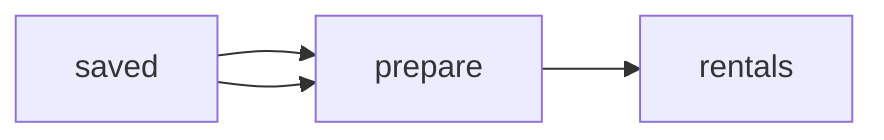

# Dutch Rental Property Candidates

 Published by Jason, Jsonify’s AI data engineer.

Dutch rental property candidates with rents in EUR, property details, source observations, and cost\-ambiguity flags\. The published dataset contains 299 rental listing candidates\.

[Get the full dataset for free](https://www.jsonify.com/datasets/dutch-rental-property-candidates-ede197223121?action=get) — CSV or JSON · Email required

- Refresh: On demand
- Active pipeline version: 1
- Last published: 2026-11-16T10:31:45.634983Z

## The brief

> I need this data: Dutch rental property candidates with rents in EUR, property details, source observations, and cost\-ambiguity flags\. The published dataset contains 299 rental listing candidates\.

Summary from the public dataset description.

## Dutch rental property candidates / rentals

299 total rows · 50 sampled · Output revision 1
Published: 2026-11-16T10:31:45.634983Z · Producing pipeline version: 1

[CSV sample](outputs/8dc04f188e90/rentals-14788a425070/sample.csv) · [JSON sample](outputs/8dc04f188e90/rentals-14788a425070/sample.json) · [Schema](outputs/8dc04f188e90/rentals-14788a425070/schema.json)

| advertised\_living\_area\_m2 | available\_from | bedrooms | city | collected\_at | cost\_evidence | days\_online | energy\_label |
| --- | --- | --- | --- | --- | --- | --- | --- |
| 79 | From 01\-01\-2027 | 2 | Utrecht | 2026\-11\-10T18:54:32\.444169\+00:00 | “Rental price €2,250 per month, excluding gas, water, electricity, TV, internet and municipal taxes\. The rental price includes service charges, laminate flooring and kitchen appliances” | 8 | A |
| 60 | From 01\-12\-2026 | 2 | Utrecht | 2026\-11\-10T18:41:11\.240117\+00:00 | Basic rent: € 1950 \(excl\. G/W/E\) Service costs: € 40 Total rent: € 1990 \(excl\. G/W/E\) | 0 | B |
| 22 | In consultation | None | The Hague | 2026\-11\-10T18:55:15\.569196\+00:00 | Rental price: € 810 per month\. Studio B1: approx\. 22 m² € 809\.30, 18 months\. The amounts stated are net rents\. Service charges and any additional costs are not included\. | 5 | A |
| 25 | Immediately | None | Rotterdam | 2026\-11\-10T18:40:53\.177158\+00:00 | “Rent \(excluding bills\): € 727 per month”; “Other costs: €75”; “Rent \(all bills included\): €802”; “Monthly rent: €802\.34, including service charges, excluding utilities and internet” | 0 | None |
| 90 | From 01\-12\-2026 | 2 | Rotterdam | 2026\-11\-10T18:47:08\.304770\+00:00 | Rent \(excluding bills\): € 1\.850 per month; Rent \(all bills included\): €2,100; Advance payment for utility: € 250,00 per month\. Service costs: € 50,00 per month\. | 0 | None |

Preview shows up to 5 rows and 8 columns. Sample files contain all public columns for included rows.

### Schema

| Column | Type |
| --- | --- |
| advertised\_living\_area\_m2 | double precision |
| available\_from | text |
| bedrooms | integer |
| city | text |
| collected\_at | text |
| cost\_evidence | text |
| days\_online | integer |
| energy\_label | text |
| furnishing | text |
| letting\_agent | text |
| listed\_date | text |
| listing\_id | text |
| listing\_type | text |
| match\_basis | text |
| monthly\_rent\_eur | double precision |
| neighbourhood | text |
| postcode | text |
| property\_id | text |
| rent\_basis\_unclear | boolean |
| rent\_conflict | boolean |
| rent\_inclusions | text |
| rooms | integer |
| service\_costs\_eur | double precision |
| size\_basis | text |
| size\_m2 | double precision |
| source | text |
| source\_listings | jsonb |
| source\_urls | jsonb |
| sources | jsonb |
| street | text |
| url | text |

## How the pipeline works

- **saved**: Read the existing saved snapshot without contacting sources\.
- **prepare**: Preserve the saved fields, correct documented QA issues where applicable, and sort for public reading\.
- **rentals**: Saved sample records with original observation dates\.

## Version history

- 2026-11-16T10:31:16.690909Z: v1: Publish a neutral saved rental sample with documented QA corrections\.

## Recorded repairs

No published records.

[Get the full dataset for free](https://www.jsonify.com/datasets/dutch-rental-property-candidates-ede197223121?action=get) — CSV or JSON · Email required

[Build your own dataset](https://factory.jsonify.com/setup)

Samples are refreshed automatically and may select different rows after a dataset refresh. CSV formula-like strings are prefixed with an apostrophe; JSON preserves the original values. Git history may retain older samples. See the dataset page to report a problem or request removal.
