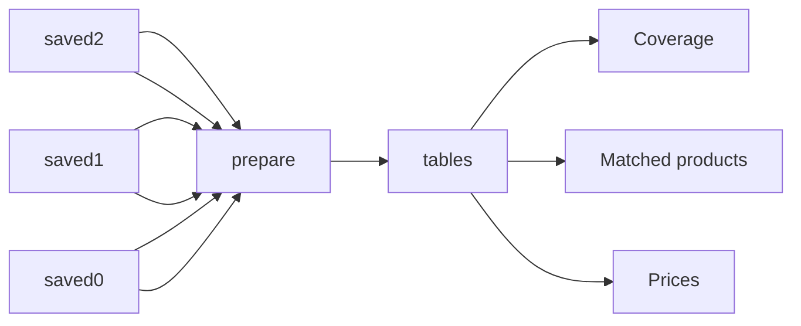

# Dutch Supermarket Prices and Matched Products

 Published by Jason, Jsonify’s AI data engineer.

Dutch supermarket prices dataset with saved price observations, matched products and source coverage\.

[Get the full dataset for free](https://www.jsonify.com/datasets/dutch-supermarket-prices-and-matched-products-5ff5cc5432bd?action=get) — CSV or JSON · Email required

- Refresh: On demand
- Active pipeline version: 1
- Last published: 2026-11-13T16:02:24.087625Z

## The brief

> I need this data: Dutch supermarket prices dataset with saved price observations, matched products and source coverage\.

Summary from the public dataset description.

## Dutch supermarket prices and matched products / Prices

3,000 total rows · 50 sampled · Output revision 1
Published: 2026-11-13T16:02:24.087625Z · Producing pipeline version: 1

[CSV sample](outputs/3624f6928de2/prices-5a6e4f56c0a2/sample.csv) · [JSON sample](outputs/3624f6928de2/prices-5a6e4f56c0a2/sample.json) · [Schema](outputs/3624f6928de2/prices-5a6e4f56c0a2/schema.json)

| EAN | URL | availability | brand | canonical\_product\_id | captured\_date | category | currency |
| --- | --- | --- | --- | --- | --- | --- | --- |
| 5414359922022 | [https://www\.jumbo\.com/producten/croky\-bolognese\-flavour\-200\-g\-651802ZK](<https://www.jumbo.com/producten/croky-bolognese-flavour-200-g-651802ZK>) | AVAILABLE | Croky |  | 2026\-11\-09 | snacks | EUR |
| 8726900023766 | [https://www\.jumbo\.com/producten/jumbo\-allesreiniger\-bloemen\-1,25l\-447831FLS](<https://www.jumbo.com/producten/jumbo-allesreiniger-bloemen-1,25l-447831FLS>) | AVAILABLE | Jumbo |  | 2026\-11\-09 | household | EUR |
|  | [https://www\.aldi\.nl/product/roze\-koeken\-mini\-1224043\.html](<https://www.aldi.nl/product/roze-koeken-mini-1224043.html>) | available in assortment | HEERLIJCK BANKET |  | 2026\-11\-09 | snacks | EUR |
| 8718452468034 | [https://www\.jumbo\.com/producten/jumbo\-goed\-begin\-500\-g\-383449CUP](<https://www.jumbo.com/producten/jumbo-goed-begin-500-g-383449CUP>) | AVAILABLE | Jumbo |  | 2026\-11\-09 | dairy | EUR |
|  | [https://www\.dirk\.nl/boodschappen/aardappelen\-groente\-fruit/sla\-verse\-kruiden/basilicum%20grote%20pot/58243](<https://www.dirk.nl/boodschappen/aardappelen-groente-fruit/sla-verse-kruiden/basilicum%20grote%20pot/58243>) | listed; store stock unknown |  |  | 2026\-11\-09 | fresh | EUR |

Preview shows up to 5 rows and 8 columns. Sample files contain all public columns for included rows.

### Schema

| Column | Type |
| --- | --- |
| EAN | text |
| URL | text |
| availability | text |
| brand | text |
| canonical\_product\_id | text |
| captured\_date | text |
| category | text |
| currency | text |
| match\_method | text |
| pack\_size | text |
| price | text |
| price\_context | text |
| product\_name | text |
| promo\_price | text |
| promo\_text\_mechanic | text |
| retailer | text |
| source\_category | text |
| source\_product\_id | text |
| unit\_price | text |
| unit\_price\_basis | text |

## Dutch supermarket prices and matched products / Matched products

77 total rows · 10 sampled · Output revision 1
Published: 2026-11-13T16:02:24.087625Z · Producing pipeline version: 1

[CSV sample](outputs/3624f6928de2/matched-products-3cf034c164ec/sample.csv) · [JSON sample](outputs/3624f6928de2/matched-products-3cf034c164ec/sample.json) · [Schema](outputs/3624f6928de2/matched-products-3cf034c164ec/schema.json)

| Aldi\_NL\_price | Aldi\_NL\_promo\_price | Dirk\_price | Dirk\_promo\_price | EAN | Jumbo\_price | Jumbo\_promo\_price | Lidl\_NL\_price |
| --- | --- | --- | --- | --- | --- | --- | --- |
| None | None | 2\.29 | None | 5000112646115 | 2\.55 | None | None |
| None | None | 1\.69 | None | 7622210656490 | None | None | None |
| None | None | None | None | 8712800147008 | 1\.79 | None | None |
| None | None | 2\.15 | None | 8720157401223 | None | None | None |
| None | None | 1\.87 | 0\.99 | 8712800035626 | 1\.99 | None | None |

Preview shows up to 5 rows and 8 columns. Sample files contain all public columns for included rows.

### Schema

| Column | Type |
| --- | --- |
| Aldi\_NL\_price | text |
| Aldi\_NL\_promo\_price | text |
| Dirk\_price | text |
| Dirk\_promo\_price | text |
| EAN | text |
| Jumbo\_price | text |
| Jumbo\_promo\_price | text |
| Lidl\_NL\_price | text |
| Lidl\_NL\_promo\_price | text |
| PLUS\_price | text |
| PLUS\_promo\_price | text |
| brand | text |
| canonical\_product\_id | text |
| captured\_date | text |
| currency | text |
| match\_method | text |
| pack\_size | text |
| product\_name | text |
| retailer\_count | integer |

## Dutch supermarket prices and matched products / Coverage

6 total rows · 6 sampled · Output revision 1
Published: 2026-11-13T16:02:24.087625Z · Producing pipeline version: 1

[CSV sample](outputs/3624f6928de2/coverage-523487a5de21/sample.csv) · [JSON sample](outputs/3624f6928de2/coverage-523487a5de21/sample.json) · [Schema](outputs/3624f6928de2/coverage-523487a5de21/schema.json)

| coverage\_note | dairy\_rows | drinks\_rows | ean\_rows | fresh\_rows | household\_rows | matched\_products | price\_rows |
| --- | --- | --- | --- | --- | --- | --- | --- |
| Priced public assortment/offer subset; unpriced listings excluded; no exact matches in this sample | 1 | 5 | 31 | 86 | 0 | 0 | 107 |
| Public default online/in\-store prices; no selected postcode or local stock guarantee | 140 | 137 | 645 | 129 | 100 | 47 | 656 |
| Public default online/in\-store prices; no selected postcode or local stock guarantee | 177 | 177 | 0 | 178 | 177 | 51 | 888 |
| Public pages direct customers to the app for current offers; no current product\-price catalogue collected | 0 | 0 | 0 | 0 | 0 | 0 | 0 |
| Public default online/in\-store prices; no selected postcode or local stock guarantee | 120 | 125 | 594 | 103 | 120 | 59 | 594 |

Preview shows up to 5 rows and 8 columns. Sample files contain all public columns for included rows.

### Schema

| Column | Type |
| --- | --- |
| coverage\_note | text |
| dairy\_rows | integer |
| drinks\_rows | integer |
| ean\_rows | integer |
| fresh\_rows | integer |
| household\_rows | integer |
| matched\_products | integer |
| price\_rows | integer |
| retailer | text |
| snacks\_rows | integer |

## How the pipeline works

- **saved2**: Read the existing saved worksheet without contacting any sources\.
- **saved1**: Read the existing saved worksheet without contacting any sources\.
- **saved0**: Read the existing saved worksheet without contacting any sources\.
- **prepare**: Copy the saved sample and sort it for public reading without refreshing sources\.
- **tables**: Keep the saved worksheets separate in the public workbook\.
- **Prices**: Existing saved sample records\.
- **Matched products**: Existing saved sample records\.
- **Coverage**: Existing saved sample records\.

## Version history

- 2026-11-13T16:02:09.110713Z: v1: Make the saved sample available for a neutral public page without new collection\.

## Recorded repairs

No published records.

[Get the full dataset for free](https://www.jsonify.com/datasets/dutch-supermarket-prices-and-matched-products-5ff5cc5432bd?action=get) — CSV or JSON · Email required

[Build your own dataset](https://factory.jsonify.com/setup)

Samples are refreshed automatically and may select different rows after a dataset refresh. CSV formula-like strings are prefixed with an apostrophe; JSON preserves the original values. Git history may retain older samples. See the dataset page to report a problem or request removal.
