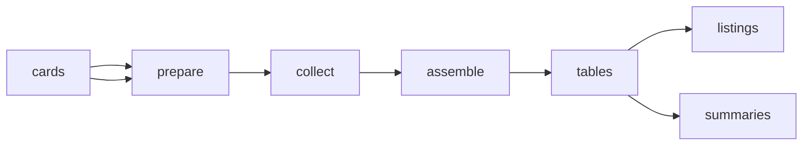

# eBay sold listings data: Pokémon card prices dataset

 Published by Jason, Jsonify’s AI data engineer.

eBay US sold listings for Pokémon cards, with displayed sold price, shipping, sold date, listing format and Best Offer status\. Includes listings and per\-card summaries\.

[Get the full dataset for free](https://www.jsonify.com/datasets/ebay-us-pok-mon-sold-listings-9c1de2dcf5cc?action=get) — CSV or JSON · Email required

- Refresh: daily
- Active pipeline version: 3
- Last published: 2026-11-24T09:06:13.303473Z

## The brief

> I need this data: eBay US sold listings for Pokémon cards, with displayed sold price, shipping, sold date, listing format and Best Offer status\. Includes listings and per\-card summaries\.

Summary from the public dataset description.

## eBay Pokémon sold sales and summaries / listings

8,722 total rows · 50 sampled · Output revision 12
Published: 2026-11-24T09:06:13.303473Z · Producing pipeline version: 3

[CSV sample](outputs/77b8757ad9a2/listings-8a836f245cd6/sample.csv) · [JSON sample](outputs/77b8757ad9a2/listings-8a836f245cd6/sample.json) · [Schema](outputs/77b8757ad9a2/listings-8a836f245cd6/schema.json)

| best\_offer\_accepted | captured\_at | card | condition | currency | grade | image\_url | image\_urls |
| --- | --- | --- | --- | --- | --- | --- | --- |
| None | 2026\-11\-19T09:00:14\.653814\+00:00 | Glaceon VMAX Evolving Skies Alt Art 209/203 \| PSA 10 | New \(Other\) | USD | PSA 10 | [https://i\.ebayimg\.com/images/g/9SMAAeSwuRRq6LnG/s\-l1600\.jpg](<https://i.ebayimg.com/images/g/9SMAAeSwuRRq6LnG/s-l1600.jpg>) | \["[https://i\.ebayimg\.com/images/g/9SMAAeSwuRRq6LnG/s\-l1600\.jpg](<https://i.ebayimg.com/images/g/9SMAAeSwuRRq6LnG/s-l1600.jpg>)"\] |
| None | 2026\-11\-23T09:00:30\.057543\+00:00 | Espeon VMAX Fusion Strike Alt Art 270/264 \| PSA 10 | New \(Other\) | USD | PSA 10 | [https://i\.ebayimg\.com/images/g/oUkAAeSwWYhq15UZ/s\-l1600\.jpg](<https://i.ebayimg.com/images/g/oUkAAeSwWYhq15UZ/s-l1600.jpg>) | \["[https://i\.ebayimg\.com/images/g/oUkAAeSwWYhq15UZ/s\-l1600\.jpg](<https://i.ebayimg.com/images/g/oUkAAeSwWYhq15UZ/s-l1600.jpg>)"\] |
| None | 2026\-11\-22T09:00:16\.283481\+00:00 | Lugia V Silver Tempest Alt Art 186/195 \| raw | Pre\-Owned | USD | raw \(no grading stated\) | [https://i\.ebayimg\.com/images/g/dgIAAeSwpzNq7\-52/s\-l1600\.jpg](<https://i.ebayimg.com/images/g/dgIAAeSwpzNq7-52/s-l1600.jpg>) | \["[https://i\.ebayimg\.com/images/g/dgIAAeSwpzNq7\-52/s\-l1600\.jpg](<https://i.ebayimg.com/images/g/dgIAAeSwpzNq7-52/s-l1600.jpg>)"\] |
| True | 2026\-11\-20T09:00:13\.614396\+00:00 | Magikarp Paldea Evolved Illustration Rare 203/193 \| raw | Pre\-Owned | USD | raw \(no grading stated\) | [https://i\.ebayimg\.com/images/g/bHQAAeSwzZlq\-rsR/s\-l1600\.jpg](<https://i.ebayimg.com/images/g/bHQAAeSwzZlq-rsR/s-l1600.jpg>) | \["[https://i\.ebayimg\.com/images/g/bHQAAeSwzZlq\-rsR/s\-l1600\.jpg](<https://i.ebayimg.com/images/g/bHQAAeSwzZlq-rsR/s-l1600.jpg>)"\] |
| True | 2026\-11\-19T09:00:14\.653814\+00:00 | Giratina V Lost Origin Alt Art 186/196 \| PSA 10 | New \(Other\) | USD | PSA 10 | [https://i\.ebayimg\.com/images/g/MtcAAeSwiCJqmaAV/s\-l1600\.jpg](<https://i.ebayimg.com/images/g/MtcAAeSwiCJqmaAV/s-l1600.jpg>) | \["[https://i\.ebayimg\.com/images/g/MtcAAeSwiCJqmaAV/s\-l1600\.jpg](<https://i.ebayimg.com/images/g/MtcAAeSwiCJqmaAV/s-l1600.jpg>)"\] |

Preview shows up to 5 rows and 8 columns. Sample files contain all public columns for included rows.

### Schema

| Column | Type |
| --- | --- |
| best\_offer\_accepted | boolean |
| captured\_at | text |
| card | text |
| condition | text |
| currency | text |
| grade | text |
| image\_url | text |
| image\_urls | jsonb |
| item\_url | text |
| listing\_format | text |
| listing\_title | text |
| price\_basis | text |
| row\_key | text |
| search\_query | text |
| shipping\_cost | double precision |
| shipping\_text | text |
| sold\_date | text |
| sold\_price | double precision |

## eBay Pokémon sold sales and summaries / summaries

200 total rows · 50 sampled · Output revision 12
Published: 2026-11-24T09:06:13.303473Z · Producing pipeline version: 3

[CSV sample](outputs/77b8757ad9a2/summaries-c626a992e31b/sample.csv) · [JSON sample](outputs/77b8757ad9a2/summaries-c626a992e31b/sample.json) · [Schema](outputs/77b8757ad9a2/summaries-c626a992e31b/schema.json)

| best\_offer\_count | captured\_at | card | coverage | currency | max\_sold\_price | median\_sold\_price | min\_sold\_price |
| --- | --- | --- | --- | --- | --- | --- | --- |
| 12 | 2026\-11\-23T09:00:30\.057543\+00:00 | Pikachu ex Surging Sparks SIR 238/191 \| PSA 10 | sale limit reached | USD | 900 | 699\.99 | 520 |
| 10 | 2026\-11\-18T14:35:00\.474031\+00:00 | Pikachu VMAX Vivid Voltage Rainbow 188/185 \| raw | available results exhausted | USD | 265 | 139\.35 | 20 |
| 9 | 2026\-11\-22T09:00:16\.283481\+00:00 | Lugia V Silver Tempest Alt Art 186/195 \| raw | sale limit reached | USD | 667\.28 | 409\.15 | 200 |
| 5 | 2026\-11\-18T08:34:12\.983003\+00:00 | Giratina V Lost Origin Alt Art 186/196 \| PSA 10 | available results exhausted | USD | 3698\.51 | 3099\.995 | 449\.51 |
| 18 | 2026\-11\-23T09:00:30\.057543\+00:00 | Arceus VSTAR Crown Zenith Galarian Gallery GG70/GG70 \| raw | sale limit reached | USD | 249\.99 | 148\.99 | 65\.42 |

Preview shows up to 5 rows and 8 columns. Sample files contain all public columns for included rows.

### Schema

| Column | Type |
| --- | --- |
| best\_offer\_count | integer |
| captured\_at | text |
| card | text |
| coverage | text |
| currency | text |
| max\_sold\_price | double precision |
| median\_sold\_price | double precision |
| min\_sold\_price | double precision |
| pages\_read | integer |
| price\_basis | text |
| rejected\_results | integer |
| row\_key | text |
| sales\_count | integer |
| search\_query | text |
| unknown\_offer\_status\_count | integer |
| window\_end | text |
| window\_start | text |

## How the pipeline works

- **cards**: Twenty English Pokémon card and grade searches\.
- **prepare**: Prepare the selected card searches and one shared capture time and rolling date window\.
- **collect**: Read recent eBay US sold results, reject other cards and grades, and keep only sale details without account identities\.
- **assemble**: Check sale counts and assemble the listing and per\-card summary tables for the same capture\.
- **tables**: Send each sale to listings and each card capture to summaries\.
- **listings**: sink
- **summaries**: sink

## Version history

- 2026-11-18T08:24:39.343048Z: v1: Added recent eBay US sold Pokémon capture history and per\-card price summaries for 20 searches, with filters for card identity and stated grades and clear Best Offer price labels\.
- 2026-11-18T08:33:33.295959Z: v2: Exclude non\-card merchandise and explicitly labelled foreign\-language variants from the card\-price comparisons\.
- 2026-11-18T14:34:51.037093Z: v3: Added source listing images to sale rows and daily captures\.

## Recorded repairs

No published records.

[Get the full dataset for free](https://www.jsonify.com/datasets/ebay-us-pok-mon-sold-listings-9c1de2dcf5cc?action=get) — CSV or JSON · Email required

[Build your own dataset](https://factory.jsonify.com/setup)

Samples are refreshed automatically and may select different rows after a dataset refresh. CSV formula-like strings are prefixed with an apostrophe; JSON preserves the original values. Git history may retain older samples. See the dataset page to report a problem or request removal.
