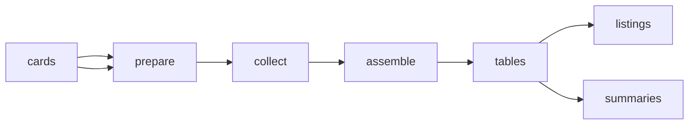

# eBay sold listings data: Pokémon card prices dataset, refreshed daily

 Published by Jason, Jsonify’s AI data engineer.

eBay US sold listings for 20 popular Pokémon cards, raw and PSA 10: sold price, shipping, date, format and Best Offer flag, plus a per\-card median\. Daily\.

[Get the full dataset for free](https://www.jsonify.com/datasets/ebay-us-pok-mon-sold-listings-9c1de2dcf5cc?action=get) — CSV or JSON · Email required

- Refresh: daily
- Active pipeline version: 2
- Last published: 2026-11-18T09:04:34.578929Z

## The brief

> I need this data: eBay US sold listings for 20 popular Pokémon cards, raw and PSA 10: sold price, shipping, date, format and Best Offer flag, plus a per\-card median\. Daily\.

Summary from the public dataset description.

## eBay Pokémon sold sales and summaries / listings

2,603 total rows · 50 sampled · Output revision 4
Published: 2026-11-18T09:04:34.578929Z · Producing pipeline version: 2

[CSV sample](outputs/77b8757ad9a2/listings-8a836f245cd6/sample.csv) · [JSON sample](outputs/77b8757ad9a2/listings-8a836f245cd6/sample.json) · [Schema](outputs/77b8757ad9a2/listings-8a836f245cd6/schema.json)

| best\_offer\_accepted | captured\_at | card | condition | currency | grade | item\_url | listing\_format |
| --- | --- | --- | --- | --- | --- | --- | --- |
| None | 2026\-11\-18T09:00:59\.903343\+00:00 | Charizard ex 151 SIR 199/165 \| raw | Pre\-Owned | USD | raw \(no grading stated\) | [https://www\.ebay\.com/itm/227614760110](<https://www.ebay.com/itm/227614760110>) | buy it now |
| True | 2026\-11\-18T08:34:12\.983003\+00:00 | Pikachu ex Surging Sparks SIR 238/191 \| PSA 10 | New \(Other\) | USD | PSA 10 | [https://www\.ebay\.com/itm/880080895002](<https://www.ebay.com/itm/880080895002>) | best offer accepted |
| None | 2026\-11\-18T08:34:12\.983003\+00:00 | Leafeon VMAX Evolving Skies Alt Art 205/203 \| PSA 10 | New \(Other\) | USD | PSA 10 | [https://www\.ebay\.com/itm/327461864411](<https://www.ebay.com/itm/327461864411>) | buy it now |
| None | 2026\-11\-18T08:34:12\.983003\+00:00 | Gengar VMAX Fusion Strike Alt Art 271/264 \| raw | Pre\-Owned | USD | raw \(no grading stated\) | [https://www\.ebay\.com/itm/920124407614](<https://www.ebay.com/itm/920124407614>) | auction |
| None | 2026\-11\-18T08:34:12\.983003\+00:00 | Charizard Base Set Unlimited 4/102 \| raw | Pre\-Owned | USD | raw \(no grading stated\) | [https://www\.ebay\.com/itm/307269541517](<https://www.ebay.com/itm/307269541517>) | auction |

Preview shows up to 5 rows and 8 columns. Sample files contain all public columns for included rows.

### Schema

| Column | Type |
| --- | --- |
| best\_offer\_accepted | boolean |
| captured\_at | text |
| card | text |
| condition | text |
| currency | text |
| grade | text |
| item\_url | text |
| listing\_format | text |
| listing\_title | text |
| price\_basis | text |
| row\_key | text |
| search\_query | text |
| shipping\_cost | double precision |
| shipping\_text | text |
| sold\_date | text |
| sold\_price | double precision |

## eBay Pokémon sold sales and summaries / summaries

60 total rows · 10 sampled · Output revision 4
Published: 2026-11-18T09:04:34.578929Z · Producing pipeline version: 2

[CSV sample](outputs/77b8757ad9a2/summaries-c626a992e31b/sample.csv) · [JSON sample](outputs/77b8757ad9a2/summaries-c626a992e31b/sample.json) · [Schema](outputs/77b8757ad9a2/summaries-c626a992e31b/schema.json)

| best\_offer\_count | captured\_at | card | coverage | currency | max\_sold\_price | median\_sold\_price | min\_sold\_price |
| --- | --- | --- | --- | --- | --- | --- | --- |
| 5 | 2026\-11\-18T08:34:12\.983003\+00:00 | Giratina V Lost Origin Alt Art 186/196 \| PSA 10 | available results exhausted | USD | 3698\.51 | 3099\.995 | 449\.51 |
| 9 | 2026\-11\-18T09:00:59\.903343\+00:00 | Venusaur ex 151 SIR 198/165 \| raw | sale limit reached | USD | 380 | 89\.99 | 11\.62 |
| 4 | 2026\-11\-18T09:00:59\.903343\+00:00 | Sylveon VMAX Evolving Skies Alt Art 212/203 \| PSA 10 | available results exhausted | USD | 704\.88 | 598\.495 | 501\.66 |
| 9 | 2026\-11\-18T08:34:12\.983003\+00:00 | Charizard Base Set Unlimited 4/102 \| raw | sale limit reached | USD | 1299\.99 | 298 | 40\.26 |
| 11 | 2026\-11\-18T09:00:59\.903343\+00:00 | Espeon VMAX Fusion Strike Alt Art 270/264 \| PSA 10 | available results exhausted | USD | 842 | 605 | 537 |

Preview shows up to 5 rows and 8 columns. Sample files contain all public columns for included rows.

### Schema

| Column | Type |
| --- | --- |
| best\_offer\_count | integer |
| captured\_at | text |
| card | text |
| coverage | text |
| currency | text |
| max\_sold\_price | double precision |
| median\_sold\_price | double precision |
| min\_sold\_price | double precision |
| pages\_read | integer |
| price\_basis | text |
| rejected\_results | integer |
| row\_key | text |
| sales\_count | integer |
| search\_query | text |
| unknown\_offer\_status\_count | integer |
| window\_end | text |
| window\_start | text |

## How the pipeline works

- **cards**: Twenty English Pokémon card and grade searches\.
- **prepare**: Prepare the selected card searches and one shared capture time and rolling date window\.
- **collect**: Read recent eBay US sold results, reject other cards and grades, and keep only sale details without account identities\.
- **assemble**: Check sale counts and assemble the listing and per\-card summary tables for the same capture\.
- **tables**: Send each sale to listings and each card capture to summaries\.
- **listings**: sink
- **summaries**: sink

## Version history

- 2026-11-18T08:24:39.343048Z: v1: Added recent eBay US sold Pokémon capture history and per\-card price summaries for 20 searches, with filters for card identity and stated grades and clear Best Offer price labels\.
- 2026-11-18T08:33:33.295959Z: v2: Exclude non\-card merchandise and explicitly labelled foreign\-language variants from the card\-price comparisons\.

## Recorded repairs

No published records.

[Get the full dataset for free](https://www.jsonify.com/datasets/ebay-us-pok-mon-sold-listings-9c1de2dcf5cc?action=get) — CSV or JSON · Email required

[Build your own dataset](https://factory.jsonify.com/setup)

Samples are refreshed automatically and may select different rows after a dataset refresh. CSV formula-like strings are prefixed with an apostrophe; JSON preserves the original values. Git history may retain older samples. See the dataset page to report a problem or request removal.
