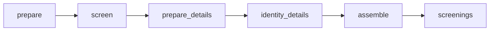

# EU, US and Poland Company Sanctions Screening

 Published by Jason, Jsonify’s AI data engineer.

Company sanctions screening against EU, US OFAC and Polish national sanctions sources\.

[Get the full dataset for free](https://www.jsonify.com/datasets/eu-us-and-poland-company-sanctions-screening-6090d629090b?action=get) — CSV or JSON · Email required

- Refresh: On demand
- Active pipeline version: 1
- Last published: 2026-11-27T09:37:45.861406Z

## The brief

> I need this data: Company sanctions screening against EU, US OFAC and Polish national sanctions sources\.

Summary from the public dataset description.

## Company Sanctions Screening / screenings

3 total rows · 3 sampled · Output revision 4
Published: 2026-11-27T09:37:45.861406Z · Producing pipeline version: 1

[CSV sample](outputs/3fbfd82ef2f0/screenings-bf33fa3c864f/sample.csv) · [JSON sample](outputs/3fbfd82ef2f0/screenings-bf33fa3c864f/sample.json) · [Schema](outputs/3fbfd82ef2f0/screenings-bf33fa3c864f/schema.json)

| checked\_at | company\_name | coverage | jurisdiction | match\_count | matches | review\_note | screening\_result |
| --- | --- | --- | --- | --- | --- | --- | --- |
| 2026\-11\-27T09:35:02\.393528\+00:00 | Sberbank | Polish MSWiA national company sanctions table, excluding entries with a removal date\. Names matched using exact, fuzzy &gt;=85 and whole\-name containment; mentions only in grounds do not count\. | Poland | 0 | \[\] | Name screening only, not identity confirmation or legal clearance\. No match does not mean not sanctioned\. Ownership/control, country\-wide, sectoral and trade/export restrictions outside these lists are not assessed\. Review identifiers and applicable law before acting\. | no\_list\_match\_found |
| 2026\-11\-27T09:35:05\.312963\+00:00 | Sberbank | EU consolidated financial sanctions \(asset\-freeze\) entities and aliases; exact, fuzzy &gt;=85, and whole\-name containment matching\. | EU | 1 | \[\{"list": "EU consolidated financial sanctions", "score": 100\.0, "aliases": \["Сбербанк", "Sberbank"\], "addresses": \[\{"city": "Moscow", "place": "", "poBox": "", "region": "", "street": "19 Vavilova St\., 117997", "zipCode": "", "logicalId": "142065", "asAtListingTime": "false", "countryIso2Code": "RU", "countryDescription": "RUSSIAN FEDERATION", "regulationLanguage": "en"}\], "record\_id": "EU\.8537\.32", "match\_type": "exact\_name\_or\_alias", "programmes": \["UKR"\], "source\_url": "[https://webgate\.ec\.europa\.eu/fsd/fsf/public/files/xmlFullSanctionsList\_1\_1/content?token=dG9rZW4tMjAxNw](<https://webgate.ec.europa.eu/fsd/fsf/public/files/xmlFullSanctionsList_1_1/content?token=dG9rZW4tMjAxNw>)", "identifiers": \[\{"number": "1027700132195", "region": "", "issuedBy": "19 Vavilova St\., 117997 Moscow", "issueDate": "1991\-03\-22", "logicalId": "142066", "diplomatic": "false", "knownFalse": "false", "latinNumber": "", "knownExpired": "false", "reportedLost": "false", "nameOnDocument": "", "countryIso2Code": "RU", "revokedByIssuer": "false", "countryDescription": "RUSSIAN FEDERATION", "regulationLanguage": "en", "identificationTypeCode": "regnumber", "identificationTypeDescription": "Registration Number"}\], "matched\_name": "Sberbank", "score\_method": "local normalized character/token similarity", "legal\_sources": \["[https://eur\-lex\.europa\.eu/legal\-content/EN/TXT/PDF/?uri=OJ:L:2022:193:FULL&amp;from=EN](<https://eur-lex.europa.eu/legal-content/EN/TXT/PDF/?uri=OJ:L:2022:193:FULL&amp;from=EN>)"\]}\] | Name screening only, not identity confirmation or legal clearance\. No match does not mean not sanctioned\. Ownership/control, country\-wide, sectoral and trade/export restrictions outside these lists are not assessed\. Review identifiers and applicable law before acting\. | name\_match\_requires\_identity\_review |
| 2026\-11\-27T09:35:09\.870962\+00:00 | Sberbank | US OFAC SDN and non\-SDN entity search, including source alias results, minimum source score 85\. Non\-SDN restrictions vary by list and programme\. | US | 92 | \[\{"list": "SDN; Non\-SDN", "score": 100, "aliases": \[\{"Name": "SUBSIDIARY BANK SBERBANK OF RUSSIA PUBLIC JOINT STOCK COMPANY", "Type": "a\.k\.a\.", "Category": "strong"}, \{"Name": "SBERBANK OF RUSSIA SUBSIDIARY BANK PUBLIC JOINT STOCK COMPANY", "Type": "a\.k\.a\.", "Category": "strong"}, \{"Name": "PUBLICHNE AKTSIONERNE TOVARYSTVO DOCHIRNII BANK SBERBANKU ROSII", "Type": "a\.k\.a\.", "Category": "strong"}, \{"Name": "JSC SBERBANK OF RUSSIA", "Type": "a\.k\.a\.", "Category": "strong"}, \{"Name": "SBERBANK OF RUSSIA SUBSIDIARY BANK PRIVATE JOINT STOCK COMPANY", "Type": "f\.k\.a\.", "Category": "strong"}, \{"Name": "JSC SBERBANK", "Type": "a\.k\.a\.", "Category": "strong"}, \{"Name": "AKTSIONERNE TOVARYSTVO SBERBANK", "Type": "a\.k\.a\.", "Category": "strong"}\], "addresses": \[\{"City": "Kyiv", "Address": "46 Volodymyrska street", "Country": "Ukraine", "Postal Code": "01601", "address\_lines": \["46 Volodymyrska street"\], "State/Province": null}, \{"City": "Kyiv", "Address": "46 Vladimirskaya St", "Country": "Ukraine", "Postal Code": "01601", "address\_lines": \["46 Vladimirskaya St"\], "State/Province": null}\], "record\_id": "18715", "match\_type": "possible\_match", "programmes": \["RUSSIA\-EO14024; UKRAINE\-EO13662"\], "source\_url": "[https://sanctionssearch\.ofac\.treas\.gov/Details\.aspx?id=18715](<https://sanctionssearch.ofac.treas.gov/Details.aspx?id=18715>)", "identifiers": \[\{"ID\#": "25959784", "Type": "Registration ID", "Country": "Ukraine", "Issue Date": null, "Expire Date": null}, \{"ID\#": "259597826652", "Type": "Tax ID No\.", "Country": "Ukraine", "Issue Date": null, "Expire Date": null}, \{"ID\#": "See Section 11 of Executive Order 14024\.", "Type": "Secondary sanctions risk:", "Country": null, "Issue Date": null, "Expire Date": null}, \{"ID\#": "SABRUAUK", "Type": "SWIFT/BIC", "Country": null, "Issue Date": null, "Expire Date": null}, \{"ID\#": "[www\.sberbank\.ua](<https://www.sberbank.ua>)", "Type": "Website", "Country": null, "Issue Date": null, "Expire Date": null}, \{"ID\#": "sbrf\.com\.ua", "Type": "Website", "Country": null, "Issue Date": null, "Expire Date": null}, \{"ID\#": "Subject to Directive 1", "Type": "Executive Order 13662 Directive Determination \-", "Country": null, "Issue Date": null, "Expire Date": null}, \{"ID\#": "Ukraine\-/Russia\-Related Sanctions Regulations, 31 CFR 589\.201 and/or 589\.209", "Type": "Secondary sanctions risk:", "Country": null, "Issue Date": null, "Expire Date": null}, \{"ID\#": "For more information on directives, please visit the following link: [https://home\.treasury\.gov/policy\-issues/financial\-sanctions/sanctions\-programs\-and\-country\-information/russian\-harmful\-foreign\-activities\-sanctions\#directives](<https://home.treasury.gov/policy-issues/financial-sanctions/sanctions-programs-and-country-information/russian-harmful-foreign-activities-sanctions#directives>)", "Type": "Executive Order 14024 Directive Information \-", "Country": null, "Issue Date": null, "Expire Date": null}, \{"ID\#": "24 Feb 2022", "Type": "Listing Date \(EO 14024 Directive 2\):", "Country": null, "Issue Date": null, "Expire Date": null}, \{"ID\#": "26 Mar 2022", "Type": "Effective Date \(EO 14024 Directive 2\):", "Country": null, "Issue Date": null, "Expire Date": null}\], "matched\_name": "AKTSIONERNE TOVARYSTVO SBERBANK", "score\_method": "OFAC search score", "evidence\_note": "OFAC detail fields are preserved as published\. Legal\-act links are not separately collected; consult the linked official entry and its restriction details\.", "legal\_sources": null, "restriction\_details": \{"List": "SDN, Non\-SDN", "Type": "Entity", "Program": "UKRAINE\-EO13662; RUSSIA\-EO14024", "Remarks": "For more information on directives, please visit the following link: [http://www\.treasury\.gov/resource\-center/sanctions/Programs/Pages/ukraine\.aspx\#directives](<http://www.treasury.gov/resource-center/sanctions/Programs/Pages/ukraine.aspx#directives>); \(Linked To: PUBLIC JOINT STOCK COMPANY SBERBANK OF RUSSIA\)", "Entity Name": "JOINT STOCK COMPANY SBERBANK"}}, \{"list": "SDN; Non\-SDN", "score": 100, "aliases": \[\{"Name": "BPS SBERBANK OJSC", "Type": "a\.k\.a\.", "Category": "strong"}, \{"Name": "BPS\-SBERBANK OAO", "Type": "a\.k\.a\.", "Category": "strong"}, \{"Name": "SBER BANK", "Type": "a\.k\.a\.", "Category": "strong"}\], "addresses": \[\{"City": "Minsk", "Address": "6 Mulyavina Boulevard", "Country": "Belarus", "Postal Code": "220005", "address\_lines": \["6 Mulyavina Boulevard"\], "State/Province": null}\], "record\_id": "18714", "match\_type": "possible\_match", "programmes": \["RUSSIA\-EO14024; UKRAINE\-EO13662"\], "source\_url": "[https://sanctionssearch\.ofac\.treas\.gov/Details\.aspx?id=18714](<https://sanctionssearch.ofac.treas.gov/Details.aspx?id=18714>)", "identifiers": \[\{"ID\#": "100219673", "Type": "Tax ID No\.", "Country": "Belarus", "Issue Date": null, "Expire Date": null}, \{"ID\#": "Subject to Directive 1", "Type": "Executive Order 13662 Directive Determination \-", "Country": null, "Issue Date": null, "Expire Date": null}, \{"ID\#": "BPSBBY2X", "Type": "SWIFT/BIC", "Country": null, "Issue Date": null, "Expire Date": null}, \{"ID\#": "[www\.sber\-bank\.by](<https://www.sber-bank.by>)", "Type": "Website", "Country": null, "Issue Date": null, "Expire Date": null}, \{"ID\#": "[www\.bps\-sberbank\.by](<https://www.bps-sberbank.by>)", "Type": "Website", "Country": null, "Issue Date": null, "Expire Date": null}, \{"ID\#": "For more information on directives, please visit the following link: [https://home\.treasury\.gov/policy\-issues/financial\-sanctions/sanctions\-programs\-and\-country\-information/russian\-harmful\-foreign\-activities\-sanctions\#directives](<https://home.treasury.gov/policy-issues/financial-sanctions/sanctions-programs-and-country-information/russian-harmful-foreign-activities-sanctions#directives>)", "Type": "Executive Order 14024 Directive Information \-", "Country": null, "Issue Date": null, "Expire Date": null}, \{"ID\#": "24 Feb 2022", "Type": "Listing Date \(EO 14024 Directive 2\):", "Country": null, "Issue Date": null, "Expire Date": null}, \{"ID\#": "26 Mar 2022", "Type": "Effective Date \(EO 14024 Directive 2\):", "Country": null, "Issue Date": null, "Expire Date": null}, \{"ID\#": "Ukraine\-/Russia\-Related Sanctions Regulations, 31 CFR 589\.201 and/or 589\.209", "Type": "Secondary sanctions risk:", "Country": null, "Issue Date": null, "Expire Date": null}, \{"ID\#": "See Section 11 of Executive Order 14024\.", "Type": "Secondary sanctions risk:", "Country": null, "Issue Date": null, "Expire Date": null}\], "matched\_name": "BPS SBERBANK OJSC", "score\_method": "OFAC search score", "evidence\_note": "OFAC detail fields are preserved as published\. Legal\-act links are not separately collected; consult the linked official entry and its restriction details\.", "legal\_sources": null, "restriction\_details": \{"List": "SDN, Non\-SDN", "Type": "Entity", "Program": "UKRAINE\-EO13662; RUSSIA\-EO14024", "Remarks": "For more information on directives, please visit the following link: [http://www\.treasury\.gov/resource\-center/sanctions/Programs/Pages/ukraine\.aspx\#directives](<http://www.treasury.gov/resource-center/sanctions/Programs/Pages/ukraine.aspx#directives>); \(Linked To: PUBLIC JOINT STOCK COMPANY SBERBANK OF RUSSIA\)", "Entity Name": "OPEN JOINT STOCK COMPANY BPS\-SBERBANK"}}, \{"list": "SDN; Non\-SDN", "score": 100, "aliases": \[\{"Name": "BPS SBERBANK OJSC", "Type": "a\.k\.a\.", "Category": "strong"}, \{"Name": "BPS\-SBERBANK OAO", "Type": "a\.k\.a\.", "Category": "strong"}, \{"Name": "SBER BANK", "Type": "a\.k\.a\.", "Category": "strong"}\], "addresses": \[\{"City": "Minsk", "Address": "6 Mulyavina Boulevard", "Country": "Belarus", "Postal Code": "220005", "address\_lines": \["6 Mulyavina Boulevard"\], "State/Province": null}\], "record\_id": "18714", "match\_type": "possible\_match", "programmes": \["RUSSIA\-EO14024; UKRAINE\-EO13662"\], "source\_url": "[https://sanctionssearch\.ofac\.treas\.gov/Details\.aspx?id=18714](<https://sanctionssearch.ofac.treas.gov/Details.aspx?id=18714>)", "identifiers": \[\{"ID\#": "100219673", "Type": "Tax ID No\.", "Country": "Belarus", "Issue Date": null, "Expire Date": null}, \{"ID\#": "Subject to Directive 1", "Type": "Executive Order 13662 Directive Determination \-", "Country": null, "Issue Date": null, "Expire Date": null}, \{"ID\#": "BPSBBY2X", "Type": "SWIFT/BIC", "Country": null, "Issue Date": null, "Expire Date": null}, \{"ID\#": "[www\.sber\-bank\.by](<https://www.sber-bank.by>)", "Type": "Website", "Country": null, "Issue Date": null, "Expire Date": null}, \{"ID\#": "[www\.bps\-sberbank\.by](<https://www.bps-sberbank.by>)", "Type": "Website", "Country": null, "Issue Date": null, "Expire Date": null}, \{"ID\#": "For more information on directives, please visit the following link: [https://home\.treasury\.gov/policy\-issues/financial\-sanctions/sanctions\-programs\-and\-country\-information/russian\-harmful\-foreign\-activities\-sanctions\#directives](<https://home.treasury.gov/policy-issues/financial-sanctions/sanctions-programs-and-country-information/russian-harmful-foreign-activities-sanctions#directives>)", "Type": "Executive Order 14024 Directive Information \-", "Country": null, "Issue Date": null, "Expire Date": null}, \{"ID\#": "24 Feb 2022", "Type": "Listing Date \(EO 14024 Directive 2\):", "Country": null, "Issue Date": null, "Expire Date": null}, \{"ID\#": "26 Mar 2022", "Type": "Effective Date \(EO 14024 Directive 2\):", "Country": null, "Issue Date": null, "Expire Date": null}, \{"ID\#": "Ukraine\-/Russia\-Related Sanctions Regulations, 31 CFR 589\.201 and/or 589\.209", "Type": "Secondary sanctions risk:", "Country": null, "Issue Date": null, "Expire Date": null}, \{"ID\#": "See Section 11 of Executive Order 14024\.", "Type": "Secondary sanctions risk:", "Country": null, "Issue Date": null, "Expire Date": null}\], "matched\_name": "BPS\-SBERBANK OAO", "score\_method": "OFAC search score", "evidence\_note": "OFAC detail fields are preserved as published\. Legal\-act links are not separately collected; consult the linked official entry and its restriction details\.", "legal\_sources": null, "restriction\_details": \{"List": "SDN, Non\-SDN", "Type": "Entity", "Program": "UKRAINE\-EO13662; RUSSIA\-EO14024", "Remarks": "For more information on directives, please visit the following link: [http://www\.treasury\.gov/resource\-center/sanctions/Programs/Pages/ukraine\.aspx\#directives](<http://www.treasury.gov/resource-center/sanctions/Programs/Pages/ukraine.aspx#directives>); \(Linked To: PUBLIC JOINT STOCK COMPANY SBERBANK OF RUSSIA\)", "Entity Name": "OPEN JOINT STOCK COMPANY BPS\-SBERBANK"}}, \{"list": "SDN; Non\-SDN", "score": 100, "aliases": \[\{"Name": "CJSC NON\-STATE PENSION FUND OF SBERBANK", "Type": "a\.k\.a\.", "Category": "strong"}, \{"Name": "NPF SBERBANKA ZAO", "Type": "a\.k\.a\.", "Category": "strong"}, \{"Name": "ZAKRYTOE AKTSIONERNOE OBSHCHESTVO NEGOSUDARSTVENNY PENSIONNY FOND SBERBANKA", "Type": "a\.k\.a\.", "Category": "strong"}, \{"Name": "SBERBANK PRIVATE PENSION FUND CLOSED JOINT STOCK COMPANY", "Type": "a\.k\.a\.", "Category": "strong"}, \{"Name": "NEGOSUDARSTVENNY PENSIONNY FOND SBERBANKA", "Type": "f\.k\.a\.", "Category": "strong"}, \{"Name": "SBERBANK PPF JSC", "Type": "a\.k\.a\.", "Category": "strong"}\], "addresses": \[\{"City": "Moscow", "Address": "d\. 31 G ul\. Shabolovka", "Country": "Russia", "Postal Code": "115162", "address\_lines": \["d\. 31 G ul\. Shabolovka"\], "State/Province": null}\], "record\_id": "18749", "match\_type": "possible\_match", "programmes": \["RUSSIA\-EO14024; UKRAINE\-EO13662"\], "source\_url": "[https://sanctionssearch\.ofac\.treas\.gov/Details\.aspx?id=18749](<https://sanctionssearch.ofac.treas.gov/Details.aspx?id=18749>)", "identifiers": \[\{"ID\#": "1147799009160", "Type": "Registration ID", "Country": "Russia", "Issue Date": null, "Expire Date": null}, \{"ID\#": "7725352740", "Type": "Tax ID No\.", "Country": "Russia", "Issue Date": null, "Expire Date": null}, \{"ID\#": "Subject to Directive 1", "Type": "Executive Order 13662 Directive Determination \-", "Country": null, "Issue Date": null, "Expire Date": null}, \{"ID\#": "Ukraine\-/Russia\-Related Sanctions Regulations, 31 CFR 589\.201 and/or 589\.209", "Type": "Secondary sanctions risk:", "Country": null, "Issue Date": null, "Expire Date": null}, \{"ID\#": "[www\.npfsberbanka\.ru](<https://www.npfsberbanka.ru>)", "Type": "Website", "Country": null, "Issue Date": null, "Expire Date": null}, \{"ID\#": "See Section 11 of Executive Order 14024\.", "Type": "Secondary sanctions risk:", "Country": null, "Issue Date": null, "Expire Date": null}, \{"ID\#": "For more information on directives, please visit the following link: [https://home\.treasury\.gov/policy\-issues/financial\-sanctions/sanctions\-programs\-and\-country\-information/russian\-harmful\-foreign\-activities\-sanctions\#directives](<https://home.treasury.gov/policy-issues/financial-sanctions/sanctions-programs-and-country-information/russian-harmful-foreign-activities-sanctions#directives>)", "Type": "Executive Order 14024 Directive Information \-", "Country": null, "Issue Date": null, "Expire Date": null}, \{"ID\#": "24 Feb 2022", "Type": "Listing Date \(EO 14024 Directive 2\):", "Country": null, "Issue Date": null, "Expire Date": null}, \{"ID\#": "26 Mar 2022", "Type": "Effective Date \(EO 14024 Directive 2\):", "Country": null, "Issue Date": null, "Expire Date": null}\], "matched\_name": "CJSC NON\-STATE PENSION FUND OF SBERBANK", "score\_method": "OFAC search score", "evidence\_note": "OFAC detail fields are preserved as published\. Legal\-act links are not separately collected; consult the linked official entry and its restriction details\.", "legal\_sources": null, "restriction\_details": \{"List": "SDN, Non\-SDN", "Type": "Entity", "Program": "UKRAINE\-EO13662; RUSSIA\-EO14024", "Remarks": "For more information on directives, please visit the following link: [http://www\.treasury\.gov/resource\-center/sanctions/Programs/Pages/ukraine\.aspx\#directives](<http://www.treasury.gov/resource-center/sanctions/Programs/Pages/ukraine.aspx#directives>); \(Linked To: PUBLIC JOINT STOCK COMPANY SBERBANK OF RUSSIA\)", "Entity Name": "JOINT STOCK COMPANY SBERBANK PRIVATE PENSION FUND"}}, \{"list": "SDN; Non\-SDN", "score": 100, "aliases": \[\{"Name": "CJSC SBERBANK LEASING", "Type": "a\.k\.a\.", "Category": "strong"}, \{"Name": "SBERBANK LEASING ZAO", "Type": "a\.k\.a\.", "Category": "strong"}, \{"Name": "SBERBANK LIZING ZAKRYTOE AKTSIONERNOE OBSHCHESTVO", "Type": "a\.k\.a\.", "Category": "strong"}, \{"Name": "SBERBANK LEASING JSC", "Type": "a\.k\.a\.", "Category": "strong"}, \{"Name": "RUSSKO\-GERMANSKAYA LIZINGOVAYA KOMPANIYA ZAO", "Type": "f\.k\.a\.", "Category": "strong"}\], "addresses": \[\{"City": "Odintsovo", "Address": "Novoivanovskoe workers settlement", "Country": "Russia", "Postal Code": "143026", "address\_lines": \["Novoivanovskoe workers settlement"\], "State/Province": "Moscow Region"}, \{"City": "Moscow", "Address": "6 Vorobievskoe shosse", "Country": "Russia", "Postal Code": "119285", "address\_lines": \["6 Vorobievskoe shosse"\], "State/Province": null}\], "record\_id": "18709", "match\_type": "possible\_match", "programmes": \["RUSSIA\-EO14024; UKRAINE\-EO13662"\], "source\_url": "[https://sanctionssearch\.ofac\.treas\.gov/Details\.aspx?id=18709](<https://sanctionssearch.ofac.treas.gov/Details.aspx?id=18709>)", "identifiers": \[\{"ID\#": "1027739000728", "Type": "Registration ID", "Country": "Russia", "Issue Date": null, "Expire Date": null}, \{"ID\#": "7707009586", "Type": "Tax ID No\.", "Country": "Russia", "Issue Date": null, "Expire Date": null}, \{"ID\#": "See Section 11 of Executive Order 14024\.", "Type": "Secondary sanctions risk:", "Country": null, "Issue Date": null, "Expire Date": null}, \{"ID\#": "Ukraine\-/Russia\-Related Sanctions Regulations, 31 CFR 589\.201 and/or 589\.209", "Type": "Secondary sanctions risk:", "Country": null, "Issue Date": null, "Expire Date": null}, \{"ID\#": "[www\.sberleasing\.ru](<https://www.sberleasing.ru>)", "Type": "Website", "Country": null, "Issue Date": null, "Expire Date": null}, \{"ID\#": "Subject to Directive 1", "Type": "Executive Order 13662 Directive Determination \-", "Country": null, "Issue Date": null, "Expire Date": null}, \{"ID\#": "For more information on directives, please visit the following link: [https://home\.treasury\.gov/policy\-issues/financial\-sanctions/sanctions\-programs\-and\-country\-information/russian\-harmful\-foreign\-activities\-sanctions\#directives](<https://home.treasury.gov/policy-issues/financial-sanctions/sanctions-programs-and-country-information/russian-harmful-foreign-activities-sanctions#directives>)", "Type": "Executive Order 14024 Directive Information \-", "Country": null, "Issue Date": null, "Expire Date": null}, \{"ID\#": "24 Feb 2022", "Type": "Listing Date \(EO 14024 Directive 2\):", "Country": null, "Issue Date": null, "Expire Date": null}, \{"ID\#": "26 Mar 2022", "Type": "Effective Date \(EO 14024 Directive 2\):", "Country": null, "Issue Date": null, "Expire Date": null}\], "matched\_name": "CJSC SBERBANK LEASING", "score\_method": "OFAC search score", "evidence\_note": "OFAC detail fields are preserved as published\. Legal\-act links are not separately collected; consult the linked official entry and its restriction details\.", "legal\_sources": null, "restriction\_details": \{"List": "SDN, Non\-SDN", "Type": "Entity", "Program": "UKRAINE\-EO13662; RUSSIA\-EO14024", "Remarks": "For more information on directives, please visit the following link: [http://www\.treasury\.gov/resource\-center/sanctions/Programs/Pages/ukraine\.aspx\#directives](<http://www.treasury.gov/resource-center/sanctions/Programs/Pages/ukraine.aspx#directives>); \(Linked To: PUBLIC JOINT STOCK COMPANY SBERBANK OF RUSSIA\)", "Entity Name": "JOINT STOCK COMPANY SBERBANK LEASING"}}, \{"list": "Non\-SDN", "score": 100, "aliases": \[\{"Name": "CJSC SBERBANK\-TECHNOLOGY", "Type": "a\.k\.a\.", "Category": "strong"}, \{"Name": "SBERTEKH, ZAO", "Type": "a\.k\.a\.", "Category": "strong"}, \{"Name": "ZAKRYTOE AKTSIONERNOE OBSHCHESTVO SBERBANK \-TEKHNOLOGII", "Type": "a\.k\.a\.", "Category": "strong"}, \{"Name": "CLOSED JOINT STOCK COMPANY SBERBANK \- TECHNOLOGY", "Type": "a\.k\.a\.", "Category": "strong"}\], "addresses": \[\{"City": "Moscow", "Address": "d\. 10 nab\. Novodanilovskaya", "Country": "Russia", "Postal Code": "117105", "address\_lines": \["d\. 10 nab\. Novodanilovskaya"\], "State/Province": null}\], "record\_id": "18746", "match\_type": "possible\_match", "programmes": \["UKRAINE\-EO13662"\], "source\_url": "[https://sanctionssearch\.ofac\.treas\.gov/Details\.aspx?id=18746](<https://sanctionssearch.ofac.treas.gov/Details.aspx?id=18746>)", "identifiers": \[\{"ID\#": "1117746533926", "Type": "Registration ID", "Country": "Russia", "Issue Date": null, "Expire Date": null}, \{"ID\#": "Ukraine\-/Russia\-Related Sanctions Regulations, 31 CFR 589\.201 and/or 589\.209", "Type": "Secondary sanctions risk:", "Country": null, "Issue Date": null, "Expire Date": null}, \{"ID\#": "Subject to Directive 1", "Type": "Executive Order 13662 Directive Determination \-", "Country": null, "Issue Date": null, "Expire Date": null}\], "matched\_name": "CJSC SBERBANK\-TECHNOLOGY", "score\_method": "OFAC search score", "evidence\_note": "OFAC detail fields are preserved as published\. Legal\-act links are not separately collected; consult the linked official entry and its restriction details\.", "legal\_sources": null, "restriction\_details": \{"List": "Non\-SDN", "Type": "Entity", "Program": "UKRAINE\-EO13662", "Remarks": "For more information on directives, please visit the following link: [http://www\.treasury\.gov/resource\-center/sanctions/Programs/Pages/ukraine\.aspx\#directives](<http://www.treasury.gov/resource-center/sanctions/Programs/Pages/ukraine.aspx#directives>); \(Linked To: PUBLIC JOINT STOCK COMPANY SBERBANK OF RUSSIA\)", "Entity Name": "SBERBANK TECHNOLOGIES CLOSED JOINT STOCK COMPANY"}}, \{"list": "Non\-SDN", "score": 100, "aliases": \[\{"Name": "CJSC SBERBANK\-TECHNOLOGY", "Type": "a\.k\.a\.", "Category": "strong"}, \{"Name": "SBERTEKH, ZAO", "Type": "a\.k\.a\.", "Category": "strong"}, \{"Name": "ZAKRYTOE AKTSIONERNOE OBSHCHESTVO SBERBANK \-TEKHNOLOGII", "Type": "a\.k\.a\.", "Category": "strong"}, \{"Name": "CLOSED JOINT STOCK COMPANY SBERBANK \- TECHNOLOGY", "Type": "a\.k\.a\.", "Category": "strong"}\], "addresses": \[\{"City": "Moscow", "Address": "d\. 10 nab\. Novodanilovskaya", "Country": "Russia", "Postal Code": "117105", "address\_lines": \["d\. 10 nab\. Novodanilovskaya"\], "State/Province": null}\], "record\_id": "18746", "match\_type": "possible\_match", "programmes": \["UKRAINE\-EO13662"\], "source\_url": "[https://sanctionssearch\.ofac\.treas\.gov/Details\.aspx?id=18746](<https://sanctionssearch.ofac.treas.gov/Details.aspx?id=18746>)", "identifiers": \[\{"ID\#": "1117746533926", "Type": "Registration ID", "Country": "Russia", "Issue Date": null, "Expire Date": null}, \{"ID\#": "Ukraine\-/Russia\-Related Sanctions Regulations, 31 CFR 589\.201 and/or 589\.209", "Type": "Secondary sanctions risk:", "Country": null, "Issue Date": null, "Expire Date": null}, \{"ID\#": "Subject to Directive 1", "Type": "Executive Order 13662 Directive Determination \-", "Country": null, "Issue Date": null, "Expire Date": null}\], "matched\_name": "CLOSED JOINT STOCK COMPANY SBERBANK \- TECHNOLOGY", "score\_method": "OFAC search score", "evidence\_note": "OFAC detail fields are preserved as published\. Legal\-act links are not separately collected; consult the linked official entry and its restriction details\.", "legal\_sources": null, "restriction\_details": \{"List": "Non\-SDN", "Type": "Entity", "Program": "UKRAINE\-EO13662", "Remarks": "For more information on directives, please visit the following link: [http://www\.treasury\.gov/resource\-center/sanctions/Programs/Pages/ukraine\.aspx\#directives](<http://www.treasury.gov/resource-center/sanctions/Programs/Pages/ukraine.aspx#directives>); \(Linked To: PUBLIC JOINT STOCK COMPANY SBERBANK OF RUSSIA\)", "Entity Name": "SBERBANK TECHNOLOGIES CLOSED JOINT STOCK COMPANY"}}, \{"list": "SDN; Non\-SDN", "score": 100, "aliases": \[\{"Name": "LLC INSURANCE COMPANY SBERBANK INSURANCE", "Type": "a\.k\.a\.", "Category": "strong"}, \{"Name": "SBERBANK STRAHOVANIE OOO SK", "Type": "a\.k\.a\.", "Category": "strong"}, \{"Name": "OBSHCHESTVO S OGRANICHENNOI OTVETSTVENNOSTYU STRAKHOVAYA KOMPANIYA SBERBANK STRAKHOVANIE", "Type": "a\.k\.a\.", "Category": "strong"}, \{"Name": "SK SBERBANK STRAHOVANIE LLC", "Type": "a\.k\.a\.", "Category": "strong"}, \{"Name": "OBSHCHESTVO S OGRANICHENNOI OTVETSTVENNOSTYU STRAKHOVAYA KOMPANIYA SBERBANK OBSHCHEE STRAKHOVANIE", "Type": "f\.k\.a\.", "Category": "strong"}, \{"Name": "SBERBANK INSURANCE IC LLC", "Type": "a\.k\.a\.", "Category": "strong"}, \{"Name": "STRAKHOVAYA KOMPANIYA SBERBANK STRAKHOVANIE", "Type": "a\.k\.a\.", "Category": "strong"}, \{"Name": "SBERBANK INSURANCE COMPANY LTD", "Type": "a\.k\.a\.", "Category": "strong"}\], "addresses": \[\{"City": "Moscow", "Address": "42 Bolshaya Yakimanka St\., b\. 1\-2, office 209", "Country": "Russia", "Postal Code": "119049", "address\_lines": \["42 Bolshaya Yakimanka St\., b\. 1\-2, office 209"\], "State/Province": null}, \{"City": "Moscow", "Address": "7 ul\. Pavlovskaya", "Country": "Russia", "Postal Code": null, "address\_lines": \["7 ul\. Pavlovskaya"\], "State/Province": null}, \{"City": "Moscow", "Address": "3 Poklonnaya Street, building 1, floor 1, office 3", "Country": "Russia", "Postal Code": "121170", "address\_lines": \["3 Poklonnaya Street, building 1, floor 1, office 3"\], "State/Province": null}\], "record\_id": "18750", "match\_type": "possible\_match", "programmes": \["RUSSIA\-EO14024; UKRAINE\-EO13662"\], "source\_url": "[https://sanctionssearch\.ofac\.treas\.gov/Details\.aspx?id=18750](<https://sanctionssearch.ofac.treas.gov/Details.aspx?id=18750>)", "identifiers": \[\{"ID\#": "1147746683479", "Type": "Registration ID", "Country": "Russia", "Issue Date": null, "Expire Date": null}, \{"ID\#": "7706810747", "Type": "Tax ID No\.", "Country": "Russia", "Issue Date": null, "Expire Date": null}, \{"ID\#": "For more information on directives, please visit the following link: [https://home\.treasury\.gov/policy\-issues/financial\-sanctions/sanctions\-programs\-and\-country\-information/russian\-harmful\-foreign\-activities\-sanctions\#directives](<https://home.treasury.gov/policy-issues/financial-sanctions/sanctions-programs-and-country-information/russian-harmful-foreign-activities-sanctions#directives>)", "Type": "Executive Order 14024 Directive Information \-", "Country": null, "Issue Date": null, "Expire Date": null}, \{"ID\#": "24 Feb 2022", "Type": "Listing Date \(EO 14024 Directive 2\):", "Country": null, "Issue Date": null, "Expire Date": null}, \{"ID\#": "26 Mar 2022", "Type": "Effective Date \(EO 14024 Directive 2\):", "Country": null, "Issue Date": null, "Expire Date": null}, \{"ID\#": "Ukraine\-/Russia\-Related Sanctions Regulations, 31 CFR 589\.201 and/or 589\.209", "Type": "Secondary sanctions risk:", "Country": null, "Issue Date": null, "Expire Date": null}, \{"ID\#": "Subject to Directive 1", "Type": "Executive Order 13662 Directive Determination \-", "Country": null, "Issue Date": null, "Expire Date": null}, \{"ID\#": "See Section 11 of Executive Order 14024\.", "Type": "Secondary sanctions risk:", "Country": null, "Issue Date": null, "Expire Date": null}\], "matched\_name": "INSURANCE COMPANY SBERBANK INSURANCE LIMITED LIABILITY COMPANY", "score\_method": "OFAC search score", "evidence\_note": "OFAC detail fields are preserved as published\. Legal\-act links are not separately collected; consult the linked official entry and its restriction details\.", "legal\_sources": null, "restriction\_details": \{"List": "SDN, Non\-SDN", "Type": "Entity", "Program": "UKRAINE\-EO13662; RUSSIA\-EO14024", "Remarks": "For more information on directives, please visit the following link: [http://www\.treasury\.gov/resource\-center/sanctions/Programs/Pages/ukraine\.aspx\#directives](<http://www.treasury.gov/resource-center/sanctions/Programs/Pages/ukraine.aspx#directives>); \(Linked To: PUBLIC JOINT STOCK COMPANY SBERBANK OF RUSSIA\)", "Entity Name": "INSURANCE COMPANY SBERBANK INSURANCE LIMITED LIABILITY COMPANY"}}, \{"list": "SDN", "score": 100, "aliases": \[\{"Name": "SBERBANK LIFE INSURANCE IC LLC", "Type": "a\.k\.a\.", "Category": "strong"}, \{"Name": "LIMITED LIABILITY COMPANY INSURANCE COMPANY SBERBANK INSURANCE", "Type": "a\.k\.a\.", "Category": "strong"}\], "addresses": \[\{"City": "Moscow", "Address": "3 Poklonnaya St\., Building 1", "Country": "Russia", "Postal Code": "121170", "address\_lines": \["3 Poklonnaya St\., Building 1"\], "State/Province": null}\], "record\_id": "34641", "match\_type": "possible\_match", "programmes": \["RUSSIA\-EO14024"\], "source\_url": "[https://sanctionssearch\.ofac\.treas\.gov/Details\.aspx?id=34641](<https://sanctionssearch.ofac.treas.gov/Details.aspx?id=34641>)", "identifiers": \[\{"ID\#": "1037700051146", "Type": "Registration Number", "Country": "Russia", "Issue Date": null, "Expire Date": null}, \{"ID\#": "7744002123", "Type": "Tax ID No\.", "Country": "Russia", "Issue Date": null, "Expire Date": null}, \{"ID\#": "For more information on directives, please visit the following link: [https://home\.treasury\.gov/policy\-issues/financial\-sanctions/sanctions\-programs\-and\-country\-information/russian\-harmful\-foreign\-activities\-sanctions\#directives](<https://home.treasury.gov/policy-issues/financial-sanctions/sanctions-programs-and-country-information/russian-harmful-foreign-activities-sanctions#directives>)", "Type": "Executive Order 14024 Directive Information \-", "Country": null, "Issue Date": null, "Expire Date": null}, \{"ID\#": "24 Feb 2022", "Type": "Listing Date \(EO 14024 Directive 2\):", "Country": null, "Issue Date": null, "Expire Date": null}, \{"ID\#": "26 Mar 2022", "Type": "Effective Date \(EO 14024 Directive 2\):", "Country": null, "Issue Date": null, "Expire Date": null}, \{"ID\#": "See Section 11 of Executive Order 14024\.", "Type": "Secondary sanctions risk:", "Country": null, "Issue Date": null, "Expire Date": null}\], "matched\_name": "INSURANCE COMPANY SBERBANK LIFE INSURANCE LIMITED LIABILITY COMPANY", "score\_method": "OFAC search score", "evidence\_note": "OFAC detail fields are preserved as published\. Legal\-act links are not separately collected; consult the linked official entry and its restriction details\.", "legal\_sources": null, "restriction\_details": \{"List": "SDN", "Type": "Entity", "Program": "RUSSIA\-EO14024", "Remarks": "\(Linked To: PUBLIC JOINT STOCK COMPANY SBERBANK OF RUSSIA\)", "Entity Name": "INSURANCE COMPANY SBERBANK LIFE INSURANCE LIMITED LIABILITY COMPANY"}}, \{"list": "SDN; Non\-SDN", "score": 100, "aliases": \[\{"Name": "SUBSIDIARY BANK SBERBANK OF RUSSIA PUBLIC JOINT STOCK COMPANY", "Type": "a\.k\.a\.", "Category": "strong"}, \{"Name": "SBERBANK OF RUSSIA SUBSIDIARY BANK PUBLIC JOINT STOCK COMPANY", "Type": "a\.k\.a\.", "Category": "strong"}, \{"Name": "PUBLICHNE AKTSIONERNE TOVARYSTVO DOCHIRNII BANK SBERBANKU ROSII", "Type": "a\.k\.a\.", "Category": "strong"}, \{"Name": "JSC SBERBANK OF RUSSIA", "Type": "a\.k\.a\.", "Category": "strong"}, \{"Name": "SBERBANK OF RUSSIA SUBSIDIARY BANK PRIVATE JOINT STOCK COMPANY", "Type": "f\.k\.a\.", "Category": "strong"}, \{"Name": "JSC SBERBANK", "Type": "a\.k\.a\.", "Category": "strong"}, \{"Name": "AKTSIONERNE TOVARYSTVO SBERBANK", "Type": "a\.k\.a\.", "Category": "strong"}\], "addresses": \[\{"City": "Kyiv", "Address": "46 Volodymyrska street", "Country": "Ukraine", "Postal Code": "01601", "address\_lines": \["46 Volodymyrska street"\], "State/Province": null}, \{"City": "Kyiv", "Address": "46 Vladimirskaya St", "Country": "Ukraine", "Postal Code": "01601", "address\_lines": \["46 Vladimirskaya St"\], "State/Province": null}\], "record\_id": "18715", "match\_type": "possible\_match", "programmes": \["RUSSIA\-EO14024; UKRAINE\-EO13662"\], "source\_url": "[https://sanctionssearch\.ofac\.treas\.gov/Details\.aspx?id=18715](<https://sanctionssearch.ofac.treas.gov/Details.aspx?id=18715>)", "identifiers": \[\{"ID\#": "25959784", "Type": "Registration ID", "Country": "Ukraine", "Issue Date": null, "Expire Date": null}, \{"ID\#": "259597826652", "Type": "Tax ID No\.", "Country": "Ukraine", "Issue Date": null, "Expire Date": null}, \{"ID\#": "See Section 11 of Executive Order 14024\.", "Type": "Secondary sanctions risk:", "Country": null, "Issue Date": null, "Expire Date": null}, \{"ID\#": "SABRUAUK", "Type": "SWIFT/BIC", "Country": null, "Issue Date": null, "Expire Date": null}, \{"ID\#": "[www\.sberbank\.ua](<https://www.sberbank.ua>)", "Type": "Website", "Country": null, "Issue Date": null, "Expire Date": null}, \{"ID\#": "sbrf\.com\.ua", "Type": "Website", "Country": null, "Issue Date": null, "Expire Date": null}, \{"ID\#": "Subject to Directive 1", "Type": "Executive Order 13662 Directive Determination \-", "Country": null, "Issue Date": null, "Expire Date": null}, \{"ID\#": "Ukraine\-/Russia\-Related Sanctions Regulations, 31 CFR 589\.201 and/or 589\.209", "Type": "Secondary sanctions risk:", "Country": null, "Issue Date": null, "Expire Date": null}, \{"ID\#": "For more information on directives, please visit the following link: [https://home\.treasury\.gov/policy\-issues/financial\-sanctions/sanctions\-programs\-and\-country\-information/russian\-harmful\-foreign\-activities\-sanctions\#directives](<https://home.treasury.gov/policy-issues/financial-sanctions/sanctions-programs-and-country-information/russian-harmful-foreign-activities-sanctions#directives>)", "Type": "Executive Order 14024 Directive Information \-", "Country": null, "Issue Date": null, "Expire Date": null}, \{"ID\#": "24 Feb 2022", "Type": "Listing Date \(EO 14024 Directive 2\):", "Country": null, "Issue Date": null, "Expire Date": null}, \{"ID\#": "26 Mar 2022", "Type": "Effective Date \(EO 14024 Directive 2\):", "Country": null, "Issue Date": null, "Expire Date": null}\], "matched\_name": "JOINT STOCK COMPANY SBERBANK", "score\_method": "OFAC search score", "evidence\_note": "OFAC detail fields are preserved as published\. Legal\-act links are not separately collected; consult the linked official entry and its restriction details\.", "legal\_sources": null, "restriction\_details": \{"List": "SDN, Non\-SDN", "Type": "Entity", "Program": "UKRAINE\-EO13662; RUSSIA\-EO14024", "Remarks": "For more information on directives, please visit the following link: [http://www\.treasury\.gov/resource\-center/sanctions/Programs/Pages/ukraine\.aspx\#directives](<http://www.treasury.gov/resource-center/sanctions/Programs/Pages/ukraine.aspx#directives>); \(Linked To: PUBLIC JOINT STOCK COMPANY SBERBANK OF RUSSIA\)", "Entity Name": "JOINT STOCK COMPANY SBERBANK"}}, \{"list": "SDN; Non\-SDN", "score": 100, "aliases": \[\{"Name": "SBERBANK\-AUTOMATED TRADING SYSTEM CLOSED JOINT STOCK COMPANY", "Type": "a\.k\.a\.", "Category": "strong"}, \{"Name": "SBERBANK\-AST ZAO", "Type": "a\.k\.a\.", "Category": "strong"}, \{"Name": "ZAKRYTOE AKTSIONERNOE OBSHCHESTVO SBERBANK AVTOMATIZIROVANNAYA SISTEMA TORGOV", "Type": "a\.k\.a\.", "Category": "strong"}, \{"Name": "JOINT STOCK COMPANY SBERBANK\-AUTOMATED SYSTEM FOR TRADING", "Type": "a\.k\.a\.", "Category": "strong"}, \{"Name": "SBERBANK\-AST JSC", "Type": "a\.k\.a\.", "Category": "strong"}, \{"Name": "JSC SBERBANK\-AUTOMATED SYSTEM FOR TRADING", "Type": "a\.k\.a\.", "Category": "strong"}\], "addresses": \[\{"City": "Moscow", "Address": "d\. 24 str\. 2 ul\. Novoslobodskaya", "Country": "Russia", "Postal Code": "127055", "address\_lines": \["d\. 24 str\. 2 ul\. Novoslobodskaya"\], "State/Province": null}, \{"City": "Moscow", "Address": "12 B\. Savvinsky Lane, building 9, floor 1, office 1, room 1", "Country": "Russia", "Postal Code": "119435", "address\_lines": \["12 B\. Savvinsky Lane, building 9, floor 1, office 1, room 1"\], "State/Province": null}\], "record\_id": "18743", "match\_type": "possible\_match", "programmes": \["RUSSIA\-EO14024; UKRAINE\-EO13662"\], "source\_url": "[https://sanctionssearch\.ofac\.treas\.gov/Details\.aspx?id=18743](<https://sanctionssearch.ofac.treas.gov/Details.aspx?id=18743>)", "identifiers": \[\{"ID\#": "1027707000441", "Type": "Registration ID", "Country": "Russia", "Issue Date": null, "Expire Date": null}, \{"ID\#": "7707308480", "Type": "Tax ID No\.", "Country": "Russia", "Issue Date": null, "Expire Date": null}, \{"ID\#": "Subject to Directive 1", "Type": "Executive Order 13662 Directive Determination \-", "Country": null, "Issue Date": null, "Expire Date": null}, \{"ID\#": "[www\.sberbank\-ast\.ru](<https://www.sberbank-ast.ru>)", "Type": "Website", "Country": null, "Issue Date": null, "Expire Date": null}, \{"ID\#": "For more information on directives, please visit the following link: [https://home\.treasury\.gov/policy\-issues/financial\-sanctions/sanctions\-programs\-and\-country\-information/russian\-harmful\-foreign\-activities\-sanctions\#directives](<https://home.treasury.gov/policy-issues/financial-sanctions/sanctions-programs-and-country-information/russian-harmful-foreign-activities-sanctions#directives>)", "Type": "Executive Order 14024 Directive Information \-", "Country": null, "Issue Date": null, "Expire Date": null}, \{"ID\#": "24 Feb 2022", "Type": "Listing Date \(EO 14024 Directive 2\):", "Country": null, "Issue Date": null, "Expire Date": null}, \{"ID\#": "26 Mar 2022", "Type": "Effective Date \(EO 14024 Directive 2\):", "Country": null, "Issue Date": null, "Expire Date": null}, \{"ID\#": "Ukraine\-/Russia\-Related Sanctions Regulations, 31 CFR 589\.201 and/or 589\.209", "Type": "Secondary sanctions risk:", "Country": null, "Issue Date": null, "Expire Date": null}, \{"ID\#": "See Section 11 of Executive Order 14024\.", "Type": "Secondary sanctions risk:", "Country": null, "Issue Date": null, "Expire Date": null}\], "matched\_name": "JOINT STOCK COMPANY SBERBANK AUTOMATED TRADE SYSTEM", "score\_method": "OFAC search score", "evidence\_note": "OFAC detail fields are preserved as published\. Legal\-act links are not separately collected; consult the linked official entry and its restriction details\.", "legal\_sources": null, "restriction\_details": \{"List": "SDN, Non\-SDN", "Type": "Entity", "Program": "UKRAINE\-EO13662; RUSSIA\-EO14024", "Remarks": "For more information on directives, please visit the following link: [http://www\.treasury\.gov/resource\-center/sanctions/Programs/Pages/ukraine\.aspx\#directives](<http://www.treasury.gov/resource-center/sanctions/Programs/Pages/ukraine.aspx#directives>); \(Linked To: PUBLIC JOINT STOCK COMPANY SBERBANK OF RUSSIA\)", "Entity Name": "JOINT STOCK COMPANY SBERBANK AUTOMATED TRADE SYSTEM"}}, \{"list": "SDN; Non\-SDN", "score": 100, "aliases": \[\{"Name": "CJSC SBERBANK LEASING", "Type": "a\.k\.a\.", "Category": "strong"}, \{"Name": "SBERBANK LEASING ZAO", "Type": "a\.k\.a\.", "Category": "strong"}, \{"Name": "SBERBANK LIZING ZAKRYTOE AKTSIONERNOE OBSHCHESTVO", "Type": "a\.k\.a\.", "Category": "strong"}, \{"Name": "SBERBANK LEASING JSC", "Type": "a\.k\.a\.", "Category": "strong"}, \{"Name": "RUSSKO\-GERMANSKAYA LIZINGOVAYA KOMPANIYA ZAO", "Type": "f\.k\.a\.", "Category": "strong"}\], "addresses": \[\{"City": "Odintsovo", "Address": "Novoivanovskoe workers settlement", "Country": "Russia", "Postal Code": "143026", "address\_lines": \["Novoivanovskoe workers settlement"\], "State/Province": "Moscow Region"}, \{"City": "Moscow", "Address": "6 Vorobievskoe shosse", "Country": "Russia", "Postal Code": "119285", "address\_lines": \["6 Vorobievskoe shosse"\], "State/Province": null}\], "record\_id": "18709", "match\_type": "possible\_match", "programmes": \["RUSSIA\-EO14024; UKRAINE\-EO13662"\], "source\_url": "[https://sanctionssearch\.ofac\.treas\.gov/Details\.aspx?id=18709](<https://sanctionssearch.ofac.treas.gov/Details.aspx?id=18709>)", "identifiers": \[\{"ID\#": "1027739000728", "Type": "Registration ID", "Country": "Russia", "Issue Date": null, "Expire Date": null}, \{"ID\#": "7707009586", "Type": "Tax ID No\.", "Country": "Russia", "Issue Date": null, "Expire Date": null}, \{"ID\#": "See Section 11 of Executive Order 14024\.", "Type": "Secondary sanctions risk:", "Country": null, "Issue Date": null, "Expire Date": null}, \{"ID\#": "Ukraine\-/Russia\-Related Sanctions Regulations, 31 CFR 589\.201 and/or 589\.209", "Type": "Secondary sanctions risk:", "Country": null, "Issue Date": null, "Expire Date": null}, \{"ID\#": "[www\.sberleasing\.ru](<https://www.sberleasing.ru>)", "Type": "Website", "Country": null, "Issue Date": null, "Expire Date": null}, \{"ID\#": "Subject to Directive 1", "Type": "Executive Order 13662 Directive Determination \-", "Country": null, "Issue Date": null, "Expire Date": null}, \{"ID\#": "For more information on directives, please visit the following link: [https://home\.treasury\.gov/policy\-issues/financial\-sanctions/sanctions\-programs\-and\-country\-information/russian\-harmful\-foreign\-activities\-sanctions\#directives](<https://home.treasury.gov/policy-issues/financial-sanctions/sanctions-programs-and-country-information/russian-harmful-foreign-activities-sanctions#directives>)", "Type": "Executive Order 14024 Directive Information \-", "Country": null, "Issue Date": null, "Expire Date": null}, \{"ID\#": "24 Feb 2022", "Type": "Listing Date \(EO 14024 Directive 2\):", "Country": null, "Issue Date": null, "Expire Date": null}, \{"ID\#": "26 Mar 2022", "Type": "Effective Date \(EO 14024 Directive 2\):", "Country": null, "Issue Date": null, "Expire Date": null}\], "matched\_name": "JOINT STOCK COMPANY SBERBANK LEASING", "score\_method": "OFAC search score", "evidence\_note": "OFAC detail fields are preserved as published\. Legal\-act links are not separately collected; consult the linked official entry and its restriction details\.", "legal\_sources": null, "restriction\_details": \{"List": "SDN, Non\-SDN", "Type": "Entity", "Program": "UKRAINE\-EO13662; RUSSIA\-EO14024", "Remarks": "For more information on directives, please visit the following link: [http://www\.treasury\.gov/resource\-center/sanctions/Programs/Pages/ukraine\.aspx\#directives](<http://www.treasury.gov/resource-center/sanctions/Programs/Pages/ukraine.aspx#directives>); \(Linked To: PUBLIC JOINT STOCK COMPANY SBERBANK OF RUSSIA\)", "Entity Name": "JOINT STOCK COMPANY SBERBANK LEASING"}}, \{"list": "SDN; Non\-SDN", "score": 100, "aliases": \[\{"Name": "CJSC NON\-STATE PENSION FUND OF SBERBANK", "Type": "a\.k\.a\.", "Category": "strong"}, \{"Name": "NPF SBERBANKA ZAO", "Type": "a\.k\.a\.", "Category": "strong"}, \{"Name": "ZAKRYTOE AKTSIONERNOE OBSHCHESTVO NEGOSUDARSTVENNY PENSIONNY FOND SBERBANKA", "Type": "a\.k\.a\.", "Category": "strong"}, \{"Name": "SBERBANK PRIVATE PENSION FUND CLOSED JOINT STOCK COMPANY", "Type": "a\.k\.a\.", "Category": "strong"}, \{"Name": "NEGOSUDARSTVENNY PENSIONNY FOND SBERBANKA", "Type": "f\.k\.a\.", "Category": "strong"}, \{"Name": "SBERBANK PPF JSC", "Type": "a\.k\.a\.", "Category": "strong"}\], "addresses": \[\{"City": "Moscow", "Address": "d\. 31 G ul\. Shabolovka", "Country": "Russia", "Postal Code": "115162", "address\_lines": \["d\. 31 G ul\. Shabolovka"\], "State/Province": null}\], "record\_id": "18749", "match\_type": "possible\_match", "programmes": \["RUSSIA\-EO14024; UKRAINE\-EO13662"\], "source\_url": "[https://sanctionssearch\.ofac\.treas\.gov/Details\.aspx?id=18749](<https://sanctionssearch.ofac.treas.gov/Details.aspx?id=18749>)", "identifiers": \[\{"ID\#": "1147799009160", "Type": "Registration ID", "Country": "Russia", "Issue Date": null, "Expire Date": null}, \{"ID\#": "7725352740", "Type": "Tax ID No\.", "Country": "Russia", "Issue Date": null, "Expire Date": null}, \{"ID\#": "Subject to Directive 1", "Type": "Executive Order 13662 Directive Determination \-", "Country": null, "Issue Date": null, "Expire Date": null}, \{"ID\#": "Ukraine\-/Russia\-Related Sanctions Regulations, 31 CFR 589\.201 and/or 589\.209", "Type": "Secondary sanctions risk:", "Country": null, "Issue Date": null, "Expire Date": null}, \{"ID\#": "[www\.npfsberbanka\.ru](<https://www.npfsberbanka.ru>)", "Type": "Website", "Country": null, "Issue Date": null, "Expire Date": null}, \{"ID\#": "See Section 11 of Executive Order 14024\.", "Type": "Secondary sanctions risk:", "Country": null, "Issue Date": null, "Expire Date": null}, \{"ID\#": "For more information on directives, please visit the following link: [https://home\.treasury\.gov/policy\-issues/financial\-sanctions/sanctions\-programs\-and\-country\-information/russian\-harmful\-foreign\-activities\-sanctions\#directives](<https://home.treasury.gov/policy-issues/financial-sanctions/sanctions-programs-and-country-information/russian-harmful-foreign-activities-sanctions#directives>)", "Type": "Executive Order 14024 Directive Information \-", "Country": null, "Issue Date": null, "Expire Date": null}, \{"ID\#": "24 Feb 2022", "Type": "Listing Date \(EO 14024 Directive 2\):", "Country": null, "Issue Date": null, "Expire Date": null}, \{"ID\#": "26 Mar 2022", "Type": "Effective Date \(EO 14024 Directive 2\):", "Country": null, "Issue Date": null, "Expire Date": null}\], "matched\_name": "JOINT STOCK COMPANY SBERBANK PRIVATE PENSION FUND", "score\_method": "OFAC search score", "evidence\_note": "OFAC detail fields are preserved as published\. Legal\-act links are not separately collected; consult the linked official entry and its restriction details\.", "legal\_sources": null, "restriction\_details": \{"List": "SDN, Non\-SDN", "Type": "Entity", "Program": "UKRAINE\-EO13662; RUSSIA\-EO14024", "Remarks": "For more information on directives, please visit the following link: [http://www\.treasury\.gov/resource\-center/sanctions/Programs/Pages/ukraine\.aspx\#directives](<http://www.treasury.gov/resource-center/sanctions/Programs/Pages/ukraine.aspx#directives>); \(Linked To: PUBLIC JOINT STOCK COMPANY SBERBANK OF RUSSIA\)", "Entity Name": "JOINT STOCK COMPANY SBERBANK PRIVATE PENSION FUND"}}, \{"list": "SDN", "score": 100, "aliases": \[\{"Name": "SBERTECH JSC", "Type": "a\.k\.a\.", "Category": "strong"}, \{"Name": "JOINT STOCK COMPANY SBERBANK TECHNOLOGY", "Type": "a\.k\.a\.", "Category": "strong"}\], "addresses": \[\{"City": "Moscow", "Address": "10 Novodanilovskaya Emb\.", "Country": "Russia", "Postal Code": "117105", "address\_lines": \["10 Novodanilovskaya Emb\."\], "State/Province": null}\], "record\_id": "36410", "match\_type": "possible\_match", "programmes": \["RUSSIA\-EO14024"\], "source\_url": "[https://sanctionssearch\.ofac\.treas\.gov/Details\.aspx?id=36410](<https://sanctionssearch.ofac.treas.gov/Details.aspx?id=36410>)", "identifiers": \[\{"ID\#": "1117746533926", "Type": "Registration Number", "Country": "Russia", "Issue Date": null, "Expire Date": null}, \{"ID\#": "7736632467", "Type": "Tax ID No\.", "Country": "Russia", "Issue Date": null, "Expire Date": null}, \{"ID\#": "See Section 11 of Executive Order 14024\.", "Type": "Secondary sanctions risk:", "Country": null, "Issue Date": null, "Expire Date": null}\], "matched\_name": "JOINT STOCK COMPANY SBERBANK TECHNOLOGIES", "score\_method": "OFAC search score", "evidence\_note": "OFAC detail fields are preserved as published\. Legal\-act links are not separately collected; consult the linked official entry and its restriction details\.", "legal\_sources": null, "restriction\_details": \{"List": "SDN", "Type": "Entity", "Program": "RUSSIA\-EO14024", "Remarks": "\(Linked To: PUBLIC JOINT STOCK COMPANY SBERBANK OF RUSSIA\)", "Entity Name": "JOINT STOCK COMPANY SBERBANK TECHNOLOGIES"}}, \{"list": "SDN", "score": 100, "aliases": \[\{"Name": "SBERTECH JSC", "Type": "a\.k\.a\.", "Category": "strong"}, \{"Name": "JOINT STOCK COMPANY SBERBANK TECHNOLOGY", "Type": "a\.k\.a\.", "Category": "strong"}\], "addresses": \[\{"City": "Moscow", "Address": "10 Novodanilovskaya Emb\.", "Country": "Russia", "Postal Code": "117105", "address\_lines": \["10 Novodanilovskaya Emb\."\], "State/Province": null}\], "record\_id": "36410", "match\_type": "possible\_match", "programmes": \["RUSSIA\-EO14024"\], "source\_url": "[https://sanctionssearch\.ofac\.treas\.gov/Details\.aspx?id=36410](<https://sanctionssearch.ofac.treas.gov/Details.aspx?id=36410>)", "identifiers": \[\{"ID\#": "1117746533926", "Type": "Registration Number", "Country": "Russia", "Issue Date": null, "Expire Date": null}, \{"ID\#": "7736632467", "Type": "Tax ID No\.", "Country": "Russia", "Issue Date": null, "Expire Date": null}, \{"ID\#": "See Section 11 of Executive Order 14024\.", "Type": "Secondary sanctions risk:", "Country": null, "Issue Date": null, "Expire Date": null}\], "matched\_name": "JOINT STOCK COMPANY SBERBANK TECHNOLOGY", "score\_method": "OFAC search score", "evidence\_note": "OFAC detail fields are preserved as published\. Legal\-act links are not separately collected; consult the linked official entry and its restriction details\.", "legal\_sources": null, "restriction\_details": \{"List": "SDN", "Type": "Entity", "Program": "RUSSIA\-EO14024", "Remarks": "\(Linked To: PUBLIC JOINT STOCK COMPANY SBERBANK OF RUSSIA\)", "Entity Name": "JOINT STOCK COMPANY SBERBANK TECHNOLOGIES"}}, \{"list": "SDN; Non\-SDN", "score": 100, "aliases": \[\{"Name": "SBERBANK\-AUTOMATED TRADING SYSTEM CLOSED JOINT STOCK COMPANY", "Type": "a\.k\.a\.", "Category": "strong"}, \{"Name": "SBERBANK\-AST ZAO", "Type": "a\.k\.a\.", "Category": "strong"}, \{"Name": "ZAKRYTOE AKTSIONERNOE OBSHCHESTVO SBERBANK AVTOMATIZIROVANNAYA SISTEMA TORGOV", "Type": "a\.k\.a\.", "Category": "strong"}, \{"Name": "JOINT STOCK COMPANY SBERBANK\-AUTOMATED SYSTEM FOR TRADING", "Type": "a\.k\.a\.", "Category": "strong"}, \{"Name": "SBERBANK\-AST JSC", "Type": "a\.k\.a\.", "Category": "strong"}, \{"Name": "JSC SBERBANK\-AUTOMATED SYSTEM FOR TRADING", "Type": "a\.k\.a\.", "Category": "strong"}\], "addresses": \[\{"City": "Moscow", "Address": "d\. 24 str\. 2 ul\. Novoslobodskaya", "Country": "Russia", "Postal Code": "127055", "address\_lines": \["d\. 24 str\. 2 ul\. Novoslobodskaya"\], "State/Province": null}, \{"City": "Moscow", "Address": "12 B\. Savvinsky Lane, building 9, floor 1, office 1, room 1", "Country": "Russia", "Postal Code": "119435", "address\_lines": \["12 B\. Savvinsky Lane, building 9, floor 1, office 1, room 1"\], "State/Province": null}\], "record\_id": "18743", "match\_type": "possible\_match", "programmes": \["RUSSIA\-EO14024; UKRAINE\-EO13662"\], "source\_url": "[https://sanctionssearch\.ofac\.treas\.gov/Details\.aspx?id=18743](<https://sanctionssearch.ofac.treas.gov/Details.aspx?id=18743>)", "identifiers": \[\{"ID\#": "1027707000441", "Type": "Registration ID", "Country": "Russia", "Issue Date": null, "Expire Date": null}, \{"ID\#": "7707308480", "Type": "Tax ID No\.", "Country": "Russia", "Issue Date": null, "Expire Date": null}, \{"ID\#": "Subject to Directive 1", "Type": "Executive Order 13662 Directive Determination \-", "Country": null, "Issue Date": null, "Expire Date": null}, \{"ID\#": "[www\.sberbank\-ast\.ru](<https://www.sberbank-ast.ru>)", "Type": "Website", "Country": null, "Issue Date": null, "Expire Date": null}, \{"ID\#": "For more information on directives, please visit the following link: [https://home\.treasury\.gov/policy\-issues/financial\-sanctions/sanctions\-programs\-and\-country\-information/russian\-harmful\-foreign\-activities\-sanctions\#directives](<https://home.treasury.gov/policy-issues/financial-sanctions/sanctions-programs-and-country-information/russian-harmful-foreign-activities-sanctions#directives>)", "Type": "Executive Order 14024 Directive Information \-", "Country": null, "Issue Date": null, "Expire Date": null}, \{"ID\#": "24 Feb 2022", "Type": "Listing Date \(EO 14024 Directive 2\):", "Country": null, "Issue Date": null, "Expire Date": null}, \{"ID\#": "26 Mar 2022", "Type": "Effective Date \(EO 14024 Directive 2\):", "Country": null, "Issue Date": null, "Expire Date": null}, \{"ID\#": "Ukraine\-/Russia\-Related Sanctions Regulations, 31 CFR 589\.201 and/or 589\.209", "Type": "Secondary sanctions risk:", "Country": null, "Issue Date": null, "Expire Date": null}, \{"ID\#": "See Section 11 of Executive Order 14024\.", "Type": "Secondary sanctions risk:", "Country": null, "Issue Date": null, "Expire Date": null}\], "matched\_name": "JOINT STOCK COMPANY SBERBANK\-AUTOMATED SYSTEM FOR TRADING", "score\_method": "OFAC search score", "evidence\_note": "OFAC detail fields are preserved as published\. Legal\-act links are not separately collected; consult the linked official entry and its restriction details\.", "legal\_sources": null, "restriction\_details": \{"List": "SDN, Non\-SDN", "Type": "Entity", "Program": "UKRAINE\-EO13662; RUSSIA\-EO14024", "Remarks": "For more information on directives, please visit the following link: [http://www\.treasury\.gov/resource\-center/sanctions/Programs/Pages/ukraine\.aspx\#directives](<http://www.treasury.gov/resource-center/sanctions/Programs/Pages/ukraine.aspx#directives>); \(Linked To: PUBLIC JOINT STOCK COMPANY SBERBANK OF RUSSIA\)", "Entity Name": "JOINT STOCK COMPANY SBERBANK AUTOMATED TRADE SYSTEM"}}, \{"list": "SDN; Non\-SDN", "score": 100, "aliases": \[\{"Name": "SUBSIDIARY BANK SBERBANK OF RUSSIA PUBLIC JOINT STOCK COMPANY", "Type": "a\.k\.a\.", "Category": "strong"}, \{"Name": "SBERBANK OF RUSSIA SUBSIDIARY BANK PUBLIC JOINT STOCK COMPANY", "Type": "a\.k\.a\.", "Category": "strong"}, \{"Name": "PUBLICHNE AKTSIONERNE TOVARYSTVO DOCHIRNII BANK SBERBANKU ROSII", "Type": "a\.k\.a\.", "Category": "strong"}, \{"Name": "JSC SBERBANK OF RUSSIA", "Type": "a\.k\.a\.", "Category": "strong"}, \{"Name": "SBERBANK OF RUSSIA SUBSIDIARY BANK PRIVATE JOINT STOCK COMPANY", "Type": "f\.k\.a\.", "Category": "strong"}, \{"Name": "JSC SBERBANK", "Type": "a\.k\.a\.", "Category": "strong"}, \{"Name": "AKTSIONERNE TOVARYSTVO SBERBANK", "Type": "a\.k\.a\.", "Category": "strong"}\], "addresses": \[\{"City": "Kyiv", "Address": "46 Volodymyrska street", "Country": "Ukraine", "Postal Code": "01601", "address\_lines": \["46 Volodymyrska street"\], "State/Province": null}, \{"City": "Kyiv", "Address": "46 Vladimirskaya St", "Country": "Ukraine", "Postal Code": "01601", "address\_lines": \["46 Vladimirskaya St"\], "State/Province": null}\], "record\_id": "18715", "match\_type": "possible\_match", "programmes": \["RUSSIA\-EO14024; UKRAINE\-EO13662"\], "source\_url": "[https://sanctionssearch\.ofac\.treas\.gov/Details\.aspx?id=18715](<https://sanctionssearch.ofac.treas.gov/Details.aspx?id=18715>)", "identifiers": \[\{"ID\#": "25959784", "Type": "Registration ID", "Country": "Ukraine", "Issue Date": null, "Expire Date": null}, \{"ID\#": "259597826652", "Type": "Tax ID No\.", "Country": "Ukraine", "Issue Date": null, "Expire Date": null}, \{"ID\#": "See Section 11 of Executive Order 14024\.", "Type": "Secondary sanctions risk:", "Country": null, "Issue Date": null, "Expire Date": null}, \{"ID\#": "SABRUAUK", "Type": "SWIFT/BIC", "Country": null, "Issue Date": null, "Expire Date": null}, \{"ID\#": "[www\.sberbank\.ua](<https://www.sberbank.ua>)", "Type": "Website", "Country": null, "Issue Date": null, "Expire Date": null}, \{"ID\#": "sbrf\.com\.ua", "Type": "Website", "Country": null, "Issue Date": null, "Expire Date": null}, \{"ID\#": "Subject to Directive 1", "Type": "Executive Order 13662 Directive Determination \-", "Country": null, "Issue Date": null, "Expire Date": null}, \{"ID\#": "Ukraine\-/Russia\-Related Sanctions Regulations, 31 CFR 589\.201 and/or 589\.209", "Type": "Secondary sanctions risk:", "Country": null, "Issue Date": null, "Expire Date": null}, \{"ID\#": "For more information on directives, please visit the following link: [https://home\.treasury\.gov/policy\-issues/financial\-sanctions/sanctions\-programs\-and\-country\-information/russian\-harmful\-foreign\-activities\-sanctions\#directives](<https://home.treasury.gov/policy-issues/financial-sanctions/sanctions-programs-and-country-information/russian-harmful-foreign-activities-sanctions#directives>)", "Type": "Executive Order 14024 Directive Information \-", "Country": null, "Issue Date": null, "Expire Date": null}, \{"ID\#": "24 Feb 2022", "Type": "Listing Date \(EO 14024 Directive 2\):", "Country": null, "Issue Date": null, "Expire Date": null}, \{"ID\#": "26 Mar 2022", "Type": "Effective Date \(EO 14024 Directive 2\):", "Country": null, "Issue Date": null, "Expire Date": null}\], "matched\_name": "JSC SBERBANK", "score\_method": "OFAC search score", "evidence\_note": "OFAC detail fields are preserved as published\. Legal\-act links are not separately collected; consult the linked official entry and its restriction details\.", "legal\_sources": null, "restriction\_details": \{"List": "SDN, Non\-SDN", "Type": "Entity", "Program": "UKRAINE\-EO13662; RUSSIA\-EO14024", "Remarks": "For more information on directives, please visit the following link: [http://www\.treasury\.gov/resource\-center/sanctions/Programs/Pages/ukraine\.aspx\#directives](<http://www.treasury.gov/resource-center/sanctions/Programs/Pages/ukraine.aspx#directives>); \(Linked To: PUBLIC JOINT STOCK COMPANY SBERBANK OF RUSSIA\)", "Entity Name": "JOINT STOCK COMPANY SBERBANK"}}, \{"list": "SDN; Non\-SDN", "score": 100, "aliases": \[\{"Name": "SUBSIDIARY BANK SBERBANK OF RUSSIA PUBLIC JOINT STOCK COMPANY", "Type": "a\.k\.a\.", "Category": "strong"}, \{"Name": "SBERBANK OF RUSSIA SUBSIDIARY BANK PUBLIC JOINT STOCK COMPANY", "Type": "a\.k\.a\.", "Category": "strong"}, \{"Name": "PUBLICHNE AKTSIONERNE TOVARYSTVO DOCHIRNII BANK SBERBANKU ROSII", "Type": "a\.k\.a\.", "Category": "strong"}, \{"Name": "JSC SBERBANK OF RUSSIA", "Type": "a\.k\.a\.", "Category": "strong"}, \{"Name": "SBERBANK OF RUSSIA SUBSIDIARY BANK PRIVATE JOINT STOCK COMPANY", "Type": "f\.k\.a\.", "Category": "strong"}, \{"Name": "JSC SBERBANK", "Type": "a\.k\.a\.", "Category": "strong"}, \{"Name": "AKTSIONERNE TOVARYSTVO SBERBANK", "Type": "a\.k\.a\.", "Category": "strong"}\], "addresses": \[\{"City": "Kyiv", "Address": "46 Volodymyrska street", "Country": "Ukraine", "Postal Code": "01601", "address\_lines": \["46 Volodymyrska street"\], "State/Province": null}, \{"City": "Kyiv", "Address": "46 Vladimirskaya St", "Country": "Ukraine", "Postal Code": "01601", "address\_lines": \["46 Vladimirskaya St"\], "State/Province": null}\], "record\_id": "18715", "match\_type": "possible\_match", "programmes": \["RUSSIA\-EO14024; UKRAINE\-EO13662"\], "source\_url": "[https://sanctionssearch\.ofac\.treas\.gov/Details\.aspx?id=18715](<https://sanctionssearch.ofac.treas.gov/Details.aspx?id=18715>)", "identifiers": \[\{"ID\#": "25959784", "Type": "Registration ID", "Country": "Ukraine", "Issue Date": null, "Expire Date": null}, \{"ID\#": "259597826652", "Type": "Tax ID No\.", "Country": "Ukraine", "Issue Date": null, "Expire Date": null}, \{"ID\#": "See Section 11 of Executive Order 14024\.", "Type": "Secondary sanctions risk:", "Country": null, "Issue Date": null, "Expire Date": null}, \{"ID\#": "SABRUAUK", "Type": "SWIFT/BIC", "Country": null, "Issue Date": null, "Expire Date": null}, \{"ID\#": "[www\.sberbank\.ua](<https://www.sberbank.ua>)", "Type": "Website", "Country": null, "Issue Date": null, "Expire Date": null}, \{"ID\#": "sbrf\.com\.ua", "Type": "Website", "Country": null, "Issue Date": null, "Expire Date": null}, \{"ID\#": "Subject to Directive 1", "Type": "Executive Order 13662 Directive Determination \-", "Country": null, "Issue Date": null, "Expire Date": null}, \{"ID\#": "Ukraine\-/Russia\-Related Sanctions Regulations, 31 CFR 589\.201 and/or 589\.209", "Type": "Secondary sanctions risk:", "Country": null, "Issue Date": null, "Expire Date": null}, \{"ID\#": "For more information on directives, please visit the following link: [https://home\.treasury\.gov/policy\-issues/financial\-sanctions/sanctions\-programs\-and\-country\-information/russian\-harmful\-foreign\-activities\-sanctions\#directives](<https://home.treasury.gov/policy-issues/financial-sanctions/sanctions-programs-and-country-information/russian-harmful-foreign-activities-sanctions#directives>)", "Type": "Executive Order 14024 Directive Information \-", "Country": null, "Issue Date": null, "Expire Date": null}, \{"ID\#": "24 Feb 2022", "Type": "Listing Date \(EO 14024 Directive 2\):", "Country": null, "Issue Date": null, "Expire Date": null}, \{"ID\#": "26 Mar 2022", "Type": "Effective Date \(EO 14024 Directive 2\):", "Country": null, "Issue Date": null, "Expire Date": null}\], "matched\_name": "JSC SBERBANK OF RUSSIA", "score\_method": "OFAC search score", "evidence\_note": "OFAC detail fields are preserved as published\. Legal\-act links are not separately collected; consult the linked official entry and its restriction details\.", "legal\_sources": null, "restriction\_details": \{"List": "SDN, Non\-SDN", "Type": "Entity", "Program": "UKRAINE\-EO13662; RUSSIA\-EO14024", "Remarks": "For more information on directives, please visit the following link: [http://www\.treasury\.gov/resource\-center/sanctions/Programs/Pages/ukraine\.aspx\#directives](<http://www.treasury.gov/resource-center/sanctions/Programs/Pages/ukraine.aspx#directives>); \(Linked To: PUBLIC JOINT STOCK COMPANY SBERBANK OF RUSSIA\)", "Entity Name": "JOINT STOCK COMPANY SBERBANK"}}, \{"list": "SDN; Non\-SDN", "score": 100, "aliases": \[\{"Name": "SBERBANK\-AUTOMATED TRADING SYSTEM CLOSED JOINT STOCK COMPANY", "Type": "a\.k\.a\.", "Category": "strong"}, \{"Name": "SBERBANK\-AST ZAO", "Type": "a\.k\.a\.", "Category": "strong"}, \{"Name": "ZAKRYTOE AKTSIONERNOE OBSHCHESTVO SBERBANK AVTOMATIZIROVANNAYA SISTEMA TORGOV", "Type": "a\.k\.a\.", "Category": "strong"}, \{"Name": "JOINT STOCK COMPANY SBERBANK\-AUTOMATED SYSTEM FOR TRADING", "Type": "a\.k\.a\.", "Category": "strong"}, \{"Name": "SBERBANK\-AST JSC", "Type": "a\.k\.a\.", "Category": "strong"}, \{"Name": "JSC SBERBANK\-AUTOMATED SYSTEM FOR TRADING", "Type": "a\.k\.a\.", "Category": "strong"}\], "addresses": \[\{"City": "Moscow", "Address": "d\. 24 str\. 2 ul\. Novoslobodskaya", "Country": "Russia", "Postal Code": "127055", "address\_lines": \["d\. 24 str\. 2 ul\. Novoslobodskaya"\], "State/Province": null}, \{"City": "Moscow", "Address": "12 B\. Savvinsky Lane, building 9, floor 1, office 1, room 1", "Country": "Russia", "Postal Code": "119435", "address\_lines": \["12 B\. Savvinsky Lane, building 9, floor 1, office 1, room 1"\], "State/Province": null}\], "record\_id": "18743", "match\_type": "possible\_match", "programmes": \["RUSSIA\-EO14024; UKRAINE\-EO13662"\], "source\_url": "[https://sanctionssearch\.ofac\.treas\.gov/Details\.aspx?id=18743](<https://sanctionssearch.ofac.treas.gov/Details.aspx?id=18743>)", "identifiers": \[\{"ID\#": "1027707000441", "Type": "Registration ID", "Country": "Russia", "Issue Date": null, "Expire Date": null}, \{"ID\#": "7707308480", "Type": "Tax ID No\.", "Country": "Russia", "Issue Date": null, "Expire Date": null}, \{"ID\#": "Subject to Directive 1", "Type": "Executive Order 13662 Directive Determination \-", "Country": null, "Issue Date": null, "Expire Date": null}, \{"ID\#": "[www\.sberbank\-ast\.ru](<https://www.sberbank-ast.ru>)", "Type": "Website", "Country": null, "Issue Date": null, "Expire Date": null}, \{"ID\#": "For more information on directives, please visit the following link: [https://home\.treasury\.gov/policy\-issues/financial\-sanctions/sanctions\-programs\-and\-country\-information/russian\-harmful\-foreign\-activities\-sanctions\#directives](<https://home.treasury.gov/policy-issues/financial-sanctions/sanctions-programs-and-country-information/russian-harmful-foreign-activities-sanctions#directives>)", "Type": "Executive Order 14024 Directive Information \-", "Country": null, "Issue Date": null, "Expire Date": null}, \{"ID\#": "24 Feb 2022", "Type": "Listing Date \(EO 14024 Directive 2\):", "Country": null, "Issue Date": null, "Expire Date": null}, \{"ID\#": "26 Mar 2022", "Type": "Effective Date \(EO 14024 Directive 2\):", "Country": null, "Issue Date": null, "Expire Date": null}, \{"ID\#": "Ukraine\-/Russia\-Related Sanctions Regulations, 31 CFR 589\.201 and/or 589\.209", "Type": "Secondary sanctions risk:", "Country": null, "Issue Date": null, "Expire Date": null}, \{"ID\#": "See Section 11 of Executive Order 14024\.", "Type": "Secondary sanctions risk:", "Country": null, "Issue Date": null, "Expire Date": null}\], "matched\_name": "JSC SBERBANK\-AUTOMATED SYSTEM FOR TRADING", "score\_method": "OFAC search score", "evidence\_note": "OFAC detail fields are preserved as published\. Legal\-act links are not separately collected; consult the linked official entry and its restriction details\.", "legal\_sources": null, "restriction\_details": \{"List": "SDN, Non\-SDN", "Type": "Entity", "Program": "UKRAINE\-EO13662; RUSSIA\-EO14024", "Remarks": "For more information on directives, please visit the following link: [http://www\.treasury\.gov/resource\-center/sanctions/Programs/Pages/ukraine\.aspx\#directives](<http://www.treasury.gov/resource-center/sanctions/Programs/Pages/ukraine.aspx#directives>); \(Linked To: PUBLIC JOINT STOCK COMPANY SBERBANK OF RUSSIA\)", "Entity Name": "JOINT STOCK COMPANY SBERBANK AUTOMATED TRADE SYSTEM"}}, \{"list": "SDN", "score": 100, "aliases": \[\{"Name": "SBERBANK LIFE INSURANCE IC LLC", "Type": "a\.k\.a\.", "Category": "strong"}, \{"Name": "LIMITED LIABILITY COMPANY INSURANCE COMPANY SBERBANK INSURANCE", "Type": "a\.k\.a\.", "Category": "strong"}\], "addresses": \[\{"City": "Moscow", "Address": "3 Poklonnaya St\., Building 1", "Country": "Russia", "Postal Code": "121170", "address\_lines": \["3 Poklonnaya St\., Building 1"\], "State/Province": null}\], "record\_id": "34641", "match\_type": "possible\_match", "programmes": \["RUSSIA\-EO14024"\], "source\_url": "[https://sanctionssearch\.ofac\.treas\.gov/Details\.aspx?id=34641](<https://sanctionssearch.ofac.treas.gov/Details.aspx?id=34641>)", "identifiers": \[\{"ID\#": "1037700051146", "Type": "Registration Number", "Country": "Russia", "Issue Date": null, "Expire Date": null}, \{"ID\#": "7744002123", "Type": "Tax ID No\.", "Country": "Russia", "Issue Date": null, "Expire Date": null}, \{"ID\#": "For more information on directives, please visit the following link: [https://home\.treasury\.gov/policy\-issues/financial\-sanctions/sanctions\-programs\-and\-country\-information/russian\-harmful\-foreign\-activities\-sanctions\#directives](<https://home.treasury.gov/policy-issues/financial-sanctions/sanctions-programs-and-country-information/russian-harmful-foreign-activities-sanctions#directives>)", "Type": "Executive Order 14024 Directive Information \-", "Country": null, "Issue Date": null, "Expire Date": null}, \{"ID\#": "24 Feb 2022", "Type": "Listing Date \(EO 14024 Directive 2\):", "Country": null, "Issue Date": null, "Expire Date": null}, \{"ID\#": "26 Mar 2022", "Type": "Effective Date \(EO 14024 Directive 2\):", "Country": null, "Issue Date": null, "Expire Date": null}, \{"ID\#": "See Section 11 of Executive Order 14024\.", "Type": "Secondary sanctions risk:", "Country": null, "Issue Date": null, "Expire Date": null}\], "matched\_name": "LIMITED LIABILITY COMPANY INSURANCE COMPANY SBERBANK INSURANCE", "score\_method": "OFAC search score", "evidence\_note": "OFAC detail fields are preserved as published\. Legal\-act links are not separately collected; consult the linked official entry and its restriction details\.", "legal\_sources": null, "restriction\_details": \{"List": "SDN", "Type": "Entity", "Program": "RUSSIA\-EO14024", "Remarks": "\(Linked To: PUBLIC JOINT STOCK COMPANY SBERBANK OF RUSSIA\)", "Entity Name": "INSURANCE COMPANY SBERBANK LIFE INSURANCE LIMITED LIABILITY COMPANY"}}, \{"list": "SDN; Non\-SDN", "score": 100, "aliases": \[\{"Name": "SBERBANK CAPITAL LLC", "Type": "a\.k\.a\.", "Category": "strong"}, \{"Name": "SBERBANK KAPITAL OOO", "Type": "a\.k\.a\.", "Category": "strong"}, \{"Name": "OBSHCHESTVO S OGRANICHENNOI OTVETSTVENNOSTYU SBERBANK KAPITAL", "Type": "a\.k\.a\.", "Category": "strong"}, \{"Name": "SBERBANK CAPITAL LIMITED LIABILITY COMPANY", "Type": "a\.k\.a\.", "Category": "strong"}\], "addresses": \[\{"City": "Moscow", "Address": "d\.19 ul\. Vavilova", "Country": "Russia", "Postal Code": "117997", "address\_lines": \["d\.19 ul\. Vavilova"\], "State/Province": null}\], "record\_id": "18669", "match\_type": "possible\_match", "programmes": \["RUSSIA\-EO14024; UKRAINE\-EO13662"\], "source\_url": "[https://sanctionssearch\.ofac\.treas\.gov/Details\.aspx?id=18669](<https://sanctionssearch.ofac.treas.gov/Details.aspx?id=18669>)", "identifiers": \[\{"ID\#": "1087746887678", "Type": "Registration ID", "Country": "Russia", "Issue Date": null, "Expire Date": null}, \{"ID\#": "7736581290", "Type": "Tax ID No\.", "Country": "Russia", "Issue Date": null, "Expire Date": null}, \{"ID\#": "Ukraine\-/Russia\-Related Sanctions Regulations, 31 CFR 589\.201 and/or 589\.209", "Type": "Secondary sanctions risk:", "Country": null, "Issue Date": null, "Expire Date": null}, \{"ID\#": "See Section 11 of Executive Order 14024\.", "Type": "Secondary sanctions risk:", "Country": null, "Issue Date": null, "Expire Date": null}, \{"ID\#": "Subject to Directive 1", "Type": "Executive Order 13662 Directive Determination \-", "Country": null, "Issue Date": null, "Expire Date": null}, \{"ID\#": "For more information on directives, please visit the following link: [https://home\.treasury\.gov/policy\-issues/financial\-sanctions/sanctions\-programs\-and\-country\-information/russian\-harmful\-foreign\-activities\-sanctions\#directives](<https://home.treasury.gov/policy-issues/financial-sanctions/sanctions-programs-and-country-information/russian-harmful-foreign-activities-sanctions#directives>)", "Type": "Executive Order 14024 Directive Information \-", "Country": null, "Issue Date": null, "Expire Date": null}, \{"ID\#": "24 Feb 2022", "Type": "Listing Date \(EO 14024 Directive 2\):", "Country": null, "Issue Date": null, "Expire Date": null}, \{"ID\#": "26 Mar 2022", "Type": "Effective Date \(EO 14024 Directive 2\):", "Country": null, "Issue Date": null, "Expire Date": null}\], "matched\_name": "LIMITED LIABILITY COMPANY SBERBANK CAPITAL", "score\_method": "OFAC search score", "evidence\_note": "OFAC detail fields are preserved as published\. Legal\-act links are not separately collected; consult the linked official entry and its restriction details\.", "legal\_sources": null, "restriction\_details": \{"List": "SDN, Non\-SDN", "Type": "Entity", "Program": "UKRAINE\-EO13662; RUSSIA\-EO14024", "Remarks": "For more information on directives, please visit the following link: [http://www\.treasury\.gov/resource\-center/sanctions/Programs/Pages/ukraine\.aspx\#directives](<http://www.treasury.gov/resource-center/sanctions/Programs/Pages/ukraine.aspx#directives>); \(Linked To: PUBLIC JOINT STOCK COMPANY SBERBANK OF RUSSIA\)", "Entity Name": "LIMITED LIABILITY COMPANY SBERBANK CAPITAL"}}, \{"list": "SDN", "score": 100, "aliases": \[\{"Name": "SBERBANK CIB HOLDING LLC", "Type": "a\.k\.a\.", "Category": "strong"}, \{"Name": "SB KIB KHOLDING", "Type": "a\.k\.a\.", "Category": "strong"}\], "addresses": \[\{"City": "Moscow", "Address": "19 Vavilova St\.", "Country": "Russia", "Postal Code": "117312", "address\_lines": \["19 Vavilova St\."\], "State/Province": null}\], "record\_id": "34639", "match\_type": "possible\_match", "programmes": \["RUSSIA\-EO14024"\], "source\_url": "[https://sanctionssearch\.ofac\.treas\.gov/Details\.aspx?id=34639](<https://sanctionssearch.ofac.treas.gov/Details.aspx?id=34639>)", "identifiers": \[\{"ID\#": "1027700057428", "Type": "Registration Number", "Country": "Russia", "Issue Date": null, "Expire Date": null}, \{"ID\#": "7709297379", "Type": "Tax ID No\.", "Country": "Russia", "Issue Date": null, "Expire Date": null}, \{"ID\#": "See Section 11 of Executive Order 14024\.", "Type": "Secondary sanctions risk:", "Country": null, "Issue Date": null, "Expire Date": null}, \{"ID\#": "For more information on directives, please visit the following link: [https://home\.treasury\.gov/policy\-issues/financial\-sanctions/sanctions\-programs\-and\-country\-information/russian\-harmful\-foreign\-activities\-sanctions\#directives](<https://home.treasury.gov/policy-issues/financial-sanctions/sanctions-programs-and-country-information/russian-harmful-foreign-activities-sanctions#directives>)", "Type": "Executive Order 14024 Directive Information \-", "Country": null, "Issue Date": null, "Expire Date": null}, \{"ID\#": "24 Feb 2022", "Type": "Listing Date \(EO 14024 Directive 2\):", "Country": null, "Issue Date": null, "Expire Date": null}, \{"ID\#": "26 Mar 2022", "Type": "Effective Date \(EO 14024 Directive 2\):", "Country": null, "Issue Date": null, "Expire Date": null}\], "matched\_name": "LIMITED LIABILITY COMPANY SBERBANK CIB HOLDING", "score\_method": "OFAC search score", "evidence\_note": "OFAC detail fields are preserved as published\. Legal\-act links are not separately collected; consult the linked official entry and its restriction details\.", "legal\_sources": null, "restriction\_details": \{"List": "SDN", "Type": "Entity", "Program": "RUSSIA\-EO14024", "Remarks": "\(Linked To: PUBLIC JOINT STOCK COMPANY SBERBANK OF RUSSIA\)", "Entity Name": "LIMITED LIABILITY COMPANY SBERBANK CIB HOLDING"}}, \{"list": "SDN", "score": 100, "aliases": \[\{"Name": "SBERBANK FACTORING LLC", "Type": "a\.k\.a\.", "Category": "strong"}, \{"Name": "KORUS DISTRIBUTION LIMITED", "Type": "a\.k\.a\.", "Category": "strong"}, \{"Name": "SBERBANK FAKTORING", "Type": "a\.k\.a\.", "Category": "strong"}\], "addresses": \[\{"City": "Moscow", "Address": "Room I, 31a/bld\. 1 Leningradsky Ave", "Country": "Russia", "Postal Code": "125284", "address\_lines": \["Room I, 31a/bld\. 1 Leningradsky Ave"\], "State/Province": null}\], "record\_id": "34638", "match\_type": "possible\_match", "programmes": \["RUSSIA\-EO14024"\], "source\_url": "[https://sanctionssearch\.ofac\.treas\.gov/Details\.aspx?id=34638](<https://sanctionssearch.ofac.treas.gov/Details.aspx?id=34638>)", "identifiers": \[\{"ID\#": "1117847260794", "Type": "Registration Number", "Country": "Russia", "Issue Date": null, "Expire Date": null}, \{"ID\#": "7802754982", "Type": "Tax ID No\.", "Country": "Russia", "Issue Date": null, "Expire Date": null}, \{"ID\#": "For more information on directives, please visit the following link: [https://home\.treasury\.gov/policy\-issues/financial\-sanctions/sanctions\-programs\-and\-country\-information/russian\-harmful\-foreign\-activities\-sanctions\#directives](<https://home.treasury.gov/policy-issues/financial-sanctions/sanctions-programs-and-country-information/russian-harmful-foreign-activities-sanctions#directives>)", "Type": "Executive Order 14024 Directive Information \-", "Country": null, "Issue Date": null, "Expire Date": null}, \{"ID\#": "24 Feb 2022", "Type": "Listing Date \(EO 14024 Directive 2\):", "Country": null, "Issue Date": null, "Expire Date": null}, \{"ID\#": "26 Mar 2022", "Type": "Effective Date \(EO 14024 Directive 2\):", "Country": null, "Issue Date": null, "Expire Date": null}, \{"ID\#": "See Section 11 of Executive Order 14024\.", "Type": "Secondary sanctions risk:", "Country": null, "Issue Date": null, "Expire Date": null}\], "matched\_name": "LIMITED LIABILITY COMPANY SBERBANK FACTORING", "score\_method": "OFAC search score", "evidence\_note": "OFAC detail fields are preserved as published\. Legal\-act links are not separately collected; consult the linked official entry and its restriction details\.", "legal\_sources": null, "restriction\_details": \{"List": "SDN", "Type": "Entity", "Program": "RUSSIA\-EO14024", "Remarks": "\(Linked To: PUBLIC JOINT STOCK COMPANY SBERBANK OF RUSSIA\)", "Entity Name": "LIMITED LIABILITY COMPANY SBERBANK FACTORING"}}, \{"list": "SDN; Non\-SDN", "score": 100, "aliases": \[\{"Name": "LLC SBERBANK FINANCIAL COMPANY", "Type": "a\.k\.a\.", "Category": "strong"}, \{"Name": "SBERBANK\-FINANS OOO", "Type": "a\.k\.a\.", "Category": "strong"}, \{"Name": "OBSHCHESTVO S OGRANICHENNOI OTVETSTVENNOSTYU FINANSOVAYA KOMPANIYA SBERBANKA", "Type": "a\.k\.a\.", "Category": "strong"}, \{"Name": "SBERBANK FINANCE LLC", "Type": "a\.k\.a\.", "Category": "strong"}, \{"Name": "SBERBANK\-FINANCE", "Type": "a\.k\.a\.", "Category": "strong"}, \{"Name": "SBERBANK FINANCE COMPANY LIMITED LIABILITY COMPANY", "Type": "a\.k\.a\.", "Category": "strong"}\], "addresses": \[\{"City": "Moscow", "Address": "d\. 29/16 per\. Sivtsev Vrazhek", "Country": "Russia", "Postal Code": "119002", "address\_lines": \["d\. 29/16 per\. Sivtsev Vrazhek"\], "State/Province": null}\], "record\_id": "18744", "match\_type": "possible\_match", "programmes": \["RUSSIA\-EO14024; UKRAINE\-EO13662"\], "source\_url": "[https://sanctionssearch\.ofac\.treas\.gov/Details\.aspx?id=18744](<https://sanctionssearch.ofac.treas.gov/Details.aspx?id=18744>)", "identifiers": \[\{"ID\#": "1107746399903", "Type": "Registration ID", "Country": "Russia", "Issue Date": null, "Expire Date": null}, \{"ID\#": "7736617998", "Type": "Tax ID No\.", "Country": "Russia", "Issue Date": null, "Expire Date": null}, \{"ID\#": "See Section 11 of Executive Order 14024\.", "Type": "Secondary sanctions risk:", "Country": null, "Issue Date": null, "Expire Date": null}, \{"ID\#": "Subject to Directive 1", "Type": "Executive Order 13662 Directive Determination \-", "Country": null, "Issue Date": null, "Expire Date": null}, \{"ID\#": "Ukraine\-/Russia\-Related Sanctions Regulations, 31 CFR 589\.201 and/or 589\.209", "Type": "Secondary sanctions risk:", "Country": null, "Issue Date": null, "Expire Date": null}, \{"ID\#": "For more information on directives, please visit the following link: [https://home\.treasury\.gov/policy\-issues/financial\-sanctions/sanctions\-programs\-and\-country\-information/russian\-harmful\-foreign\-activities\-sanctions\#directives](<https://home.treasury.gov/policy-issues/financial-sanctions/sanctions-programs-and-country-information/russian-harmful-foreign-activities-sanctions#directives>)", "Type": "Executive Order 14024 Directive Information \-", "Country": null, "Issue Date": null, "Expire Date": null}, \{"ID\#": "24 Feb 2022", "Type": "Listing Date \(EO 14024 Directive 2\):", "Country": null, "Issue Date": null, "Expire Date": null}, \{"ID\#": "26 Mar 2022", "Type": "Effective Date \(EO 14024 Directive 2\):", "Country": null, "Issue Date": null, "Expire Date": null}\], "matched\_name": "LIMITED LIABILITY COMPANY SBERBANK FINANCIAL COMPANY", "score\_method": "OFAC search score", "evidence\_note": "OFAC detail fields are preserved as published\. Legal\-act links are not separately collected; consult the linked official entry and its restriction details\.", "legal\_sources": null, "restriction\_details": \{"List": "SDN, Non\-SDN", "Type": "Entity", "Program": "UKRAINE\-EO13662; RUSSIA\-EO14024", "Remarks": "For more information on directives, please visit the following link: [http://www\.treasury\.gov/resource\-center/sanctions/Programs/Pages/ukraine\.aspx\#directives](<http://www.treasury.gov/resource-center/sanctions/Programs/Pages/ukraine.aspx#directives>); \(Linked To: PUBLIC JOINT STOCK COMPANY SBERBANK OF RUSSIA\)", "Entity Name": "LIMITED LIABILITY COMPANY SBERBANK FINANCIAL COMPANY"}}, \{"list": "SDN; Non\-SDN", "score": 100, "aliases": \[\{"Name": "LLC INSURANCE BROKER OF SBERBANK", "Type": "a\.k\.a\.", "Category": "strong"}, \{"Name": "SBERBANK INSURANCE BROKER LLC", "Type": "a\.k\.a\.", "Category": "strong"}, \{"Name": "OBSHCHESTVO S OGRANICHENNOI OTVETSTVENNOSTYU STRAKHOVOI BROKER SBERBANKA", "Type": "a\.k\.a\.", "Category": "strong"}, \{"Name": "OOO STRAKHOVOI BROKER SBERBANKA", "Type": "a\.k\.a\.", "Category": "strong"}\], "addresses": \[\{"City": "Moscow", "Address": "42 Bolshaya Yakimanka St\., b\. 1\-2, office 206", "Country": "Russia", "Postal Code": "119049", "address\_lines": \["42 Bolshaya Yakimanka St\., b\. 1\-2, office 206"\], "State/Province": null}, \{"City": "Moscow", "Address": "1 Vasilisy Kozhinoy Street, building 1, floor 11, room 30", "Country": "Russia", "Postal Code": "121096", "address\_lines": \["1 Vasilisy Kozhinoy Street, building 1, floor 11, room 30"\], "State/Province": null}\], "record\_id": "18751", "match\_type": "possible\_match", "programmes": \["RUSSIA\-EO14024; UKRAINE\-EO13662"\], "source\_url": "[https://sanctionssearch\.ofac\.treas\.gov/Details\.aspx?id=18751](<https://sanctionssearch.ofac.treas.gov/Details.aspx?id=18751>)", "identifiers": \[\{"ID\#": "1147746683468", "Type": "Registration ID", "Country": "Russia", "Issue Date": null, "Expire Date": null}, \{"ID\#": "7706810730", "Type": "Tax ID No\.", "Country": "Russia", "Issue Date": null, "Expire Date": null}, \{"ID\#": "See Section 11 of Executive Order 14024\.", "Type": "Secondary sanctions risk:", "Country": null, "Issue Date": null, "Expire Date": null}, \{"ID\#": "Ukraine\-/Russia\-Related Sanctions Regulations, 31 CFR 589\.201 and/or 589\.209", "Type": "Secondary sanctions risk:", "Country": null, "Issue Date": null, "Expire Date": null}, \{"ID\#": "For more information on directives, please visit the following link: [https://home\.treasury\.gov/policy\-issues/financial\-sanctions/sanctions\-programs\-and\-country\-information/russian\-harmful\-foreign\-activities\-sanctions\#directives](<https://home.treasury.gov/policy-issues/financial-sanctions/sanctions-programs-and-country-information/russian-harmful-foreign-activities-sanctions#directives>)", "Type": "Executive Order 14024 Directive Information \-", "Country": null, "Issue Date": null, "Expire Date": null}, \{"ID\#": "24 Feb 2022", "Type": "Listing Date \(EO 14024 Directive 2\):", "Country": null, "Issue Date": null, "Expire Date": null}, \{"ID\#": "26 Mar 2022", "Type": "Effective Date \(EO 14024 Directive 2\):", "Country": null, "Issue Date": null, "Expire Date": null}, \{"ID\#": "Subject to Directive 1", "Type": "Executive Order 13662 Directive Determination \-", "Country": null, "Issue Date": null, "Expire Date": null}\], "matched\_name": "LIMITED LIABILITY COMPANY SBERBANK INSURANCE BROKER", "score\_method": "OFAC search score", "evidence\_note": "OFAC detail fields are preserved as published\. Legal\-act links are not separately collected; consult the linked official entry and its restriction details\.", "legal\_sources": null, "restriction\_details": \{"List": "SDN, Non\-SDN", "Type": "Entity", "Program": "UKRAINE\-EO13662; RUSSIA\-EO14024", "Remarks": "For more information on directives, please visit the following link: [http://www\.treasury\.gov/resource\-center/sanctions/Programs/Pages/ukraine\.aspx\#directives](<http://www.treasury.gov/resource-center/sanctions/Programs/Pages/ukraine.aspx#directives>); \(Linked To: PUBLIC JOINT STOCK COMPANY SBERBANK OF RUSSIA\)", "Entity Name": "LIMITED LIABILITY COMPANY SBERBANK INSURANCE BROKER"}}, \{"list": "SDN; Non\-SDN", "score": 100, "aliases": \[\{"Name": "SBERBANK INVESTMENTS LLC", "Type": "a\.k\.a\.", "Category": "strong"}, \{"Name": "SBERBANK INVESTMENTS OOO", "Type": "a\.k\.a\.", "Category": "strong"}\], "addresses": \[\{"City": "Odintsovo", "Address": "46 Molodezhnaya St\.", "Country": "Russia", "Postal Code": "143002", "address\_lines": \["46 Molodezhnaya St\."\], "State/Province": "Moscow Region"}\], "record\_id": "18708", "match\_type": "possible\_match", "programmes": \["RUSSIA\-EO14024; UKRAINE\-EO13662"\], "source\_url": "[https://sanctionssearch\.ofac\.treas\.gov/Details\.aspx?id=18708](<https://sanctionssearch.ofac.treas.gov/Details.aspx?id=18708>)", "identifiers": \[\{"ID\#": "1105032007761", "Type": "Registration Number", "Country": "Russia", "Issue Date": null, "Expire Date": null}, \{"ID\#": "5039441", "Type": "Tax ID No\.", "Country": "Russia", "Issue Date": null, "Expire Date": null}, \{"ID\#": "Ukraine\-/Russia\-Related Sanctions Regulations, 31 CFR 589\.201 and/or 589\.209", "Type": "Secondary sanctions risk:", "Country": null, "Issue Date": null, "Expire Date": null}, \{"ID\#": "For more information on directives, please visit the following link: [https://home\.treasury\.gov/policy\-issues/financial\-sanctions/sanctions\-programs\-and\-country\-information/russian\-harmful\-foreign\-activities\-sanctions\#directives](<https://home.treasury.gov/policy-issues/financial-sanctions/sanctions-programs-and-country-information/russian-harmful-foreign-activities-sanctions#directives>)", "Type": "Executive Order 14024 Directive Information \-", "Country": null, "Issue Date": null, "Expire Date": null}, \{"ID\#": "24 Feb 2022", "Type": "Listing Date \(EO 14024 Directive 2\):", "Country": null, "Issue Date": null, "Expire Date": null}, \{"ID\#": "26 Mar 2022", "Type": "Effective Date \(EO 14024 Directive 2\):", "Country": null, "Issue Date": null, "Expire Date": null}, \{"ID\#": "Subject to Directive 1", "Type": "Executive Order 13662 Directive Determination \-", "Country": null, "Issue Date": null, "Expire Date": null}, \{"ID\#": "See Section 11 of Executive Order 14024\.", "Type": "Secondary sanctions risk:", "Country": null, "Issue Date": null, "Expire Date": null}\], "matched\_name": "LIMITED LIABILITY COMPANY SBERBANK INVESTMENTS", "score\_method": "OFAC search score", "evidence\_note": "OFAC detail fields are preserved as published\. Legal\-act links are not separately collected; consult the linked official entry and its restriction details\.", "legal\_sources": null, "restriction\_details": \{"List": "SDN, Non\-SDN", "Type": "Entity", "Program": "UKRAINE\-EO13662; RUSSIA\-EO14024", "Remarks": "For more information on directives, please visit the following link: [http://www\.treasury\.gov/resource\-center/sanctions/Programs/Pages/ukraine\.aspx\#directives](<http://www.treasury.gov/resource-center/sanctions/Programs/Pages/ukraine.aspx#directives>); \(Linked To: PUBLIC JOINT STOCK COMPANY SBERBANK OF RUSSIA\)", "Entity Name": "LIMITED LIABILITY COMPANY SBERBANK INVESTMENTS"}}, \{"list": "SDN", "score": 100, "aliases": \[\{"Name": "SREC LLC", "Type": "a\.k\.a\.", "Category": "weak"}, \{"Name": "TSENTR NEDVIZHIMOSTI OT SBERBANKA", "Type": "a\.k\.a\.", "Category": "strong"}\], "addresses": \[\{"City": "Moscow", "Address": "32/1 Kutuzovsky Ave", "Country": "Russia", "Postal Code": "121170", "address\_lines": \["32/1 Kutuzovsky Ave"\], "State/Province": null}\], "record\_id": "36422", "match\_type": "possible\_match", "programmes": \["RUSSIA\-EO14024"\], "source\_url": "[https://sanctionssearch\.ofac\.treas\.gov/Details\.aspx?id=36422](<https://sanctionssearch.ofac.treas.gov/Details.aspx?id=36422>)", "identifiers": \[\{"ID\#": "7736249247", "Type": "Tax ID No\.", "Country": "Russia", "Issue Date": null, "Expire Date": null}, \{"ID\#": "1157746652150", "Type": "Registration Number", "Country": "Russia", "Issue Date": null, "Expire Date": null}, \{"ID\#": "See Section 11 of Executive Order 14024\.", "Type": "Secondary sanctions risk:", "Country": null, "Issue Date": null, "Expire Date": null}\], "matched\_name": "LIMITED LIABILITY COMPANY SBERBANK REAL ESTATE CENTER", "score\_method": "OFAC search score", "evidence\_note": "OFAC detail fields are preserved as published\. Legal\-act links are not separately collected; consult the linked official entry and its restriction details\.", "legal\_sources": null, "restriction\_details": \{"List": "SDN", "Type": "Entity", "Program": "RUSSIA\-EO14024", "Remarks": "\(Linked To: PUBLIC JOINT STOCK COMPANY SBERBANK OF RUSSIA\)", "Entity Name": "LIMITED LIABILITY COMPANY SBERBANK REAL ESTATE CENTER"}}, \{"list": "SDN", "score": 100, "aliases": \[\{"Name": "SBERBANK SERVICE LLC", "Type": "a\.k\.a\.", "Category": "strong"}, \{"Name": "SBERBANK\-SERVICE", "Type": "a\.k\.a\.", "Category": "strong"}\], "addresses": \[\{"City": "Moscow", "Address": "18 Suschevsky Val Street, floor 7", "Country": "Russia", "Postal Code": "127018", "address\_lines": \["18 Suschevsky Val Street, floor 7"\], "State/Province": null}\], "record\_id": "36418", "match\_type": "possible\_match", "programmes": \["RUSSIA\-EO14024"\], "source\_url": "[https://sanctionssearch\.ofac\.treas\.gov/Details\.aspx?id=36418](<https://sanctionssearch.ofac.treas.gov/Details.aspx?id=36418>)", "identifiers": \[\{"ID\#": "1137746703709", "Type": "Registration Number", "Country": "Russia", "Issue Date": null, "Expire Date": null}, \{"ID\#": "7736663049", "Type": "Tax ID No\.", "Country": "Russia", "Issue Date": null, "Expire Date": null}, \{"ID\#": "See Section 11 of Executive Order 14024\.", "Type": "Secondary sanctions risk:", "Country": null, "Issue Date": null, "Expire Date": null}\], "matched\_name": "LIMITED LIABILITY COMPANY SBERBANK SERVICE", "score\_method": "OFAC search score", "evidence\_note": "OFAC detail fields are preserved as published\. Legal\-act links are not separately collected; consult the linked official entry and its restriction details\.", "legal\_sources": null, "restriction\_details": \{"List": "SDN", "Type": "Entity", "Program": "RUSSIA\-EO14024", "Remarks": "\(Linked To: PUBLIC JOINT STOCK COMPANY SBERBANK OF RUSSIA\)", "Entity Name": "LIMITED LIABILITY COMPANY SBERBANK SERVICE"}}, \{"list": "SDN; Non\-SDN", "score": 100, "aliases": \[\{"Name": "LLC INSURANCE BROKER OF SBERBANK", "Type": "a\.k\.a\.", "Category": "strong"}, \{"Name": "SBERBANK INSURANCE BROKER LLC", "Type": "a\.k\.a\.", "Category": "strong"}, \{"Name": "OBSHCHESTVO S OGRANICHENNOI OTVETSTVENNOSTYU STRAKHOVOI BROKER SBERBANKA", "Type": "a\.k\.a\.", "Category": "strong"}, \{"Name": "OOO STRAKHOVOI BROKER SBERBANKA", "Type": "a\.k\.a\.", "Category": "strong"}\], "addresses": \[\{"City": "Moscow", "Address": "42 Bolshaya Yakimanka St\., b\. 1\-2, office 206", "Country": "Russia", "Postal Code": "119049", "address\_lines": \["42 Bolshaya Yakimanka St\., b\. 1\-2, office 206"\], "State/Province": null}, \{"City": "Moscow", "Address": "1 Vasilisy Kozhinoy Street, building 1, floor 11, room 30", "Country": "Russia", "Postal Code": "121096", "address\_lines": \["1 Vasilisy Kozhinoy Street, building 1, floor 11, room 30"\], "State/Province": null}\], "record\_id": "18751", "match\_type": "possible\_match", "programmes": \["RUSSIA\-EO14024; UKRAINE\-EO13662"\], "source\_url": "[https://sanctionssearch\.ofac\.treas\.gov/Details\.aspx?id=18751](<https://sanctionssearch.ofac.treas.gov/Details.aspx?id=18751>)", "identifiers": \[\{"ID\#": "1147746683468", "Type": "Registration ID", "Country": "Russia", "Issue Date": null, "Expire Date": null}, \{"ID\#": "7706810730", "Type": "Tax ID No\.", "Country": "Russia", "Issue Date": null, "Expire Date": null}, \{"ID\#": "See Section 11 of Executive Order 14024\.", "Type": "Secondary sanctions risk:", "Country": null, "Issue Date": null, "Expire Date": null}, \{"ID\#": "Ukraine\-/Russia\-Related Sanctions Regulations, 31 CFR 589\.201 and/or 589\.209", "Type": "Secondary sanctions risk:", "Country": null, "Issue Date": null, "Expire Date": null}, \{"ID\#": "For more information on directives, please visit the following link: [https://home\.treasury\.gov/policy\-issues/financial\-sanctions/sanctions\-programs\-and\-country\-information/russian\-harmful\-foreign\-activities\-sanctions\#directives](<https://home.treasury.gov/policy-issues/financial-sanctions/sanctions-programs-and-country-information/russian-harmful-foreign-activities-sanctions#directives>)", "Type": "Executive Order 14024 Directive Information \-", "Country": null, "Issue Date": null, "Expire Date": null}, \{"ID\#": "24 Feb 2022", "Type": "Listing Date \(EO 14024 Directive 2\):", "Country": null, "Issue Date": null, "Expire Date": null}, \{"ID\#": "26 Mar 2022", "Type": "Effective Date \(EO 14024 Directive 2\):", "Country": null, "Issue Date": null, "Expire Date": null}, \{"ID\#": "Subject to Directive 1", "Type": "Executive Order 13662 Directive Determination \-", "Country": null, "Issue Date": null, "Expire Date": null}\], "matched\_name": "LLC INSURANCE BROKER OF SBERBANK", "score\_method": "OFAC search score", "evidence\_note": "OFAC detail fields are preserved as published\. Legal\-act links are not separately collected; consult the linked official entry and its restriction details\.", "legal\_sources": null, "restriction\_details": \{"List": "SDN, Non\-SDN", "Type": "Entity", "Program": "UKRAINE\-EO13662; RUSSIA\-EO14024", "Remarks": "For more information on directives, please visit the following link: [http://www\.treasury\.gov/resource\-center/sanctions/Programs/Pages/ukraine\.aspx\#directives](<http://www.treasury.gov/resource-center/sanctions/Programs/Pages/ukraine.aspx#directives>); \(Linked To: PUBLIC JOINT STOCK COMPANY SBERBANK OF RUSSIA\)", "Entity Name": "LIMITED LIABILITY COMPANY SBERBANK INSURANCE BROKER"}}, \{"list": "SDN; Non\-SDN", "score": 100, "aliases": \[\{"Name": "LLC INSURANCE COMPANY SBERBANK INSURANCE", "Type": "a\.k\.a\.", "Category": "strong"}, \{"Name": "SBERBANK STRAHOVANIE OOO SK", "Type": "a\.k\.a\.", "Category": "strong"}, \{"Name": "OBSHCHESTVO S OGRANICHENNOI OTVETSTVENNOSTYU STRAKHOVAYA KOMPANIYA SBERBANK STRAKHOVANIE", "Type": "a\.k\.a\.", "Category": "strong"}, \{"Name": "SK SBERBANK STRAHOVANIE LLC", "Type": "a\.k\.a\.", "Category": "strong"}, \{"Name": "OBSHCHESTVO S OGRANICHENNOI OTVETSTVENNOSTYU STRAKHOVAYA KOMPANIYA SBERBANK OBSHCHEE STRAKHOVANIE", "Type": "f\.k\.a\.", "Category": "strong"}, \{"Name": "SBERBANK INSURANCE IC LLC", "Type": "a\.k\.a\.", "Category": "strong"}, \{"Name": "STRAKHOVAYA KOMPANIYA SBERBANK STRAKHOVANIE", "Type": "a\.k\.a\.", "Category": "strong"}, \{"Name": "SBERBANK INSURANCE COMPANY LTD", "Type": "a\.k\.a\.", "Category": "strong"}\], "addresses": \[\{"City": "Moscow", "Address": "42 Bolshaya Yakimanka St\., b\. 1\-2, office 209", "Country": "Russia", "Postal Code": "119049", "address\_lines": \["42 Bolshaya Yakimanka St\., b\. 1\-2, office 209"\], "State/Province": null}, \{"City": "Moscow", "Address": "7 ul\. Pavlovskaya", "Country": "Russia", "Postal Code": null, "address\_lines": \["7 ul\. Pavlovskaya"\], "State/Province": null}, \{"City": "Moscow", "Address": "3 Poklonnaya Street, building 1, floor 1, office 3", "Country": "Russia", "Postal Code": "121170", "address\_lines": \["3 Poklonnaya Street, building 1, floor 1, office 3"\], "State/Province": null}\], "record\_id": "18750", "match\_type": "possible\_match", "programmes": \["RUSSIA\-EO14024; UKRAINE\-EO13662"\], "source\_url": "[https://sanctionssearch\.ofac\.treas\.gov/Details\.aspx?id=18750](<https://sanctionssearch.ofac.treas.gov/Details.aspx?id=18750>)", "identifiers": \[\{"ID\#": "1147746683479", "Type": "Registration ID", "Country": "Russia", "Issue Date": null, "Expire Date": null}, \{"ID\#": "7706810747", "Type": "Tax ID No\.", "Country": "Russia", "Issue Date": null, "Expire Date": null}, \{"ID\#": "For more information on directives, please visit the following link: [https://home\.treasury\.gov/policy\-issues/financial\-sanctions/sanctions\-programs\-and\-country\-information/russian\-harmful\-foreign\-activities\-sanctions\#directives](<https://home.treasury.gov/policy-issues/financial-sanctions/sanctions-programs-and-country-information/russian-harmful-foreign-activities-sanctions#directives>)", "Type": "Executive Order 14024 Directive Information \-", "Country": null, "Issue Date": null, "Expire Date": null}, \{"ID\#": "24 Feb 2022", "Type": "Listing Date \(EO 14024 Directive 2\):", "Country": null, "Issue Date": null, "Expire Date": null}, \{"ID\#": "26 Mar 2022", "Type": "Effective Date \(EO 14024 Directive 2\):", "Country": null, "Issue Date": null, "Expire Date": null}, \{"ID\#": "Ukraine\-/Russia\-Related Sanctions Regulations, 31 CFR 589\.201 and/or 589\.209", "Type": "Secondary sanctions risk:", "Country": null, "Issue Date": null, "Expire Date": null}, \{"ID\#": "Subject to Directive 1", "Type": "Executive Order 13662 Directive Determination \-", "Country": null, "Issue Date": null, "Expire Date": null}, \{"ID\#": "See Section 11 of Executive Order 14024\.", "Type": "Secondary sanctions risk:", "Country": null, "Issue Date": null, "Expire Date": null}\], "matched\_name": "LLC INSURANCE COMPANY SBERBANK INSURANCE", "score\_method": "OFAC search score", "evidence\_note": "OFAC detail fields are preserved as published\. Legal\-act links are not separately collected; consult the linked official entry and its restriction details\.", "legal\_sources": null, "restriction\_details": \{"List": "SDN, Non\-SDN", "Type": "Entity", "Program": "UKRAINE\-EO13662; RUSSIA\-EO14024", "Remarks": "For more information on directives, please visit the following link: [http://www\.treasury\.gov/resource\-center/sanctions/Programs/Pages/ukraine\.aspx\#directives](<http://www.treasury.gov/resource-center/sanctions/Programs/Pages/ukraine.aspx#directives>); \(Linked To: PUBLIC JOINT STOCK COMPANY SBERBANK OF RUSSIA\)", "Entity Name": "INSURANCE COMPANY SBERBANK INSURANCE LIMITED LIABILITY COMPANY"}}, \{"list": "SDN; Non\-SDN", "score": 100, "aliases": \[\{"Name": "LLC SBERBANK FINANCIAL COMPANY", "Type": "a\.k\.a\.", "Category": "strong"}, \{"Name": "SBERBANK\-FINANS OOO", "Type": "a\.k\.a\.", "Category": "strong"}, \{"Name": "OBSHCHESTVO S OGRANICHENNOI OTVETSTVENNOSTYU FINANSOVAYA KOMPANIYA SBERBANKA", "Type": "a\.k\.a\.", "Category": "strong"}, \{"Name": "SBERBANK FINANCE LLC", "Type": "a\.k\.a\.", "Category": "strong"}, \{"Name": "SBERBANK\-FINANCE", "Type": "a\.k\.a\.", "Category": "strong"}, \{"Name": "SBERBANK FINANCE COMPANY LIMITED LIABILITY COMPANY", "Type": "a\.k\.a\.", "Category": "strong"}\], "addresses": \[\{"City": "Moscow", "Address": "d\. 29/16 per\. Sivtsev Vrazhek", "Country": "Russia", "Postal Code": "119002", "address\_lines": \["d\. 29/16 per\. Sivtsev Vrazhek"\], "State/Province": null}\], "record\_id": "18744", "match\_type": "possible\_match", "programmes": \["RUSSIA\-EO14024; UKRAINE\-EO13662"\], "source\_url": "[https://sanctionssearch\.ofac\.treas\.gov/Details\.aspx?id=18744](<https://sanctionssearch.ofac.treas.gov/Details.aspx?id=18744>)", "identifiers": \[\{"ID\#": "1107746399903", "Type": "Registration ID", "Country": "Russia", "Issue Date": null, "Expire Date": null}, \{"ID\#": "7736617998", "Type": "Tax ID No\.", "Country": "Russia", "Issue Date": null, "Expire Date": null}, \{"ID\#": "See Section 11 of Executive Order 14024\.", "Type": "Secondary sanctions risk:", "Country": null, "Issue Date": null, "Expire Date": null}, \{"ID\#": "Subject to Directive 1", "Type": "Executive Order 13662 Directive Determination \-", "Country": null, "Issue Date": null, "Expire Date": null}, \{"ID\#": "Ukraine\-/Russia\-Related Sanctions Regulations, 31 CFR 589\.201 and/or 589\.209", "Type": "Secondary sanctions risk:", "Country": null, "Issue Date": null, "Expire Date": null}, \{"ID\#": "For more information on directives, please visit the following link: [https://home\.treasury\.gov/policy\-issues/financial\-sanctions/sanctions\-programs\-and\-country\-information/russian\-harmful\-foreign\-activities\-sanctions\#directives](<https://home.treasury.gov/policy-issues/financial-sanctions/sanctions-programs-and-country-information/russian-harmful-foreign-activities-sanctions#directives>)", "Type": "Executive Order 14024 Directive Information \-", "Country": null, "Issue Date": null, "Expire Date": null}, \{"ID\#": "24 Feb 2022", "Type": "Listing Date \(EO 14024 Directive 2\):", "Country": null, "Issue Date": null, "Expire Date": null}, \{"ID\#": "26 Mar 2022", "Type": "Effective Date \(EO 14024 Directive 2\):", "Country": null, "Issue Date": null, "Expire Date": null}\], "matched\_name": "LLC SBERBANK FINANCIAL COMPANY", "score\_method": "OFAC search score", "evidence\_note": "OFAC detail fields are preserved as published\. Legal\-act links are not separately collected; consult the linked official entry and its restriction details\.", "legal\_sources": null, "restriction\_details": \{"List": "SDN, Non\-SDN", "Type": "Entity", "Program": "UKRAINE\-EO13662; RUSSIA\-EO14024", "Remarks": "For more information on directives, please visit the following link: [http://www\.treasury\.gov/resource\-center/sanctions/Programs/Pages/ukraine\.aspx\#directives](<http://www.treasury.gov/resource-center/sanctions/Programs/Pages/ukraine.aspx#directives>); \(Linked To: PUBLIC JOINT STOCK COMPANY SBERBANK OF RUSSIA\)", "Entity Name": "LIMITED LIABILITY COMPANY SBERBANK FINANCIAL COMPANY"}}, \{"list": "SDN; Non\-SDN", "score": 100, "aliases": \[\{"Name": "SBERBANK CAPITAL LLC", "Type": "a\.k\.a\.", "Category": "strong"}, \{"Name": "SBERBANK KAPITAL OOO", "Type": "a\.k\.a\.", "Category": "strong"}, \{"Name": "OBSHCHESTVO S OGRANICHENNOI OTVETSTVENNOSTYU SBERBANK KAPITAL", "Type": "a\.k\.a\.", "Category": "strong"}, \{"Name": "SBERBANK CAPITAL LIMITED LIABILITY COMPANY", "Type": "a\.k\.a\.", "Category": "strong"}\], "addresses": \[\{"City": "Moscow", "Address": "d\.19 ul\. Vavilova", "Country": "Russia", "Postal Code": "117997", "address\_lines": \["d\.19 ul\. Vavilova"\], "State/Province": null}\], "record\_id": "18669", "match\_type": "possible\_match", "programmes": \["RUSSIA\-EO14024; UKRAINE\-EO13662"\], "source\_url": "[https://sanctionssearch\.ofac\.treas\.gov/Details\.aspx?id=18669](<https://sanctionssearch.ofac.treas.gov/Details.aspx?id=18669>)", "identifiers": \[\{"ID\#": "1087746887678", "Type": "Registration ID", "Country": "Russia", "Issue Date": null, "Expire Date": null}, \{"ID\#": "7736581290", "Type": "Tax ID No\.", "Country": "Russia", "Issue Date": null, "Expire Date": null}, \{"ID\#": "Ukraine\-/Russia\-Related Sanctions Regulations, 31 CFR 589\.201 and/or 589\.209", "Type": "Secondary sanctions risk:", "Country": null, "Issue Date": null, "Expire Date": null}, \{"ID\#": "See Section 11 of Executive Order 14024\.", "Type": "Secondary sanctions risk:", "Country": null, "Issue Date": null, "Expire Date": null}, \{"ID\#": "Subject to Directive 1", "Type": "Executive Order 13662 Directive Determination \-", "Country": null, "Issue Date": null, "Expire Date": null}, \{"ID\#": "For more information on directives, please visit the following link: [https://home\.treasury\.gov/policy\-issues/financial\-sanctions/sanctions\-programs\-and\-country\-information/russian\-harmful\-foreign\-activities\-sanctions\#directives](<https://home.treasury.gov/policy-issues/financial-sanctions/sanctions-programs-and-country-information/russian-harmful-foreign-activities-sanctions#directives>)", "Type": "Executive Order 14024 Directive Information \-", "Country": null, "Issue Date": null, "Expire Date": null}, \{"ID\#": "24 Feb 2022", "Type": "Listing Date \(EO 14024 Directive 2\):", "Country": null, "Issue Date": null, "Expire Date": null}, \{"ID\#": "26 Mar 2022", "Type": "Effective Date \(EO 14024 Directive 2\):", "Country": null, "Issue Date": null, "Expire Date": null}\], "matched\_name": "OBSHCHESTVO S OGRANICHENNOI OTVETSTVENNOSTYU SBERBANK KAPITAL", "score\_method": "OFAC search score", "evidence\_note": "OFAC detail fields are preserved as published\. Legal\-act links are not separately collected; consult the linked official entry and its restriction details\.", "legal\_sources": null, "restriction\_details": \{"List": "SDN, Non\-SDN", "Type": "Entity", "Program": "UKRAINE\-EO13662; RUSSIA\-EO14024", "Remarks": "For more information on directives, please visit the following link: [http://www\.treasury\.gov/resource\-center/sanctions/Programs/Pages/ukraine\.aspx\#directives](<http://www.treasury.gov/resource-center/sanctions/Programs/Pages/ukraine.aspx#directives>); \(Linked To: PUBLIC JOINT STOCK COMPANY SBERBANK OF RUSSIA\)", "Entity Name": "LIMITED LIABILITY COMPANY SBERBANK CAPITAL"}}, \{"list": "SDN; Non\-SDN", "score": 100, "aliases": \[\{"Name": "LLC INSURANCE COMPANY SBERBANK INSURANCE", "Type": "a\.k\.a\.", "Category": "strong"}, \{"Name": "SBERBANK STRAHOVANIE OOO SK", "Type": "a\.k\.a\.", "Category": "strong"}, \{"Name": "OBSHCHESTVO S OGRANICHENNOI OTVETSTVENNOSTYU STRAKHOVAYA KOMPANIYA SBERBANK STRAKHOVANIE", "Type": "a\.k\.a\.", "Category": "strong"}, \{"Name": "SK SBERBANK STRAHOVANIE LLC", "Type": "a\.k\.a\.", "Category": "strong"}, \{"Name": "OBSHCHESTVO S OGRANICHENNOI OTVETSTVENNOSTYU STRAKHOVAYA KOMPANIYA SBERBANK OBSHCHEE STRAKHOVANIE", "Type": "f\.k\.a\.", "Category": "strong"}, \{"Name": "SBERBANK INSURANCE IC LLC", "Type": "a\.k\.a\.", "Category": "strong"}, \{"Name": "STRAKHOVAYA KOMPANIYA SBERBANK STRAKHOVANIE", "Type": "a\.k\.a\.", "Category": "strong"}, \{"Name": "SBERBANK INSURANCE COMPANY LTD", "Type": "a\.k\.a\.", "Category": "strong"}\], "addresses": \[\{"City": "Moscow", "Address": "42 Bolshaya Yakimanka St\., b\. 1\-2, office 209", "Country": "Russia", "Postal Code": "119049", "address\_lines": \["42 Bolshaya Yakimanka St\., b\. 1\-2, office 209"\], "State/Province": null}, \{"City": "Moscow", "Address": "7 ul\. Pavlovskaya", "Country": "Russia", "Postal Code": null, "address\_lines": \["7 ul\. Pavlovskaya"\], "State/Province": null}, \{"City": "Moscow", "Address": "3 Poklonnaya Street, building 1, floor 1, office 3", "Country": "Russia", "Postal Code": "121170", "address\_lines": \["3 Poklonnaya Street, building 1, floor 1, office 3"\], "State/Province": null}\], "record\_id": "18750", "match\_type": "possible\_match", "programmes": \["RUSSIA\-EO14024; UKRAINE\-EO13662"\], "source\_url": "[https://sanctionssearch\.ofac\.treas\.gov/Details\.aspx?id=18750](<https://sanctionssearch.ofac.treas.gov/Details.aspx?id=18750>)", "identifiers": \[\{"ID\#": "1147746683479", "Type": "Registration ID", "Country": "Russia", "Issue Date": null, "Expire Date": null}, \{"ID\#": "7706810747", "Type": "Tax ID No\.", "Country": "Russia", "Issue Date": null, "Expire Date": null}, \{"ID\#": "For more information on directives, please visit the following link: [https://home\.treasury\.gov/policy\-issues/financial\-sanctions/sanctions\-programs\-and\-country\-information/russian\-harmful\-foreign\-activities\-sanctions\#directives](<https://home.treasury.gov/policy-issues/financial-sanctions/sanctions-programs-and-country-information/russian-harmful-foreign-activities-sanctions#directives>)", "Type": "Executive Order 14024 Directive Information \-", "Country": null, "Issue Date": null, "Expire Date": null}, \{"ID\#": "24 Feb 2022", "Type": "Listing Date \(EO 14024 Directive 2\):", "Country": null, "Issue Date": null, "Expire Date": null}, \{"ID\#": "26 Mar 2022", "Type": "Effective Date \(EO 14024 Directive 2\):", "Country": null, "Issue Date": null, "Expire Date": null}, \{"ID\#": "Ukraine\-/Russia\-Related Sanctions Regulations, 31 CFR 589\.201 and/or 589\.209", "Type": "Secondary sanctions risk:", "Country": null, "Issue Date": null, "Expire Date": null}, \{"ID\#": "Subject to Directive 1", "Type": "Executive Order 13662 Directive Determination \-", "Country": null, "Issue Date": null, "Expire Date": null}, \{"ID\#": "See Section 11 of Executive Order 14024\.", "Type": "Secondary sanctions risk:", "Country": null, "Issue Date": null, "Expire Date": null}\], "matched\_name": "OBSHCHESTVO S OGRANICHENNOI OTVETSTVENNOSTYU STRAKHOVAYA KOMPANIYA SBERBANK OBSHCHEE STRAKHOVANIE", "score\_method": "OFAC search score", "evidence\_note": "OFAC detail fields are preserved as published\. Legal\-act links are not separately collected; consult the linked official entry and its restriction details\.", "legal\_sources": null, "restriction\_details": \{"List": "SDN, Non\-SDN", "Type": "Entity", "Program": "UKRAINE\-EO13662; RUSSIA\-EO14024", "Remarks": "For more information on directives, please visit the following link: [http://www\.treasury\.gov/resource\-center/sanctions/Programs/Pages/ukraine\.aspx\#directives](<http://www.treasury.gov/resource-center/sanctions/Programs/Pages/ukraine.aspx#directives>); \(Linked To: PUBLIC JOINT STOCK COMPANY SBERBANK OF RUSSIA\)", "Entity Name": "INSURANCE COMPANY SBERBANK INSURANCE LIMITED LIABILITY COMPANY"}}, \{"list": "SDN; Non\-SDN", "score": 100, "aliases": \[\{"Name": "LLC INSURANCE COMPANY SBERBANK INSURANCE", "Type": "a\.k\.a\.", "Category": "strong"}, \{"Name": "SBERBANK STRAHOVANIE OOO SK", "Type": "a\.k\.a\.", "Category": "strong"}, \{"Name": "OBSHCHESTVO S OGRANICHENNOI OTVETSTVENNOSTYU STRAKHOVAYA KOMPANIYA SBERBANK STRAKHOVANIE", "Type": "a\.k\.a\.", "Category": "strong"}, \{"Name": "SK SBERBANK STRAHOVANIE LLC", "Type": "a\.k\.a\.", "Category": "strong"}, \{"Name": "OBSHCHESTVO S OGRANICHENNOI OTVETSTVENNOSTYU STRAKHOVAYA KOMPANIYA SBERBANK OBSHCHEE STRAKHOVANIE", "Type": "f\.k\.a\.", "Category": "strong"}, \{"Name": "SBERBANK INSURANCE IC LLC", "Type": "a\.k\.a\.", "Category": "strong"}, \{"Name": "STRAKHOVAYA KOMPANIYA SBERBANK STRAKHOVANIE", "Type": "a\.k\.a\.", "Category": "strong"}, \{"Name": "SBERBANK INSURANCE COMPANY LTD", "Type": "a\.k\.a\.", "Category": "strong"}\], "addresses": \[\{"City": "Moscow", "Address": "42 Bolshaya Yakimanka St\., b\. 1\-2, office 209", "Country": "Russia", "Postal Code": "119049", "address\_lines": \["42 Bolshaya Yakimanka St\., b\. 1\-2, office 209"\], "State/Province": null}, \{"City": "Moscow", "Address": "7 ul\. Pavlovskaya", "Country": "Russia", "Postal Code": null, "address\_lines": \["7 ul\. Pavlovskaya"\], "State/Province": null}, \{"City": "Moscow", "Address": "3 Poklonnaya Street, building 1, floor 1, office 3", "Country": "Russia", "Postal Code": "121170", "address\_lines": \["3 Poklonnaya Street, building 1, floor 1, office 3"\], "State/Province": null}\], "record\_id": "18750", "match\_type": "possible\_match", "programmes": \["RUSSIA\-EO14024; UKRAINE\-EO13662"\], "source\_url": "[https://sanctionssearch\.ofac\.treas\.gov/Details\.aspx?id=18750](<https://sanctionssearch.ofac.treas.gov/Details.aspx?id=18750>)", "identifiers": \[\{"ID\#": "1147746683479", "Type": "Registration ID", "Country": "Russia", "Issue Date": null, "Expire Date": null}, \{"ID\#": "7706810747", "Type": "Tax ID No\.", "Country": "Russia", "Issue Date": null, "Expire Date": null}, \{"ID\#": "For more information on directives, please visit the following link: [https://home\.treasury\.gov/policy\-issues/financial\-sanctions/sanctions\-programs\-and\-country\-information/russian\-harmful\-foreign\-activities\-sanctions\#directives](<https://home.treasury.gov/policy-issues/financial-sanctions/sanctions-programs-and-country-information/russian-harmful-foreign-activities-sanctions#directives>)", "Type": "Executive Order 14024 Directive Information \-", "Country": null, "Issue Date": null, "Expire Date": null}, \{"ID\#": "24 Feb 2022", "Type": "Listing Date \(EO 14024 Directive 2\):", "Country": null, "Issue Date": null, "Expire Date": null}, \{"ID\#": "26 Mar 2022", "Type": "Effective Date \(EO 14024 Directive 2\):", "Country": null, "Issue Date": null, "Expire Date": null}, \{"ID\#": "Ukraine\-/Russia\-Related Sanctions Regulations, 31 CFR 589\.201 and/or 589\.209", "Type": "Secondary sanctions risk:", "Country": null, "Issue Date": null, "Expire Date": null}, \{"ID\#": "Subject to Directive 1", "Type": "Executive Order 13662 Directive Determination \-", "Country": null, "Issue Date": null, "Expire Date": null}, \{"ID\#": "See Section 11 of Executive Order 14024\.", "Type": "Secondary sanctions risk:", "Country": null, "Issue Date": null, "Expire Date": null}\], "matched\_name": "OBSHCHESTVO S OGRANICHENNOI OTVETSTVENNOSTYU STRAKHOVAYA KOMPANIYA SBERBANK STRAKHOVANIE", "score\_method": "OFAC search score", "evidence\_note": "OFAC detail fields are preserved as published\. Legal\-act links are not separately collected; consult the linked official entry and its restriction details\.", "legal\_sources": null, "restriction\_details": \{"List": "SDN, Non\-SDN", "Type": "Entity", "Program": "UKRAINE\-EO13662; RUSSIA\-EO14024", "Remarks": "For more information on directives, please visit the following link: [http://www\.treasury\.gov/resource\-center/sanctions/Programs/Pages/ukraine\.aspx\#directives](<http://www.treasury.gov/resource-center/sanctions/Programs/Pages/ukraine.aspx#directives>); \(Linked To: PUBLIC JOINT STOCK COMPANY SBERBANK OF RUSSIA\)", "Entity Name": "INSURANCE COMPANY SBERBANK INSURANCE LIMITED LIABILITY COMPANY"}}, \{"list": "SDN; Non\-SDN", "score": 100, "aliases": \[\{"Name": "SBERBANK ROSSII", "Type": "a\.k\.a\.", "Category": "strong"}, \{"Name": "SBERBANK ROSSII OAO", "Type": "f\.k\.a\.", "Category": "strong"}, \{"Name": "OTKRYTOE AKTSIONERNOE OBSHCHESTVO SBERBANK ROSSII", "Type": "f\.k\.a\.", "Category": "strong"}, \{"Name": "SBERBANK OF RUSSIA", "Type": "a\.k\.a\.", "Category": "strong"}, \{"Name": "PJSC SBERBANK", "Type": "a\.k\.a\.", "Category": "strong"}, \{"Name": "OPEN JOINT STOCK COMPANY SBERBANK OF RUSSIA", "Type": "f\.k\.a\.", "Category": "strong"}, \{"Name": "OJSC SBERBANK OF RUSSIA", "Type": "f\.k\.a\.", "Category": "strong"}, \{"Name": "JOINT STOCK COMMERCIAL SAVINGS BANK OF THE RUSSIAN FEDERATION", "Type": "f\.k\.a\.", "Category": "strong"}, \{"Name": "JOINT STOCK COMMERCIAL SAVINGS BANK OF THE RUSSIAN SOVIET FEDERATIVE SOCIALIST REPUBLIC", "Type": "f\.k\.a\.", "Category": "strong"}, \{"Name": "SBERBANK OF RSFSR", "Type": "f\.k\.a\.", "Category": "strong"}, \{"Name": "SBERBANK INDIA", "Type": "a\.k\.a\.", "Category": "weak"}, \{"Name": "SBERBANK MUMBAI", "Type": "a\.k\.a\.", "Category": "weak"}\], "addresses": \[\{"City": "Moscow", "Address": "19 ul\. Vavilova", "Country": "Russia", "Postal Code": "117312", "address\_lines": \["19 ul\. Vavilova"\], "State/Province": null}, \{"City": "Beijing", "Address": "C305/306A Lufthansa Centre 50 Liangmaqiao Rd\.\\nChaoyang District", "Country": "China", "Postal Code": "100027", "address\_lines": \["C305/306A Lufthansa Centre 50 Liangmaqiao Rd\.", "Chaoyang District"\], "State/Province": null}, \{"City": "New Delhi", "Address": "upper ground floor and fourth floor, Birla Tower, 25\-Barakhamba Road", "Country": "India", "Postal Code": "110001", "address\_lines": \["upper ground floor and fourth floor, Birla Tower, 25\-Barakhamba Road"\], "State/Province": null}, \{"City": "Mumbai", "Address": "81\-B, 8th Floor, 5th North Avenue, Maker Maxity, Bandra Kurla Complex, Bandra East", "Country": "India", "Postal Code": "400051", "address\_lines": \["81\-B, 8th Floor, 5th North Avenue, Maker Maxity, Bandra Kurla Complex, Bandra East"\], "State/Province": "Maharashtra"}\], "record\_id": "17018", "match\_type": "possible\_match", "programmes": \["RUSSIA\-EO14024; UKRAINE\-EO13662"\], "source\_url": "[https://sanctionssearch\.ofac\.treas\.gov/Details\.aspx?id=17018](<https://sanctionssearch.ofac.treas.gov/Details.aspx?id=17018>)", "identifiers": \[\{"ID\#": "1027700132195", "Type": "Registration Number", "Country": "Russia", "Issue Date": null, "Expire Date": null}, \{"ID\#": "7707083893", "Type": "Tax ID No\.", "Country": "Russia", "Issue Date": null, "Expire Date": null}, \{"ID\#": "See Section 11 of Executive Order 14024\.", "Type": "Secondary sanctions risk:", "Country": null, "Issue Date": null, "Expire Date": null}, \{"ID\#": "Subject to Directive 1", "Type": "Executive Order 13662 Directive Determination \-", "Country": null, "Issue Date": null, "Expire Date": null}, \{"ID\#": "Ukraine\-/Russia\-Related Sanctions Regulations, 31 CFR 589\.201 and/or 589\.209", "Type": "Secondary sanctions risk:", "Country": null, "Issue Date": null, "Expire Date": null}, \{"ID\#": "Financial Institution", "Type": "Target Type", "Country": null, "Issue Date": null, "Expire Date": null}, \{"ID\#": "For more information on directives, please visit the following link: [https://home\.treasury\.gov/policy\-issues/financial\-sanctions/sanctions\-programs\-and\-country\-information/russian\-harmful\-foreign\-activities\-sanctions\#directives](<https://home.treasury.gov/policy-issues/financial-sanctions/sanctions-programs-and-country-information/russian-harmful-foreign-activities-sanctions#directives>)", "Type": "Executive Order 14024 Directive Information \-", "Country": null, "Issue Date": null, "Expire Date": null}, \{"ID\#": "Subject to Directive 3 \- All transactions in, provision of financing for, and other dealings in new debt of longer than 14 days maturity or new equity where such new debt or new equity is issued on or after the 'Effective Date \(EO 14024 Directive\)' associated with this name are prohibited\.", "Type": "Executive Order 14024 Directive Information", "Country": null, "Issue Date": null, "Expire Date": null}, \{"ID\#": "24 Feb 2022", "Type": "Listing Date \(EO 14024 Directive 2\):", "Country": null, "Issue Date": null, "Expire Date": null}, \{"ID\#": "26 Mar 2022", "Type": "Effective Date \(EO 14024 Directive 2\):", "Country": null, "Issue Date": null, "Expire Date": null}, \{"ID\#": "24 Feb 2022", "Type": "Listing Date \(EO 14024 Directive 3\):", "Country": null, "Issue Date": null, "Expire Date": null}, \{"ID\#": "26 Mar 2022", "Type": "Effective Date \(EO 14024 Directive 3\):", "Country": null, "Issue Date": null, "Expire Date": null}, \{"ID\#": "SABRRUMM", "Type": "SWIFT/BIC", "Country": null, "Issue Date": null, "Expire Date": null}, \{"ID\#": "[www\.sberbank\.ru](<https://www.sberbank.ru>)", "Type": "Website", "Country": null, "Issue Date": null, "Expire Date": null}, \{"ID\#": "[www\.sberbank\.com](<https://www.sberbank.com>)", "Type": "Website", "Country": null, "Issue Date": null, "Expire Date": null}\], "matched\_name": "OJSC SBERBANK OF RUSSIA", "score\_method": "OFAC search score", "evidence\_note": "OFAC detail fields are preserved as published\. Legal\-act links are not separately collected; consult the linked official entry and its restriction details\.", "legal\_sources": null, "restriction\_details": \{"List": "SDN, Non\-SDN", "Type": "Entity", "Program": "UKRAINE\-EO13662; RUSSIA\-EO14024", "Remarks": "For more information on directives, please visit the following link: [http://www\.treasury\.gov/resource\-center/sanctions/Programs/Pages/ukraine\.aspx\#directives](<http://www.treasury.gov/resource-center/sanctions/Programs/Pages/ukraine.aspx#directives>)\.", "Entity Name": "PUBLIC JOINT STOCK COMPANY SBERBANK OF RUSSIA"}}, \{"list": "SDN; Non\-SDN", "score": 100, "aliases": \[\{"Name": "BPS SBERBANK OJSC", "Type": "a\.k\.a\.", "Category": "strong"}, \{"Name": "BPS\-SBERBANK OAO", "Type": "a\.k\.a\.", "Category": "strong"}, \{"Name": "SBER BANK", "Type": "a\.k\.a\.", "Category": "strong"}\], "addresses": \[\{"City": "Minsk", "Address": "6 Mulyavina Boulevard", "Country": "Belarus", "Postal Code": "220005", "address\_lines": \["6 Mulyavina Boulevard"\], "State/Province": null}\], "record\_id": "18714", "match\_type": "possible\_match", "programmes": \["RUSSIA\-EO14024; UKRAINE\-EO13662"\], "source\_url": "[https://sanctionssearch\.ofac\.treas\.gov/Details\.aspx?id=18714](<https://sanctionssearch.ofac.treas.gov/Details.aspx?id=18714>)", "identifiers": \[\{"ID\#": "100219673", "Type": "Tax ID No\.", "Country": "Belarus", "Issue Date": null, "Expire Date": null}, \{"ID\#": "Subject to Directive 1", "Type": "Executive Order 13662 Directive Determination \-", "Country": null, "Issue Date": null, "Expire Date": null}, \{"ID\#": "BPSBBY2X", "Type": "SWIFT/BIC", "Country": null, "Issue Date": null, "Expire Date": null}, \{"ID\#": "[www\.sber\-bank\.by](<https://www.sber-bank.by>)", "Type": "Website", "Country": null, "Issue Date": null, "Expire Date": null}, \{"ID\#": "[www\.bps\-sberbank\.by](<https://www.bps-sberbank.by>)", "Type": "Website", "Country": null, "Issue Date": null, "Expire Date": null}, \{"ID\#": "For more information on directives, please visit the following link: [https://home\.treasury\.gov/policy\-issues/financial\-sanctions/sanctions\-programs\-and\-country\-information/russian\-harmful\-foreign\-activities\-sanctions\#directives](<https://home.treasury.gov/policy-issues/financial-sanctions/sanctions-programs-and-country-information/russian-harmful-foreign-activities-sanctions#directives>)", "Type": "Executive Order 14024 Directive Information \-", "Country": null, "Issue Date": null, "Expire Date": null}, \{"ID\#": "24 Feb 2022", "Type": "Listing Date \(EO 14024 Directive 2\):", "Country": null, "Issue Date": null, "Expire Date": null}, \{"ID\#": "26 Mar 2022", "Type": "Effective Date \(EO 14024 Directive 2\):", "Country": null, "Issue Date": null, "Expire Date": null}, \{"ID\#": "Ukraine\-/Russia\-Related Sanctions Regulations, 31 CFR 589\.201 and/or 589\.209", "Type": "Secondary sanctions risk:", "Country": null, "Issue Date": null, "Expire Date": null}, \{"ID\#": "See Section 11 of Executive Order 14024\.", "Type": "Secondary sanctions risk:", "Country": null, "Issue Date": null, "Expire Date": null}\], "matched\_name": "OPEN JOINT STOCK COMPANY BPS\-SBERBANK", "score\_method": "OFAC search score", "evidence\_note": "OFAC detail fields are preserved as published\. Legal\-act links are not separately collected; consult the linked official entry and its restriction details\.", "legal\_sources": null, "restriction\_details": \{"List": "SDN, Non\-SDN", "Type": "Entity", "Program": "UKRAINE\-EO13662; RUSSIA\-EO14024", "Remarks": "For more information on directives, please visit the following link: [http://www\.treasury\.gov/resource\-center/sanctions/Programs/Pages/ukraine\.aspx\#directives](<http://www.treasury.gov/resource-center/sanctions/Programs/Pages/ukraine.aspx#directives>); \(Linked To: PUBLIC JOINT STOCK COMPANY SBERBANK OF RUSSIA\)", "Entity Name": "OPEN JOINT STOCK COMPANY BPS\-SBERBANK"}}, \{"list": "SDN; Non\-SDN", "score": 100, "aliases": \[\{"Name": "SBERBANK ROSSII", "Type": "a\.k\.a\.", "Category": "strong"}, \{"Name": "SBERBANK ROSSII OAO", "Type": "f\.k\.a\.", "Category": "strong"}, \{"Name": "OTKRYTOE AKTSIONERNOE OBSHCHESTVO SBERBANK ROSSII", "Type": "f\.k\.a\.", "Category": "strong"}, \{"Name": "SBERBANK OF RUSSIA", "Type": "a\.k\.a\.", "Category": "strong"}, \{"Name": "PJSC SBERBANK", "Type": "a\.k\.a\.", "Category": "strong"}, \{"Name": "OPEN JOINT STOCK COMPANY SBERBANK OF RUSSIA", "Type": "f\.k\.a\.", "Category": "strong"}, \{"Name": "OJSC SBERBANK OF RUSSIA", "Type": "f\.k\.a\.", "Category": "strong"}, \{"Name": "JOINT STOCK COMMERCIAL SAVINGS BANK OF THE RUSSIAN FEDERATION", "Type": "f\.k\.a\.", "Category": "strong"}, \{"Name": "JOINT STOCK COMMERCIAL SAVINGS BANK OF THE RUSSIAN SOVIET FEDERATIVE SOCIALIST REPUBLIC", "Type": "f\.k\.a\.", "Category": "strong"}, \{"Name": "SBERBANK OF RSFSR", "Type": "f\.k\.a\.", "Category": "strong"}, \{"Name": "SBERBANK INDIA", "Type": "a\.k\.a\.", "Category": "weak"}, \{"Name": "SBERBANK MUMBAI", "Type": "a\.k\.a\.", "Category": "weak"}\], "addresses": \[\{"City": "Moscow", "Address": "19 ul\. Vavilova", "Country": "Russia", "Postal Code": "117312", "address\_lines": \["19 ul\. Vavilova"\], "State/Province": null}, \{"City": "Beijing", "Address": "C305/306A Lufthansa Centre 50 Liangmaqiao Rd\.\\nChaoyang District", "Country": "China", "Postal Code": "100027", "address\_lines": \["C305/306A Lufthansa Centre 50 Liangmaqiao Rd\.", "Chaoyang District"\], "State/Province": null}, \{"City": "New Delhi", "Address": "upper ground floor and fourth floor, Birla Tower, 25\-Barakhamba Road", "Country": "India", "Postal Code": "110001", "address\_lines": \["upper ground floor and fourth floor, Birla Tower, 25\-Barakhamba Road"\], "State/Province": null}, \{"City": "Mumbai", "Address": "81\-B, 8th Floor, 5th North Avenue, Maker Maxity, Bandra Kurla Complex, Bandra East", "Country": "India", "Postal Code": "400051", "address\_lines": \["81\-B, 8th Floor, 5th North Avenue, Maker Maxity, Bandra Kurla Complex, Bandra East"\], "State/Province": "Maharashtra"}\], "record\_id": "17018", "match\_type": "possible\_match", "programmes": \["RUSSIA\-EO14024; UKRAINE\-EO13662"\], "source\_url": "[https://sanctionssearch\.ofac\.treas\.gov/Details\.aspx?id=17018](<https://sanctionssearch.ofac.treas.gov/Details.aspx?id=17018>)", "identifiers": \[\{"ID\#": "1027700132195", "Type": "Registration Number", "Country": "Russia", "Issue Date": null, "Expire Date": null}, \{"ID\#": "7707083893", "Type": "Tax ID No\.", "Country": "Russia", "Issue Date": null, "Expire Date": null}, \{"ID\#": "See Section 11 of Executive Order 14024\.", "Type": "Secondary sanctions risk:", "Country": null, "Issue Date": null, "Expire Date": null}, \{"ID\#": "Subject to Directive 1", "Type": "Executive Order 13662 Directive Determination \-", "Country": null, "Issue Date": null, "Expire Date": null}, \{"ID\#": "Ukraine\-/Russia\-Related Sanctions Regulations, 31 CFR 589\.201 and/or 589\.209", "Type": "Secondary sanctions risk:", "Country": null, "Issue Date": null, "Expire Date": null}, \{"ID\#": "Financial Institution", "Type": "Target Type", "Country": null, "Issue Date": null, "Expire Date": null}, \{"ID\#": "For more information on directives, please visit the following link: [https://home\.treasury\.gov/policy\-issues/financial\-sanctions/sanctions\-programs\-and\-country\-information/russian\-harmful\-foreign\-activities\-sanctions\#directives](<https://home.treasury.gov/policy-issues/financial-sanctions/sanctions-programs-and-country-information/russian-harmful-foreign-activities-sanctions#directives>)", "Type": "Executive Order 14024 Directive Information \-", "Country": null, "Issue Date": null, "Expire Date": null}, \{"ID\#": "Subject to Directive 3 \- All transactions in, provision of financing for, and other dealings in new debt of longer than 14 days maturity or new equity where such new debt or new equity is issued on or after the 'Effective Date \(EO 14024 Directive\)' associated with this name are prohibited\.", "Type": "Executive Order 14024 Directive Information", "Country": null, "Issue Date": null, "Expire Date": null}, \{"ID\#": "24 Feb 2022", "Type": "Listing Date \(EO 14024 Directive 2\):", "Country": null, "Issue Date": null, "Expire Date": null}, \{"ID\#": "26 Mar 2022", "Type": "Effective Date \(EO 14024 Directive 2\):", "Country": null, "Issue Date": null, "Expire Date": null}, \{"ID\#": "24 Feb 2022", "Type": "Listing Date \(EO 14024 Directive 3\):", "Country": null, "Issue Date": null, "Expire Date": null}, \{"ID\#": "26 Mar 2022", "Type": "Effective Date \(EO 14024 Directive 3\):", "Country": null, "Issue Date": null, "Expire Date": null}, \{"ID\#": "SABRRUMM", "Type": "SWIFT/BIC", "Country": null, "Issue Date": null, "Expire Date": null}, \{"ID\#": "[www\.sberbank\.ru](<https://www.sberbank.ru>)", "Type": "Website", "Country": null, "Issue Date": null, "Expire Date": null}, \{"ID\#": "[www\.sberbank\.com](<https://www.sberbank.com>)", "Type": "Website", "Country": null, "Issue Date": null, "Expire Date": null}\], "matched\_name": "OPEN JOINT STOCK COMPANY SBERBANK OF RUSSIA", "score\_method": "OFAC search score", "evidence\_note": "OFAC detail fields are preserved as published\. Legal\-act links are not separately collected; consult the linked official entry and its restriction details\.", "legal\_sources": null, "restriction\_details": \{"List": "SDN, Non\-SDN", "Type": "Entity", "Program": "UKRAINE\-EO13662; RUSSIA\-EO14024", "Remarks": "For more information on directives, please visit the following link: [http://www\.treasury\.gov/resource\-center/sanctions/Programs/Pages/ukraine\.aspx\#directives](<http://www.treasury.gov/resource-center/sanctions/Programs/Pages/ukraine.aspx#directives>)\.", "Entity Name": "PUBLIC JOINT STOCK COMPANY SBERBANK OF RUSSIA"}}, \{"list": "SDN; Non\-SDN", "score": 100, "aliases": \[\{"Name": "SBERBANK ROSSII", "Type": "a\.k\.a\.", "Category": "strong"}, \{"Name": "SBERBANK ROSSII OAO", "Type": "f\.k\.a\.", "Category": "strong"}, \{"Name": "OTKRYTOE AKTSIONERNOE OBSHCHESTVO SBERBANK ROSSII", "Type": "f\.k\.a\.", "Category": "strong"}, \{"Name": "SBERBANK OF RUSSIA", "Type": "a\.k\.a\.", "Category": "strong"}, \{"Name": "PJSC SBERBANK", "Type": "a\.k\.a\.", "Category": "strong"}, \{"Name": "OPEN JOINT STOCK COMPANY SBERBANK OF RUSSIA", "Type": "f\.k\.a\.", "Category": "strong"}, \{"Name": "OJSC SBERBANK OF RUSSIA", "Type": "f\.k\.a\.", "Category": "strong"}, \{"Name": "JOINT STOCK COMMERCIAL SAVINGS BANK OF THE RUSSIAN FEDERATION", "Type": "f\.k\.a\.", "Category": "strong"}, \{"Name": "JOINT STOCK COMMERCIAL SAVINGS BANK OF THE RUSSIAN SOVIET FEDERATIVE SOCIALIST REPUBLIC", "Type": "f\.k\.a\.", "Category": "strong"}, \{"Name": "SBERBANK OF RSFSR", "Type": "f\.k\.a\.", "Category": "strong"}, \{"Name": "SBERBANK INDIA", "Type": "a\.k\.a\.", "Category": "weak"}, \{"Name": "SBERBANK MUMBAI", "Type": "a\.k\.a\.", "Category": "weak"}\], "addresses": \[\{"City": "Moscow", "Address": "19 ul\. Vavilova", "Country": "Russia", "Postal Code": "117312", "address\_lines": \["19 ul\. Vavilova"\], "State/Province": null}, \{"City": "Beijing", "Address": "C305/306A Lufthansa Centre 50 Liangmaqiao Rd\.\\nChaoyang District", "Country": "China", "Postal Code": "100027", "address\_lines": \["C305/306A Lufthansa Centre 50 Liangmaqiao Rd\.", "Chaoyang District"\], "State/Province": null}, \{"City": "New Delhi", "Address": "upper ground floor and fourth floor, Birla Tower, 25\-Barakhamba Road", "Country": "India", "Postal Code": "110001", "address\_lines": \["upper ground floor and fourth floor, Birla Tower, 25\-Barakhamba Road"\], "State/Province": null}, \{"City": "Mumbai", "Address": "81\-B, 8th Floor, 5th North Avenue, Maker Maxity, Bandra Kurla Complex, Bandra East", "Country": "India", "Postal Code": "400051", "address\_lines": \["81\-B, 8th Floor, 5th North Avenue, Maker Maxity, Bandra Kurla Complex, Bandra East"\], "State/Province": "Maharashtra"}\], "record\_id": "17018", "match\_type": "possible\_match", "programmes": \["RUSSIA\-EO14024; UKRAINE\-EO13662"\], "source\_url": "[https://sanctionssearch\.ofac\.treas\.gov/Details\.aspx?id=17018](<https://sanctionssearch.ofac.treas.gov/Details.aspx?id=17018>)", "identifiers": \[\{"ID\#": "1027700132195", "Type": "Registration Number", "Country": "Russia", "Issue Date": null, "Expire Date": null}, \{"ID\#": "7707083893", "Type": "Tax ID No\.", "Country": "Russia", "Issue Date": null, "Expire Date": null}, \{"ID\#": "See Section 11 of Executive Order 14024\.", "Type": "Secondary sanctions risk:", "Country": null, "Issue Date": null, "Expire Date": null}, \{"ID\#": "Subject to Directive 1", "Type": "Executive Order 13662 Directive Determination \-", "Country": null, "Issue Date": null, "Expire Date": null}, \{"ID\#": "Ukraine\-/Russia\-Related Sanctions Regulations, 31 CFR 589\.201 and/or 589\.209", "Type": "Secondary sanctions risk:", "Country": null, "Issue Date": null, "Expire Date": null}, \{"ID\#": "Financial Institution", "Type": "Target Type", "Country": null, "Issue Date": null, "Expire Date": null}, \{"ID\#": "For more information on directives, please visit the following link: [https://home\.treasury\.gov/policy\-issues/financial\-sanctions/sanctions\-programs\-and\-country\-information/russian\-harmful\-foreign\-activities\-sanctions\#directives](<https://home.treasury.gov/policy-issues/financial-sanctions/sanctions-programs-and-country-information/russian-harmful-foreign-activities-sanctions#directives>)", "Type": "Executive Order 14024 Directive Information \-", "Country": null, "Issue Date": null, "Expire Date": null}, \{"ID\#": "Subject to Directive 3 \- All transactions in, provision of financing for, and other dealings in new debt of longer than 14 days maturity or new equity where such new debt or new equity is issued on or after the 'Effective Date \(EO 14024 Directive\)' associated with this name are prohibited\.", "Type": "Executive Order 14024 Directive Information", "Country": null, "Issue Date": null, "Expire Date": null}, \{"ID\#": "24 Feb 2022", "Type": "Listing Date \(EO 14024 Directive 2\):", "Country": null, "Issue Date": null, "Expire Date": null}, \{"ID\#": "26 Mar 2022", "Type": "Effective Date \(EO 14024 Directive 2\):", "Country": null, "Issue Date": null, "Expire Date": null}, \{"ID\#": "24 Feb 2022", "Type": "Listing Date \(EO 14024 Directive 3\):", "Country": null, "Issue Date": null, "Expire Date": null}, \{"ID\#": "26 Mar 2022", "Type": "Effective Date \(EO 14024 Directive 3\):", "Country": null, "Issue Date": null, "Expire Date": null}, \{"ID\#": "SABRRUMM", "Type": "SWIFT/BIC", "Country": null, "Issue Date": null, "Expire Date": null}, \{"ID\#": "[www\.sberbank\.ru](<https://www.sberbank.ru>)", "Type": "Website", "Country": null, "Issue Date": null, "Expire Date": null}, \{"ID\#": "[www\.sberbank\.com](<https://www.sberbank.com>)", "Type": "Website", "Country": null, "Issue Date": null, "Expire Date": null}\], "matched\_name": "OTKRYTOE AKTSIONERNOE OBSHCHESTVO SBERBANK ROSSII", "score\_method": "OFAC search score", "evidence\_note": "OFAC detail fields are preserved as published\. Legal\-act links are not separately collected; consult the linked official entry and its restriction details\.", "legal\_sources": null, "restriction\_details": \{"List": "SDN, Non\-SDN", "Type": "Entity", "Program": "UKRAINE\-EO13662; RUSSIA\-EO14024", "Remarks": "For more information on directives, please visit the following link: [http://www\.treasury\.gov/resource\-center/sanctions/Programs/Pages/ukraine\.aspx\#directives](<http://www.treasury.gov/resource-center/sanctions/Programs/Pages/ukraine.aspx#directives>)\.", "Entity Name": "PUBLIC JOINT STOCK COMPANY SBERBANK OF RUSSIA"}}, \{"list": "SDN; Non\-SDN", "score": 100, "aliases": \[\{"Name": "SBERBANK ROSSII", "Type": "a\.k\.a\.", "Category": "strong"}, \{"Name": "SBERBANK ROSSII OAO", "Type": "f\.k\.a\.", "Category": "strong"}, \{"Name": "OTKRYTOE AKTSIONERNOE OBSHCHESTVO SBERBANK ROSSII", "Type": "f\.k\.a\.", "Category": "strong"}, \{"Name": "SBERBANK OF RUSSIA", "Type": "a\.k\.a\.", "Category": "strong"}, \{"Name": "PJSC SBERBANK", "Type": "a\.k\.a\.", "Category": "strong"}, \{"Name": "OPEN JOINT STOCK COMPANY SBERBANK OF RUSSIA", "Type": "f\.k\.a\.", "Category": "strong"}, \{"Name": "OJSC SBERBANK OF RUSSIA", "Type": "f\.k\.a\.", "Category": "strong"}, \{"Name": "JOINT STOCK COMMERCIAL SAVINGS BANK OF THE RUSSIAN FEDERATION", "Type": "f\.k\.a\.", "Category": "strong"}, \{"Name": "JOINT STOCK COMMERCIAL SAVINGS BANK OF THE RUSSIAN SOVIET FEDERATIVE SOCIALIST REPUBLIC", "Type": "f\.k\.a\.", "Category": "strong"}, \{"Name": "SBERBANK OF RSFSR", "Type": "f\.k\.a\.", "Category": "strong"}, \{"Name": "SBERBANK INDIA", "Type": "a\.k\.a\.", "Category": "weak"}, \{"Name": "SBERBANK MUMBAI", "Type": "a\.k\.a\.", "Category": "weak"}\], "addresses": \[\{"City": "Moscow", "Address": "19 ul\. Vavilova", "Country": "Russia", "Postal Code": "117312", "address\_lines": \["19 ul\. Vavilova"\], "State/Province": null}, \{"City": "Beijing", "Address": "C305/306A Lufthansa Centre 50 Liangmaqiao Rd\.\\nChaoyang District", "Country": "China", "Postal Code": "100027", "address\_lines": \["C305/306A Lufthansa Centre 50 Liangmaqiao Rd\.", "Chaoyang District"\], "State/Province": null}, \{"City": "New Delhi", "Address": "upper ground floor and fourth floor, Birla Tower, 25\-Barakhamba Road", "Country": "India", "Postal Code": "110001", "address\_lines": \["upper ground floor and fourth floor, Birla Tower, 25\-Barakhamba Road"\], "State/Province": null}, \{"City": "Mumbai", "Address": "81\-B, 8th Floor, 5th North Avenue, Maker Maxity, Bandra Kurla Complex, Bandra East", "Country": "India", "Postal Code": "400051", "address\_lines": \["81\-B, 8th Floor, 5th North Avenue, Maker Maxity, Bandra Kurla Complex, Bandra East"\], "State/Province": "Maharashtra"}\], "record\_id": "17018", "match\_type": "possible\_match", "programmes": \["RUSSIA\-EO14024; UKRAINE\-EO13662"\], "source\_url": "[https://sanctionssearch\.ofac\.treas\.gov/Details\.aspx?id=17018](<https://sanctionssearch.ofac.treas.gov/Details.aspx?id=17018>)", "identifiers": \[\{"ID\#": "1027700132195", "Type": "Registration Number", "Country": "Russia", "Issue Date": null, "Expire Date": null}, \{"ID\#": "7707083893", "Type": "Tax ID No\.", "Country": "Russia", "Issue Date": null, "Expire Date": null}, \{"ID\#": "See Section 11 of Executive Order 14024\.", "Type": "Secondary sanctions risk:", "Country": null, "Issue Date": null, "Expire Date": null}, \{"ID\#": "Subject to Directive 1", "Type": "Executive Order 13662 Directive Determination \-", "Country": null, "Issue Date": null, "Expire Date": null}, \{"ID\#": "Ukraine\-/Russia\-Related Sanctions Regulations, 31 CFR 589\.201 and/or 589\.209", "Type": "Secondary sanctions risk:", "Country": null, "Issue Date": null, "Expire Date": null}, \{"ID\#": "Financial Institution", "Type": "Target Type", "Country": null, "Issue Date": null, "Expire Date": null}, \{"ID\#": "For more information on directives, please visit the following link: [https://home\.treasury\.gov/policy\-issues/financial\-sanctions/sanctions\-programs\-and\-country\-information/russian\-harmful\-foreign\-activities\-sanctions\#directives](<https://home.treasury.gov/policy-issues/financial-sanctions/sanctions-programs-and-country-information/russian-harmful-foreign-activities-sanctions#directives>)", "Type": "Executive Order 14024 Directive Information \-", "Country": null, "Issue Date": null, "Expire Date": null}, \{"ID\#": "Subject to Directive 3 \- All transactions in, provision of financing for, and other dealings in new debt of longer than 14 days maturity or new equity where such new debt or new equity is issued on or after the 'Effective Date \(EO 14024 Directive\)' associated with this name are prohibited\.", "Type": "Executive Order 14024 Directive Information", "Country": null, "Issue Date": null, "Expire Date": null}, \{"ID\#": "24 Feb 2022", "Type": "Listing Date \(EO 14024 Directive 2\):", "Country": null, "Issue Date": null, "Expire Date": null}, \{"ID\#": "26 Mar 2022", "Type": "Effective Date \(EO 14024 Directive 2\):", "Country": null, "Issue Date": null, "Expire Date": null}, \{"ID\#": "24 Feb 2022", "Type": "Listing Date \(EO 14024 Directive 3\):", "Country": null, "Issue Date": null, "Expire Date": null}, \{"ID\#": "26 Mar 2022", "Type": "Effective Date \(EO 14024 Directive 3\):", "Country": null, "Issue Date": null, "Expire Date": null}, \{"ID\#": "SABRRUMM", "Type": "SWIFT/BIC", "Country": null, "Issue Date": null, "Expire Date": null}, \{"ID\#": "[www\.sberbank\.ru](<https://www.sberbank.ru>)", "Type": "Website", "Country": null, "Issue Date": null, "Expire Date": null}, \{"ID\#": "[www\.sberbank\.com](<https://www.sberbank.com>)", "Type": "Website", "Country": null, "Issue Date": null, "Expire Date": null}\], "matched\_name": "PJSC SBERBANK", "score\_method": "OFAC search score", "evidence\_note": "OFAC detail fields are preserved as published\. Legal\-act links are not separately collected; consult the linked official entry and its restriction details\.", "legal\_sources": null, "restriction\_details": \{"List": "SDN, Non\-SDN", "Type": "Entity", "Program": "UKRAINE\-EO13662; RUSSIA\-EO14024", "Remarks": "For more information on directives, please visit the following link: [http://www\.treasury\.gov/resource\-center/sanctions/Programs/Pages/ukraine\.aspx\#directives](<http://www.treasury.gov/resource-center/sanctions/Programs/Pages/ukraine.aspx#directives>)\.", "Entity Name": "PUBLIC JOINT STOCK COMPANY SBERBANK OF RUSSIA"}}, \{"list": "SDN; Non\-SDN", "score": 100, "aliases": \[\{"Name": "SBERBANK ROSSII", "Type": "a\.k\.a\.", "Category": "strong"}, \{"Name": "SBERBANK ROSSII OAO", "Type": "f\.k\.a\.", "Category": "strong"}, \{"Name": "OTKRYTOE AKTSIONERNOE OBSHCHESTVO SBERBANK ROSSII", "Type": "f\.k\.a\.", "Category": "strong"}, \{"Name": "SBERBANK OF RUSSIA", "Type": "a\.k\.a\.", "Category": "strong"}, \{"Name": "PJSC SBERBANK", "Type": "a\.k\.a\.", "Category": "strong"}, \{"Name": "OPEN JOINT STOCK COMPANY SBERBANK OF RUSSIA", "Type": "f\.k\.a\.", "Category": "strong"}, \{"Name": "OJSC SBERBANK OF RUSSIA", "Type": "f\.k\.a\.", "Category": "strong"}, \{"Name": "JOINT STOCK COMMERCIAL SAVINGS BANK OF THE RUSSIAN FEDERATION", "Type": "f\.k\.a\.", "Category": "strong"}, \{"Name": "JOINT STOCK COMMERCIAL SAVINGS BANK OF THE RUSSIAN SOVIET FEDERATIVE SOCIALIST REPUBLIC", "Type": "f\.k\.a\.", "Category": "strong"}, \{"Name": "SBERBANK OF RSFSR", "Type": "f\.k\.a\.", "Category": "strong"}, \{"Name": "SBERBANK INDIA", "Type": "a\.k\.a\.", "Category": "weak"}, \{"Name": "SBERBANK MUMBAI", "Type": "a\.k\.a\.", "Category": "weak"}\], "addresses": \[\{"City": "Moscow", "Address": "19 ul\. Vavilova", "Country": "Russia", "Postal Code": "117312", "address\_lines": \["19 ul\. Vavilova"\], "State/Province": null}, \{"City": "Beijing", "Address": "C305/306A Lufthansa Centre 50 Liangmaqiao Rd\.\\nChaoyang District", "Country": "China", "Postal Code": "100027", "address\_lines": \["C305/306A Lufthansa Centre 50 Liangmaqiao Rd\.", "Chaoyang District"\], "State/Province": null}, \{"City": "New Delhi", "Address": "upper ground floor and fourth floor, Birla Tower, 25\-Barakhamba Road", "Country": "India", "Postal Code": "110001", "address\_lines": \["upper ground floor and fourth floor, Birla Tower, 25\-Barakhamba Road"\], "State/Province": null}, \{"City": "Mumbai", "Address": "81\-B, 8th Floor, 5th North Avenue, Maker Maxity, Bandra Kurla Complex, Bandra East", "Country": "India", "Postal Code": "400051", "address\_lines": \["81\-B, 8th Floor, 5th North Avenue, Maker Maxity, Bandra Kurla Complex, Bandra East"\], "State/Province": "Maharashtra"}\], "record\_id": "17018", "match\_type": "possible\_match", "programmes": \["RUSSIA\-EO14024; UKRAINE\-EO13662"\], "source\_url": "[https://sanctionssearch\.ofac\.treas\.gov/Details\.aspx?id=17018](<https://sanctionssearch.ofac.treas.gov/Details.aspx?id=17018>)", "identifiers": \[\{"ID\#": "1027700132195", "Type": "Registration Number", "Country": "Russia", "Issue Date": null, "Expire Date": null}, \{"ID\#": "7707083893", "Type": "Tax ID No\.", "Country": "Russia", "Issue Date": null, "Expire Date": null}, \{"ID\#": "See Section 11 of Executive Order 14024\.", "Type": "Secondary sanctions risk:", "Country": null, "Issue Date": null, "Expire Date": null}, \{"ID\#": "Subject to Directive 1", "Type": "Executive Order 13662 Directive Determination \-", "Country": null, "Issue Date": null, "Expire Date": null}, \{"ID\#": "Ukraine\-/Russia\-Related Sanctions Regulations, 31 CFR 589\.201 and/or 589\.209", "Type": "Secondary sanctions risk:", "Country": null, "Issue Date": null, "Expire Date": null}, \{"ID\#": "Financial Institution", "Type": "Target Type", "Country": null, "Issue Date": null, "Expire Date": null}, \{"ID\#": "For more information on directives, please visit the following link: [https://home\.treasury\.gov/policy\-issues/financial\-sanctions/sanctions\-programs\-and\-country\-information/russian\-harmful\-foreign\-activities\-sanctions\#directives](<https://home.treasury.gov/policy-issues/financial-sanctions/sanctions-programs-and-country-information/russian-harmful-foreign-activities-sanctions#directives>)", "Type": "Executive Order 14024 Directive Information \-", "Country": null, "Issue Date": null, "Expire Date": null}, \{"ID\#": "Subject to Directive 3 \- All transactions in, provision of financing for, and other dealings in new debt of longer than 14 days maturity or new equity where such new debt or new equity is issued on or after the 'Effective Date \(EO 14024 Directive\)' associated with this name are prohibited\.", "Type": "Executive Order 14024 Directive Information", "Country": null, "Issue Date": null, "Expire Date": null}, \{"ID\#": "24 Feb 2022", "Type": "Listing Date \(EO 14024 Directive 2\):", "Country": null, "Issue Date": null, "Expire Date": null}, \{"ID\#": "26 Mar 2022", "Type": "Effective Date \(EO 14024 Directive 2\):", "Country": null, "Issue Date": null, "Expire Date": null}, \{"ID\#": "24 Feb 2022", "Type": "Listing Date \(EO 14024 Directive 3\):", "Country": null, "Issue Date": null, "Expire Date": null}, \{"ID\#": "26 Mar 2022", "Type": "Effective Date \(EO 14024 Directive 3\):", "Country": null, "Issue Date": null, "Expire Date": null}, \{"ID\#": "SABRRUMM", "Type": "SWIFT/BIC", "Country": null, "Issue Date": null, "Expire Date": null}, \{"ID\#": "[www\.sberbank\.ru](<https://www.sberbank.ru>)", "Type": "Website", "Country": null, "Issue Date": null, "Expire Date": null}, \{"ID\#": "[www\.sberbank\.com](<https://www.sberbank.com>)", "Type": "Website", "Country": null, "Issue Date": null, "Expire Date": null}\], "matched\_name": "PUBLIC JOINT STOCK COMPANY SBERBANK OF RUSSIA", "score\_method": "OFAC search score", "evidence\_note": "OFAC detail fields are preserved as published\. Legal\-act links are not separately collected; consult the linked official entry and its restriction details\.", "legal\_sources": null, "restriction\_details": \{"List": "SDN, Non\-SDN", "Type": "Entity", "Program": "UKRAINE\-EO13662; RUSSIA\-EO14024", "Remarks": "For more information on directives, please visit the following link: [http://www\.treasury\.gov/resource\-center/sanctions/Programs/Pages/ukraine\.aspx\#directives](<http://www.treasury.gov/resource-center/sanctions/Programs/Pages/ukraine.aspx#directives>)\.", "Entity Name": "PUBLIC JOINT STOCK COMPANY SBERBANK OF RUSSIA"}}, \{"list": "SDN; Non\-SDN", "score": 100, "aliases": \[\{"Name": "BPS SBERBANK OJSC", "Type": "a\.k\.a\.", "Category": "strong"}, \{"Name": "BPS\-SBERBANK OAO", "Type": "a\.k\.a\.", "Category": "strong"}, \{"Name": "SBER BANK", "Type": "a\.k\.a\.", "Category": "strong"}\], "addresses": \[\{"City": "Minsk", "Address": "6 Mulyavina Boulevard", "Country": "Belarus", "Postal Code": "220005", "address\_lines": \["6 Mulyavina Boulevard"\], "State/Province": null}\], "record\_id": "18714", "match\_type": "possible\_match", "programmes": \["RUSSIA\-EO14024; UKRAINE\-EO13662"\], "source\_url": "[https://sanctionssearch\.ofac\.treas\.gov/Details\.aspx?id=18714](<https://sanctionssearch.ofac.treas.gov/Details.aspx?id=18714>)", "identifiers": \[\{"ID\#": "100219673", "Type": "Tax ID No\.", "Country": "Belarus", "Issue Date": null, "Expire Date": null}, \{"ID\#": "Subject to Directive 1", "Type": "Executive Order 13662 Directive Determination \-", "Country": null, "Issue Date": null, "Expire Date": null}, \{"ID\#": "BPSBBY2X", "Type": "SWIFT/BIC", "Country": null, "Issue Date": null, "Expire Date": null}, \{"ID\#": "[www\.sber\-bank\.by](<https://www.sber-bank.by>)", "Type": "Website", "Country": null, "Issue Date": null, "Expire Date": null}, \{"ID\#": "[www\.bps\-sberbank\.by](<https://www.bps-sberbank.by>)", "Type": "Website", "Country": null, "Issue Date": null, "Expire Date": null}, \{"ID\#": "For more information on directives, please visit the following link: [https://home\.treasury\.gov/policy\-issues/financial\-sanctions/sanctions\-programs\-and\-country\-information/russian\-harmful\-foreign\-activities\-sanctions\#directives](<https://home.treasury.gov/policy-issues/financial-sanctions/sanctions-programs-and-country-information/russian-harmful-foreign-activities-sanctions#directives>)", "Type": "Executive Order 14024 Directive Information \-", "Country": null, "Issue Date": null, "Expire Date": null}, \{"ID\#": "24 Feb 2022", "Type": "Listing Date \(EO 14024 Directive 2\):", "Country": null, "Issue Date": null, "Expire Date": null}, \{"ID\#": "26 Mar 2022", "Type": "Effective Date \(EO 14024 Directive 2\):", "Country": null, "Issue Date": null, "Expire Date": null}, \{"ID\#": "Ukraine\-/Russia\-Related Sanctions Regulations, 31 CFR 589\.201 and/or 589\.209", "Type": "Secondary sanctions risk:", "Country": null, "Issue Date": null, "Expire Date": null}, \{"ID\#": "See Section 11 of Executive Order 14024\.", "Type": "Secondary sanctions risk:", "Country": null, "Issue Date": null, "Expire Date": null}\], "matched\_name": "SBER BANK", "score\_method": "OFAC search score", "evidence\_note": "OFAC detail fields are preserved as published\. Legal\-act links are not separately collected; consult the linked official entry and its restriction details\.", "legal\_sources": null, "restriction\_details": \{"List": "SDN, Non\-SDN", "Type": "Entity", "Program": "UKRAINE\-EO13662; RUSSIA\-EO14024", "Remarks": "For more information on directives, please visit the following link: [http://www\.treasury\.gov/resource\-center/sanctions/Programs/Pages/ukraine\.aspx\#directives](<http://www.treasury.gov/resource-center/sanctions/Programs/Pages/ukraine.aspx#directives>); \(Linked To: PUBLIC JOINT STOCK COMPANY SBERBANK OF RUSSIA\)", "Entity Name": "OPEN JOINT STOCK COMPANY BPS\-SBERBANK"}}, \{"list": "SDN; Non\-SDN", "score": 100, "aliases": \[\{"Name": "SBERBANK CAPITAL LLC", "Type": "a\.k\.a\.", "Category": "strong"}, \{"Name": "SBERBANK KAPITAL OOO", "Type": "a\.k\.a\.", "Category": "strong"}, \{"Name": "OBSHCHESTVO S OGRANICHENNOI OTVETSTVENNOSTYU SBERBANK KAPITAL", "Type": "a\.k\.a\.", "Category": "strong"}, \{"Name": "SBERBANK CAPITAL LIMITED LIABILITY COMPANY", "Type": "a\.k\.a\.", "Category": "strong"}\], "addresses": \[\{"City": "Moscow", "Address": "d\.19 ul\. Vavilova", "Country": "Russia", "Postal Code": "117997", "address\_lines": \["d\.19 ul\. Vavilova"\], "State/Province": null}\], "record\_id": "18669", "match\_type": "possible\_match", "programmes": \["RUSSIA\-EO14024; UKRAINE\-EO13662"\], "source\_url": "[https://sanctionssearch\.ofac\.treas\.gov/Details\.aspx?id=18669](<https://sanctionssearch.ofac.treas.gov/Details.aspx?id=18669>)", "identifiers": \[\{"ID\#": "1087746887678", "Type": "Registration ID", "Country": "Russia", "Issue Date": null, "Expire Date": null}, \{"ID\#": "7736581290", "Type": "Tax ID No\.", "Country": "Russia", "Issue Date": null, "Expire Date": null}, \{"ID\#": "Ukraine\-/Russia\-Related Sanctions Regulations, 31 CFR 589\.201 and/or 589\.209", "Type": "Secondary sanctions risk:", "Country": null, "Issue Date": null, "Expire Date": null}, \{"ID\#": "See Section 11 of Executive Order 14024\.", "Type": "Secondary sanctions risk:", "Country": null, "Issue Date": null, "Expire Date": null}, \{"ID\#": "Subject to Directive 1", "Type": "Executive Order 13662 Directive Determination \-", "Country": null, "Issue Date": null, "Expire Date": null}, \{"ID\#": "For more information on directives, please visit the following link: [https://home\.treasury\.gov/policy\-issues/financial\-sanctions/sanctions\-programs\-and\-country\-information/russian\-harmful\-foreign\-activities\-sanctions\#directives](<https://home.treasury.gov/policy-issues/financial-sanctions/sanctions-programs-and-country-information/russian-harmful-foreign-activities-sanctions#directives>)", "Type": "Executive Order 14024 Directive Information \-", "Country": null, "Issue Date": null, "Expire Date": null}, \{"ID\#": "24 Feb 2022", "Type": "Listing Date \(EO 14024 Directive 2\):", "Country": null, "Issue Date": null, "Expire Date": null}, \{"ID\#": "26 Mar 2022", "Type": "Effective Date \(EO 14024 Directive 2\):", "Country": null, "Issue Date": null, "Expire Date": null}\], "matched\_name": "SBERBANK CAPITAL LIMITED LIABILITY COMPANY", "score\_method": "OFAC search score", "evidence\_note": "OFAC detail fields are preserved as published\. Legal\-act links are not separately collected; consult the linked official entry and its restriction details\.", "legal\_sources": null, "restriction\_details": \{"List": "SDN, Non\-SDN", "Type": "Entity", "Program": "UKRAINE\-EO13662; RUSSIA\-EO14024", "Remarks": "For more information on directives, please visit the following link: [http://www\.treasury\.gov/resource\-center/sanctions/Programs/Pages/ukraine\.aspx\#directives](<http://www.treasury.gov/resource-center/sanctions/Programs/Pages/ukraine.aspx#directives>); \(Linked To: PUBLIC JOINT STOCK COMPANY SBERBANK OF RUSSIA\)", "Entity Name": "LIMITED LIABILITY COMPANY SBERBANK CAPITAL"}}, \{"list": "SDN; Non\-SDN", "score": 100, "aliases": \[\{"Name": "SBERBANK CAPITAL LLC", "Type": "a\.k\.a\.", "Category": "strong"}, \{"Name": "SBERBANK KAPITAL OOO", "Type": "a\.k\.a\.", "Category": "strong"}, \{"Name": "OBSHCHESTVO S OGRANICHENNOI OTVETSTVENNOSTYU SBERBANK KAPITAL", "Type": "a\.k\.a\.", "Category": "strong"}, \{"Name": "SBERBANK CAPITAL LIMITED LIABILITY COMPANY", "Type": "a\.k\.a\.", "Category": "strong"}\], "addresses": \[\{"City": "Moscow", "Address": "d\.19 ul\. Vavilova", "Country": "Russia", "Postal Code": "117997", "address\_lines": \["d\.19 ul\. Vavilova"\], "State/Province": null}\], "record\_id": "18669", "match\_type": "possible\_match", "programmes": \["RUSSIA\-EO14024; UKRAINE\-EO13662"\], "source\_url": "[https://sanctionssearch\.ofac\.treas\.gov/Details\.aspx?id=18669](<https://sanctionssearch.ofac.treas.gov/Details.aspx?id=18669>)", "identifiers": \[\{"ID\#": "1087746887678", "Type": "Registration ID", "Country": "Russia", "Issue Date": null, "Expire Date": null}, \{"ID\#": "7736581290", "Type": "Tax ID No\.", "Country": "Russia", "Issue Date": null, "Expire Date": null}, \{"ID\#": "Ukraine\-/Russia\-Related Sanctions Regulations, 31 CFR 589\.201 and/or 589\.209", "Type": "Secondary sanctions risk:", "Country": null, "Issue Date": null, "Expire Date": null}, \{"ID\#": "See Section 11 of Executive Order 14024\.", "Type": "Secondary sanctions risk:", "Country": null, "Issue Date": null, "Expire Date": null}, \{"ID\#": "Subject to Directive 1", "Type": "Executive Order 13662 Directive Determination \-", "Country": null, "Issue Date": null, "Expire Date": null}, \{"ID\#": "For more information on directives, please visit the following link: [https://home\.treasury\.gov/policy\-issues/financial\-sanctions/sanctions\-programs\-and\-country\-information/russian\-harmful\-foreign\-activities\-sanctions\#directives](<https://home.treasury.gov/policy-issues/financial-sanctions/sanctions-programs-and-country-information/russian-harmful-foreign-activities-sanctions#directives>)", "Type": "Executive Order 14024 Directive Information \-", "Country": null, "Issue Date": null, "Expire Date": null}, \{"ID\#": "24 Feb 2022", "Type": "Listing Date \(EO 14024 Directive 2\):", "Country": null, "Issue Date": null, "Expire Date": null}, \{"ID\#": "26 Mar 2022", "Type": "Effective Date \(EO 14024 Directive 2\):", "Country": null, "Issue Date": null, "Expire Date": null}\], "matched\_name": "SBERBANK CAPITAL LLC", "score\_method": "OFAC search score", "evidence\_note": "OFAC detail fields are preserved as published\. Legal\-act links are not separately collected; consult the linked official entry and its restriction details\.", "legal\_sources": null, "restriction\_details": \{"List": "SDN, Non\-SDN", "Type": "Entity", "Program": "UKRAINE\-EO13662; RUSSIA\-EO14024", "Remarks": "For more information on directives, please visit the following link: [http://www\.treasury\.gov/resource\-center/sanctions/Programs/Pages/ukraine\.aspx\#directives](<http://www.treasury.gov/resource-center/sanctions/Programs/Pages/ukraine.aspx#directives>); \(Linked To: PUBLIC JOINT STOCK COMPANY SBERBANK OF RUSSIA\)", "Entity Name": "LIMITED LIABILITY COMPANY SBERBANK CAPITAL"}}, \{"list": "SDN", "score": 100, "aliases": \[\{"Name": "SBERBANK CIB HOLDING LLC", "Type": "a\.k\.a\.", "Category": "strong"}, \{"Name": "SB KIB KHOLDING", "Type": "a\.k\.a\.", "Category": "strong"}\], "addresses": \[\{"City": "Moscow", "Address": "19 Vavilova St\.", "Country": "Russia", "Postal Code": "117312", "address\_lines": \["19 Vavilova St\."\], "State/Province": null}\], "record\_id": "34639", "match\_type": "possible\_match", "programmes": \["RUSSIA\-EO14024"\], "source\_url": "[https://sanctionssearch\.ofac\.treas\.gov/Details\.aspx?id=34639](<https://sanctionssearch.ofac.treas.gov/Details.aspx?id=34639>)", "identifiers": \[\{"ID\#": "1027700057428", "Type": "Registration Number", "Country": "Russia", "Issue Date": null, "Expire Date": null}, \{"ID\#": "7709297379", "Type": "Tax ID No\.", "Country": "Russia", "Issue Date": null, "Expire Date": null}, \{"ID\#": "See Section 11 of Executive Order 14024\.", "Type": "Secondary sanctions risk:", "Country": null, "Issue Date": null, "Expire Date": null}, \{"ID\#": "For more information on directives, please visit the following link: [https://home\.treasury\.gov/policy\-issues/financial\-sanctions/sanctions\-programs\-and\-country\-information/russian\-harmful\-foreign\-activities\-sanctions\#directives](<https://home.treasury.gov/policy-issues/financial-sanctions/sanctions-programs-and-country-information/russian-harmful-foreign-activities-sanctions#directives>)", "Type": "Executive Order 14024 Directive Information \-", "Country": null, "Issue Date": null, "Expire Date": null}, \{"ID\#": "24 Feb 2022", "Type": "Listing Date \(EO 14024 Directive 2\):", "Country": null, "Issue Date": null, "Expire Date": null}, \{"ID\#": "26 Mar 2022", "Type": "Effective Date \(EO 14024 Directive 2\):", "Country": null, "Issue Date": null, "Expire Date": null}\], "matched\_name": "SBERBANK CIB HOLDING LLC", "score\_method": "OFAC search score", "evidence\_note": "OFAC detail fields are preserved as published\. Legal\-act links are not separately collected; consult the linked official entry and its restriction details\.", "legal\_sources": null, "restriction\_details": \{"List": "SDN", "Type": "Entity", "Program": "RUSSIA\-EO14024", "Remarks": "\(Linked To: PUBLIC JOINT STOCK COMPANY SBERBANK OF RUSSIA\)", "Entity Name": "LIMITED LIABILITY COMPANY SBERBANK CIB HOLDING"}}, \{"list": "SDN; Non\-SDN", "score": 100, "aliases": \[\], "addresses": \[\{"City": "Vienna", "Address": "Schwarzenbergplatz 3", "Country": "Austria", "Postal Code": "1010", "address\_lines": \["Schwarzenbergplatz 3"\], "State/Province": null}\], "record\_id": "18716", "match\_type": "possible\_match", "programmes": \["RUSSIA\-EO14024; UKRAINE\-EO13662"\], "source\_url": "[https://sanctionssearch\.ofac\.treas\.gov/Details\.aspx?id=18716](<https://sanctionssearch.ofac.treas.gov/Details.aspx?id=18716>)", "identifiers": \[\{"ID\#": "FN 161285 i", "Type": "Registration Number", "Country": "Austria", "Issue Date": null, "Expire Date": null}, \{"ID\#": "ATU55795009", "Type": "Tax ID No\.", "Country": "Austria", "Issue Date": null, "Expire Date": null}, \{"ID\#": "For more information on directives, please visit the following link: [https://home\.treasury\.gov/policy\-issues/financial\-sanctions/sanctions\-programs\-and\-country\-information/russian\-harmful\-foreign\-activities\-sanctions\#directives](<https://home.treasury.gov/policy-issues/financial-sanctions/sanctions-programs-and-country-information/russian-harmful-foreign-activities-sanctions#directives>)", "Type": "Executive Order 14024 Directive Information \-", "Country": null, "Issue Date": null, "Expire Date": null}, \{"ID\#": "24 Feb 2022", "Type": "Listing Date \(EO 14024 Directive 2\):", "Country": null, "Issue Date": null, "Expire Date": null}, \{"ID\#": "26 Mar 2022", "Type": "Effective Date \(EO 14024 Directive 2\):", "Country": null, "Issue Date": null, "Expire Date": null}, \{"ID\#": "SABRATWW", "Type": "SWIFT/BIC", "Country": null, "Issue Date": null, "Expire Date": null}, \{"ID\#": "[www\.sberbank\.at](<https://www.sberbank.at>)", "Type": "Website", "Country": null, "Issue Date": null, "Expire Date": null}, \{"ID\#": "See Section 11 of Executive Order 14024\.", "Type": "Secondary sanctions risk:", "Country": null, "Issue Date": null, "Expire Date": null}, \{"ID\#": "Ukraine\-/Russia\-Related Sanctions Regulations, 31 CFR 589\.201 and/or 589\.209", "Type": "Secondary sanctions risk:", "Country": null, "Issue Date": null, "Expire Date": null}, \{"ID\#": "Subject to Directive 1", "Type": "Executive Order 13662 Directive Determination \-", "Country": null, "Issue Date": null, "Expire Date": null}\], "matched\_name": "SBERBANK EUROPE AG", "score\_method": "OFAC search score", "evidence\_note": "OFAC detail fields are preserved as published\. Legal\-act links are not separately collected; consult the linked official entry and its restriction details\.", "legal\_sources": null, "restriction\_details": \{"List": "SDN, Non\-SDN", "Type": "Entity", "Program": "UKRAINE\-EO13662; RUSSIA\-EO14024", "Remarks": "For more information on directives, please visit the following link: [http://www\.treasury\.gov/resource\-center/sanctions/Programs/Pages/ukraine\.aspx\#directives](<http://www.treasury.gov/resource-center/sanctions/Programs/Pages/ukraine.aspx#directives>)\.; \(Linked To: PUBLIC JOINT STOCK COMPANY SBERBANK OF RUSSIA\)", "Entity Name": "SBERBANK EUROPE AG"}}, \{"list": "SDN", "score": 100, "aliases": \[\{"Name": "SBERBANK FACTORING LLC", "Type": "a\.k\.a\.", "Category": "strong"}, \{"Name": "KORUS DISTRIBUTION LIMITED", "Type": "a\.k\.a\.", "Category": "strong"}, \{"Name": "SBERBANK FAKTORING", "Type": "a\.k\.a\.", "Category": "strong"}\], "addresses": \[\{"City": "Moscow", "Address": "Room I, 31a/bld\. 1 Leningradsky Ave", "Country": "Russia", "Postal Code": "125284", "address\_lines": \["Room I, 31a/bld\. 1 Leningradsky Ave"\], "State/Province": null}\], "record\_id": "34638", "match\_type": "possible\_match", "programmes": \["RUSSIA\-EO14024"\], "source\_url": "[https://sanctionssearch\.ofac\.treas\.gov/Details\.aspx?id=34638](<https://sanctionssearch.ofac.treas.gov/Details.aspx?id=34638>)", "identifiers": \[\{"ID\#": "1117847260794", "Type": "Registration Number", "Country": "Russia", "Issue Date": null, "Expire Date": null}, \{"ID\#": "7802754982", "Type": "Tax ID No\.", "Country": "Russia", "Issue Date": null, "Expire Date": null}, \{"ID\#": "For more information on directives, please visit the following link: [https://home\.treasury\.gov/policy\-issues/financial\-sanctions/sanctions\-programs\-and\-country\-information/russian\-harmful\-foreign\-activities\-sanctions\#directives](<https://home.treasury.gov/policy-issues/financial-sanctions/sanctions-programs-and-country-information/russian-harmful-foreign-activities-sanctions#directives>)", "Type": "Executive Order 14024 Directive Information \-", "Country": null, "Issue Date": null, "Expire Date": null}, \{"ID\#": "24 Feb 2022", "Type": "Listing Date \(EO 14024 Directive 2\):", "Country": null, "Issue Date": null, "Expire Date": null}, \{"ID\#": "26 Mar 2022", "Type": "Effective Date \(EO 14024 Directive 2\):", "Country": null, "Issue Date": null, "Expire Date": null}, \{"ID\#": "See Section 11 of Executive Order 14024\.", "Type": "Secondary sanctions risk:", "Country": null, "Issue Date": null, "Expire Date": null}\], "matched\_name": "SBERBANK FACTORING LLC", "score\_method": "OFAC search score", "evidence\_note": "OFAC detail fields are preserved as published\. Legal\-act links are not separately collected; consult the linked official entry and its restriction details\.", "legal\_sources": null, "restriction\_details": \{"List": "SDN", "Type": "Entity", "Program": "RUSSIA\-EO14024", "Remarks": "\(Linked To: PUBLIC JOINT STOCK COMPANY SBERBANK OF RUSSIA\)", "Entity Name": "LIMITED LIABILITY COMPANY SBERBANK FACTORING"}}, \{"list": "SDN", "score": 100, "aliases": \[\{"Name": "SBERBANK FACTORING LLC", "Type": "a\.k\.a\.", "Category": "strong"}, \{"Name": "KORUS DISTRIBUTION LIMITED", "Type": "a\.k\.a\.", "Category": "strong"}, \{"Name": "SBERBANK FAKTORING", "Type": "a\.k\.a\.", "Category": "strong"}\], "addresses": \[\{"City": "Moscow", "Address": "Room I, 31a/bld\. 1 Leningradsky Ave", "Country": "Russia", "Postal Code": "125284", "address\_lines": \["Room I, 31a/bld\. 1 Leningradsky Ave"\], "State/Province": null}\], "record\_id": "34638", "match\_type": "possible\_match", "programmes": \["RUSSIA\-EO14024"\], "source\_url": "[https://sanctionssearch\.ofac\.treas\.gov/Details\.aspx?id=34638](<https://sanctionssearch.ofac.treas.gov/Details.aspx?id=34638>)", "identifiers": \[\{"ID\#": "1117847260794", "Type": "Registration Number", "Country": "Russia", "Issue Date": null, "Expire Date": null}, \{"ID\#": "7802754982", "Type": "Tax ID No\.", "Country": "Russia", "Issue Date": null, "Expire Date": null}, \{"ID\#": "For more information on directives, please visit the following link: [https://home\.treasury\.gov/policy\-issues/financial\-sanctions/sanctions\-programs\-and\-country\-information/russian\-harmful\-foreign\-activities\-sanctions\#directives](<https://home.treasury.gov/policy-issues/financial-sanctions/sanctions-programs-and-country-information/russian-harmful-foreign-activities-sanctions#directives>)", "Type": "Executive Order 14024 Directive Information \-", "Country": null, "Issue Date": null, "Expire Date": null}, \{"ID\#": "24 Feb 2022", "Type": "Listing Date \(EO 14024 Directive 2\):", "Country": null, "Issue Date": null, "Expire Date": null}, \{"ID\#": "26 Mar 2022", "Type": "Effective Date \(EO 14024 Directive 2\):", "Country": null, "Issue Date": null, "Expire Date": null}, \{"ID\#": "See Section 11 of Executive Order 14024\.", "Type": "Secondary sanctions risk:", "Country": null, "Issue Date": null, "Expire Date": null}\], "matched\_name": "SBERBANK FAKTORING", "score\_method": "OFAC search score", "evidence\_note": "OFAC detail fields are preserved as published\. Legal\-act links are not separately collected; consult the linked official entry and its restriction details\.", "legal\_sources": null, "restriction\_details": \{"List": "SDN", "Type": "Entity", "Program": "RUSSIA\-EO14024", "Remarks": "\(Linked To: PUBLIC JOINT STOCK COMPANY SBERBANK OF RUSSIA\)", "Entity Name": "LIMITED LIABILITY COMPANY SBERBANK FACTORING"}}, \{"list": "SDN; Non\-SDN", "score": 100, "aliases": \[\{"Name": "LLC SBERBANK FINANCIAL COMPANY", "Type": "a\.k\.a\.", "Category": "strong"}, \{"Name": "SBERBANK\-FINANS OOO", "Type": "a\.k\.a\.", "Category": "strong"}, \{"Name": "OBSHCHESTVO S OGRANICHENNOI OTVETSTVENNOSTYU FINANSOVAYA KOMPANIYA SBERBANKA", "Type": "a\.k\.a\.", "Category": "strong"}, \{"Name": "SBERBANK FINANCE LLC", "Type": "a\.k\.a\.", "Category": "strong"}, \{"Name": "SBERBANK\-FINANCE", "Type": "a\.k\.a\.", "Category": "strong"}, \{"Name": "SBERBANK FINANCE COMPANY LIMITED LIABILITY COMPANY", "Type": "a\.k\.a\.", "Category": "strong"}\], "addresses": \[\{"City": "Moscow", "Address": "d\. 29/16 per\. Sivtsev Vrazhek", "Country": "Russia", "Postal Code": "119002", "address\_lines": \["d\. 29/16 per\. Sivtsev Vrazhek"\], "State/Province": null}\], "record\_id": "18744", "match\_type": "possible\_match", "programmes": \["RUSSIA\-EO14024; UKRAINE\-EO13662"\], "source\_url": "[https://sanctionssearch\.ofac\.treas\.gov/Details\.aspx?id=18744](<https://sanctionssearch.ofac.treas.gov/Details.aspx?id=18744>)", "identifiers": \[\{"ID\#": "1107746399903", "Type": "Registration ID", "Country": "Russia", "Issue Date": null, "Expire Date": null}, \{"ID\#": "7736617998", "Type": "Tax ID No\.", "Country": "Russia", "Issue Date": null, "Expire Date": null}, \{"ID\#": "See Section 11 of Executive Order 14024\.", "Type": "Secondary sanctions risk:", "Country": null, "Issue Date": null, "Expire Date": null}, \{"ID\#": "Subject to Directive 1", "Type": "Executive Order 13662 Directive Determination \-", "Country": null, "Issue Date": null, "Expire Date": null}, \{"ID\#": "Ukraine\-/Russia\-Related Sanctions Regulations, 31 CFR 589\.201 and/or 589\.209", "Type": "Secondary sanctions risk:", "Country": null, "Issue Date": null, "Expire Date": null}, \{"ID\#": "For more information on directives, please visit the following link: [https://home\.treasury\.gov/policy\-issues/financial\-sanctions/sanctions\-programs\-and\-country\-information/russian\-harmful\-foreign\-activities\-sanctions\#directives](<https://home.treasury.gov/policy-issues/financial-sanctions/sanctions-programs-and-country-information/russian-harmful-foreign-activities-sanctions#directives>)", "Type": "Executive Order 14024 Directive Information \-", "Country": null, "Issue Date": null, "Expire Date": null}, \{"ID\#": "24 Feb 2022", "Type": "Listing Date \(EO 14024 Directive 2\):", "Country": null, "Issue Date": null, "Expire Date": null}, \{"ID\#": "26 Mar 2022", "Type": "Effective Date \(EO 14024 Directive 2\):", "Country": null, "Issue Date": null, "Expire Date": null}\], "matched\_name": "SBERBANK FINANCE COMPANY LIMITED LIABILITY COMPANY", "score\_method": "OFAC search score", "evidence\_note": "OFAC detail fields are preserved as published\. Legal\-act links are not separately collected; consult the linked official entry and its restriction details\.", "legal\_sources": null, "restriction\_details": \{"List": "SDN, Non\-SDN", "Type": "Entity", "Program": "UKRAINE\-EO13662; RUSSIA\-EO14024", "Remarks": "For more information on directives, please visit the following link: [http://www\.treasury\.gov/resource\-center/sanctions/Programs/Pages/ukraine\.aspx\#directives](<http://www.treasury.gov/resource-center/sanctions/Programs/Pages/ukraine.aspx#directives>); \(Linked To: PUBLIC JOINT STOCK COMPANY SBERBANK OF RUSSIA\)", "Entity Name": "LIMITED LIABILITY COMPANY SBERBANK FINANCIAL COMPANY"}}, \{"list": "SDN; Non\-SDN", "score": 100, "aliases": \[\{"Name": "LLC SBERBANK FINANCIAL COMPANY", "Type": "a\.k\.a\.", "Category": "strong"}, \{"Name": "SBERBANK\-FINANS OOO", "Type": "a\.k\.a\.", "Category": "strong"}, \{"Name": "OBSHCHESTVO S OGRANICHENNOI OTVETSTVENNOSTYU FINANSOVAYA KOMPANIYA SBERBANKA", "Type": "a\.k\.a\.", "Category": "strong"}, \{"Name": "SBERBANK FINANCE LLC", "Type": "a\.k\.a\.", "Category": "strong"}, \{"Name": "SBERBANK\-FINANCE", "Type": "a\.k\.a\.", "Category": "strong"}, \{"Name": "SBERBANK FINANCE COMPANY LIMITED LIABILITY COMPANY", "Type": "a\.k\.a\.", "Category": "strong"}\], "addresses": \[\{"City": "Moscow", "Address": "d\. 29/16 per\. Sivtsev Vrazhek", "Country": "Russia", "Postal Code": "119002", "address\_lines": \["d\. 29/16 per\. Sivtsev Vrazhek"\], "State/Province": null}\], "record\_id": "18744", "match\_type": "possible\_match", "programmes": \["RUSSIA\-EO14024; UKRAINE\-EO13662"\], "source\_url": "[https://sanctionssearch\.ofac\.treas\.gov/Details\.aspx?id=18744](<https://sanctionssearch.ofac.treas.gov/Details.aspx?id=18744>)", "identifiers": \[\{"ID\#": "1107746399903", "Type": "Registration ID", "Country": "Russia", "Issue Date": null, "Expire Date": null}, \{"ID\#": "7736617998", "Type": "Tax ID No\.", "Country": "Russia", "Issue Date": null, "Expire Date": null}, \{"ID\#": "See Section 11 of Executive Order 14024\.", "Type": "Secondary sanctions risk:", "Country": null, "Issue Date": null, "Expire Date": null}, \{"ID\#": "Subject to Directive 1", "Type": "Executive Order 13662 Directive Determination \-", "Country": null, "Issue Date": null, "Expire Date": null}, \{"ID\#": "Ukraine\-/Russia\-Related Sanctions Regulations, 31 CFR 589\.201 and/or 589\.209", "Type": "Secondary sanctions risk:", "Country": null, "Issue Date": null, "Expire Date": null}, \{"ID\#": "For more information on directives, please visit the following link: [https://home\.treasury\.gov/policy\-issues/financial\-sanctions/sanctions\-programs\-and\-country\-information/russian\-harmful\-foreign\-activities\-sanctions\#directives](<https://home.treasury.gov/policy-issues/financial-sanctions/sanctions-programs-and-country-information/russian-harmful-foreign-activities-sanctions#directives>)", "Type": "Executive Order 14024 Directive Information \-", "Country": null, "Issue Date": null, "Expire Date": null}, \{"ID\#": "24 Feb 2022", "Type": "Listing Date \(EO 14024 Directive 2\):", "Country": null, "Issue Date": null, "Expire Date": null}, \{"ID\#": "26 Mar 2022", "Type": "Effective Date \(EO 14024 Directive 2\):", "Country": null, "Issue Date": null, "Expire Date": null}\], "matched\_name": "SBERBANK FINANCE LLC", "score\_method": "OFAC search score", "evidence\_note": "OFAC detail fields are preserved as published\. Legal\-act links are not separately collected; consult the linked official entry and its restriction details\.", "legal\_sources": null, "restriction\_details": \{"List": "SDN, Non\-SDN", "Type": "Entity", "Program": "UKRAINE\-EO13662; RUSSIA\-EO14024", "Remarks": "For more information on directives, please visit the following link: [http://www\.treasury\.gov/resource\-center/sanctions/Programs/Pages/ukraine\.aspx\#directives](<http://www.treasury.gov/resource-center/sanctions/Programs/Pages/ukraine.aspx#directives>); \(Linked To: PUBLIC JOINT STOCK COMPANY SBERBANK OF RUSSIA\)", "Entity Name": "LIMITED LIABILITY COMPANY SBERBANK FINANCIAL COMPANY"}}, \{"list": "SDN", "score": 100, "aliases": \[\{"Name": "SBERBANK FUND ADMINISTRATION LIMITED LIABILITY COMPANY", "Type": "a\.k\.a\.", "Category": "strong"}, \{"Name": "MARKET FA LLC", "Type": "a\.k\.a\.", "Category": "weak"}\], "addresses": \[\{"City": "Derbent", "Address": "79 V\. Lenina St, room 8", "Country": "Russia", "Postal Code": "368602", "address\_lines": \["79 V\. Lenina St, room 8"\], "State/Province": "Dagestan"}\], "record\_id": "34542", "match\_type": "possible\_match", "programmes": \["RUSSIA\-EO14024"\], "source\_url": "[https://sanctionssearch\.ofac\.treas\.gov/Details\.aspx?id=34542](<https://sanctionssearch.ofac.treas.gov/Details.aspx?id=34542>)", "identifiers": \[\{"ID\#": "1107746400827", "Type": "Registration Number", "Country": "Russia", "Issue Date": null, "Expire Date": null}, \{"ID\#": "7736618039", "Type": "Tax ID No\.", "Country": "Russia", "Issue Date": null, "Expire Date": null}, \{"ID\#": "For more information on directives, please visit the following link: [https://home\.treasury\.gov/policy\-issues/financial\-sanctions/sanctions\-programs\-and\-country\-information/russian\-harmful\-foreign\-activities\-sanctions\#directives](<https://home.treasury.gov/policy-issues/financial-sanctions/sanctions-programs-and-country-information/russian-harmful-foreign-activities-sanctions#directives>)", "Type": "Executive Order 14024 Directive Information \-", "Country": null, "Issue Date": null, "Expire Date": null}, \{"ID\#": "24 Feb 2022", "Type": "Listing Date \(EO 14024 Directive 2\):", "Country": null, "Issue Date": null, "Expire Date": null}, \{"ID\#": "26 Mar 2022", "Type": "Effective Date \(EO 14024 Directive 2\):", "Country": null, "Issue Date": null, "Expire Date": null}, \{"ID\#": "See Section 11 of Executive Order 14024\.", "Type": "Secondary sanctions risk:", "Country": null, "Issue Date": null, "Expire Date": null}\], "matched\_name": "SBERBANK FUND ADMINISTRATION LIMITED LIABILITY COMPANY", "score\_method": "OFAC search score", "evidence\_note": "OFAC detail fields are preserved as published\. Legal\-act links are not separately collected; consult the linked official entry and its restriction details\.", "legal\_sources": null, "restriction\_details": \{"List": "SDN", "Type": "Entity", "Program": "RUSSIA\-EO14024", "Remarks": "\(Linked To: PUBLIC JOINT STOCK COMPANY SBERBANK OF RUSSIA\)", "Entity Name": "LIMITED LIABILITY COMPANY MARKET FUND ADMINISTRATION"}}, \{"list": "SDN; Non\-SDN", "score": 100, "aliases": \[\{"Name": "SBERBANK ROSSII", "Type": "a\.k\.a\.", "Category": "strong"}, \{"Name": "SBERBANK ROSSII OAO", "Type": "f\.k\.a\.", "Category": "strong"}, \{"Name": "OTKRYTOE AKTSIONERNOE OBSHCHESTVO SBERBANK ROSSII", "Type": "f\.k\.a\.", "Category": "strong"}, \{"Name": "SBERBANK OF RUSSIA", "Type": "a\.k\.a\.", "Category": "strong"}, \{"Name": "PJSC SBERBANK", "Type": "a\.k\.a\.", "Category": "strong"}, \{"Name": "OPEN JOINT STOCK COMPANY SBERBANK OF RUSSIA", "Type": "f\.k\.a\.", "Category": "strong"}, \{"Name": "OJSC SBERBANK OF RUSSIA", "Type": "f\.k\.a\.", "Category": "strong"}, \{"Name": "JOINT STOCK COMMERCIAL SAVINGS BANK OF THE RUSSIAN FEDERATION", "Type": "f\.k\.a\.", "Category": "strong"}, \{"Name": "JOINT STOCK COMMERCIAL SAVINGS BANK OF THE RUSSIAN SOVIET FEDERATIVE SOCIALIST REPUBLIC", "Type": "f\.k\.a\.", "Category": "strong"}, \{"Name": "SBERBANK OF RSFSR", "Type": "f\.k\.a\.", "Category": "strong"}, \{"Name": "SBERBANK INDIA", "Type": "a\.k\.a\.", "Category": "weak"}, \{"Name": "SBERBANK MUMBAI", "Type": "a\.k\.a\.", "Category": "weak"}\], "addresses": \[\{"City": "Moscow", "Address": "19 ul\. Vavilova", "Country": "Russia", "Postal Code": "117312", "address\_lines": \["19 ul\. Vavilova"\], "State/Province": null}, \{"City": "Beijing", "Address": "C305/306A Lufthansa Centre 50 Liangmaqiao Rd\.\\nChaoyang District", "Country": "China", "Postal Code": "100027", "address\_lines": \["C305/306A Lufthansa Centre 50 Liangmaqiao Rd\.", "Chaoyang District"\], "State/Province": null}, \{"City": "New Delhi", "Address": "upper ground floor and fourth floor, Birla Tower, 25\-Barakhamba Road", "Country": "India", "Postal Code": "110001", "address\_lines": \["upper ground floor and fourth floor, Birla Tower, 25\-Barakhamba Road"\], "State/Province": null}, \{"City": "Mumbai", "Address": "81\-B, 8th Floor, 5th North Avenue, Maker Maxity, Bandra Kurla Complex, Bandra East", "Country": "India", "Postal Code": "400051", "address\_lines": \["81\-B, 8th Floor, 5th North Avenue, Maker Maxity, Bandra Kurla Complex, Bandra East"\], "State/Province": "Maharashtra"}\], "record\_id": "17018", "match\_type": "possible\_match", "programmes": \["RUSSIA\-EO14024; UKRAINE\-EO13662"\], "source\_url": "[https://sanctionssearch\.ofac\.treas\.gov/Details\.aspx?id=17018](<https://sanctionssearch.ofac.treas.gov/Details.aspx?id=17018>)", "identifiers": \[\{"ID\#": "1027700132195", "Type": "Registration Number", "Country": "Russia", "Issue Date": null, "Expire Date": null}, \{"ID\#": "7707083893", "Type": "Tax ID No\.", "Country": "Russia", "Issue Date": null, "Expire Date": null}, \{"ID\#": "See Section 11 of Executive Order 14024\.", "Type": "Secondary sanctions risk:", "Country": null, "Issue Date": null, "Expire Date": null}, \{"ID\#": "Subject to Directive 1", "Type": "Executive Order 13662 Directive Determination \-", "Country": null, "Issue Date": null, "Expire Date": null}, \{"ID\#": "Ukraine\-/Russia\-Related Sanctions Regulations, 31 CFR 589\.201 and/or 589\.209", "Type": "Secondary sanctions risk:", "Country": null, "Issue Date": null, "Expire Date": null}, \{"ID\#": "Financial Institution", "Type": "Target Type", "Country": null, "Issue Date": null, "Expire Date": null}, \{"ID\#": "For more information on directives, please visit the following link: [https://home\.treasury\.gov/policy\-issues/financial\-sanctions/sanctions\-programs\-and\-country\-information/russian\-harmful\-foreign\-activities\-sanctions\#directives](<https://home.treasury.gov/policy-issues/financial-sanctions/sanctions-programs-and-country-information/russian-harmful-foreign-activities-sanctions#directives>)", "Type": "Executive Order 14024 Directive Information \-", "Country": null, "Issue Date": null, "Expire Date": null}, \{"ID\#": "Subject to Directive 3 \- All transactions in, provision of financing for, and other dealings in new debt of longer than 14 days maturity or new equity where such new debt or new equity is issued on or after the 'Effective Date \(EO 14024 Directive\)' associated with this name are prohibited\.", "Type": "Executive Order 14024 Directive Information", "Country": null, "Issue Date": null, "Expire Date": null}, \{"ID\#": "24 Feb 2022", "Type": "Listing Date \(EO 14024 Directive 2\):", "Country": null, "Issue Date": null, "Expire Date": null}, \{"ID\#": "26 Mar 2022", "Type": "Effective Date \(EO 14024 Directive 2\):", "Country": null, "Issue Date": null, "Expire Date": null}, \{"ID\#": "24 Feb 2022", "Type": "Listing Date \(EO 14024 Directive 3\):", "Country": null, "Issue Date": null, "Expire Date": null}, \{"ID\#": "26 Mar 2022", "Type": "Effective Date \(EO 14024 Directive 3\):", "Country": null, "Issue Date": null, "Expire Date": null}, \{"ID\#": "SABRRUMM", "Type": "SWIFT/BIC", "Country": null, "Issue Date": null, "Expire Date": null}, \{"ID\#": "[www\.sberbank\.ru](<https://www.sberbank.ru>)", "Type": "Website", "Country": null, "Issue Date": null, "Expire Date": null}, \{"ID\#": "[www\.sberbank\.com](<https://www.sberbank.com>)", "Type": "Website", "Country": null, "Issue Date": null, "Expire Date": null}\], "matched\_name": "SBERBANK INDIA", "score\_method": "OFAC search score", "evidence\_note": "OFAC detail fields are preserved as published\. Legal\-act links are not separately collected; consult the linked official entry and its restriction details\.", "legal\_sources": null, "restriction\_details": \{"List": "SDN, Non\-SDN", "Type": "Entity", "Program": "UKRAINE\-EO13662; RUSSIA\-EO14024", "Remarks": "For more information on directives, please visit the following link: [http://www\.treasury\.gov/resource\-center/sanctions/Programs/Pages/ukraine\.aspx\#directives](<http://www.treasury.gov/resource-center/sanctions/Programs/Pages/ukraine.aspx#directives>)\.", "Entity Name": "PUBLIC JOINT STOCK COMPANY SBERBANK OF RUSSIA"}}, \{"list": "SDN; Non\-SDN", "score": 100, "aliases": \[\{"Name": "LLC INSURANCE BROKER OF SBERBANK", "Type": "a\.k\.a\.", "Category": "strong"}, \{"Name": "SBERBANK INSURANCE BROKER LLC", "Type": "a\.k\.a\.", "Category": "strong"}, \{"Name": "OBSHCHESTVO S OGRANICHENNOI OTVETSTVENNOSTYU STRAKHOVOI BROKER SBERBANKA", "Type": "a\.k\.a\.", "Category": "strong"}, \{"Name": "OOO STRAKHOVOI BROKER SBERBANKA", "Type": "a\.k\.a\.", "Category": "strong"}\], "addresses": \[\{"City": "Moscow", "Address": "42 Bolshaya Yakimanka St\., b\. 1\-2, office 206", "Country": "Russia", "Postal Code": "119049", "address\_lines": \["42 Bolshaya Yakimanka St\., b\. 1\-2, office 206"\], "State/Province": null}, \{"City": "Moscow", "Address": "1 Vasilisy Kozhinoy Street, building 1, floor 11, room 30", "Country": "Russia", "Postal Code": "121096", "address\_lines": \["1 Vasilisy Kozhinoy Street, building 1, floor 11, room 30"\], "State/Province": null}\], "record\_id": "18751", "match\_type": "possible\_match", "programmes": \["RUSSIA\-EO14024; UKRAINE\-EO13662"\], "source\_url": "[https://sanctionssearch\.ofac\.treas\.gov/Details\.aspx?id=18751](<https://sanctionssearch.ofac.treas.gov/Details.aspx?id=18751>)", "identifiers": \[\{"ID\#": "1147746683468", "Type": "Registration ID", "Country": "Russia", "Issue Date": null, "Expire Date": null}, \{"ID\#": "7706810730", "Type": "Tax ID No\.", "Country": "Russia", "Issue Date": null, "Expire Date": null}, \{"ID\#": "See Section 11 of Executive Order 14024\.", "Type": "Secondary sanctions risk:", "Country": null, "Issue Date": null, "Expire Date": null}, \{"ID\#": "Ukraine\-/Russia\-Related Sanctions Regulations, 31 CFR 589\.201 and/or 589\.209", "Type": "Secondary sanctions risk:", "Country": null, "Issue Date": null, "Expire Date": null}, \{"ID\#": "For more information on directives, please visit the following link: [https://home\.treasury\.gov/policy\-issues/financial\-sanctions/sanctions\-programs\-and\-country\-information/russian\-harmful\-foreign\-activities\-sanctions\#directives](<https://home.treasury.gov/policy-issues/financial-sanctions/sanctions-programs-and-country-information/russian-harmful-foreign-activities-sanctions#directives>)", "Type": "Executive Order 14024 Directive Information \-", "Country": null, "Issue Date": null, "Expire Date": null}, \{"ID\#": "24 Feb 2022", "Type": "Listing Date \(EO 14024 Directive 2\):", "Country": null, "Issue Date": null, "Expire Date": null}, \{"ID\#": "26 Mar 2022", "Type": "Effective Date \(EO 14024 Directive 2\):", "Country": null, "Issue Date": null, "Expire Date": null}, \{"ID\#": "Subject to Directive 1", "Type": "Executive Order 13662 Directive Determination \-", "Country": null, "Issue Date": null, "Expire Date": null}\], "matched\_name": "SBERBANK INSURANCE BROKER LLC", "score\_method": "OFAC search score", "evidence\_note": "OFAC detail fields are preserved as published\. Legal\-act links are not separately collected; consult the linked official entry and its restriction details\.", "legal\_sources": null, "restriction\_details": \{"List": "SDN, Non\-SDN", "Type": "Entity", "Program": "UKRAINE\-EO13662; RUSSIA\-EO14024", "Remarks": "For more information on directives, please visit the following link: [http://www\.treasury\.gov/resource\-center/sanctions/Programs/Pages/ukraine\.aspx\#directives](<http://www.treasury.gov/resource-center/sanctions/Programs/Pages/ukraine.aspx#directives>); \(Linked To: PUBLIC JOINT STOCK COMPANY SBERBANK OF RUSSIA\)", "Entity Name": "LIMITED LIABILITY COMPANY SBERBANK INSURANCE BROKER"}}, \{"list": "SDN; Non\-SDN", "score": 100, "aliases": \[\{"Name": "LLC INSURANCE COMPANY SBERBANK INSURANCE", "Type": "a\.k\.a\.", "Category": "strong"}, \{"Name": "SBERBANK STRAHOVANIE OOO SK", "Type": "a\.k\.a\.", "Category": "strong"}, \{"Name": "OBSHCHESTVO S OGRANICHENNOI OTVETSTVENNOSTYU STRAKHOVAYA KOMPANIYA SBERBANK STRAKHOVANIE", "Type": "a\.k\.a\.", "Category": "strong"}, \{"Name": "SK SBERBANK STRAHOVANIE LLC", "Type": "a\.k\.a\.", "Category": "strong"}, \{"Name": "OBSHCHESTVO S OGRANICHENNOI OTVETSTVENNOSTYU STRAKHOVAYA KOMPANIYA SBERBANK OBSHCHEE STRAKHOVANIE", "Type": "f\.k\.a\.", "Category": "strong"}, \{"Name": "SBERBANK INSURANCE IC LLC", "Type": "a\.k\.a\.", "Category": "strong"}, \{"Name": "STRAKHOVAYA KOMPANIYA SBERBANK STRAKHOVANIE", "Type": "a\.k\.a\.", "Category": "strong"}, \{"Name": "SBERBANK INSURANCE COMPANY LTD", "Type": "a\.k\.a\.", "Category": "strong"}\], "addresses": \[\{"City": "Moscow", "Address": "42 Bolshaya Yakimanka St\., b\. 1\-2, office 209", "Country": "Russia", "Postal Code": "119049", "address\_lines": \["42 Bolshaya Yakimanka St\., b\. 1\-2, office 209"\], "State/Province": null}, \{"City": "Moscow", "Address": "7 ul\. Pavlovskaya", "Country": "Russia", "Postal Code": null, "address\_lines": \["7 ul\. Pavlovskaya"\], "State/Province": null}, \{"City": "Moscow", "Address": "3 Poklonnaya Street, building 1, floor 1, office 3", "Country": "Russia", "Postal Code": "121170", "address\_lines": \["3 Poklonnaya Street, building 1, floor 1, office 3"\], "State/Province": null}\], "record\_id": "18750", "match\_type": "possible\_match", "programmes": \["RUSSIA\-EO14024; UKRAINE\-EO13662"\], "source\_url": "[https://sanctionssearch\.ofac\.treas\.gov/Details\.aspx?id=18750](<https://sanctionssearch.ofac.treas.gov/Details.aspx?id=18750>)", "identifiers": \[\{"ID\#": "1147746683479", "Type": "Registration ID", "Country": "Russia", "Issue Date": null, "Expire Date": null}, \{"ID\#": "7706810747", "Type": "Tax ID No\.", "Country": "Russia", "Issue Date": null, "Expire Date": null}, \{"ID\#": "For more information on directives, please visit the following link: [https://home\.treasury\.gov/policy\-issues/financial\-sanctions/sanctions\-programs\-and\-country\-information/russian\-harmful\-foreign\-activities\-sanctions\#directives](<https://home.treasury.gov/policy-issues/financial-sanctions/sanctions-programs-and-country-information/russian-harmful-foreign-activities-sanctions#directives>)", "Type": "Executive Order 14024 Directive Information \-", "Country": null, "Issue Date": null, "Expire Date": null}, \{"ID\#": "24 Feb 2022", "Type": "Listing Date \(EO 14024 Directive 2\):", "Country": null, "Issue Date": null, "Expire Date": null}, \{"ID\#": "26 Mar 2022", "Type": "Effective Date \(EO 14024 Directive 2\):", "Country": null, "Issue Date": null, "Expire Date": null}, \{"ID\#": "Ukraine\-/Russia\-Related Sanctions Regulations, 31 CFR 589\.201 and/or 589\.209", "Type": "Secondary sanctions risk:", "Country": null, "Issue Date": null, "Expire Date": null}, \{"ID\#": "Subject to Directive 1", "Type": "Executive Order 13662 Directive Determination \-", "Country": null, "Issue Date": null, "Expire Date": null}, \{"ID\#": "See Section 11 of Executive Order 14024\.", "Type": "Secondary sanctions risk:", "Country": null, "Issue Date": null, "Expire Date": null}\], "matched\_name": "SBERBANK INSURANCE COMPANY LTD", "score\_method": "OFAC search score", "evidence\_note": "OFAC detail fields are preserved as published\. Legal\-act links are not separately collected; consult the linked official entry and its restriction details\.", "legal\_sources": null, "restriction\_details": \{"List": "SDN, Non\-SDN", "Type": "Entity", "Program": "UKRAINE\-EO13662; RUSSIA\-EO14024", "Remarks": "For more information on directives, please visit the following link: [http://www\.treasury\.gov/resource\-center/sanctions/Programs/Pages/ukraine\.aspx\#directives](<http://www.treasury.gov/resource-center/sanctions/Programs/Pages/ukraine.aspx#directives>); \(Linked To: PUBLIC JOINT STOCK COMPANY SBERBANK OF RUSSIA\)", "Entity Name": "INSURANCE COMPANY SBERBANK INSURANCE LIMITED LIABILITY COMPANY"}}, \{"list": "SDN; Non\-SDN", "score": 100, "aliases": \[\{"Name": "LLC INSURANCE COMPANY SBERBANK INSURANCE", "Type": "a\.k\.a\.", "Category": "strong"}, \{"Name": "SBERBANK STRAHOVANIE OOO SK", "Type": "a\.k\.a\.", "Category": "strong"}, \{"Name": "OBSHCHESTVO S OGRANICHENNOI OTVETSTVENNOSTYU STRAKHOVAYA KOMPANIYA SBERBANK STRAKHOVANIE", "Type": "a\.k\.a\.", "Category": "strong"}, \{"Name": "SK SBERBANK STRAHOVANIE LLC", "Type": "a\.k\.a\.", "Category": "strong"}, \{"Name": "OBSHCHESTVO S OGRANICHENNOI OTVETSTVENNOSTYU STRAKHOVAYA KOMPANIYA SBERBANK OBSHCHEE STRAKHOVANIE", "Type": "f\.k\.a\.", "Category": "strong"}, \{"Name": "SBERBANK INSURANCE IC LLC", "Type": "a\.k\.a\.", "Category": "strong"}, \{"Name": "STRAKHOVAYA KOMPANIYA SBERBANK STRAKHOVANIE", "Type": "a\.k\.a\.", "Category": "strong"}, \{"Name": "SBERBANK INSURANCE COMPANY LTD", "Type": "a\.k\.a\.", "Category": "strong"}\], "addresses": \[\{"City": "Moscow", "Address": "42 Bolshaya Yakimanka St\., b\. 1\-2, office 209", "Country": "Russia", "Postal Code": "119049", "address\_lines": \["42 Bolshaya Yakimanka St\., b\. 1\-2, office 209"\], "State/Province": null}, \{"City": "Moscow", "Address": "7 ul\. Pavlovskaya", "Country": "Russia", "Postal Code": null, "address\_lines": \["7 ul\. Pavlovskaya"\], "State/Province": null}, \{"City": "Moscow", "Address": "3 Poklonnaya Street, building 1, floor 1, office 3", "Country": "Russia", "Postal Code": "121170", "address\_lines": \["3 Poklonnaya Street, building 1, floor 1, office 3"\], "State/Province": null}\], "record\_id": "18750", "match\_type": "possible\_match", "programmes": \["RUSSIA\-EO14024; UKRAINE\-EO13662"\], "source\_url": "[https://sanctionssearch\.ofac\.treas\.gov/Details\.aspx?id=18750](<https://sanctionssearch.ofac.treas.gov/Details.aspx?id=18750>)", "identifiers": \[\{"ID\#": "1147746683479", "Type": "Registration ID", "Country": "Russia", "Issue Date": null, "Expire Date": null}, \{"ID\#": "7706810747", "Type": "Tax ID No\.", "Country": "Russia", "Issue Date": null, "Expire Date": null}, \{"ID\#": "For more information on directives, please visit the following link: [https://home\.treasury\.gov/policy\-issues/financial\-sanctions/sanctions\-programs\-and\-country\-information/russian\-harmful\-foreign\-activities\-sanctions\#directives](<https://home.treasury.gov/policy-issues/financial-sanctions/sanctions-programs-and-country-information/russian-harmful-foreign-activities-sanctions#directives>)", "Type": "Executive Order 14024 Directive Information \-", "Country": null, "Issue Date": null, "Expire Date": null}, \{"ID\#": "24 Feb 2022", "Type": "Listing Date \(EO 14024 Directive 2\):", "Country": null, "Issue Date": null, "Expire Date": null}, \{"ID\#": "26 Mar 2022", "Type": "Effective Date \(EO 14024 Directive 2\):", "Country": null, "Issue Date": null, "Expire Date": null}, \{"ID\#": "Ukraine\-/Russia\-Related Sanctions Regulations, 31 CFR 589\.201 and/or 589\.209", "Type": "Secondary sanctions risk:", "Country": null, "Issue Date": null, "Expire Date": null}, \{"ID\#": "Subject to Directive 1", "Type": "Executive Order 13662 Directive Determination \-", "Country": null, "Issue Date": null, "Expire Date": null}, \{"ID\#": "See Section 11 of Executive Order 14024\.", "Type": "Secondary sanctions risk:", "Country": null, "Issue Date": null, "Expire Date": null}\], "matched\_name": "SBERBANK INSURANCE IC LLC", "score\_method": "OFAC search score", "evidence\_note": "OFAC detail fields are preserved as published\. Legal\-act links are not separately collected; consult the linked official entry and its restriction details\.", "legal\_sources": null, "restriction\_details": \{"List": "SDN, Non\-SDN", "Type": "Entity", "Program": "UKRAINE\-EO13662; RUSSIA\-EO14024", "Remarks": "For more information on directives, please visit the following link: [http://www\.treasury\.gov/resource\-center/sanctions/Programs/Pages/ukraine\.aspx\#directives](<http://www.treasury.gov/resource-center/sanctions/Programs/Pages/ukraine.aspx#directives>); \(Linked To: PUBLIC JOINT STOCK COMPANY SBERBANK OF RUSSIA\)", "Entity Name": "INSURANCE COMPANY SBERBANK INSURANCE LIMITED LIABILITY COMPANY"}}, \{"list": "SDN; Non\-SDN", "score": 100, "aliases": \[\{"Name": "SBERBANK INVESTMENTS LLC", "Type": "a\.k\.a\.", "Category": "strong"}, \{"Name": "SBERBANK INVESTMENTS OOO", "Type": "a\.k\.a\.", "Category": "strong"}\], "addresses": \[\{"City": "Odintsovo", "Address": "46 Molodezhnaya St\.", "Country": "Russia", "Postal Code": "143002", "address\_lines": \["46 Molodezhnaya St\."\], "State/Province": "Moscow Region"}\], "record\_id": "18708", "match\_type": "possible\_match", "programmes": \["RUSSIA\-EO14024; UKRAINE\-EO13662"\], "source\_url": "[https://sanctionssearch\.ofac\.treas\.gov/Details\.aspx?id=18708](<https://sanctionssearch.ofac.treas.gov/Details.aspx?id=18708>)", "identifiers": \[\{"ID\#": "1105032007761", "Type": "Registration Number", "Country": "Russia", "Issue Date": null, "Expire Date": null}, \{"ID\#": "5039441", "Type": "Tax ID No\.", "Country": "Russia", "Issue Date": null, "Expire Date": null}, \{"ID\#": "Ukraine\-/Russia\-Related Sanctions Regulations, 31 CFR 589\.201 and/or 589\.209", "Type": "Secondary sanctions risk:", "Country": null, "Issue Date": null, "Expire Date": null}, \{"ID\#": "For more information on directives, please visit the following link: [https://home\.treasury\.gov/policy\-issues/financial\-sanctions/sanctions\-programs\-and\-country\-information/russian\-harmful\-foreign\-activities\-sanctions\#directives](<https://home.treasury.gov/policy-issues/financial-sanctions/sanctions-programs-and-country-information/russian-harmful-foreign-activities-sanctions#directives>)", "Type": "Executive Order 14024 Directive Information \-", "Country": null, "Issue Date": null, "Expire Date": null}, \{"ID\#": "24 Feb 2022", "Type": "Listing Date \(EO 14024 Directive 2\):", "Country": null, "Issue Date": null, "Expire Date": null}, \{"ID\#": "26 Mar 2022", "Type": "Effective Date \(EO 14024 Directive 2\):", "Country": null, "Issue Date": null, "Expire Date": null}, \{"ID\#": "Subject to Directive 1", "Type": "Executive Order 13662 Directive Determination \-", "Country": null, "Issue Date": null, "Expire Date": null}, \{"ID\#": "See Section 11 of Executive Order 14024\.", "Type": "Secondary sanctions risk:", "Country": null, "Issue Date": null, "Expire Date": null}\], "matched\_name": "SBERBANK INVESTMENTS LLC", "score\_method": "OFAC search score", "evidence\_note": "OFAC detail fields are preserved as published\. Legal\-act links are not separately collected; consult the linked official entry and its restriction details\.", "legal\_sources": null, "restriction\_details": \{"List": "SDN, Non\-SDN", "Type": "Entity", "Program": "UKRAINE\-EO13662; RUSSIA\-EO14024", "Remarks": "For more information on directives, please visit the following link: [http://www\.treasury\.gov/resource\-center/sanctions/Programs/Pages/ukraine\.aspx\#directives](<http://www.treasury.gov/resource-center/sanctions/Programs/Pages/ukraine.aspx#directives>); \(Linked To: PUBLIC JOINT STOCK COMPANY SBERBANK OF RUSSIA\)", "Entity Name": "LIMITED LIABILITY COMPANY SBERBANK INVESTMENTS"}}, \{"list": "SDN; Non\-SDN", "score": 100, "aliases": \[\{"Name": "SBERBANK INVESTMENTS LLC", "Type": "a\.k\.a\.", "Category": "strong"}, \{"Name": "SBERBANK INVESTMENTS OOO", "Type": "a\.k\.a\.", "Category": "strong"}\], "addresses": \[\{"City": "Odintsovo", "Address": "46 Molodezhnaya St\.", "Country": "Russia", "Postal Code": "143002", "address\_lines": \["46 Molodezhnaya St\."\], "State/Province": "Moscow Region"}\], "record\_id": "18708", "match\_type": "possible\_match", "programmes": \["RUSSIA\-EO14024; UKRAINE\-EO13662"\], "source\_url": "[https://sanctionssearch\.ofac\.treas\.gov/Details\.aspx?id=18708](<https://sanctionssearch.ofac.treas.gov/Details.aspx?id=18708>)", "identifiers": \[\{"ID\#": "1105032007761", "Type": "Registration Number", "Country": "Russia", "Issue Date": null, "Expire Date": null}, \{"ID\#": "5039441", "Type": "Tax ID No\.", "Country": "Russia", "Issue Date": null, "Expire Date": null}, \{"ID\#": "Ukraine\-/Russia\-Related Sanctions Regulations, 31 CFR 589\.201 and/or 589\.209", "Type": "Secondary sanctions risk:", "Country": null, "Issue Date": null, "Expire Date": null}, \{"ID\#": "For more information on directives, please visit the following link: [https://home\.treasury\.gov/policy\-issues/financial\-sanctions/sanctions\-programs\-and\-country\-information/russian\-harmful\-foreign\-activities\-sanctions\#directives](<https://home.treasury.gov/policy-issues/financial-sanctions/sanctions-programs-and-country-information/russian-harmful-foreign-activities-sanctions#directives>)", "Type": "Executive Order 14024 Directive Information \-", "Country": null, "Issue Date": null, "Expire Date": null}, \{"ID\#": "24 Feb 2022", "Type": "Listing Date \(EO 14024 Directive 2\):", "Country": null, "Issue Date": null, "Expire Date": null}, \{"ID\#": "26 Mar 2022", "Type": "Effective Date \(EO 14024 Directive 2\):", "Country": null, "Issue Date": null, "Expire Date": null}, \{"ID\#": "Subject to Directive 1", "Type": "Executive Order 13662 Directive Determination \-", "Country": null, "Issue Date": null, "Expire Date": null}, \{"ID\#": "See Section 11 of Executive Order 14024\.", "Type": "Secondary sanctions risk:", "Country": null, "Issue Date": null, "Expire Date": null}\], "matched\_name": "SBERBANK INVESTMENTS OOO", "score\_method": "OFAC search score", "evidence\_note": "OFAC detail fields are preserved as published\. Legal\-act links are not separately collected; consult the linked official entry and its restriction details\.", "legal\_sources": null, "restriction\_details": \{"List": "SDN, Non\-SDN", "Type": "Entity", "Program": "UKRAINE\-EO13662; RUSSIA\-EO14024", "Remarks": "For more information on directives, please visit the following link: [http://www\.treasury\.gov/resource\-center/sanctions/Programs/Pages/ukraine\.aspx\#directives](<http://www.treasury.gov/resource-center/sanctions/Programs/Pages/ukraine.aspx#directives>); \(Linked To: PUBLIC JOINT STOCK COMPANY SBERBANK OF RUSSIA\)", "Entity Name": "LIMITED LIABILITY COMPANY SBERBANK INVESTMENTS"}}, \{"list": "SDN; Non\-SDN", "score": 100, "aliases": \[\{"Name": "SBERBANK CAPITAL LLC", "Type": "a\.k\.a\.", "Category": "strong"}, \{"Name": "SBERBANK KAPITAL OOO", "Type": "a\.k\.a\.", "Category": "strong"}, \{"Name": "OBSHCHESTVO S OGRANICHENNOI OTVETSTVENNOSTYU SBERBANK KAPITAL", "Type": "a\.k\.a\.", "Category": "strong"}, \{"Name": "SBERBANK CAPITAL LIMITED LIABILITY COMPANY", "Type": "a\.k\.a\.", "Category": "strong"}\], "addresses": \[\{"City": "Moscow", "Address": "d\.19 ul\. Vavilova", "Country": "Russia", "Postal Code": "117997", "address\_lines": \["d\.19 ul\. Vavilova"\], "State/Province": null}\], "record\_id": "18669", "match\_type": "possible\_match", "programmes": \["RUSSIA\-EO14024; UKRAINE\-EO13662"\], "source\_url": "[https://sanctionssearch\.ofac\.treas\.gov/Details\.aspx?id=18669](<https://sanctionssearch.ofac.treas.gov/Details.aspx?id=18669>)", "identifiers": \[\{"ID\#": "1087746887678", "Type": "Registration ID", "Country": "Russia", "Issue Date": null, "Expire Date": null}, \{"ID\#": "7736581290", "Type": "Tax ID No\.", "Country": "Russia", "Issue Date": null, "Expire Date": null}, \{"ID\#": "Ukraine\-/Russia\-Related Sanctions Regulations, 31 CFR 589\.201 and/or 589\.209", "Type": "Secondary sanctions risk:", "Country": null, "Issue Date": null, "Expire Date": null}, \{"ID\#": "See Section 11 of Executive Order 14024\.", "Type": "Secondary sanctions risk:", "Country": null, "Issue Date": null, "Expire Date": null}, \{"ID\#": "Subject to Directive 1", "Type": "Executive Order 13662 Directive Determination \-", "Country": null, "Issue Date": null, "Expire Date": null}, \{"ID\#": "For more information on directives, please visit the following link: [https://home\.treasury\.gov/policy\-issues/financial\-sanctions/sanctions\-programs\-and\-country\-information/russian\-harmful\-foreign\-activities\-sanctions\#directives](<https://home.treasury.gov/policy-issues/financial-sanctions/sanctions-programs-and-country-information/russian-harmful-foreign-activities-sanctions#directives>)", "Type": "Executive Order 14024 Directive Information \-", "Country": null, "Issue Date": null, "Expire Date": null}, \{"ID\#": "24 Feb 2022", "Type": "Listing Date \(EO 14024 Directive 2\):", "Country": null, "Issue Date": null, "Expire Date": null}, \{"ID\#": "26 Mar 2022", "Type": "Effective Date \(EO 14024 Directive 2\):", "Country": null, "Issue Date": null, "Expire Date": null}\], "matched\_name": "SBERBANK KAPITAL OOO", "score\_method": "OFAC search score", "evidence\_note": "OFAC detail fields are preserved as published\. Legal\-act links are not separately collected; consult the linked official entry and its restriction details\.", "legal\_sources": null, "restriction\_details": \{"List": "SDN, Non\-SDN", "Type": "Entity", "Program": "UKRAINE\-EO13662; RUSSIA\-EO14024", "Remarks": "For more information on directives, please visit the following link: [http://www\.treasury\.gov/resource\-center/sanctions/Programs/Pages/ukraine\.aspx\#directives](<http://www.treasury.gov/resource-center/sanctions/Programs/Pages/ukraine.aspx#directives>); \(Linked To: PUBLIC JOINT STOCK COMPANY SBERBANK OF RUSSIA\)", "Entity Name": "LIMITED LIABILITY COMPANY SBERBANK CAPITAL"}}, \{"list": "SDN; Non\-SDN", "score": 100, "aliases": \[\{"Name": "CJSC SBERBANK LEASING", "Type": "a\.k\.a\.", "Category": "strong"}, \{"Name": "SBERBANK LEASING ZAO", "Type": "a\.k\.a\.", "Category": "strong"}, \{"Name": "SBERBANK LIZING ZAKRYTOE AKTSIONERNOE OBSHCHESTVO", "Type": "a\.k\.a\.", "Category": "strong"}, \{"Name": "SBERBANK LEASING JSC", "Type": "a\.k\.a\.", "Category": "strong"}, \{"Name": "RUSSKO\-GERMANSKAYA LIZINGOVAYA KOMPANIYA ZAO", "Type": "f\.k\.a\.", "Category": "strong"}\], "addresses": \[\{"City": "Odintsovo", "Address": "Novoivanovskoe workers settlement", "Country": "Russia", "Postal Code": "143026", "address\_lines": \["Novoivanovskoe workers settlement"\], "State/Province": "Moscow Region"}, \{"City": "Moscow", "Address": "6 Vorobievskoe shosse", "Country": "Russia", "Postal Code": "119285", "address\_lines": \["6 Vorobievskoe shosse"\], "State/Province": null}\], "record\_id": "18709", "match\_type": "possible\_match", "programmes": \["RUSSIA\-EO14024; UKRAINE\-EO13662"\], "source\_url": "[https://sanctionssearch\.ofac\.treas\.gov/Details\.aspx?id=18709](<https://sanctionssearch.ofac.treas.gov/Details.aspx?id=18709>)", "identifiers": \[\{"ID\#": "1027739000728", "Type": "Registration ID", "Country": "Russia", "Issue Date": null, "Expire Date": null}, \{"ID\#": "7707009586", "Type": "Tax ID No\.", "Country": "Russia", "Issue Date": null, "Expire Date": null}, \{"ID\#": "See Section 11 of Executive Order 14024\.", "Type": "Secondary sanctions risk:", "Country": null, "Issue Date": null, "Expire Date": null}, \{"ID\#": "Ukraine\-/Russia\-Related Sanctions Regulations, 31 CFR 589\.201 and/or 589\.209", "Type": "Secondary sanctions risk:", "Country": null, "Issue Date": null, "Expire Date": null}, \{"ID\#": "[www\.sberleasing\.ru](<https://www.sberleasing.ru>)", "Type": "Website", "Country": null, "Issue Date": null, "Expire Date": null}, \{"ID\#": "Subject to Directive 1", "Type": "Executive Order 13662 Directive Determination \-", "Country": null, "Issue Date": null, "Expire Date": null}, \{"ID\#": "For more information on directives, please visit the following link: [https://home\.treasury\.gov/policy\-issues/financial\-sanctions/sanctions\-programs\-and\-country\-information/russian\-harmful\-foreign\-activities\-sanctions\#directives](<https://home.treasury.gov/policy-issues/financial-sanctions/sanctions-programs-and-country-information/russian-harmful-foreign-activities-sanctions#directives>)", "Type": "Executive Order 14024 Directive Information \-", "Country": null, "Issue Date": null, "Expire Date": null}, \{"ID\#": "24 Feb 2022", "Type": "Listing Date \(EO 14024 Directive 2\):", "Country": null, "Issue Date": null, "Expire Date": null}, \{"ID\#": "26 Mar 2022", "Type": "Effective Date \(EO 14024 Directive 2\):", "Country": null, "Issue Date": null, "Expire Date": null}\], "matched\_name": "SBERBANK LEASING JSC", "score\_method": "OFAC search score", "evidence\_note": "OFAC detail fields are preserved as published\. Legal\-act links are not separately collected; consult the linked official entry and its restriction details\.", "legal\_sources": null, "restriction\_details": \{"List": "SDN, Non\-SDN", "Type": "Entity", "Program": "UKRAINE\-EO13662; RUSSIA\-EO14024", "Remarks": "For more information on directives, please visit the following link: [http://www\.treasury\.gov/resource\-center/sanctions/Programs/Pages/ukraine\.aspx\#directives](<http://www.treasury.gov/resource-center/sanctions/Programs/Pages/ukraine.aspx#directives>); \(Linked To: PUBLIC JOINT STOCK COMPANY SBERBANK OF RUSSIA\)", "Entity Name": "JOINT STOCK COMPANY SBERBANK LEASING"}}, \{"list": "SDN; Non\-SDN", "score": 100, "aliases": \[\{"Name": "CJSC SBERBANK LEASING", "Type": "a\.k\.a\.", "Category": "strong"}, \{"Name": "SBERBANK LEASING ZAO", "Type": "a\.k\.a\.", "Category": "strong"}, \{"Name": "SBERBANK LIZING ZAKRYTOE AKTSIONERNOE OBSHCHESTVO", "Type": "a\.k\.a\.", "Category": "strong"}, \{"Name": "SBERBANK LEASING JSC", "Type": "a\.k\.a\.", "Category": "strong"}, \{"Name": "RUSSKO\-GERMANSKAYA LIZINGOVAYA KOMPANIYA ZAO", "Type": "f\.k\.a\.", "Category": "strong"}\], "addresses": \[\{"City": "Odintsovo", "Address": "Novoivanovskoe workers settlement", "Country": "Russia", "Postal Code": "143026", "address\_lines": \["Novoivanovskoe workers settlement"\], "State/Province": "Moscow Region"}, \{"City": "Moscow", "Address": "6 Vorobievskoe shosse", "Country": "Russia", "Postal Code": "119285", "address\_lines": \["6 Vorobievskoe shosse"\], "State/Province": null}\], "record\_id": "18709", "match\_type": "possible\_match", "programmes": \["RUSSIA\-EO14024; UKRAINE\-EO13662"\], "source\_url": "[https://sanctionssearch\.ofac\.treas\.gov/Details\.aspx?id=18709](<https://sanctionssearch.ofac.treas.gov/Details.aspx?id=18709>)", "identifiers": \[\{"ID\#": "1027739000728", "Type": "Registration ID", "Country": "Russia", "Issue Date": null, "Expire Date": null}, \{"ID\#": "7707009586", "Type": "Tax ID No\.", "Country": "Russia", "Issue Date": null, "Expire Date": null}, \{"ID\#": "See Section 11 of Executive Order 14024\.", "Type": "Secondary sanctions risk:", "Country": null, "Issue Date": null, "Expire Date": null}, \{"ID\#": "Ukraine\-/Russia\-Related Sanctions Regulations, 31 CFR 589\.201 and/or 589\.209", "Type": "Secondary sanctions risk:", "Country": null, "Issue Date": null, "Expire Date": null}, \{"ID\#": "[www\.sberleasing\.ru](<https://www.sberleasing.ru>)", "Type": "Website", "Country": null, "Issue Date": null, "Expire Date": null}, \{"ID\#": "Subject to Directive 1", "Type": "Executive Order 13662 Directive Determination \-", "Country": null, "Issue Date": null, "Expire Date": null}, \{"ID\#": "For more information on directives, please visit the following link: [https://home\.treasury\.gov/policy\-issues/financial\-sanctions/sanctions\-programs\-and\-country\-information/russian\-harmful\-foreign\-activities\-sanctions\#directives](<https://home.treasury.gov/policy-issues/financial-sanctions/sanctions-programs-and-country-information/russian-harmful-foreign-activities-sanctions#directives>)", "Type": "Executive Order 14024 Directive Information \-", "Country": null, "Issue Date": null, "Expire Date": null}, \{"ID\#": "24 Feb 2022", "Type": "Listing Date \(EO 14024 Directive 2\):", "Country": null, "Issue Date": null, "Expire Date": null}, \{"ID\#": "26 Mar 2022", "Type": "Effective Date \(EO 14024 Directive 2\):", "Country": null, "Issue Date": null, "Expire Date": null}\], "matched\_name": "SBERBANK LEASING ZAO", "score\_method": "OFAC search score", "evidence\_note": "OFAC detail fields are preserved as published\. Legal\-act links are not separately collected; consult the linked official entry and its restriction details\.", "legal\_sources": null, "restriction\_details": \{"List": "SDN, Non\-SDN", "Type": "Entity", "Program": "UKRAINE\-EO13662; RUSSIA\-EO14024", "Remarks": "For more information on directives, please visit the following link: [http://www\.treasury\.gov/resource\-center/sanctions/Programs/Pages/ukraine\.aspx\#directives](<http://www.treasury.gov/resource-center/sanctions/Programs/Pages/ukraine.aspx#directives>); \(Linked To: PUBLIC JOINT STOCK COMPANY SBERBANK OF RUSSIA\)", "Entity Name": "JOINT STOCK COMPANY SBERBANK LEASING"}}, \{"list": "SDN", "score": 100, "aliases": \[\{"Name": "SBERBANK LIFE INSURANCE IC LLC", "Type": "a\.k\.a\.", "Category": "strong"}, \{"Name": "LIMITED LIABILITY COMPANY INSURANCE COMPANY SBERBANK INSURANCE", "Type": "a\.k\.a\.", "Category": "strong"}\], "addresses": \[\{"City": "Moscow", "Address": "3 Poklonnaya St\., Building 1", "Country": "Russia", "Postal Code": "121170", "address\_lines": \["3 Poklonnaya St\., Building 1"\], "State/Province": null}\], "record\_id": "34641", "match\_type": "possible\_match", "programmes": \["RUSSIA\-EO14024"\], "source\_url": "[https://sanctionssearch\.ofac\.treas\.gov/Details\.aspx?id=34641](<https://sanctionssearch.ofac.treas.gov/Details.aspx?id=34641>)", "identifiers": \[\{"ID\#": "1037700051146", "Type": "Registration Number", "Country": "Russia", "Issue Date": null, "Expire Date": null}, \{"ID\#": "7744002123", "Type": "Tax ID No\.", "Country": "Russia", "Issue Date": null, "Expire Date": null}, \{"ID\#": "For more information on directives, please visit the following link: [https://home\.treasury\.gov/policy\-issues/financial\-sanctions/sanctions\-programs\-and\-country\-information/russian\-harmful\-foreign\-activities\-sanctions\#directives](<https://home.treasury.gov/policy-issues/financial-sanctions/sanctions-programs-and-country-information/russian-harmful-foreign-activities-sanctions#directives>)", "Type": "Executive Order 14024 Directive Information \-", "Country": null, "Issue Date": null, "Expire Date": null}, \{"ID\#": "24 Feb 2022", "Type": "Listing Date \(EO 14024 Directive 2\):", "Country": null, "Issue Date": null, "Expire Date": null}, \{"ID\#": "26 Mar 2022", "Type": "Effective Date \(EO 14024 Directive 2\):", "Country": null, "Issue Date": null, "Expire Date": null}, \{"ID\#": "See Section 11 of Executive Order 14024\.", "Type": "Secondary sanctions risk:", "Country": null, "Issue Date": null, "Expire Date": null}\], "matched\_name": "SBERBANK LIFE INSURANCE IC LLC", "score\_method": "OFAC search score", "evidence\_note": "OFAC detail fields are preserved as published\. Legal\-act links are not separately collected; consult the linked official entry and its restriction details\.", "legal\_sources": null, "restriction\_details": \{"List": "SDN", "Type": "Entity", "Program": "RUSSIA\-EO14024", "Remarks": "\(Linked To: PUBLIC JOINT STOCK COMPANY SBERBANK OF RUSSIA\)", "Entity Name": "INSURANCE COMPANY SBERBANK LIFE INSURANCE LIMITED LIABILITY COMPANY"}}, \{"list": "SDN; Non\-SDN", "score": 100, "aliases": \[\{"Name": "CJSC SBERBANK LEASING", "Type": "a\.k\.a\.", "Category": "strong"}, \{"Name": "SBERBANK LEASING ZAO", "Type": "a\.k\.a\.", "Category": "strong"}, \{"Name": "SBERBANK LIZING ZAKRYTOE AKTSIONERNOE OBSHCHESTVO", "Type": "a\.k\.a\.", "Category": "strong"}, \{"Name": "SBERBANK LEASING JSC", "Type": "a\.k\.a\.", "Category": "strong"}, \{"Name": "RUSSKO\-GERMANSKAYA LIZINGOVAYA KOMPANIYA ZAO", "Type": "f\.k\.a\.", "Category": "strong"}\], "addresses": \[\{"City": "Odintsovo", "Address": "Novoivanovskoe workers settlement", "Country": "Russia", "Postal Code": "143026", "address\_lines": \["Novoivanovskoe workers settlement"\], "State/Province": "Moscow Region"}, \{"City": "Moscow", "Address": "6 Vorobievskoe shosse", "Country": "Russia", "Postal Code": "119285", "address\_lines": \["6 Vorobievskoe shosse"\], "State/Province": null}\], "record\_id": "18709", "match\_type": "possible\_match", "programmes": \["RUSSIA\-EO14024; UKRAINE\-EO13662"\], "source\_url": "[https://sanctionssearch\.ofac\.treas\.gov/Details\.aspx?id=18709](<https://sanctionssearch.ofac.treas.gov/Details.aspx?id=18709>)", "identifiers": \[\{"ID\#": "1027739000728", "Type": "Registration ID", "Country": "Russia", "Issue Date": null, "Expire Date": null}, \{"ID\#": "7707009586", "Type": "Tax ID No\.", "Country": "Russia", "Issue Date": null, "Expire Date": null}, \{"ID\#": "See Section 11 of Executive Order 14024\.", "Type": "Secondary sanctions risk:", "Country": null, "Issue Date": null, "Expire Date": null}, \{"ID\#": "Ukraine\-/Russia\-Related Sanctions Regulations, 31 CFR 589\.201 and/or 589\.209", "Type": "Secondary sanctions risk:", "Country": null, "Issue Date": null, "Expire Date": null}, \{"ID\#": "[www\.sberleasing\.ru](<https://www.sberleasing.ru>)", "Type": "Website", "Country": null, "Issue Date": null, "Expire Date": null}, \{"ID\#": "Subject to Directive 1", "Type": "Executive Order 13662 Directive Determination \-", "Country": null, "Issue Date": null, "Expire Date": null}, \{"ID\#": "For more information on directives, please visit the following link: [https://home\.treasury\.gov/policy\-issues/financial\-sanctions/sanctions\-programs\-and\-country\-information/russian\-harmful\-foreign\-activities\-sanctions\#directives](<https://home.treasury.gov/policy-issues/financial-sanctions/sanctions-programs-and-country-information/russian-harmful-foreign-activities-sanctions#directives>)", "Type": "Executive Order 14024 Directive Information \-", "Country": null, "Issue Date": null, "Expire Date": null}, \{"ID\#": "24 Feb 2022", "Type": "Listing Date \(EO 14024 Directive 2\):", "Country": null, "Issue Date": null, "Expire Date": null}, \{"ID\#": "26 Mar 2022", "Type": "Effective Date \(EO 14024 Directive 2\):", "Country": null, "Issue Date": null, "Expire Date": null}\], "matched\_name": "SBERBANK LIZING ZAKRYTOE AKTSIONERNOE OBSHCHESTVO", "score\_method": "OFAC search score", "evidence\_note": "OFAC detail fields are preserved as published\. Legal\-act links are not separately collected; consult the linked official entry and its restriction details\.", "legal\_sources": null, "restriction\_details": \{"List": "SDN, Non\-SDN", "Type": "Entity", "Program": "UKRAINE\-EO13662; RUSSIA\-EO14024", "Remarks": "For more information on directives, please visit the following link: [http://www\.treasury\.gov/resource\-center/sanctions/Programs/Pages/ukraine\.aspx\#directives](<http://www.treasury.gov/resource-center/sanctions/Programs/Pages/ukraine.aspx#directives>); \(Linked To: PUBLIC JOINT STOCK COMPANY SBERBANK OF RUSSIA\)", "Entity Name": "JOINT STOCK COMPANY SBERBANK LEASING"}}, \{"list": "SDN; Non\-SDN", "score": 100, "aliases": \[\{"Name": "SBERBANK ROSSII", "Type": "a\.k\.a\.", "Category": "strong"}, \{"Name": "SBERBANK ROSSII OAO", "Type": "f\.k\.a\.", "Category": "strong"}, \{"Name": "OTKRYTOE AKTSIONERNOE OBSHCHESTVO SBERBANK ROSSII", "Type": "f\.k\.a\.", "Category": "strong"}, \{"Name": "SBERBANK OF RUSSIA", "Type": "a\.k\.a\.", "Category": "strong"}, \{"Name": "PJSC SBERBANK", "Type": "a\.k\.a\.", "Category": "strong"}, \{"Name": "OPEN JOINT STOCK COMPANY SBERBANK OF RUSSIA", "Type": "f\.k\.a\.", "Category": "strong"}, \{"Name": "OJSC SBERBANK OF RUSSIA", "Type": "f\.k\.a\.", "Category": "strong"}, \{"Name": "JOINT STOCK COMMERCIAL SAVINGS BANK OF THE RUSSIAN FEDERATION", "Type": "f\.k\.a\.", "Category": "strong"}, \{"Name": "JOINT STOCK COMMERCIAL SAVINGS BANK OF THE RUSSIAN SOVIET FEDERATIVE SOCIALIST REPUBLIC", "Type": "f\.k\.a\.", "Category": "strong"}, \{"Name": "SBERBANK OF RSFSR", "Type": "f\.k\.a\.", "Category": "strong"}, \{"Name": "SBERBANK INDIA", "Type": "a\.k\.a\.", "Category": "weak"}, \{"Name": "SBERBANK MUMBAI", "Type": "a\.k\.a\.", "Category": "weak"}\], "addresses": \[\{"City": "Moscow", "Address": "19 ul\. Vavilova", "Country": "Russia", "Postal Code": "117312", "address\_lines": \["19 ul\. Vavilova"\], "State/Province": null}, \{"City": "Beijing", "Address": "C305/306A Lufthansa Centre 50 Liangmaqiao Rd\.\\nChaoyang District", "Country": "China", "Postal Code": "100027", "address\_lines": \["C305/306A Lufthansa Centre 50 Liangmaqiao Rd\.", "Chaoyang District"\], "State/Province": null}, \{"City": "New Delhi", "Address": "upper ground floor and fourth floor, Birla Tower, 25\-Barakhamba Road", "Country": "India", "Postal Code": "110001", "address\_lines": \["upper ground floor and fourth floor, Birla Tower, 25\-Barakhamba Road"\], "State/Province": null}, \{"City": "Mumbai", "Address": "81\-B, 8th Floor, 5th North Avenue, Maker Maxity, Bandra Kurla Complex, Bandra East", "Country": "India", "Postal Code": "400051", "address\_lines": \["81\-B, 8th Floor, 5th North Avenue, Maker Maxity, Bandra Kurla Complex, Bandra East"\], "State/Province": "Maharashtra"}\], "record\_id": "17018", "match\_type": "possible\_match", "programmes": \["RUSSIA\-EO14024; UKRAINE\-EO13662"\], "source\_url": "[https://sanctionssearch\.ofac\.treas\.gov/Details\.aspx?id=17018](<https://sanctionssearch.ofac.treas.gov/Details.aspx?id=17018>)", "identifiers": \[\{"ID\#": "1027700132195", "Type": "Registration Number", "Country": "Russia", "Issue Date": null, "Expire Date": null}, \{"ID\#": "7707083893", "Type": "Tax ID No\.", "Country": "Russia", "Issue Date": null, "Expire Date": null}, \{"ID\#": "See Section 11 of Executive Order 14024\.", "Type": "Secondary sanctions risk:", "Country": null, "Issue Date": null, "Expire Date": null}, \{"ID\#": "Subject to Directive 1", "Type": "Executive Order 13662 Directive Determination \-", "Country": null, "Issue Date": null, "Expire Date": null}, \{"ID\#": "Ukraine\-/Russia\-Related Sanctions Regulations, 31 CFR 589\.201 and/or 589\.209", "Type": "Secondary sanctions risk:", "Country": null, "Issue Date": null, "Expire Date": null}, \{"ID\#": "Financial Institution", "Type": "Target Type", "Country": null, "Issue Date": null, "Expire Date": null}, \{"ID\#": "For more information on directives, please visit the following link: [https://home\.treasury\.gov/policy\-issues/financial\-sanctions/sanctions\-programs\-and\-country\-information/russian\-harmful\-foreign\-activities\-sanctions\#directives](<https://home.treasury.gov/policy-issues/financial-sanctions/sanctions-programs-and-country-information/russian-harmful-foreign-activities-sanctions#directives>)", "Type": "Executive Order 14024 Directive Information \-", "Country": null, "Issue Date": null, "Expire Date": null}, \{"ID\#": "Subject to Directive 3 \- All transactions in, provision of financing for, and other dealings in new debt of longer than 14 days maturity or new equity where such new debt or new equity is issued on or after the 'Effective Date \(EO 14024 Directive\)' associated with this name are prohibited\.", "Type": "Executive Order 14024 Directive Information", "Country": null, "Issue Date": null, "Expire Date": null}, \{"ID\#": "24 Feb 2022", "Type": "Listing Date \(EO 14024 Directive 2\):", "Country": null, "Issue Date": null, "Expire Date": null}, \{"ID\#": "26 Mar 2022", "Type": "Effective Date \(EO 14024 Directive 2\):", "Country": null, "Issue Date": null, "Expire Date": null}, \{"ID\#": "24 Feb 2022", "Type": "Listing Date \(EO 14024 Directive 3\):", "Country": null, "Issue Date": null, "Expire Date": null}, \{"ID\#": "26 Mar 2022", "Type": "Effective Date \(EO 14024 Directive 3\):", "Country": null, "Issue Date": null, "Expire Date": null}, \{"ID\#": "SABRRUMM", "Type": "SWIFT/BIC", "Country": null, "Issue Date": null, "Expire Date": null}, \{"ID\#": "[www\.sberbank\.ru](<https://www.sberbank.ru>)", "Type": "Website", "Country": null, "Issue Date": null, "Expire Date": null}, \{"ID\#": "[www\.sberbank\.com](<https://www.sberbank.com>)", "Type": "Website", "Country": null, "Issue Date": null, "Expire Date": null}\], "matched\_name": "SBERBANK MUMBAI", "score\_method": "OFAC search score", "evidence\_note": "OFAC detail fields are preserved as published\. Legal\-act links are not separately collected; consult the linked official entry and its restriction details\.", "legal\_sources": null, "restriction\_details": \{"List": "SDN, Non\-SDN", "Type": "Entity", "Program": "UKRAINE\-EO13662; RUSSIA\-EO14024", "Remarks": "For more information on directives, please visit the following link: [http://www\.treasury\.gov/resource\-center/sanctions/Programs/Pages/ukraine\.aspx\#directives](<http://www.treasury.gov/resource-center/sanctions/Programs/Pages/ukraine.aspx#directives>)\.", "Entity Name": "PUBLIC JOINT STOCK COMPANY SBERBANK OF RUSSIA"}}, \{"list": "SDN; Non\-SDN", "score": 100, "aliases": \[\{"Name": "SBERBANK ROSSII", "Type": "a\.k\.a\.", "Category": "strong"}, \{"Name": "SBERBANK ROSSII OAO", "Type": "f\.k\.a\.", "Category": "strong"}, \{"Name": "OTKRYTOE AKTSIONERNOE OBSHCHESTVO SBERBANK ROSSII", "Type": "f\.k\.a\.", "Category": "strong"}, \{"Name": "SBERBANK OF RUSSIA", "Type": "a\.k\.a\.", "Category": "strong"}, \{"Name": "PJSC SBERBANK", "Type": "a\.k\.a\.", "Category": "strong"}, \{"Name": "OPEN JOINT STOCK COMPANY SBERBANK OF RUSSIA", "Type": "f\.k\.a\.", "Category": "strong"}, \{"Name": "OJSC SBERBANK OF RUSSIA", "Type": "f\.k\.a\.", "Category": "strong"}, \{"Name": "JOINT STOCK COMMERCIAL SAVINGS BANK OF THE RUSSIAN FEDERATION", "Type": "f\.k\.a\.", "Category": "strong"}, \{"Name": "JOINT STOCK COMMERCIAL SAVINGS BANK OF THE RUSSIAN SOVIET FEDERATIVE SOCIALIST REPUBLIC", "Type": "f\.k\.a\.", "Category": "strong"}, \{"Name": "SBERBANK OF RSFSR", "Type": "f\.k\.a\.", "Category": "strong"}, \{"Name": "SBERBANK INDIA", "Type": "a\.k\.a\.", "Category": "weak"}, \{"Name": "SBERBANK MUMBAI", "Type": "a\.k\.a\.", "Category": "weak"}\], "addresses": \[\{"City": "Moscow", "Address": "19 ul\. Vavilova", "Country": "Russia", "Postal Code": "117312", "address\_lines": \["19 ul\. Vavilova"\], "State/Province": null}, \{"City": "Beijing", "Address": "C305/306A Lufthansa Centre 50 Liangmaqiao Rd\.\\nChaoyang District", "Country": "China", "Postal Code": "100027", "address\_lines": \["C305/306A Lufthansa Centre 50 Liangmaqiao Rd\.", "Chaoyang District"\], "State/Province": null}, \{"City": "New Delhi", "Address": "upper ground floor and fourth floor, Birla Tower, 25\-Barakhamba Road", "Country": "India", "Postal Code": "110001", "address\_lines": \["upper ground floor and fourth floor, Birla Tower, 25\-Barakhamba Road"\], "State/Province": null}, \{"City": "Mumbai", "Address": "81\-B, 8th Floor, 5th North Avenue, Maker Maxity, Bandra Kurla Complex, Bandra East", "Country": "India", "Postal Code": "400051", "address\_lines": \["81\-B, 8th Floor, 5th North Avenue, Maker Maxity, Bandra Kurla Complex, Bandra East"\], "State/Province": "Maharashtra"}\], "record\_id": "17018", "match\_type": "possible\_match", "programmes": \["RUSSIA\-EO14024; UKRAINE\-EO13662"\], "source\_url": "[https://sanctionssearch\.ofac\.treas\.gov/Details\.aspx?id=17018](<https://sanctionssearch.ofac.treas.gov/Details.aspx?id=17018>)", "identifiers": \[\{"ID\#": "1027700132195", "Type": "Registration Number", "Country": "Russia", "Issue Date": null, "Expire Date": null}, \{"ID\#": "7707083893", "Type": "Tax ID No\.", "Country": "Russia", "Issue Date": null, "Expire Date": null}, \{"ID\#": "See Section 11 of Executive Order 14024\.", "Type": "Secondary sanctions risk:", "Country": null, "Issue Date": null, "Expire Date": null}, \{"ID\#": "Subject to Directive 1", "Type": "Executive Order 13662 Directive Determination \-", "Country": null, "Issue Date": null, "Expire Date": null}, \{"ID\#": "Ukraine\-/Russia\-Related Sanctions Regulations, 31 CFR 589\.201 and/or 589\.209", "Type": "Secondary sanctions risk:", "Country": null, "Issue Date": null, "Expire Date": null}, \{"ID\#": "Financial Institution", "Type": "Target Type", "Country": null, "Issue Date": null, "Expire Date": null}, \{"ID\#": "For more information on directives, please visit the following link: [https://home\.treasury\.gov/policy\-issues/financial\-sanctions/sanctions\-programs\-and\-country\-information/russian\-harmful\-foreign\-activities\-sanctions\#directives](<https://home.treasury.gov/policy-issues/financial-sanctions/sanctions-programs-and-country-information/russian-harmful-foreign-activities-sanctions#directives>)", "Type": "Executive Order 14024 Directive Information \-", "Country": null, "Issue Date": null, "Expire Date": null}, \{"ID\#": "Subject to Directive 3 \- All transactions in, provision of financing for, and other dealings in new debt of longer than 14 days maturity or new equity where such new debt or new equity is issued on or after the 'Effective Date \(EO 14024 Directive\)' associated with this name are prohibited\.", "Type": "Executive Order 14024 Directive Information", "Country": null, "Issue Date": null, "Expire Date": null}, \{"ID\#": "24 Feb 2022", "Type": "Listing Date \(EO 14024 Directive 2\):", "Country": null, "Issue Date": null, "Expire Date": null}, \{"ID\#": "26 Mar 2022", "Type": "Effective Date \(EO 14024 Directive 2\):", "Country": null, "Issue Date": null, "Expire Date": null}, \{"ID\#": "24 Feb 2022", "Type": "Listing Date \(EO 14024 Directive 3\):", "Country": null, "Issue Date": null, "Expire Date": null}, \{"ID\#": "26 Mar 2022", "Type": "Effective Date \(EO 14024 Directive 3\):", "Country": null, "Issue Date": null, "Expire Date": null}, \{"ID\#": "SABRRUMM", "Type": "SWIFT/BIC", "Country": null, "Issue Date": null, "Expire Date": null}, \{"ID\#": "[www\.sberbank\.ru](<https://www.sberbank.ru>)", "Type": "Website", "Country": null, "Issue Date": null, "Expire Date": null}, \{"ID\#": "[www\.sberbank\.com](<https://www.sberbank.com>)", "Type": "Website", "Country": null, "Issue Date": null, "Expire Date": null}\], "matched\_name": "SBERBANK OF RSFSR", "score\_method": "OFAC search score", "evidence\_note": "OFAC detail fields are preserved as published\. Legal\-act links are not separately collected; consult the linked official entry and its restriction details\.", "legal\_sources": null, "restriction\_details": \{"List": "SDN, Non\-SDN", "Type": "Entity", "Program": "UKRAINE\-EO13662; RUSSIA\-EO14024", "Remarks": "For more information on directives, please visit the following link: [http://www\.treasury\.gov/resource\-center/sanctions/Programs/Pages/ukraine\.aspx\#directives](<http://www.treasury.gov/resource-center/sanctions/Programs/Pages/ukraine.aspx#directives>)\.", "Entity Name": "PUBLIC JOINT STOCK COMPANY SBERBANK OF RUSSIA"}}, \{"list": "SDN; Non\-SDN", "score": 100, "aliases": \[\{"Name": "SBERBANK ROSSII", "Type": "a\.k\.a\.", "Category": "strong"}, \{"Name": "SBERBANK ROSSII OAO", "Type": "f\.k\.a\.", "Category": "strong"}, \{"Name": "OTKRYTOE AKTSIONERNOE OBSHCHESTVO SBERBANK ROSSII", "Type": "f\.k\.a\.", "Category": "strong"}, \{"Name": "SBERBANK OF RUSSIA", "Type": "a\.k\.a\.", "Category": "strong"}, \{"Name": "PJSC SBERBANK", "Type": "a\.k\.a\.", "Category": "strong"}, \{"Name": "OPEN JOINT STOCK COMPANY SBERBANK OF RUSSIA", "Type": "f\.k\.a\.", "Category": "strong"}, \{"Name": "OJSC SBERBANK OF RUSSIA", "Type": "f\.k\.a\.", "Category": "strong"}, \{"Name": "JOINT STOCK COMMERCIAL SAVINGS BANK OF THE RUSSIAN FEDERATION", "Type": "f\.k\.a\.", "Category": "strong"}, \{"Name": "JOINT STOCK COMMERCIAL SAVINGS BANK OF THE RUSSIAN SOVIET FEDERATIVE SOCIALIST REPUBLIC", "Type": "f\.k\.a\.", "Category": "strong"}, \{"Name": "SBERBANK OF RSFSR", "Type": "f\.k\.a\.", "Category": "strong"}, \{"Name": "SBERBANK INDIA", "Type": "a\.k\.a\.", "Category": "weak"}, \{"Name": "SBERBANK MUMBAI", "Type": "a\.k\.a\.", "Category": "weak"}\], "addresses": \[\{"City": "Moscow", "Address": "19 ul\. Vavilova", "Country": "Russia", "Postal Code": "117312", "address\_lines": \["19 ul\. Vavilova"\], "State/Province": null}, \{"City": "Beijing", "Address": "C305/306A Lufthansa Centre 50 Liangmaqiao Rd\.\\nChaoyang District", "Country": "China", "Postal Code": "100027", "address\_lines": \["C305/306A Lufthansa Centre 50 Liangmaqiao Rd\.", "Chaoyang District"\], "State/Province": null}, \{"City": "New Delhi", "Address": "upper ground floor and fourth floor, Birla Tower, 25\-Barakhamba Road", "Country": "India", "Postal Code": "110001", "address\_lines": \["upper ground floor and fourth floor, Birla Tower, 25\-Barakhamba Road"\], "State/Province": null}, \{"City": "Mumbai", "Address": "81\-B, 8th Floor, 5th North Avenue, Maker Maxity, Bandra Kurla Complex, Bandra East", "Country": "India", "Postal Code": "400051", "address\_lines": \["81\-B, 8th Floor, 5th North Avenue, Maker Maxity, Bandra Kurla Complex, Bandra East"\], "State/Province": "Maharashtra"}\], "record\_id": "17018", "match\_type": "possible\_match", "programmes": \["RUSSIA\-EO14024; UKRAINE\-EO13662"\], "source\_url": "[https://sanctionssearch\.ofac\.treas\.gov/Details\.aspx?id=17018](<https://sanctionssearch.ofac.treas.gov/Details.aspx?id=17018>)", "identifiers": \[\{"ID\#": "1027700132195", "Type": "Registration Number", "Country": "Russia", "Issue Date": null, "Expire Date": null}, \{"ID\#": "7707083893", "Type": "Tax ID No\.", "Country": "Russia", "Issue Date": null, "Expire Date": null}, \{"ID\#": "See Section 11 of Executive Order 14024\.", "Type": "Secondary sanctions risk:", "Country": null, "Issue Date": null, "Expire Date": null}, \{"ID\#": "Subject to Directive 1", "Type": "Executive Order 13662 Directive Determination \-", "Country": null, "Issue Date": null, "Expire Date": null}, \{"ID\#": "Ukraine\-/Russia\-Related Sanctions Regulations, 31 CFR 589\.201 and/or 589\.209", "Type": "Secondary sanctions risk:", "Country": null, "Issue Date": null, "Expire Date": null}, \{"ID\#": "Financial Institution", "Type": "Target Type", "Country": null, "Issue Date": null, "Expire Date": null}, \{"ID\#": "For more information on directives, please visit the following link: [https://home\.treasury\.gov/policy\-issues/financial\-sanctions/sanctions\-programs\-and\-country\-information/russian\-harmful\-foreign\-activities\-sanctions\#directives](<https://home.treasury.gov/policy-issues/financial-sanctions/sanctions-programs-and-country-information/russian-harmful-foreign-activities-sanctions#directives>)", "Type": "Executive Order 14024 Directive Information \-", "Country": null, "Issue Date": null, "Expire Date": null}, \{"ID\#": "Subject to Directive 3 \- All transactions in, provision of financing for, and other dealings in new debt of longer than 14 days maturity or new equity where such new debt or new equity is issued on or after the 'Effective Date \(EO 14024 Directive\)' associated with this name are prohibited\.", "Type": "Executive Order 14024 Directive Information", "Country": null, "Issue Date": null, "Expire Date": null}, \{"ID\#": "24 Feb 2022", "Type": "Listing Date \(EO 14024 Directive 2\):", "Country": null, "Issue Date": null, "Expire Date": null}, \{"ID\#": "26 Mar 2022", "Type": "Effective Date \(EO 14024 Directive 2\):", "Country": null, "Issue Date": null, "Expire Date": null}, \{"ID\#": "24 Feb 2022", "Type": "Listing Date \(EO 14024 Directive 3\):", "Country": null, "Issue Date": null, "Expire Date": null}, \{"ID\#": "26 Mar 2022", "Type": "Effective Date \(EO 14024 Directive 3\):", "Country": null, "Issue Date": null, "Expire Date": null}, \{"ID\#": "SABRRUMM", "Type": "SWIFT/BIC", "Country": null, "Issue Date": null, "Expire Date": null}, \{"ID\#": "[www\.sberbank\.ru](<https://www.sberbank.ru>)", "Type": "Website", "Country": null, "Issue Date": null, "Expire Date": null}, \{"ID\#": "[www\.sberbank\.com](<https://www.sberbank.com>)", "Type": "Website", "Country": null, "Issue Date": null, "Expire Date": null}\], "matched\_name": "SBERBANK OF RUSSIA", "score\_method": "OFAC search score", "evidence\_note": "OFAC detail fields are preserved as published\. Legal\-act links are not separately collected; consult the linked official entry and its restriction details\.", "legal\_sources": null, "restriction\_details": \{"List": "SDN, Non\-SDN", "Type": "Entity", "Program": "UKRAINE\-EO13662; RUSSIA\-EO14024", "Remarks": "For more information on directives, please visit the following link: [http://www\.treasury\.gov/resource\-center/sanctions/Programs/Pages/ukraine\.aspx\#directives](<http://www.treasury.gov/resource-center/sanctions/Programs/Pages/ukraine.aspx#directives>)\.", "Entity Name": "PUBLIC JOINT STOCK COMPANY SBERBANK OF RUSSIA"}}, \{"list": "SDN; Non\-SDN", "score": 100, "aliases": \[\{"Name": "SUBSIDIARY BANK SBERBANK OF RUSSIA PUBLIC JOINT STOCK COMPANY", "Type": "a\.k\.a\.", "Category": "strong"}, \{"Name": "SBERBANK OF RUSSIA SUBSIDIARY BANK PUBLIC JOINT STOCK COMPANY", "Type": "a\.k\.a\.", "Category": "strong"}, \{"Name": "PUBLICHNE AKTSIONERNE TOVARYSTVO DOCHIRNII BANK SBERBANKU ROSII", "Type": "a\.k\.a\.", "Category": "strong"}, \{"Name": "JSC SBERBANK OF RUSSIA", "Type": "a\.k\.a\.", "Category": "strong"}, \{"Name": "SBERBANK OF RUSSIA SUBSIDIARY BANK PRIVATE JOINT STOCK COMPANY", "Type": "f\.k\.a\.", "Category": "strong"}, \{"Name": "JSC SBERBANK", "Type": "a\.k\.a\.", "Category": "strong"}, \{"Name": "AKTSIONERNE TOVARYSTVO SBERBANK", "Type": "a\.k\.a\.", "Category": "strong"}\], "addresses": \[\{"City": "Kyiv", "Address": "46 Volodymyrska street", "Country": "Ukraine", "Postal Code": "01601", "address\_lines": \["46 Volodymyrska street"\], "State/Province": null}, \{"City": "Kyiv", "Address": "46 Vladimirskaya St", "Country": "Ukraine", "Postal Code": "01601", "address\_lines": \["46 Vladimirskaya St"\], "State/Province": null}\], "record\_id": "18715", "match\_type": "possible\_match", "programmes": \["RUSSIA\-EO14024; UKRAINE\-EO13662"\], "source\_url": "[https://sanctionssearch\.ofac\.treas\.gov/Details\.aspx?id=18715](<https://sanctionssearch.ofac.treas.gov/Details.aspx?id=18715>)", "identifiers": \[\{"ID\#": "25959784", "Type": "Registration ID", "Country": "Ukraine", "Issue Date": null, "Expire Date": null}, \{"ID\#": "259597826652", "Type": "Tax ID No\.", "Country": "Ukraine", "Issue Date": null, "Expire Date": null}, \{"ID\#": "See Section 11 of Executive Order 14024\.", "Type": "Secondary sanctions risk:", "Country": null, "Issue Date": null, "Expire Date": null}, \{"ID\#": "SABRUAUK", "Type": "SWIFT/BIC", "Country": null, "Issue Date": null, "Expire Date": null}, \{"ID\#": "[www\.sberbank\.ua](<https://www.sberbank.ua>)", "Type": "Website", "Country": null, "Issue Date": null, "Expire Date": null}, \{"ID\#": "sbrf\.com\.ua", "Type": "Website", "Country": null, "Issue Date": null, "Expire Date": null}, \{"ID\#": "Subject to Directive 1", "Type": "Executive Order 13662 Directive Determination \-", "Country": null, "Issue Date": null, "Expire Date": null}, \{"ID\#": "Ukraine\-/Russia\-Related Sanctions Regulations, 31 CFR 589\.201 and/or 589\.209", "Type": "Secondary sanctions risk:", "Country": null, "Issue Date": null, "Expire Date": null}, \{"ID\#": "For more information on directives, please visit the following link: [https://home\.treasury\.gov/policy\-issues/financial\-sanctions/sanctions\-programs\-and\-country\-information/russian\-harmful\-foreign\-activities\-sanctions\#directives](<https://home.treasury.gov/policy-issues/financial-sanctions/sanctions-programs-and-country-information/russian-harmful-foreign-activities-sanctions#directives>)", "Type": "Executive Order 14024 Directive Information \-", "Country": null, "Issue Date": null, "Expire Date": null}, \{"ID\#": "24 Feb 2022", "Type": "Listing Date \(EO 14024 Directive 2\):", "Country": null, "Issue Date": null, "Expire Date": null}, \{"ID\#": "26 Mar 2022", "Type": "Effective Date \(EO 14024 Directive 2\):", "Country": null, "Issue Date": null, "Expire Date": null}\], "matched\_name": "SBERBANK OF RUSSIA SUBSIDIARY BANK PRIVATE JOINT STOCK COMPANY", "score\_method": "OFAC search score", "evidence\_note": "OFAC detail fields are preserved as published\. Legal\-act links are not separately collected; consult the linked official entry and its restriction details\.", "legal\_sources": null, "restriction\_details": \{"List": "SDN, Non\-SDN", "Type": "Entity", "Program": "UKRAINE\-EO13662; RUSSIA\-EO14024", "Remarks": "For more information on directives, please visit the following link: [http://www\.treasury\.gov/resource\-center/sanctions/Programs/Pages/ukraine\.aspx\#directives](<http://www.treasury.gov/resource-center/sanctions/Programs/Pages/ukraine.aspx#directives>); \(Linked To: PUBLIC JOINT STOCK COMPANY SBERBANK OF RUSSIA\)", "Entity Name": "JOINT STOCK COMPANY SBERBANK"}}, \{"list": "SDN; Non\-SDN", "score": 100, "aliases": \[\{"Name": "SUBSIDIARY BANK SBERBANK OF RUSSIA PUBLIC JOINT STOCK COMPANY", "Type": "a\.k\.a\.", "Category": "strong"}, \{"Name": "SBERBANK OF RUSSIA SUBSIDIARY BANK PUBLIC JOINT STOCK COMPANY", "Type": "a\.k\.a\.", "Category": "strong"}, \{"Name": "PUBLICHNE AKTSIONERNE TOVARYSTVO DOCHIRNII BANK SBERBANKU ROSII", "Type": "a\.k\.a\.", "Category": "strong"}, \{"Name": "JSC SBERBANK OF RUSSIA", "Type": "a\.k\.a\.", "Category": "strong"}, \{"Name": "SBERBANK OF RUSSIA SUBSIDIARY BANK PRIVATE JOINT STOCK COMPANY", "Type": "f\.k\.a\.", "Category": "strong"}, \{"Name": "JSC SBERBANK", "Type": "a\.k\.a\.", "Category": "strong"}, \{"Name": "AKTSIONERNE TOVARYSTVO SBERBANK", "Type": "a\.k\.a\.", "Category": "strong"}\], "addresses": \[\{"City": "Kyiv", "Address": "46 Volodymyrska street", "Country": "Ukraine", "Postal Code": "01601", "address\_lines": \["46 Volodymyrska street"\], "State/Province": null}, \{"City": "Kyiv", "Address": "46 Vladimirskaya St", "Country": "Ukraine", "Postal Code": "01601", "address\_lines": \["46 Vladimirskaya St"\], "State/Province": null}\], "record\_id": "18715", "match\_type": "possible\_match", "programmes": \["RUSSIA\-EO14024; UKRAINE\-EO13662"\], "source\_url": "[https://sanctionssearch\.ofac\.treas\.gov/Details\.aspx?id=18715](<https://sanctionssearch.ofac.treas.gov/Details.aspx?id=18715>)", "identifiers": \[\{"ID\#": "25959784", "Type": "Registration ID", "Country": "Ukraine", "Issue Date": null, "Expire Date": null}, \{"ID\#": "259597826652", "Type": "Tax ID No\.", "Country": "Ukraine", "Issue Date": null, "Expire Date": null}, \{"ID\#": "See Section 11 of Executive Order 14024\.", "Type": "Secondary sanctions risk:", "Country": null, "Issue Date": null, "Expire Date": null}, \{"ID\#": "SABRUAUK", "Type": "SWIFT/BIC", "Country": null, "Issue Date": null, "Expire Date": null}, \{"ID\#": "[www\.sberbank\.ua](<https://www.sberbank.ua>)", "Type": "Website", "Country": null, "Issue Date": null, "Expire Date": null}, \{"ID\#": "sbrf\.com\.ua", "Type": "Website", "Country": null, "Issue Date": null, "Expire Date": null}, \{"ID\#": "Subject to Directive 1", "Type": "Executive Order 13662 Directive Determination \-", "Country": null, "Issue Date": null, "Expire Date": null}, \{"ID\#": "Ukraine\-/Russia\-Related Sanctions Regulations, 31 CFR 589\.201 and/or 589\.209", "Type": "Secondary sanctions risk:", "Country": null, "Issue Date": null, "Expire Date": null}, \{"ID\#": "For more information on directives, please visit the following link: [https://home\.treasury\.gov/policy\-issues/financial\-sanctions/sanctions\-programs\-and\-country\-information/russian\-harmful\-foreign\-activities\-sanctions\#directives](<https://home.treasury.gov/policy-issues/financial-sanctions/sanctions-programs-and-country-information/russian-harmful-foreign-activities-sanctions#directives>)", "Type": "Executive Order 14024 Directive Information \-", "Country": null, "Issue Date": null, "Expire Date": null}, \{"ID\#": "24 Feb 2022", "Type": "Listing Date \(EO 14024 Directive 2\):", "Country": null, "Issue Date": null, "Expire Date": null}, \{"ID\#": "26 Mar 2022", "Type": "Effective Date \(EO 14024 Directive 2\):", "Country": null, "Issue Date": null, "Expire Date": null}\], "matched\_name": "SBERBANK OF RUSSIA SUBSIDIARY BANK PUBLIC JOINT STOCK COMPANY", "score\_method": "OFAC search score", "evidence\_note": "OFAC detail fields are preserved as published\. Legal\-act links are not separately collected; consult the linked official entry and its restriction details\.", "legal\_sources": null, "restriction\_details": \{"List": "SDN, Non\-SDN", "Type": "Entity", "Program": "UKRAINE\-EO13662; RUSSIA\-EO14024", "Remarks": "For more information on directives, please visit the following link: [http://www\.treasury\.gov/resource\-center/sanctions/Programs/Pages/ukraine\.aspx\#directives](<http://www.treasury.gov/resource-center/sanctions/Programs/Pages/ukraine.aspx#directives>); \(Linked To: PUBLIC JOINT STOCK COMPANY SBERBANK OF RUSSIA\)", "Entity Name": "JOINT STOCK COMPANY SBERBANK"}}, \{"list": "SDN; Non\-SDN", "score": 100, "aliases": \[\{"Name": "CJSC NON\-STATE PENSION FUND OF SBERBANK", "Type": "a\.k\.a\.", "Category": "strong"}, \{"Name": "NPF SBERBANKA ZAO", "Type": "a\.k\.a\.", "Category": "strong"}, \{"Name": "ZAKRYTOE AKTSIONERNOE OBSHCHESTVO NEGOSUDARSTVENNY PENSIONNY FOND SBERBANKA", "Type": "a\.k\.a\.", "Category": "strong"}, \{"Name": "SBERBANK PRIVATE PENSION FUND CLOSED JOINT STOCK COMPANY", "Type": "a\.k\.a\.", "Category": "strong"}, \{"Name": "NEGOSUDARSTVENNY PENSIONNY FOND SBERBANKA", "Type": "f\.k\.a\.", "Category": "strong"}, \{"Name": "SBERBANK PPF JSC", "Type": "a\.k\.a\.", "Category": "strong"}\], "addresses": \[\{"City": "Moscow", "Address": "d\. 31 G ul\. Shabolovka", "Country": "Russia", "Postal Code": "115162", "address\_lines": \["d\. 31 G ul\. Shabolovka"\], "State/Province": null}\], "record\_id": "18749", "match\_type": "possible\_match", "programmes": \["RUSSIA\-EO14024; UKRAINE\-EO13662"\], "source\_url": "[https://sanctionssearch\.ofac\.treas\.gov/Details\.aspx?id=18749](<https://sanctionssearch.ofac.treas.gov/Details.aspx?id=18749>)", "identifiers": \[\{"ID\#": "1147799009160", "Type": "Registration ID", "Country": "Russia", "Issue Date": null, "Expire Date": null}, \{"ID\#": "7725352740", "Type": "Tax ID No\.", "Country": "Russia", "Issue Date": null, "Expire Date": null}, \{"ID\#": "Subject to Directive 1", "Type": "Executive Order 13662 Directive Determination \-", "Country": null, "Issue Date": null, "Expire Date": null}, \{"ID\#": "Ukraine\-/Russia\-Related Sanctions Regulations, 31 CFR 589\.201 and/or 589\.209", "Type": "Secondary sanctions risk:", "Country": null, "Issue Date": null, "Expire Date": null}, \{"ID\#": "[www\.npfsberbanka\.ru](<https://www.npfsberbanka.ru>)", "Type": "Website", "Country": null, "Issue Date": null, "Expire Date": null}, \{"ID\#": "See Section 11 of Executive Order 14024\.", "Type": "Secondary sanctions risk:", "Country": null, "Issue Date": null, "Expire Date": null}, \{"ID\#": "For more information on directives, please visit the following link: [https://home\.treasury\.gov/policy\-issues/financial\-sanctions/sanctions\-programs\-and\-country\-information/russian\-harmful\-foreign\-activities\-sanctions\#directives](<https://home.treasury.gov/policy-issues/financial-sanctions/sanctions-programs-and-country-information/russian-harmful-foreign-activities-sanctions#directives>)", "Type": "Executive Order 14024 Directive Information \-", "Country": null, "Issue Date": null, "Expire Date": null}, \{"ID\#": "24 Feb 2022", "Type": "Listing Date \(EO 14024 Directive 2\):", "Country": null, "Issue Date": null, "Expire Date": null}, \{"ID\#": "26 Mar 2022", "Type": "Effective Date \(EO 14024 Directive 2\):", "Country": null, "Issue Date": null, "Expire Date": null}\], "matched\_name": "SBERBANK PPF JSC", "score\_method": "OFAC search score", "evidence\_note": "OFAC detail fields are preserved as published\. Legal\-act links are not separately collected; consult the linked official entry and its restriction details\.", "legal\_sources": null, "restriction\_details": \{"List": "SDN, Non\-SDN", "Type": "Entity", "Program": "UKRAINE\-EO13662; RUSSIA\-EO14024", "Remarks": "For more information on directives, please visit the following link: [http://www\.treasury\.gov/resource\-center/sanctions/Programs/Pages/ukraine\.aspx\#directives](<http://www.treasury.gov/resource-center/sanctions/Programs/Pages/ukraine.aspx#directives>); \(Linked To: PUBLIC JOINT STOCK COMPANY SBERBANK OF RUSSIA\)", "Entity Name": "JOINT STOCK COMPANY SBERBANK PRIVATE PENSION FUND"}}, \{"list": "SDN; Non\-SDN", "score": 100, "aliases": \[\{"Name": "CJSC NON\-STATE PENSION FUND OF SBERBANK", "Type": "a\.k\.a\.", "Category": "strong"}, \{"Name": "NPF SBERBANKA ZAO", "Type": "a\.k\.a\.", "Category": "strong"}, \{"Name": "ZAKRYTOE AKTSIONERNOE OBSHCHESTVO NEGOSUDARSTVENNY PENSIONNY FOND SBERBANKA", "Type": "a\.k\.a\.", "Category": "strong"}, \{"Name": "SBERBANK PRIVATE PENSION FUND CLOSED JOINT STOCK COMPANY", "Type": "a\.k\.a\.", "Category": "strong"}, \{"Name": "NEGOSUDARSTVENNY PENSIONNY FOND SBERBANKA", "Type": "f\.k\.a\.", "Category": "strong"}, \{"Name": "SBERBANK PPF JSC", "Type": "a\.k\.a\.", "Category": "strong"}\], "addresses": \[\{"City": "Moscow", "Address": "d\. 31 G ul\. Shabolovka", "Country": "Russia", "Postal Code": "115162", "address\_lines": \["d\. 31 G ul\. Shabolovka"\], "State/Province": null}\], "record\_id": "18749", "match\_type": "possible\_match", "programmes": \["RUSSIA\-EO14024; UKRAINE\-EO13662"\], "source\_url": "[https://sanctionssearch\.ofac\.treas\.gov/Details\.aspx?id=18749](<https://sanctionssearch.ofac.treas.gov/Details.aspx?id=18749>)", "identifiers": \[\{"ID\#": "1147799009160", "Type": "Registration ID", "Country": "Russia", "Issue Date": null, "Expire Date": null}, \{"ID\#": "7725352740", "Type": "Tax ID No\.", "Country": "Russia", "Issue Date": null, "Expire Date": null}, \{"ID\#": "Subject to Directive 1", "Type": "Executive Order 13662 Directive Determination \-", "Country": null, "Issue Date": null, "Expire Date": null}, \{"ID\#": "Ukraine\-/Russia\-Related Sanctions Regulations, 31 CFR 589\.201 and/or 589\.209", "Type": "Secondary sanctions risk:", "Country": null, "Issue Date": null, "Expire Date": null}, \{"ID\#": "[www\.npfsberbanka\.ru](<https://www.npfsberbanka.ru>)", "Type": "Website", "Country": null, "Issue Date": null, "Expire Date": null}, \{"ID\#": "See Section 11 of Executive Order 14024\.", "Type": "Secondary sanctions risk:", "Country": null, "Issue Date": null, "Expire Date": null}, \{"ID\#": "For more information on directives, please visit the following link: [https://home\.treasury\.gov/policy\-issues/financial\-sanctions/sanctions\-programs\-and\-country\-information/russian\-harmful\-foreign\-activities\-sanctions\#directives](<https://home.treasury.gov/policy-issues/financial-sanctions/sanctions-programs-and-country-information/russian-harmful-foreign-activities-sanctions#directives>)", "Type": "Executive Order 14024 Directive Information \-", "Country": null, "Issue Date": null, "Expire Date": null}, \{"ID\#": "24 Feb 2022", "Type": "Listing Date \(EO 14024 Directive 2\):", "Country": null, "Issue Date": null, "Expire Date": null}, \{"ID\#": "26 Mar 2022", "Type": "Effective Date \(EO 14024 Directive 2\):", "Country": null, "Issue Date": null, "Expire Date": null}\], "matched\_name": "SBERBANK PRIVATE PENSION FUND CLOSED JOINT STOCK COMPANY", "score\_method": "OFAC search score", "evidence\_note": "OFAC detail fields are preserved as published\. Legal\-act links are not separately collected; consult the linked official entry and its restriction details\.", "legal\_sources": null, "restriction\_details": \{"List": "SDN, Non\-SDN", "Type": "Entity", "Program": "UKRAINE\-EO13662; RUSSIA\-EO14024", "Remarks": "For more information on directives, please visit the following link: [http://www\.treasury\.gov/resource\-center/sanctions/Programs/Pages/ukraine\.aspx\#directives](<http://www.treasury.gov/resource-center/sanctions/Programs/Pages/ukraine.aspx#directives>); \(Linked To: PUBLIC JOINT STOCK COMPANY SBERBANK OF RUSSIA\)", "Entity Name": "JOINT STOCK COMPANY SBERBANK PRIVATE PENSION FUND"}}, \{"list": "SDN; Non\-SDN", "score": 100, "aliases": \[\{"Name": "SBERBANK ROSSII", "Type": "a\.k\.a\.", "Category": "strong"}, \{"Name": "SBERBANK ROSSII OAO", "Type": "f\.k\.a\.", "Category": "strong"}, \{"Name": "OTKRYTOE AKTSIONERNOE OBSHCHESTVO SBERBANK ROSSII", "Type": "f\.k\.a\.", "Category": "strong"}, \{"Name": "SBERBANK OF RUSSIA", "Type": "a\.k\.a\.", "Category": "strong"}, \{"Name": "PJSC SBERBANK", "Type": "a\.k\.a\.", "Category": "strong"}, \{"Name": "OPEN JOINT STOCK COMPANY SBERBANK OF RUSSIA", "Type": "f\.k\.a\.", "Category": "strong"}, \{"Name": "OJSC SBERBANK OF RUSSIA", "Type": "f\.k\.a\.", "Category": "strong"}, \{"Name": "JOINT STOCK COMMERCIAL SAVINGS BANK OF THE RUSSIAN FEDERATION", "Type": "f\.k\.a\.", "Category": "strong"}, \{"Name": "JOINT STOCK COMMERCIAL SAVINGS BANK OF THE RUSSIAN SOVIET FEDERATIVE SOCIALIST REPUBLIC", "Type": "f\.k\.a\.", "Category": "strong"}, \{"Name": "SBERBANK OF RSFSR", "Type": "f\.k\.a\.", "Category": "strong"}, \{"Name": "SBERBANK INDIA", "Type": "a\.k\.a\.", "Category": "weak"}, \{"Name": "SBERBANK MUMBAI", "Type": "a\.k\.a\.", "Category": "weak"}\], "addresses": \[\{"City": "Moscow", "Address": "19 ul\. Vavilova", "Country": "Russia", "Postal Code": "117312", "address\_lines": \["19 ul\. Vavilova"\], "State/Province": null}, \{"City": "Beijing", "Address": "C305/306A Lufthansa Centre 50 Liangmaqiao Rd\.\\nChaoyang District", "Country": "China", "Postal Code": "100027", "address\_lines": \["C305/306A Lufthansa Centre 50 Liangmaqiao Rd\.", "Chaoyang District"\], "State/Province": null}, \{"City": "New Delhi", "Address": "upper ground floor and fourth floor, Birla Tower, 25\-Barakhamba Road", "Country": "India", "Postal Code": "110001", "address\_lines": \["upper ground floor and fourth floor, Birla Tower, 25\-Barakhamba Road"\], "State/Province": null}, \{"City": "Mumbai", "Address": "81\-B, 8th Floor, 5th North Avenue, Maker Maxity, Bandra Kurla Complex, Bandra East", "Country": "India", "Postal Code": "400051", "address\_lines": \["81\-B, 8th Floor, 5th North Avenue, Maker Maxity, Bandra Kurla Complex, Bandra East"\], "State/Province": "Maharashtra"}\], "record\_id": "17018", "match\_type": "possible\_match", "programmes": \["RUSSIA\-EO14024; UKRAINE\-EO13662"\], "source\_url": "[https://sanctionssearch\.ofac\.treas\.gov/Details\.aspx?id=17018](<https://sanctionssearch.ofac.treas.gov/Details.aspx?id=17018>)", "identifiers": \[\{"ID\#": "1027700132195", "Type": "Registration Number", "Country": "Russia", "Issue Date": null, "Expire Date": null}, \{"ID\#": "7707083893", "Type": "Tax ID No\.", "Country": "Russia", "Issue Date": null, "Expire Date": null}, \{"ID\#": "See Section 11 of Executive Order 14024\.", "Type": "Secondary sanctions risk:", "Country": null, "Issue Date": null, "Expire Date": null}, \{"ID\#": "Subject to Directive 1", "Type": "Executive Order 13662 Directive Determination \-", "Country": null, "Issue Date": null, "Expire Date": null}, \{"ID\#": "Ukraine\-/Russia\-Related Sanctions Regulations, 31 CFR 589\.201 and/or 589\.209", "Type": "Secondary sanctions risk:", "Country": null, "Issue Date": null, "Expire Date": null}, \{"ID\#": "Financial Institution", "Type": "Target Type", "Country": null, "Issue Date": null, "Expire Date": null}, \{"ID\#": "For more information on directives, please visit the following link: [https://home\.treasury\.gov/policy\-issues/financial\-sanctions/sanctions\-programs\-and\-country\-information/russian\-harmful\-foreign\-activities\-sanctions\#directives](<https://home.treasury.gov/policy-issues/financial-sanctions/sanctions-programs-and-country-information/russian-harmful-foreign-activities-sanctions#directives>)", "Type": "Executive Order 14024 Directive Information \-", "Country": null, "Issue Date": null, "Expire Date": null}, \{"ID\#": "Subject to Directive 3 \- All transactions in, provision of financing for, and other dealings in new debt of longer than 14 days maturity or new equity where such new debt or new equity is issued on or after the 'Effective Date \(EO 14024 Directive\)' associated with this name are prohibited\.", "Type": "Executive Order 14024 Directive Information", "Country": null, "Issue Date": null, "Expire Date": null}, \{"ID\#": "24 Feb 2022", "Type": "Listing Date \(EO 14024 Directive 2\):", "Country": null, "Issue Date": null, "Expire Date": null}, \{"ID\#": "26 Mar 2022", "Type": "Effective Date \(EO 14024 Directive 2\):", "Country": null, "Issue Date": null, "Expire Date": null}, \{"ID\#": "24 Feb 2022", "Type": "Listing Date \(EO 14024 Directive 3\):", "Country": null, "Issue Date": null, "Expire Date": null}, \{"ID\#": "26 Mar 2022", "Type": "Effective Date \(EO 14024 Directive 3\):", "Country": null, "Issue Date": null, "Expire Date": null}, \{"ID\#": "SABRRUMM", "Type": "SWIFT/BIC", "Country": null, "Issue Date": null, "Expire Date": null}, \{"ID\#": "[www\.sberbank\.ru](<https://www.sberbank.ru>)", "Type": "Website", "Country": null, "Issue Date": null, "Expire Date": null}, \{"ID\#": "[www\.sberbank\.com](<https://www.sberbank.com>)", "Type": "Website", "Country": null, "Issue Date": null, "Expire Date": null}\], "matched\_name": "SBERBANK ROSSII", "score\_method": "OFAC search score", "evidence\_note": "OFAC detail fields are preserved as published\. Legal\-act links are not separately collected; consult the linked official entry and its restriction details\.", "legal\_sources": null, "restriction\_details": \{"List": "SDN, Non\-SDN", "Type": "Entity", "Program": "UKRAINE\-EO13662; RUSSIA\-EO14024", "Remarks": "For more information on directives, please visit the following link: [http://www\.treasury\.gov/resource\-center/sanctions/Programs/Pages/ukraine\.aspx\#directives](<http://www.treasury.gov/resource-center/sanctions/Programs/Pages/ukraine.aspx#directives>)\.", "Entity Name": "PUBLIC JOINT STOCK COMPANY SBERBANK OF RUSSIA"}}, \{"list": "SDN; Non\-SDN", "score": 100, "aliases": \[\{"Name": "SBERBANK ROSSII", "Type": "a\.k\.a\.", "Category": "strong"}, \{"Name": "SBERBANK ROSSII OAO", "Type": "f\.k\.a\.", "Category": "strong"}, \{"Name": "OTKRYTOE AKTSIONERNOE OBSHCHESTVO SBERBANK ROSSII", "Type": "f\.k\.a\.", "Category": "strong"}, \{"Name": "SBERBANK OF RUSSIA", "Type": "a\.k\.a\.", "Category": "strong"}, \{"Name": "PJSC SBERBANK", "Type": "a\.k\.a\.", "Category": "strong"}, \{"Name": "OPEN JOINT STOCK COMPANY SBERBANK OF RUSSIA", "Type": "f\.k\.a\.", "Category": "strong"}, \{"Name": "OJSC SBERBANK OF RUSSIA", "Type": "f\.k\.a\.", "Category": "strong"}, \{"Name": "JOINT STOCK COMMERCIAL SAVINGS BANK OF THE RUSSIAN FEDERATION", "Type": "f\.k\.a\.", "Category": "strong"}, \{"Name": "JOINT STOCK COMMERCIAL SAVINGS BANK OF THE RUSSIAN SOVIET FEDERATIVE SOCIALIST REPUBLIC", "Type": "f\.k\.a\.", "Category": "strong"}, \{"Name": "SBERBANK OF RSFSR", "Type": "f\.k\.a\.", "Category": "strong"}, \{"Name": "SBERBANK INDIA", "Type": "a\.k\.a\.", "Category": "weak"}, \{"Name": "SBERBANK MUMBAI", "Type": "a\.k\.a\.", "Category": "weak"}\], "addresses": \[\{"City": "Moscow", "Address": "19 ul\. Vavilova", "Country": "Russia", "Postal Code": "117312", "address\_lines": \["19 ul\. Vavilova"\], "State/Province": null}, \{"City": "Beijing", "Address": "C305/306A Lufthansa Centre 50 Liangmaqiao Rd\.\\nChaoyang District", "Country": "China", "Postal Code": "100027", "address\_lines": \["C305/306A Lufthansa Centre 50 Liangmaqiao Rd\.", "Chaoyang District"\], "State/Province": null}, \{"City": "New Delhi", "Address": "upper ground floor and fourth floor, Birla Tower, 25\-Barakhamba Road", "Country": "India", "Postal Code": "110001", "address\_lines": \["upper ground floor and fourth floor, Birla Tower, 25\-Barakhamba Road"\], "State/Province": null}, \{"City": "Mumbai", "Address": "81\-B, 8th Floor, 5th North Avenue, Maker Maxity, Bandra Kurla Complex, Bandra East", "Country": "India", "Postal Code": "400051", "address\_lines": \["81\-B, 8th Floor, 5th North Avenue, Maker Maxity, Bandra Kurla Complex, Bandra East"\], "State/Province": "Maharashtra"}\], "record\_id": "17018", "match\_type": "possible\_match", "programmes": \["RUSSIA\-EO14024; UKRAINE\-EO13662"\], "source\_url": "[https://sanctionssearch\.ofac\.treas\.gov/Details\.aspx?id=17018](<https://sanctionssearch.ofac.treas.gov/Details.aspx?id=17018>)", "identifiers": \[\{"ID\#": "1027700132195", "Type": "Registration Number", "Country": "Russia", "Issue Date": null, "Expire Date": null}, \{"ID\#": "7707083893", "Type": "Tax ID No\.", "Country": "Russia", "Issue Date": null, "Expire Date": null}, \{"ID\#": "See Section 11 of Executive Order 14024\.", "Type": "Secondary sanctions risk:", "Country": null, "Issue Date": null, "Expire Date": null}, \{"ID\#": "Subject to Directive 1", "Type": "Executive Order 13662 Directive Determination \-", "Country": null, "Issue Date": null, "Expire Date": null}, \{"ID\#": "Ukraine\-/Russia\-Related Sanctions Regulations, 31 CFR 589\.201 and/or 589\.209", "Type": "Secondary sanctions risk:", "Country": null, "Issue Date": null, "Expire Date": null}, \{"ID\#": "Financial Institution", "Type": "Target Type", "Country": null, "Issue Date": null, "Expire Date": null}, \{"ID\#": "For more information on directives, please visit the following link: [https://home\.treasury\.gov/policy\-issues/financial\-sanctions/sanctions\-programs\-and\-country\-information/russian\-harmful\-foreign\-activities\-sanctions\#directives](<https://home.treasury.gov/policy-issues/financial-sanctions/sanctions-programs-and-country-information/russian-harmful-foreign-activities-sanctions#directives>)", "Type": "Executive Order 14024 Directive Information \-", "Country": null, "Issue Date": null, "Expire Date": null}, \{"ID\#": "Subject to Directive 3 \- All transactions in, provision of financing for, and other dealings in new debt of longer than 14 days maturity or new equity where such new debt or new equity is issued on or after the 'Effective Date \(EO 14024 Directive\)' associated with this name are prohibited\.", "Type": "Executive Order 14024 Directive Information", "Country": null, "Issue Date": null, "Expire Date": null}, \{"ID\#": "24 Feb 2022", "Type": "Listing Date \(EO 14024 Directive 2\):", "Country": null, "Issue Date": null, "Expire Date": null}, \{"ID\#": "26 Mar 2022", "Type": "Effective Date \(EO 14024 Directive 2\):", "Country": null, "Issue Date": null, "Expire Date": null}, \{"ID\#": "24 Feb 2022", "Type": "Listing Date \(EO 14024 Directive 3\):", "Country": null, "Issue Date": null, "Expire Date": null}, \{"ID\#": "26 Mar 2022", "Type": "Effective Date \(EO 14024 Directive 3\):", "Country": null, "Issue Date": null, "Expire Date": null}, \{"ID\#": "SABRRUMM", "Type": "SWIFT/BIC", "Country": null, "Issue Date": null, "Expire Date": null}, \{"ID\#": "[www\.sberbank\.ru](<https://www.sberbank.ru>)", "Type": "Website", "Country": null, "Issue Date": null, "Expire Date": null}, \{"ID\#": "[www\.sberbank\.com](<https://www.sberbank.com>)", "Type": "Website", "Country": null, "Issue Date": null, "Expire Date": null}\], "matched\_name": "SBERBANK ROSSII OAO", "score\_method": "OFAC search score", "evidence\_note": "OFAC detail fields are preserved as published\. Legal\-act links are not separately collected; consult the linked official entry and its restriction details\.", "legal\_sources": null, "restriction\_details": \{"List": "SDN, Non\-SDN", "Type": "Entity", "Program": "UKRAINE\-EO13662; RUSSIA\-EO14024", "Remarks": "For more information on directives, please visit the following link: [http://www\.treasury\.gov/resource\-center/sanctions/Programs/Pages/ukraine\.aspx\#directives](<http://www.treasury.gov/resource-center/sanctions/Programs/Pages/ukraine.aspx#directives>)\.", "Entity Name": "PUBLIC JOINT STOCK COMPANY SBERBANK OF RUSSIA"}}, \{"list": "SDN", "score": 100, "aliases": \[\{"Name": "SBERBANK SERVICE LLC", "Type": "a\.k\.a\.", "Category": "strong"}, \{"Name": "SBERBANK\-SERVICE", "Type": "a\.k\.a\.", "Category": "strong"}\], "addresses": \[\{"City": "Moscow", "Address": "18 Suschevsky Val Street, floor 7", "Country": "Russia", "Postal Code": "127018", "address\_lines": \["18 Suschevsky Val Street, floor 7"\], "State/Province": null}\], "record\_id": "36418", "match\_type": "possible\_match", "programmes": \["RUSSIA\-EO14024"\], "source\_url": "[https://sanctionssearch\.ofac\.treas\.gov/Details\.aspx?id=36418](<https://sanctionssearch.ofac.treas.gov/Details.aspx?id=36418>)", "identifiers": \[\{"ID\#": "1137746703709", "Type": "Registration Number", "Country": "Russia", "Issue Date": null, "Expire Date": null}, \{"ID\#": "7736663049", "Type": "Tax ID No\.", "Country": "Russia", "Issue Date": null, "Expire Date": null}, \{"ID\#": "See Section 11 of Executive Order 14024\.", "Type": "Secondary sanctions risk:", "Country": null, "Issue Date": null, "Expire Date": null}\], "matched\_name": "SBERBANK SERVICE LLC", "score\_method": "OFAC search score", "evidence\_note": "OFAC detail fields are preserved as published\. Legal\-act links are not separately collected; consult the linked official entry and its restriction details\.", "legal\_sources": null, "restriction\_details": \{"List": "SDN", "Type": "Entity", "Program": "RUSSIA\-EO14024", "Remarks": "\(Linked To: PUBLIC JOINT STOCK COMPANY SBERBANK OF RUSSIA\)", "Entity Name": "LIMITED LIABILITY COMPANY SBERBANK SERVICE"}}, \{"list": "SDN; Non\-SDN", "score": 100, "aliases": \[\{"Name": "LLC INSURANCE COMPANY SBERBANK INSURANCE", "Type": "a\.k\.a\.", "Category": "strong"}, \{"Name": "SBERBANK STRAHOVANIE OOO SK", "Type": "a\.k\.a\.", "Category": "strong"}, \{"Name": "OBSHCHESTVO S OGRANICHENNOI OTVETSTVENNOSTYU STRAKHOVAYA KOMPANIYA SBERBANK STRAKHOVANIE", "Type": "a\.k\.a\.", "Category": "strong"}, \{"Name": "SK SBERBANK STRAHOVANIE LLC", "Type": "a\.k\.a\.", "Category": "strong"}, \{"Name": "OBSHCHESTVO S OGRANICHENNOI OTVETSTVENNOSTYU STRAKHOVAYA KOMPANIYA SBERBANK OBSHCHEE STRAKHOVANIE", "Type": "f\.k\.a\.", "Category": "strong"}, \{"Name": "SBERBANK INSURANCE IC LLC", "Type": "a\.k\.a\.", "Category": "strong"}, \{"Name": "STRAKHOVAYA KOMPANIYA SBERBANK STRAKHOVANIE", "Type": "a\.k\.a\.", "Category": "strong"}, \{"Name": "SBERBANK INSURANCE COMPANY LTD", "Type": "a\.k\.a\.", "Category": "strong"}\], "addresses": \[\{"City": "Moscow", "Address": "42 Bolshaya Yakimanka St\., b\. 1\-2, office 209", "Country": "Russia", "Postal Code": "119049", "address\_lines": \["42 Bolshaya Yakimanka St\., b\. 1\-2, office 209"\], "State/Province": null}, \{"City": "Moscow", "Address": "7 ul\. Pavlovskaya", "Country": "Russia", "Postal Code": null, "address\_lines": \["7 ul\. Pavlovskaya"\], "State/Province": null}, \{"City": "Moscow", "Address": "3 Poklonnaya Street, building 1, floor 1, office 3", "Country": "Russia", "Postal Code": "121170", "address\_lines": \["3 Poklonnaya Street, building 1, floor 1, office 3"\], "State/Province": null}\], "record\_id": "18750", "match\_type": "possible\_match", "programmes": \["RUSSIA\-EO14024; UKRAINE\-EO13662"\], "source\_url": "[https://sanctionssearch\.ofac\.treas\.gov/Details\.aspx?id=18750](<https://sanctionssearch.ofac.treas.gov/Details.aspx?id=18750>)", "identifiers": \[\{"ID\#": "1147746683479", "Type": "Registration ID", "Country": "Russia", "Issue Date": null, "Expire Date": null}, \{"ID\#": "7706810747", "Type": "Tax ID No\.", "Country": "Russia", "Issue Date": null, "Expire Date": null}, \{"ID\#": "For more information on directives, please visit the following link: [https://home\.treasury\.gov/policy\-issues/financial\-sanctions/sanctions\-programs\-and\-country\-information/russian\-harmful\-foreign\-activities\-sanctions\#directives](<https://home.treasury.gov/policy-issues/financial-sanctions/sanctions-programs-and-country-information/russian-harmful-foreign-activities-sanctions#directives>)", "Type": "Executive Order 14024 Directive Information \-", "Country": null, "Issue Date": null, "Expire Date": null}, \{"ID\#": "24 Feb 2022", "Type": "Listing Date \(EO 14024 Directive 2\):", "Country": null, "Issue Date": null, "Expire Date": null}, \{"ID\#": "26 Mar 2022", "Type": "Effective Date \(EO 14024 Directive 2\):", "Country": null, "Issue Date": null, "Expire Date": null}, \{"ID\#": "Ukraine\-/Russia\-Related Sanctions Regulations, 31 CFR 589\.201 and/or 589\.209", "Type": "Secondary sanctions risk:", "Country": null, "Issue Date": null, "Expire Date": null}, \{"ID\#": "Subject to Directive 1", "Type": "Executive Order 13662 Directive Determination \-", "Country": null, "Issue Date": null, "Expire Date": null}, \{"ID\#": "See Section 11 of Executive Order 14024\.", "Type": "Secondary sanctions risk:", "Country": null, "Issue Date": null, "Expire Date": null}\], "matched\_name": "SBERBANK STRAHOVANIE OOO SK", "score\_method": "OFAC search score", "evidence\_note": "OFAC detail fields are preserved as published\. Legal\-act links are not separately collected; consult the linked official entry and its restriction details\.", "legal\_sources": null, "restriction\_details": \{"List": "SDN, Non\-SDN", "Type": "Entity", "Program": "UKRAINE\-EO13662; RUSSIA\-EO14024", "Remarks": "For more information on directives, please visit the following link: [http://www\.treasury\.gov/resource\-center/sanctions/Programs/Pages/ukraine\.aspx\#directives](<http://www.treasury.gov/resource-center/sanctions/Programs/Pages/ukraine.aspx#directives>); \(Linked To: PUBLIC JOINT STOCK COMPANY SBERBANK OF RUSSIA\)", "Entity Name": "INSURANCE COMPANY SBERBANK INSURANCE LIMITED LIABILITY COMPANY"}}, \{"list": "Non\-SDN", "score": 100, "aliases": \[\{"Name": "CJSC SBERBANK\-TECHNOLOGY", "Type": "a\.k\.a\.", "Category": "strong"}, \{"Name": "SBERTEKH, ZAO", "Type": "a\.k\.a\.", "Category": "strong"}, \{"Name": "ZAKRYTOE AKTSIONERNOE OBSHCHESTVO SBERBANK \-TEKHNOLOGII", "Type": "a\.k\.a\.", "Category": "strong"}, \{"Name": "CLOSED JOINT STOCK COMPANY SBERBANK \- TECHNOLOGY", "Type": "a\.k\.a\.", "Category": "strong"}\], "addresses": \[\{"City": "Moscow", "Address": "d\. 10 nab\. Novodanilovskaya", "Country": "Russia", "Postal Code": "117105", "address\_lines": \["d\. 10 nab\. Novodanilovskaya"\], "State/Province": null}\], "record\_id": "18746", "match\_type": "possible\_match", "programmes": \["UKRAINE\-EO13662"\], "source\_url": "[https://sanctionssearch\.ofac\.treas\.gov/Details\.aspx?id=18746](<https://sanctionssearch.ofac.treas.gov/Details.aspx?id=18746>)", "identifiers": \[\{"ID\#": "1117746533926", "Type": "Registration ID", "Country": "Russia", "Issue Date": null, "Expire Date": null}, \{"ID\#": "Ukraine\-/Russia\-Related Sanctions Regulations, 31 CFR 589\.201 and/or 589\.209", "Type": "Secondary sanctions risk:", "Country": null, "Issue Date": null, "Expire Date": null}, \{"ID\#": "Subject to Directive 1", "Type": "Executive Order 13662 Directive Determination \-", "Country": null, "Issue Date": null, "Expire Date": null}\], "matched\_name": "SBERBANK TECHNOLOGIES CLOSED JOINT STOCK COMPANY", "score\_method": "OFAC search score", "evidence\_note": "OFAC detail fields are preserved as published\. Legal\-act links are not separately collected; consult the linked official entry and its restriction details\.", "legal\_sources": null, "restriction\_details": \{"List": "Non\-SDN", "Type": "Entity", "Program": "UKRAINE\-EO13662", "Remarks": "For more information on directives, please visit the following link: [http://www\.treasury\.gov/resource\-center/sanctions/Programs/Pages/ukraine\.aspx\#directives](<http://www.treasury.gov/resource-center/sanctions/Programs/Pages/ukraine.aspx#directives>); \(Linked To: PUBLIC JOINT STOCK COMPANY SBERBANK OF RUSSIA\)", "Entity Name": "SBERBANK TECHNOLOGIES CLOSED JOINT STOCK COMPANY"}}, \{"list": "SDN; Non\-SDN", "score": 100, "aliases": \[\{"Name": "SBERBANK\-AUTOMATED TRADING SYSTEM CLOSED JOINT STOCK COMPANY", "Type": "a\.k\.a\.", "Category": "strong"}, \{"Name": "SBERBANK\-AST ZAO", "Type": "a\.k\.a\.", "Category": "strong"}, \{"Name": "ZAKRYTOE AKTSIONERNOE OBSHCHESTVO SBERBANK AVTOMATIZIROVANNAYA SISTEMA TORGOV", "Type": "a\.k\.a\.", "Category": "strong"}, \{"Name": "JOINT STOCK COMPANY SBERBANK\-AUTOMATED SYSTEM FOR TRADING", "Type": "a\.k\.a\.", "Category": "strong"}, \{"Name": "SBERBANK\-AST JSC", "Type": "a\.k\.a\.", "Category": "strong"}, \{"Name": "JSC SBERBANK\-AUTOMATED SYSTEM FOR TRADING", "Type": "a\.k\.a\.", "Category": "strong"}\], "addresses": \[\{"City": "Moscow", "Address": "d\. 24 str\. 2 ul\. Novoslobodskaya", "Country": "Russia", "Postal Code": "127055", "address\_lines": \["d\. 24 str\. 2 ul\. Novoslobodskaya"\], "State/Province": null}, \{"City": "Moscow", "Address": "12 B\. Savvinsky Lane, building 9, floor 1, office 1, room 1", "Country": "Russia", "Postal Code": "119435", "address\_lines": \["12 B\. Savvinsky Lane, building 9, floor 1, office 1, room 1"\], "State/Province": null}\], "record\_id": "18743", "match\_type": "possible\_match", "programmes": \["RUSSIA\-EO14024; UKRAINE\-EO13662"\], "source\_url": "[https://sanctionssearch\.ofac\.treas\.gov/Details\.aspx?id=18743](<https://sanctionssearch.ofac.treas.gov/Details.aspx?id=18743>)", "identifiers": \[\{"ID\#": "1027707000441", "Type": "Registration ID", "Country": "Russia", "Issue Date": null, "Expire Date": null}, \{"ID\#": "7707308480", "Type": "Tax ID No\.", "Country": "Russia", "Issue Date": null, "Expire Date": null}, \{"ID\#": "Subject to Directive 1", "Type": "Executive Order 13662 Directive Determination \-", "Country": null, "Issue Date": null, "Expire Date": null}, \{"ID\#": "[www\.sberbank\-ast\.ru](<https://www.sberbank-ast.ru>)", "Type": "Website", "Country": null, "Issue Date": null, "Expire Date": null}, \{"ID\#": "For more information on directives, please visit the following link: [https://home\.treasury\.gov/policy\-issues/financial\-sanctions/sanctions\-programs\-and\-country\-information/russian\-harmful\-foreign\-activities\-sanctions\#directives](<https://home.treasury.gov/policy-issues/financial-sanctions/sanctions-programs-and-country-information/russian-harmful-foreign-activities-sanctions#directives>)", "Type": "Executive Order 14024 Directive Information \-", "Country": null, "Issue Date": null, "Expire Date": null}, \{"ID\#": "24 Feb 2022", "Type": "Listing Date \(EO 14024 Directive 2\):", "Country": null, "Issue Date": null, "Expire Date": null}, \{"ID\#": "26 Mar 2022", "Type": "Effective Date \(EO 14024 Directive 2\):", "Country": null, "Issue Date": null, "Expire Date": null}, \{"ID\#": "Ukraine\-/Russia\-Related Sanctions Regulations, 31 CFR 589\.201 and/or 589\.209", "Type": "Secondary sanctions risk:", "Country": null, "Issue Date": null, "Expire Date": null}, \{"ID\#": "See Section 11 of Executive Order 14024\.", "Type": "Secondary sanctions risk:", "Country": null, "Issue Date": null, "Expire Date": null}\], "matched\_name": "SBERBANK\-AST JSC", "score\_method": "OFAC search score", "evidence\_note": "OFAC detail fields are preserved as published\. Legal\-act links are not separately collected; consult the linked official entry and its restriction details\.", "legal\_sources": null, "restriction\_details": \{"List": "SDN, Non\-SDN", "Type": "Entity", "Program": "UKRAINE\-EO13662; RUSSIA\-EO14024", "Remarks": "For more information on directives, please visit the following link: [http://www\.treasury\.gov/resource\-center/sanctions/Programs/Pages/ukraine\.aspx\#directives](<http://www.treasury.gov/resource-center/sanctions/Programs/Pages/ukraine.aspx#directives>); \(Linked To: PUBLIC JOINT STOCK COMPANY SBERBANK OF RUSSIA\)", "Entity Name": "JOINT STOCK COMPANY SBERBANK AUTOMATED TRADE SYSTEM"}}, \{"list": "SDN; Non\-SDN", "score": 100, "aliases": \[\{"Name": "SBERBANK\-AUTOMATED TRADING SYSTEM CLOSED JOINT STOCK COMPANY", "Type": "a\.k\.a\.", "Category": "strong"}, \{"Name": "SBERBANK\-AST ZAO", "Type": "a\.k\.a\.", "Category": "strong"}, \{"Name": "ZAKRYTOE AKTSIONERNOE OBSHCHESTVO SBERBANK AVTOMATIZIROVANNAYA SISTEMA TORGOV", "Type": "a\.k\.a\.", "Category": "strong"}, \{"Name": "JOINT STOCK COMPANY SBERBANK\-AUTOMATED SYSTEM FOR TRADING", "Type": "a\.k\.a\.", "Category": "strong"}, \{"Name": "SBERBANK\-AST JSC", "Type": "a\.k\.a\.", "Category": "strong"}, \{"Name": "JSC SBERBANK\-AUTOMATED SYSTEM FOR TRADING", "Type": "a\.k\.a\.", "Category": "strong"}\], "addresses": \[\{"City": "Moscow", "Address": "d\. 24 str\. 2 ul\. Novoslobodskaya", "Country": "Russia", "Postal Code": "127055", "address\_lines": \["d\. 24 str\. 2 ul\. Novoslobodskaya"\], "State/Province": null}, \{"City": "Moscow", "Address": "12 B\. Savvinsky Lane, building 9, floor 1, office 1, room 1", "Country": "Russia", "Postal Code": "119435", "address\_lines": \["12 B\. Savvinsky Lane, building 9, floor 1, office 1, room 1"\], "State/Province": null}\], "record\_id": "18743", "match\_type": "possible\_match", "programmes": \["RUSSIA\-EO14024; UKRAINE\-EO13662"\], "source\_url": "[https://sanctionssearch\.ofac\.treas\.gov/Details\.aspx?id=18743](<https://sanctionssearch.ofac.treas.gov/Details.aspx?id=18743>)", "identifiers": \[\{"ID\#": "1027707000441", "Type": "Registration ID", "Country": "Russia", "Issue Date": null, "Expire Date": null}, \{"ID\#": "7707308480", "Type": "Tax ID No\.", "Country": "Russia", "Issue Date": null, "Expire Date": null}, \{"ID\#": "Subject to Directive 1", "Type": "Executive Order 13662 Directive Determination \-", "Country": null, "Issue Date": null, "Expire Date": null}, \{"ID\#": "[www\.sberbank\-ast\.ru](<https://www.sberbank-ast.ru>)", "Type": "Website", "Country": null, "Issue Date": null, "Expire Date": null}, \{"ID\#": "For more information on directives, please visit the following link: [https://home\.treasury\.gov/policy\-issues/financial\-sanctions/sanctions\-programs\-and\-country\-information/russian\-harmful\-foreign\-activities\-sanctions\#directives](<https://home.treasury.gov/policy-issues/financial-sanctions/sanctions-programs-and-country-information/russian-harmful-foreign-activities-sanctions#directives>)", "Type": "Executive Order 14024 Directive Information \-", "Country": null, "Issue Date": null, "Expire Date": null}, \{"ID\#": "24 Feb 2022", "Type": "Listing Date \(EO 14024 Directive 2\):", "Country": null, "Issue Date": null, "Expire Date": null}, \{"ID\#": "26 Mar 2022", "Type": "Effective Date \(EO 14024 Directive 2\):", "Country": null, "Issue Date": null, "Expire Date": null}, \{"ID\#": "Ukraine\-/Russia\-Related Sanctions Regulations, 31 CFR 589\.201 and/or 589\.209", "Type": "Secondary sanctions risk:", "Country": null, "Issue Date": null, "Expire Date": null}, \{"ID\#": "See Section 11 of Executive Order 14024\.", "Type": "Secondary sanctions risk:", "Country": null, "Issue Date": null, "Expire Date": null}\], "matched\_name": "SBERBANK\-AST ZAO", "score\_method": "OFAC search score", "evidence\_note": "OFAC detail fields are preserved as published\. Legal\-act links are not separately collected; consult the linked official entry and its restriction details\.", "legal\_sources": null, "restriction\_details": \{"List": "SDN, Non\-SDN", "Type": "Entity", "Program": "UKRAINE\-EO13662; RUSSIA\-EO14024", "Remarks": "For more information on directives, please visit the following link: [http://www\.treasury\.gov/resource\-center/sanctions/Programs/Pages/ukraine\.aspx\#directives](<http://www.treasury.gov/resource-center/sanctions/Programs/Pages/ukraine.aspx#directives>); \(Linked To: PUBLIC JOINT STOCK COMPANY SBERBANK OF RUSSIA\)", "Entity Name": "JOINT STOCK COMPANY SBERBANK AUTOMATED TRADE SYSTEM"}}, \{"list": "SDN; Non\-SDN", "score": 100, "aliases": \[\{"Name": "SBERBANK\-AUTOMATED TRADING SYSTEM CLOSED JOINT STOCK COMPANY", "Type": "a\.k\.a\.", "Category": "strong"}, \{"Name": "SBERBANK\-AST ZAO", "Type": "a\.k\.a\.", "Category": "strong"}, \{"Name": "ZAKRYTOE AKTSIONERNOE OBSHCHESTVO SBERBANK AVTOMATIZIROVANNAYA SISTEMA TORGOV", "Type": "a\.k\.a\.", "Category": "strong"}, \{"Name": "JOINT STOCK COMPANY SBERBANK\-AUTOMATED SYSTEM FOR TRADING", "Type": "a\.k\.a\.", "Category": "strong"}, \{"Name": "SBERBANK\-AST JSC", "Type": "a\.k\.a\.", "Category": "strong"}, \{"Name": "JSC SBERBANK\-AUTOMATED SYSTEM FOR TRADING", "Type": "a\.k\.a\.", "Category": "strong"}\], "addresses": \[\{"City": "Moscow", "Address": "d\. 24 str\. 2 ul\. Novoslobodskaya", "Country": "Russia", "Postal Code": "127055", "address\_lines": \["d\. 24 str\. 2 ul\. Novoslobodskaya"\], "State/Province": null}, \{"City": "Moscow", "Address": "12 B\. Savvinsky Lane, building 9, floor 1, office 1, room 1", "Country": "Russia", "Postal Code": "119435", "address\_lines": \["12 B\. Savvinsky Lane, building 9, floor 1, office 1, room 1"\], "State/Province": null}\], "record\_id": "18743", "match\_type": "possible\_match", "programmes": \["RUSSIA\-EO14024; UKRAINE\-EO13662"\], "source\_url": "[https://sanctionssearch\.ofac\.treas\.gov/Details\.aspx?id=18743](<https://sanctionssearch.ofac.treas.gov/Details.aspx?id=18743>)", "identifiers": \[\{"ID\#": "1027707000441", "Type": "Registration ID", "Country": "Russia", "Issue Date": null, "Expire Date": null}, \{"ID\#": "7707308480", "Type": "Tax ID No\.", "Country": "Russia", "Issue Date": null, "Expire Date": null}, \{"ID\#": "Subject to Directive 1", "Type": "Executive Order 13662 Directive Determination \-", "Country": null, "Issue Date": null, "Expire Date": null}, \{"ID\#": "[www\.sberbank\-ast\.ru](<https://www.sberbank-ast.ru>)", "Type": "Website", "Country": null, "Issue Date": null, "Expire Date": null}, \{"ID\#": "For more information on directives, please visit the following link: [https://home\.treasury\.gov/policy\-issues/financial\-sanctions/sanctions\-programs\-and\-country\-information/russian\-harmful\-foreign\-activities\-sanctions\#directives](<https://home.treasury.gov/policy-issues/financial-sanctions/sanctions-programs-and-country-information/russian-harmful-foreign-activities-sanctions#directives>)", "Type": "Executive Order 14024 Directive Information \-", "Country": null, "Issue Date": null, "Expire Date": null}, \{"ID\#": "24 Feb 2022", "Type": "Listing Date \(EO 14024 Directive 2\):", "Country": null, "Issue Date": null, "Expire Date": null}, \{"ID\#": "26 Mar 2022", "Type": "Effective Date \(EO 14024 Directive 2\):", "Country": null, "Issue Date": null, "Expire Date": null}, \{"ID\#": "Ukraine\-/Russia\-Related Sanctions Regulations, 31 CFR 589\.201 and/or 589\.209", "Type": "Secondary sanctions risk:", "Country": null, "Issue Date": null, "Expire Date": null}, \{"ID\#": "See Section 11 of Executive Order 14024\.", "Type": "Secondary sanctions risk:", "Country": null, "Issue Date": null, "Expire Date": null}\], "matched\_name": "SBERBANK\-AUTOMATED TRADING SYSTEM CLOSED JOINT STOCK COMPANY", "score\_method": "OFAC search score", "evidence\_note": "OFAC detail fields are preserved as published\. Legal\-act links are not separately collected; consult the linked official entry and its restriction details\.", "legal\_sources": null, "restriction\_details": \{"List": "SDN, Non\-SDN", "Type": "Entity", "Program": "UKRAINE\-EO13662; RUSSIA\-EO14024", "Remarks": "For more information on directives, please visit the following link: [http://www\.treasury\.gov/resource\-center/sanctions/Programs/Pages/ukraine\.aspx\#directives](<http://www.treasury.gov/resource-center/sanctions/Programs/Pages/ukraine.aspx#directives>); \(Linked To: PUBLIC JOINT STOCK COMPANY SBERBANK OF RUSSIA\)", "Entity Name": "JOINT STOCK COMPANY SBERBANK AUTOMATED TRADE SYSTEM"}}, \{"list": "SDN; Non\-SDN", "score": 100, "aliases": \[\{"Name": "LLC SBERBANK FINANCIAL COMPANY", "Type": "a\.k\.a\.", "Category": "strong"}, \{"Name": "SBERBANK\-FINANS OOO", "Type": "a\.k\.a\.", "Category": "strong"}, \{"Name": "OBSHCHESTVO S OGRANICHENNOI OTVETSTVENNOSTYU FINANSOVAYA KOMPANIYA SBERBANKA", "Type": "a\.k\.a\.", "Category": "strong"}, \{"Name": "SBERBANK FINANCE LLC", "Type": "a\.k\.a\.", "Category": "strong"}, \{"Name": "SBERBANK\-FINANCE", "Type": "a\.k\.a\.", "Category": "strong"}, \{"Name": "SBERBANK FINANCE COMPANY LIMITED LIABILITY COMPANY", "Type": "a\.k\.a\.", "Category": "strong"}\], "addresses": \[\{"City": "Moscow", "Address": "d\. 29/16 per\. Sivtsev Vrazhek", "Country": "Russia", "Postal Code": "119002", "address\_lines": \["d\. 29/16 per\. Sivtsev Vrazhek"\], "State/Province": null}\], "record\_id": "18744", "match\_type": "possible\_match", "programmes": \["RUSSIA\-EO14024; UKRAINE\-EO13662"\], "source\_url": "[https://sanctionssearch\.ofac\.treas\.gov/Details\.aspx?id=18744](<https://sanctionssearch.ofac.treas.gov/Details.aspx?id=18744>)", "identifiers": \[\{"ID\#": "1107746399903", "Type": "Registration ID", "Country": "Russia", "Issue Date": null, "Expire Date": null}, \{"ID\#": "7736617998", "Type": "Tax ID No\.", "Country": "Russia", "Issue Date": null, "Expire Date": null}, \{"ID\#": "See Section 11 of Executive Order 14024\.", "Type": "Secondary sanctions risk:", "Country": null, "Issue Date": null, "Expire Date": null}, \{"ID\#": "Subject to Directive 1", "Type": "Executive Order 13662 Directive Determination \-", "Country": null, "Issue Date": null, "Expire Date": null}, \{"ID\#": "Ukraine\-/Russia\-Related Sanctions Regulations, 31 CFR 589\.201 and/or 589\.209", "Type": "Secondary sanctions risk:", "Country": null, "Issue Date": null, "Expire Date": null}, \{"ID\#": "For more information on directives, please visit the following link: [https://home\.treasury\.gov/policy\-issues/financial\-sanctions/sanctions\-programs\-and\-country\-information/russian\-harmful\-foreign\-activities\-sanctions\#directives](<https://home.treasury.gov/policy-issues/financial-sanctions/sanctions-programs-and-country-information/russian-harmful-foreign-activities-sanctions#directives>)", "Type": "Executive Order 14024 Directive Information \-", "Country": null, "Issue Date": null, "Expire Date": null}, \{"ID\#": "24 Feb 2022", "Type": "Listing Date \(EO 14024 Directive 2\):", "Country": null, "Issue Date": null, "Expire Date": null}, \{"ID\#": "26 Mar 2022", "Type": "Effective Date \(EO 14024 Directive 2\):", "Country": null, "Issue Date": null, "Expire Date": null}\], "matched\_name": "SBERBANK\-FINANCE", "score\_method": "OFAC search score", "evidence\_note": "OFAC detail fields are preserved as published\. Legal\-act links are not separately collected; consult the linked official entry and its restriction details\.", "legal\_sources": null, "restriction\_details": \{"List": "SDN, Non\-SDN", "Type": "Entity", "Program": "UKRAINE\-EO13662; RUSSIA\-EO14024", "Remarks": "For more information on directives, please visit the following link: [http://www\.treasury\.gov/resource\-center/sanctions/Programs/Pages/ukraine\.aspx\#directives](<http://www.treasury.gov/resource-center/sanctions/Programs/Pages/ukraine.aspx#directives>); \(Linked To: PUBLIC JOINT STOCK COMPANY SBERBANK OF RUSSIA\)", "Entity Name": "LIMITED LIABILITY COMPANY SBERBANK FINANCIAL COMPANY"}}, \{"list": "SDN; Non\-SDN", "score": 100, "aliases": \[\{"Name": "LLC SBERBANK FINANCIAL COMPANY", "Type": "a\.k\.a\.", "Category": "strong"}, \{"Name": "SBERBANK\-FINANS OOO", "Type": "a\.k\.a\.", "Category": "strong"}, \{"Name": "OBSHCHESTVO S OGRANICHENNOI OTVETSTVENNOSTYU FINANSOVAYA KOMPANIYA SBERBANKA", "Type": "a\.k\.a\.", "Category": "strong"}, \{"Name": "SBERBANK FINANCE LLC", "Type": "a\.k\.a\.", "Category": "strong"}, \{"Name": "SBERBANK\-FINANCE", "Type": "a\.k\.a\.", "Category": "strong"}, \{"Name": "SBERBANK FINANCE COMPANY LIMITED LIABILITY COMPANY", "Type": "a\.k\.a\.", "Category": "strong"}\], "addresses": \[\{"City": "Moscow", "Address": "d\. 29/16 per\. Sivtsev Vrazhek", "Country": "Russia", "Postal Code": "119002", "address\_lines": \["d\. 29/16 per\. Sivtsev Vrazhek"\], "State/Province": null}\], "record\_id": "18744", "match\_type": "possible\_match", "programmes": \["RUSSIA\-EO14024; UKRAINE\-EO13662"\], "source\_url": "[https://sanctionssearch\.ofac\.treas\.gov/Details\.aspx?id=18744](<https://sanctionssearch.ofac.treas.gov/Details.aspx?id=18744>)", "identifiers": \[\{"ID\#": "1107746399903", "Type": "Registration ID", "Country": "Russia", "Issue Date": null, "Expire Date": null}, \{"ID\#": "7736617998", "Type": "Tax ID No\.", "Country": "Russia", "Issue Date": null, "Expire Date": null}, \{"ID\#": "See Section 11 of Executive Order 14024\.", "Type": "Secondary sanctions risk:", "Country": null, "Issue Date": null, "Expire Date": null}, \{"ID\#": "Subject to Directive 1", "Type": "Executive Order 13662 Directive Determination \-", "Country": null, "Issue Date": null, "Expire Date": null}, \{"ID\#": "Ukraine\-/Russia\-Related Sanctions Regulations, 31 CFR 589\.201 and/or 589\.209", "Type": "Secondary sanctions risk:", "Country": null, "Issue Date": null, "Expire Date": null}, \{"ID\#": "For more information on directives, please visit the following link: [https://home\.treasury\.gov/policy\-issues/financial\-sanctions/sanctions\-programs\-and\-country\-information/russian\-harmful\-foreign\-activities\-sanctions\#directives](<https://home.treasury.gov/policy-issues/financial-sanctions/sanctions-programs-and-country-information/russian-harmful-foreign-activities-sanctions#directives>)", "Type": "Executive Order 14024 Directive Information \-", "Country": null, "Issue Date": null, "Expire Date": null}, \{"ID\#": "24 Feb 2022", "Type": "Listing Date \(EO 14024 Directive 2\):", "Country": null, "Issue Date": null, "Expire Date": null}, \{"ID\#": "26 Mar 2022", "Type": "Effective Date \(EO 14024 Directive 2\):", "Country": null, "Issue Date": null, "Expire Date": null}\], "matched\_name": "SBERBANK\-FINANS OOO", "score\_method": "OFAC search score", "evidence\_note": "OFAC detail fields are preserved as published\. Legal\-act links are not separately collected; consult the linked official entry and its restriction details\.", "legal\_sources": null, "restriction\_details": \{"List": "SDN, Non\-SDN", "Type": "Entity", "Program": "UKRAINE\-EO13662; RUSSIA\-EO14024", "Remarks": "For more information on directives, please visit the following link: [http://www\.treasury\.gov/resource\-center/sanctions/Programs/Pages/ukraine\.aspx\#directives](<http://www.treasury.gov/resource-center/sanctions/Programs/Pages/ukraine.aspx#directives>); \(Linked To: PUBLIC JOINT STOCK COMPANY SBERBANK OF RUSSIA\)", "Entity Name": "LIMITED LIABILITY COMPANY SBERBANK FINANCIAL COMPANY"}}, \{"list": "SDN", "score": 100, "aliases": \[\{"Name": "SBERBANK SERVICE LLC", "Type": "a\.k\.a\.", "Category": "strong"}, \{"Name": "SBERBANK\-SERVICE", "Type": "a\.k\.a\.", "Category": "strong"}\], "addresses": \[\{"City": "Moscow", "Address": "18 Suschevsky Val Street, floor 7", "Country": "Russia", "Postal Code": "127018", "address\_lines": \["18 Suschevsky Val Street, floor 7"\], "State/Province": null}\], "record\_id": "36418", "match\_type": "possible\_match", "programmes": \["RUSSIA\-EO14024"\], "source\_url": "[https://sanctionssearch\.ofac\.treas\.gov/Details\.aspx?id=36418](<https://sanctionssearch.ofac.treas.gov/Details.aspx?id=36418>)", "identifiers": \[\{"ID\#": "1137746703709", "Type": "Registration Number", "Country": "Russia", "Issue Date": null, "Expire Date": null}, \{"ID\#": "7736663049", "Type": "Tax ID No\.", "Country": "Russia", "Issue Date": null, "Expire Date": null}, \{"ID\#": "See Section 11 of Executive Order 14024\.", "Type": "Secondary sanctions risk:", "Country": null, "Issue Date": null, "Expire Date": null}\], "matched\_name": "SBERBANK\-SERVICE", "score\_method": "OFAC search score", "evidence\_note": "OFAC detail fields are preserved as published\. Legal\-act links are not separately collected; consult the linked official entry and its restriction details\.", "legal\_sources": null, "restriction\_details": \{"List": "SDN", "Type": "Entity", "Program": "RUSSIA\-EO14024", "Remarks": "\(Linked To: PUBLIC JOINT STOCK COMPANY SBERBANK OF RUSSIA\)", "Entity Name": "LIMITED LIABILITY COMPANY SBERBANK SERVICE"}}, \{"list": "SDN; Non\-SDN", "score": 100, "aliases": \[\{"Name": "LLC INSURANCE COMPANY SBERBANK INSURANCE", "Type": "a\.k\.a\.", "Category": "strong"}, \{"Name": "SBERBANK STRAHOVANIE OOO SK", "Type": "a\.k\.a\.", "Category": "strong"}, \{"Name": "OBSHCHESTVO S OGRANICHENNOI OTVETSTVENNOSTYU STRAKHOVAYA KOMPANIYA SBERBANK STRAKHOVANIE", "Type": "a\.k\.a\.", "Category": "strong"}, \{"Name": "SK SBERBANK STRAHOVANIE LLC", "Type": "a\.k\.a\.", "Category": "strong"}, \{"Name": "OBSHCHESTVO S OGRANICHENNOI OTVETSTVENNOSTYU STRAKHOVAYA KOMPANIYA SBERBANK OBSHCHEE STRAKHOVANIE", "Type": "f\.k\.a\.", "Category": "strong"}, \{"Name": "SBERBANK INSURANCE IC LLC", "Type": "a\.k\.a\.", "Category": "strong"}, \{"Name": "STRAKHOVAYA KOMPANIYA SBERBANK STRAKHOVANIE", "Type": "a\.k\.a\.", "Category": "strong"}, \{"Name": "SBERBANK INSURANCE COMPANY LTD", "Type": "a\.k\.a\.", "Category": "strong"}\], "addresses": \[\{"City": "Moscow", "Address": "42 Bolshaya Yakimanka St\., b\. 1\-2, office 209", "Country": "Russia", "Postal Code": "119049", "address\_lines": \["42 Bolshaya Yakimanka St\., b\. 1\-2, office 209"\], "State/Province": null}, \{"City": "Moscow", "Address": "7 ul\. Pavlovskaya", "Country": "Russia", "Postal Code": null, "address\_lines": \["7 ul\. Pavlovskaya"\], "State/Province": null}, \{"City": "Moscow", "Address": "3 Poklonnaya Street, building 1, floor 1, office 3", "Country": "Russia", "Postal Code": "121170", "address\_lines": \["3 Poklonnaya Street, building 1, floor 1, office 3"\], "State/Province": null}\], "record\_id": "18750", "match\_type": "possible\_match", "programmes": \["RUSSIA\-EO14024; UKRAINE\-EO13662"\], "source\_url": "[https://sanctionssearch\.ofac\.treas\.gov/Details\.aspx?id=18750](<https://sanctionssearch.ofac.treas.gov/Details.aspx?id=18750>)", "identifiers": \[\{"ID\#": "1147746683479", "Type": "Registration ID", "Country": "Russia", "Issue Date": null, "Expire Date": null}, \{"ID\#": "7706810747", "Type": "Tax ID No\.", "Country": "Russia", "Issue Date": null, "Expire Date": null}, \{"ID\#": "For more information on directives, please visit the following link: [https://home\.treasury\.gov/policy\-issues/financial\-sanctions/sanctions\-programs\-and\-country\-information/russian\-harmful\-foreign\-activities\-sanctions\#directives](<https://home.treasury.gov/policy-issues/financial-sanctions/sanctions-programs-and-country-information/russian-harmful-foreign-activities-sanctions#directives>)", "Type": "Executive Order 14024 Directive Information \-", "Country": null, "Issue Date": null, "Expire Date": null}, \{"ID\#": "24 Feb 2022", "Type": "Listing Date \(EO 14024 Directive 2\):", "Country": null, "Issue Date": null, "Expire Date": null}, \{"ID\#": "26 Mar 2022", "Type": "Effective Date \(EO 14024 Directive 2\):", "Country": null, "Issue Date": null, "Expire Date": null}, \{"ID\#": "Ukraine\-/Russia\-Related Sanctions Regulations, 31 CFR 589\.201 and/or 589\.209", "Type": "Secondary sanctions risk:", "Country": null, "Issue Date": null, "Expire Date": null}, \{"ID\#": "Subject to Directive 1", "Type": "Executive Order 13662 Directive Determination \-", "Country": null, "Issue Date": null, "Expire Date": null}, \{"ID\#": "See Section 11 of Executive Order 14024\.", "Type": "Secondary sanctions risk:", "Country": null, "Issue Date": null, "Expire Date": null}\], "matched\_name": "SK SBERBANK STRAHOVANIE LLC", "score\_method": "OFAC search score", "evidence\_note": "OFAC detail fields are preserved as published\. Legal\-act links are not separately collected; consult the linked official entry and its restriction details\.", "legal\_sources": null, "restriction\_details": \{"List": "SDN, Non\-SDN", "Type": "Entity", "Program": "UKRAINE\-EO13662; RUSSIA\-EO14024", "Remarks": "For more information on directives, please visit the following link: [http://www\.treasury\.gov/resource\-center/sanctions/Programs/Pages/ukraine\.aspx\#directives](<http://www.treasury.gov/resource-center/sanctions/Programs/Pages/ukraine.aspx#directives>); \(Linked To: PUBLIC JOINT STOCK COMPANY SBERBANK OF RUSSIA\)", "Entity Name": "INSURANCE COMPANY SBERBANK INSURANCE LIMITED LIABILITY COMPANY"}}, \{"list": "SDN; Non\-SDN", "score": 100, "aliases": \[\{"Name": "LLC INSURANCE COMPANY SBERBANK INSURANCE", "Type": "a\.k\.a\.", "Category": "strong"}, \{"Name": "SBERBANK STRAHOVANIE OOO SK", "Type": "a\.k\.a\.", "Category": "strong"}, \{"Name": "OBSHCHESTVO S OGRANICHENNOI OTVETSTVENNOSTYU STRAKHOVAYA KOMPANIYA SBERBANK STRAKHOVANIE", "Type": "a\.k\.a\.", "Category": "strong"}, \{"Name": "SK SBERBANK STRAHOVANIE LLC", "Type": "a\.k\.a\.", "Category": "strong"}, \{"Name": "OBSHCHESTVO S OGRANICHENNOI OTVETSTVENNOSTYU STRAKHOVAYA KOMPANIYA SBERBANK OBSHCHEE STRAKHOVANIE", "Type": "f\.k\.a\.", "Category": "strong"}, \{"Name": "SBERBANK INSURANCE IC LLC", "Type": "a\.k\.a\.", "Category": "strong"}, \{"Name": "STRAKHOVAYA KOMPANIYA SBERBANK STRAKHOVANIE", "Type": "a\.k\.a\.", "Category": "strong"}, \{"Name": "SBERBANK INSURANCE COMPANY LTD", "Type": "a\.k\.a\.", "Category": "strong"}\], "addresses": \[\{"City": "Moscow", "Address": "42 Bolshaya Yakimanka St\., b\. 1\-2, office 209", "Country": "Russia", "Postal Code": "119049", "address\_lines": \["42 Bolshaya Yakimanka St\., b\. 1\-2, office 209"\], "State/Province": null}, \{"City": "Moscow", "Address": "7 ul\. Pavlovskaya", "Country": "Russia", "Postal Code": null, "address\_lines": \["7 ul\. Pavlovskaya"\], "State/Province": null}, \{"City": "Moscow", "Address": "3 Poklonnaya Street, building 1, floor 1, office 3", "Country": "Russia", "Postal Code": "121170", "address\_lines": \["3 Poklonnaya Street, building 1, floor 1, office 3"\], "State/Province": null}\], "record\_id": "18750", "match\_type": "possible\_match", "programmes": \["RUSSIA\-EO14024; UKRAINE\-EO13662"\], "source\_url": "[https://sanctionssearch\.ofac\.treas\.gov/Details\.aspx?id=18750](<https://sanctionssearch.ofac.treas.gov/Details.aspx?id=18750>)", "identifiers": \[\{"ID\#": "1147746683479", "Type": "Registration ID", "Country": "Russia", "Issue Date": null, "Expire Date": null}, \{"ID\#": "7706810747", "Type": "Tax ID No\.", "Country": "Russia", "Issue Date": null, "Expire Date": null}, \{"ID\#": "For more information on directives, please visit the following link: [https://home\.treasury\.gov/policy\-issues/financial\-sanctions/sanctions\-programs\-and\-country\-information/russian\-harmful\-foreign\-activities\-sanctions\#directives](<https://home.treasury.gov/policy-issues/financial-sanctions/sanctions-programs-and-country-information/russian-harmful-foreign-activities-sanctions#directives>)", "Type": "Executive Order 14024 Directive Information \-", "Country": null, "Issue Date": null, "Expire Date": null}, \{"ID\#": "24 Feb 2022", "Type": "Listing Date \(EO 14024 Directive 2\):", "Country": null, "Issue Date": null, "Expire Date": null}, \{"ID\#": "26 Mar 2022", "Type": "Effective Date \(EO 14024 Directive 2\):", "Country": null, "Issue Date": null, "Expire Date": null}, \{"ID\#": "Ukraine\-/Russia\-Related Sanctions Regulations, 31 CFR 589\.201 and/or 589\.209", "Type": "Secondary sanctions risk:", "Country": null, "Issue Date": null, "Expire Date": null}, \{"ID\#": "Subject to Directive 1", "Type": "Executive Order 13662 Directive Determination \-", "Country": null, "Issue Date": null, "Expire Date": null}, \{"ID\#": "See Section 11 of Executive Order 14024\.", "Type": "Secondary sanctions risk:", "Country": null, "Issue Date": null, "Expire Date": null}\], "matched\_name": "STRAKHOVAYA KOMPANIYA SBERBANK STRAKHOVANIE", "score\_method": "OFAC search score", "evidence\_note": "OFAC detail fields are preserved as published\. Legal\-act links are not separately collected; consult the linked official entry and its restriction details\.", "legal\_sources": null, "restriction\_details": \{"List": "SDN, Non\-SDN", "Type": "Entity", "Program": "UKRAINE\-EO13662; RUSSIA\-EO14024", "Remarks": "For more information on directives, please visit the following link: [http://www\.treasury\.gov/resource\-center/sanctions/Programs/Pages/ukraine\.aspx\#directives](<http://www.treasury.gov/resource-center/sanctions/Programs/Pages/ukraine.aspx#directives>); \(Linked To: PUBLIC JOINT STOCK COMPANY SBERBANK OF RUSSIA\)", "Entity Name": "INSURANCE COMPANY SBERBANK INSURANCE LIMITED LIABILITY COMPANY"}}, \{"list": "SDN; Non\-SDN", "score": 100, "aliases": \[\{"Name": "SUBSIDIARY BANK SBERBANK OF RUSSIA PUBLIC JOINT STOCK COMPANY", "Type": "a\.k\.a\.", "Category": "strong"}, \{"Name": "SBERBANK OF RUSSIA SUBSIDIARY BANK PUBLIC JOINT STOCK COMPANY", "Type": "a\.k\.a\.", "Category": "strong"}, \{"Name": "PUBLICHNE AKTSIONERNE TOVARYSTVO DOCHIRNII BANK SBERBANKU ROSII", "Type": "a\.k\.a\.", "Category": "strong"}, \{"Name": "JSC SBERBANK OF RUSSIA", "Type": "a\.k\.a\.", "Category": "strong"}, \{"Name": "SBERBANK OF RUSSIA SUBSIDIARY BANK PRIVATE JOINT STOCK COMPANY", "Type": "f\.k\.a\.", "Category": "strong"}, \{"Name": "JSC SBERBANK", "Type": "a\.k\.a\.", "Category": "strong"}, \{"Name": "AKTSIONERNE TOVARYSTVO SBERBANK", "Type": "a\.k\.a\.", "Category": "strong"}\], "addresses": \[\{"City": "Kyiv", "Address": "46 Volodymyrska street", "Country": "Ukraine", "Postal Code": "01601", "address\_lines": \["46 Volodymyrska street"\], "State/Province": null}, \{"City": "Kyiv", "Address": "46 Vladimirskaya St", "Country": "Ukraine", "Postal Code": "01601", "address\_lines": \["46 Vladimirskaya St"\], "State/Province": null}\], "record\_id": "18715", "match\_type": "possible\_match", "programmes": \["RUSSIA\-EO14024; UKRAINE\-EO13662"\], "source\_url": "[https://sanctionssearch\.ofac\.treas\.gov/Details\.aspx?id=18715](<https://sanctionssearch.ofac.treas.gov/Details.aspx?id=18715>)", "identifiers": \[\{"ID\#": "25959784", "Type": "Registration ID", "Country": "Ukraine", "Issue Date": null, "Expire Date": null}, \{"ID\#": "259597826652", "Type": "Tax ID No\.", "Country": "Ukraine", "Issue Date": null, "Expire Date": null}, \{"ID\#": "See Section 11 of Executive Order 14024\.", "Type": "Secondary sanctions risk:", "Country": null, "Issue Date": null, "Expire Date": null}, \{"ID\#": "SABRUAUK", "Type": "SWIFT/BIC", "Country": null, "Issue Date": null, "Expire Date": null}, \{"ID\#": "[www\.sberbank\.ua](<https://www.sberbank.ua>)", "Type": "Website", "Country": null, "Issue Date": null, "Expire Date": null}, \{"ID\#": "sbrf\.com\.ua", "Type": "Website", "Country": null, "Issue Date": null, "Expire Date": null}, \{"ID\#": "Subject to Directive 1", "Type": "Executive Order 13662 Directive Determination \-", "Country": null, "Issue Date": null, "Expire Date": null}, \{"ID\#": "Ukraine\-/Russia\-Related Sanctions Regulations, 31 CFR 589\.201 and/or 589\.209", "Type": "Secondary sanctions risk:", "Country": null, "Issue Date": null, "Expire Date": null}, \{"ID\#": "For more information on directives, please visit the following link: [https://home\.treasury\.gov/policy\-issues/financial\-sanctions/sanctions\-programs\-and\-country\-information/russian\-harmful\-foreign\-activities\-sanctions\#directives](<https://home.treasury.gov/policy-issues/financial-sanctions/sanctions-programs-and-country-information/russian-harmful-foreign-activities-sanctions#directives>)", "Type": "Executive Order 14024 Directive Information \-", "Country": null, "Issue Date": null, "Expire Date": null}, \{"ID\#": "24 Feb 2022", "Type": "Listing Date \(EO 14024 Directive 2\):", "Country": null, "Issue Date": null, "Expire Date": null}, \{"ID\#": "26 Mar 2022", "Type": "Effective Date \(EO 14024 Directive 2\):", "Country": null, "Issue Date": null, "Expire Date": null}\], "matched\_name": "SUBSIDIARY BANK SBERBANK OF RUSSIA PUBLIC JOINT STOCK COMPANY", "score\_method": "OFAC search score", "evidence\_note": "OFAC detail fields are preserved as published\. Legal\-act links are not separately collected; consult the linked official entry and its restriction details\.", "legal\_sources": null, "restriction\_details": \{"List": "SDN, Non\-SDN", "Type": "Entity", "Program": "UKRAINE\-EO13662; RUSSIA\-EO14024", "Remarks": "For more information on directives, please visit the following link: [http://www\.treasury\.gov/resource\-center/sanctions/Programs/Pages/ukraine\.aspx\#directives](<http://www.treasury.gov/resource-center/sanctions/Programs/Pages/ukraine.aspx#directives>); \(Linked To: PUBLIC JOINT STOCK COMPANY SBERBANK OF RUSSIA\)", "Entity Name": "JOINT STOCK COMPANY SBERBANK"}}, \{"list": "SDN; Non\-SDN", "score": 100, "aliases": \[\{"Name": "SBERBANK\-AUTOMATED TRADING SYSTEM CLOSED JOINT STOCK COMPANY", "Type": "a\.k\.a\.", "Category": "strong"}, \{"Name": "SBERBANK\-AST ZAO", "Type": "a\.k\.a\.", "Category": "strong"}, \{"Name": "ZAKRYTOE AKTSIONERNOE OBSHCHESTVO SBERBANK AVTOMATIZIROVANNAYA SISTEMA TORGOV", "Type": "a\.k\.a\.", "Category": "strong"}, \{"Name": "JOINT STOCK COMPANY SBERBANK\-AUTOMATED SYSTEM FOR TRADING", "Type": "a\.k\.a\.", "Category": "strong"}, \{"Name": "SBERBANK\-AST JSC", "Type": "a\.k\.a\.", "Category": "strong"}, \{"Name": "JSC SBERBANK\-AUTOMATED SYSTEM FOR TRADING", "Type": "a\.k\.a\.", "Category": "strong"}\], "addresses": \[\{"City": "Moscow", "Address": "d\. 24 str\. 2 ul\. Novoslobodskaya", "Country": "Russia", "Postal Code": "127055", "address\_lines": \["d\. 24 str\. 2 ul\. Novoslobodskaya"\], "State/Province": null}, \{"City": "Moscow", "Address": "12 B\. Savvinsky Lane, building 9, floor 1, office 1, room 1", "Country": "Russia", "Postal Code": "119435", "address\_lines": \["12 B\. Savvinsky Lane, building 9, floor 1, office 1, room 1"\], "State/Province": null}\], "record\_id": "18743", "match\_type": "possible\_match", "programmes": \["RUSSIA\-EO14024; UKRAINE\-EO13662"\], "source\_url": "[https://sanctionssearch\.ofac\.treas\.gov/Details\.aspx?id=18743](<https://sanctionssearch.ofac.treas.gov/Details.aspx?id=18743>)", "identifiers": \[\{"ID\#": "1027707000441", "Type": "Registration ID", "Country": "Russia", "Issue Date": null, "Expire Date": null}, \{"ID\#": "7707308480", "Type": "Tax ID No\.", "Country": "Russia", "Issue Date": null, "Expire Date": null}, \{"ID\#": "Subject to Directive 1", "Type": "Executive Order 13662 Directive Determination \-", "Country": null, "Issue Date": null, "Expire Date": null}, \{"ID\#": "[www\.sberbank\-ast\.ru](<https://www.sberbank-ast.ru>)", "Type": "Website", "Country": null, "Issue Date": null, "Expire Date": null}, \{"ID\#": "For more information on directives, please visit the following link: [https://home\.treasury\.gov/policy\-issues/financial\-sanctions/sanctions\-programs\-and\-country\-information/russian\-harmful\-foreign\-activities\-sanctions\#directives](<https://home.treasury.gov/policy-issues/financial-sanctions/sanctions-programs-and-country-information/russian-harmful-foreign-activities-sanctions#directives>)", "Type": "Executive Order 14024 Directive Information \-", "Country": null, "Issue Date": null, "Expire Date": null}, \{"ID\#": "24 Feb 2022", "Type": "Listing Date \(EO 14024 Directive 2\):", "Country": null, "Issue Date": null, "Expire Date": null}, \{"ID\#": "26 Mar 2022", "Type": "Effective Date \(EO 14024 Directive 2\):", "Country": null, "Issue Date": null, "Expire Date": null}, \{"ID\#": "Ukraine\-/Russia\-Related Sanctions Regulations, 31 CFR 589\.201 and/or 589\.209", "Type": "Secondary sanctions risk:", "Country": null, "Issue Date": null, "Expire Date": null}, \{"ID\#": "See Section 11 of Executive Order 14024\.", "Type": "Secondary sanctions risk:", "Country": null, "Issue Date": null, "Expire Date": null}\], "matched\_name": "ZAKRYTOE AKTSIONERNOE OBSHCHESTVO SBERBANK AVTOMATIZIROVANNAYA SISTEMA TORGOV", "score\_method": "OFAC search score", "evidence\_note": "OFAC detail fields are preserved as published\. Legal\-act links are not separately collected; consult the linked official entry and its restriction details\.", "legal\_sources": null, "restriction\_details": \{"List": "SDN, Non\-SDN", "Type": "Entity", "Program": "UKRAINE\-EO13662; RUSSIA\-EO14024", "Remarks": "For more information on directives, please visit the following link: [http://www\.treasury\.gov/resource\-center/sanctions/Programs/Pages/ukraine\.aspx\#directives](<http://www.treasury.gov/resource-center/sanctions/Programs/Pages/ukraine.aspx#directives>); \(Linked To: PUBLIC JOINT STOCK COMPANY SBERBANK OF RUSSIA\)", "Entity Name": "JOINT STOCK COMPANY SBERBANK AUTOMATED TRADE SYSTEM"}}, \{"list": "Non\-SDN", "score": 100, "aliases": \[\{"Name": "CJSC SBERBANK\-TECHNOLOGY", "Type": "a\.k\.a\.", "Category": "strong"}, \{"Name": "SBERTEKH, ZAO", "Type": "a\.k\.a\.", "Category": "strong"}, \{"Name": "ZAKRYTOE AKTSIONERNOE OBSHCHESTVO SBERBANK \-TEKHNOLOGII", "Type": "a\.k\.a\.", "Category": "strong"}, \{"Name": "CLOSED JOINT STOCK COMPANY SBERBANK \- TECHNOLOGY", "Type": "a\.k\.a\.", "Category": "strong"}\], "addresses": \[\{"City": "Moscow", "Address": "d\. 10 nab\. Novodanilovskaya", "Country": "Russia", "Postal Code": "117105", "address\_lines": \["d\. 10 nab\. Novodanilovskaya"\], "State/Province": null}\], "record\_id": "18746", "match\_type": "possible\_match", "programmes": \["UKRAINE\-EO13662"\], "source\_url": "[https://sanctionssearch\.ofac\.treas\.gov/Details\.aspx?id=18746](<https://sanctionssearch.ofac.treas.gov/Details.aspx?id=18746>)", "identifiers": \[\{"ID\#": "1117746533926", "Type": "Registration ID", "Country": "Russia", "Issue Date": null, "Expire Date": null}, \{"ID\#": "Ukraine\-/Russia\-Related Sanctions Regulations, 31 CFR 589\.201 and/or 589\.209", "Type": "Secondary sanctions risk:", "Country": null, "Issue Date": null, "Expire Date": null}, \{"ID\#": "Subject to Directive 1", "Type": "Executive Order 13662 Directive Determination \-", "Country": null, "Issue Date": null, "Expire Date": null}\], "matched\_name": "ZAKRYTOE AKTSIONERNOE OBSHCHESTVO SBERBANK \-TEKHNOLOGII", "score\_method": "OFAC search score", "evidence\_note": "OFAC detail fields are preserved as published\. Legal\-act links are not separately collected; consult the linked official entry and its restriction details\.", "legal\_sources": null, "restriction\_details": \{"List": "Non\-SDN", "Type": "Entity", "Program": "UKRAINE\-EO13662", "Remarks": "For more information on directives, please visit the following link: [http://www\.treasury\.gov/resource\-center/sanctions/Programs/Pages/ukraine\.aspx\#directives](<http://www.treasury.gov/resource-center/sanctions/Programs/Pages/ukraine.aspx#directives>); \(Linked To: PUBLIC JOINT STOCK COMPANY SBERBANK OF RUSSIA\)", "Entity Name": "SBERBANK TECHNOLOGIES CLOSED JOINT STOCK COMPANY"}}, \{"list": "SDN; Non\-SDN", "score": 98, "aliases": \[\{"Name": "CJSC NON\-STATE PENSION FUND OF SBERBANK", "Type": "a\.k\.a\.", "Category": "strong"}, \{"Name": "NPF SBERBANKA ZAO", "Type": "a\.k\.a\.", "Category": "strong"}, \{"Name": "ZAKRYTOE AKTSIONERNOE OBSHCHESTVO NEGOSUDARSTVENNY PENSIONNY FOND SBERBANKA", "Type": "a\.k\.a\.", "Category": "strong"}, \{"Name": "SBERBANK PRIVATE PENSION FUND CLOSED JOINT STOCK COMPANY", "Type": "a\.k\.a\.", "Category": "strong"}, \{"Name": "NEGOSUDARSTVENNY PENSIONNY FOND SBERBANKA", "Type": "f\.k\.a\.", "Category": "strong"}, \{"Name": "SBERBANK PPF JSC", "Type": "a\.k\.a\.", "Category": "strong"}\], "addresses": \[\{"City": "Moscow", "Address": "d\. 31 G ul\. Shabolovka", "Country": "Russia", "Postal Code": "115162", "address\_lines": \["d\. 31 G ul\. Shabolovka"\], "State/Province": null}\], "record\_id": "18749", "match\_type": "possible\_match", "programmes": \["RUSSIA\-EO14024; UKRAINE\-EO13662"\], "source\_url": "[https://sanctionssearch\.ofac\.treas\.gov/Details\.aspx?id=18749](<https://sanctionssearch.ofac.treas.gov/Details.aspx?id=18749>)", "identifiers": \[\{"ID\#": "1147799009160", "Type": "Registration ID", "Country": "Russia", "Issue Date": null, "Expire Date": null}, \{"ID\#": "7725352740", "Type": "Tax ID No\.", "Country": "Russia", "Issue Date": null, "Expire Date": null}, \{"ID\#": "Subject to Directive 1", "Type": "Executive Order 13662 Directive Determination \-", "Country": null, "Issue Date": null, "Expire Date": null}, \{"ID\#": "Ukraine\-/Russia\-Related Sanctions Regulations, 31 CFR 589\.201 and/or 589\.209", "Type": "Secondary sanctions risk:", "Country": null, "Issue Date": null, "Expire Date": null}, \{"ID\#": "[www\.npfsberbanka\.ru](<https://www.npfsberbanka.ru>)", "Type": "Website", "Country": null, "Issue Date": null, "Expire Date": null}, \{"ID\#": "See Section 11 of Executive Order 14024\.", "Type": "Secondary sanctions risk:", "Country": null, "Issue Date": null, "Expire Date": null}, \{"ID\#": "For more information on directives, please visit the following link: [https://home\.treasury\.gov/policy\-issues/financial\-sanctions/sanctions\-programs\-and\-country\-information/russian\-harmful\-foreign\-activities\-sanctions\#directives](<https://home.treasury.gov/policy-issues/financial-sanctions/sanctions-programs-and-country-information/russian-harmful-foreign-activities-sanctions#directives>)", "Type": "Executive Order 14024 Directive Information \-", "Country": null, "Issue Date": null, "Expire Date": null}, \{"ID\#": "24 Feb 2022", "Type": "Listing Date \(EO 14024 Directive 2\):", "Country": null, "Issue Date": null, "Expire Date": null}, \{"ID\#": "26 Mar 2022", "Type": "Effective Date \(EO 14024 Directive 2\):", "Country": null, "Issue Date": null, "Expire Date": null}\], "matched\_name": "NEGOSUDARSTVENNY PENSIONNY FOND SBERBANKA", "score\_method": "OFAC search score", "evidence\_note": "OFAC detail fields are preserved as published\. Legal\-act links are not separately collected; consult the linked official entry and its restriction details\.", "legal\_sources": null, "restriction\_details": \{"List": "SDN, Non\-SDN", "Type": "Entity", "Program": "UKRAINE\-EO13662; RUSSIA\-EO14024", "Remarks": "For more information on directives, please visit the following link: [http://www\.treasury\.gov/resource\-center/sanctions/Programs/Pages/ukraine\.aspx\#directives](<http://www.treasury.gov/resource-center/sanctions/Programs/Pages/ukraine.aspx#directives>); \(Linked To: PUBLIC JOINT STOCK COMPANY SBERBANK OF RUSSIA\)", "Entity Name": "JOINT STOCK COMPANY SBERBANK PRIVATE PENSION FUND"}}, \{"list": "SDN; Non\-SDN", "score": 98, "aliases": \[\{"Name": "CJSC NON\-STATE PENSION FUND OF SBERBANK", "Type": "a\.k\.a\.", "Category": "strong"}, \{"Name": "NPF SBERBANKA ZAO", "Type": "a\.k\.a\.", "Category": "strong"}, \{"Name": "ZAKRYTOE AKTSIONERNOE OBSHCHESTVO NEGOSUDARSTVENNY PENSIONNY FOND SBERBANKA", "Type": "a\.k\.a\.", "Category": "strong"}, \{"Name": "SBERBANK PRIVATE PENSION FUND CLOSED JOINT STOCK COMPANY", "Type": "a\.k\.a\.", "Category": "strong"}, \{"Name": "NEGOSUDARSTVENNY PENSIONNY FOND SBERBANKA", "Type": "f\.k\.a\.", "Category": "strong"}, \{"Name": "SBERBANK PPF JSC", "Type": "a\.k\.a\.", "Category": "strong"}\], "addresses": \[\{"City": "Moscow", "Address": "d\. 31 G ul\. Shabolovka", "Country": "Russia", "Postal Code": "115162", "address\_lines": \["d\. 31 G ul\. Shabolovka"\], "State/Province": null}\], "record\_id": "18749", "match\_type": "possible\_match", "programmes": \["RUSSIA\-EO14024; UKRAINE\-EO13662"\], "source\_url": "[https://sanctionssearch\.ofac\.treas\.gov/Details\.aspx?id=18749](<https://sanctionssearch.ofac.treas.gov/Details.aspx?id=18749>)", "identifiers": \[\{"ID\#": "1147799009160", "Type": "Registration ID", "Country": "Russia", "Issue Date": null, "Expire Date": null}, \{"ID\#": "7725352740", "Type": "Tax ID No\.", "Country": "Russia", "Issue Date": null, "Expire Date": null}, \{"ID\#": "Subject to Directive 1", "Type": "Executive Order 13662 Directive Determination \-", "Country": null, "Issue Date": null, "Expire Date": null}, \{"ID\#": "Ukraine\-/Russia\-Related Sanctions Regulations, 31 CFR 589\.201 and/or 589\.209", "Type": "Secondary sanctions risk:", "Country": null, "Issue Date": null, "Expire Date": null}, \{"ID\#": "[www\.npfsberbanka\.ru](<https://www.npfsberbanka.ru>)", "Type": "Website", "Country": null, "Issue Date": null, "Expire Date": null}, \{"ID\#": "See Section 11 of Executive Order 14024\.", "Type": "Secondary sanctions risk:", "Country": null, "Issue Date": null, "Expire Date": null}, \{"ID\#": "For more information on directives, please visit the following link: [https://home\.treasury\.gov/policy\-issues/financial\-sanctions/sanctions\-programs\-and\-country\-information/russian\-harmful\-foreign\-activities\-sanctions\#directives](<https://home.treasury.gov/policy-issues/financial-sanctions/sanctions-programs-and-country-information/russian-harmful-foreign-activities-sanctions#directives>)", "Type": "Executive Order 14024 Directive Information \-", "Country": null, "Issue Date": null, "Expire Date": null}, \{"ID\#": "24 Feb 2022", "Type": "Listing Date \(EO 14024 Directive 2\):", "Country": null, "Issue Date": null, "Expire Date": null}, \{"ID\#": "26 Mar 2022", "Type": "Effective Date \(EO 14024 Directive 2\):", "Country": null, "Issue Date": null, "Expire Date": null}\], "matched\_name": "NPF SBERBANKA ZAO", "score\_method": "OFAC search score", "evidence\_note": "OFAC detail fields are preserved as published\. Legal\-act links are not separately collected; consult the linked official entry and its restriction details\.", "legal\_sources": null, "restriction\_details": \{"List": "SDN, Non\-SDN", "Type": "Entity", "Program": "UKRAINE\-EO13662; RUSSIA\-EO14024", "Remarks": "For more information on directives, please visit the following link: [http://www\.treasury\.gov/resource\-center/sanctions/Programs/Pages/ukraine\.aspx\#directives](<http://www.treasury.gov/resource-center/sanctions/Programs/Pages/ukraine.aspx#directives>); \(Linked To: PUBLIC JOINT STOCK COMPANY SBERBANK OF RUSSIA\)", "Entity Name": "JOINT STOCK COMPANY SBERBANK PRIVATE PENSION FUND"}}, \{"list": "SDN; Non\-SDN", "score": 98, "aliases": \[\{"Name": "LLC SBERBANK FINANCIAL COMPANY", "Type": "a\.k\.a\.", "Category": "strong"}, \{"Name": "SBERBANK\-FINANS OOO", "Type": "a\.k\.a\.", "Category": "strong"}, \{"Name": "OBSHCHESTVO S OGRANICHENNOI OTVETSTVENNOSTYU FINANSOVAYA KOMPANIYA SBERBANKA", "Type": "a\.k\.a\.", "Category": "strong"}, \{"Name": "SBERBANK FINANCE LLC", "Type": "a\.k\.a\.", "Category": "strong"}, \{"Name": "SBERBANK\-FINANCE", "Type": "a\.k\.a\.", "Category": "strong"}, \{"Name": "SBERBANK FINANCE COMPANY LIMITED LIABILITY COMPANY", "Type": "a\.k\.a\.", "Category": "strong"}\], "addresses": \[\{"City": "Moscow", "Address": "d\. 29/16 per\. Sivtsev Vrazhek", "Country": "Russia", "Postal Code": "119002", "address\_lines": \["d\. 29/16 per\. Sivtsev Vrazhek"\], "State/Province": null}\], "record\_id": "18744", "match\_type": "possible\_match", "programmes": \["RUSSIA\-EO14024; UKRAINE\-EO13662"\], "source\_url": "[https://sanctionssearch\.ofac\.treas\.gov/Details\.aspx?id=18744](<https://sanctionssearch.ofac.treas.gov/Details.aspx?id=18744>)", "identifiers": \[\{"ID\#": "1107746399903", "Type": "Registration ID", "Country": "Russia", "Issue Date": null, "Expire Date": null}, \{"ID\#": "7736617998", "Type": "Tax ID No\.", "Country": "Russia", "Issue Date": null, "Expire Date": null}, \{"ID\#": "See Section 11 of Executive Order 14024\.", "Type": "Secondary sanctions risk:", "Country": null, "Issue Date": null, "Expire Date": null}, \{"ID\#": "Subject to Directive 1", "Type": "Executive Order 13662 Directive Determination \-", "Country": null, "Issue Date": null, "Expire Date": null}, \{"ID\#": "Ukraine\-/Russia\-Related Sanctions Regulations, 31 CFR 589\.201 and/or 589\.209", "Type": "Secondary sanctions risk:", "Country": null, "Issue Date": null, "Expire Date": null}, \{"ID\#": "For more information on directives, please visit the following link: [https://home\.treasury\.gov/policy\-issues/financial\-sanctions/sanctions\-programs\-and\-country\-information/russian\-harmful\-foreign\-activities\-sanctions\#directives](<https://home.treasury.gov/policy-issues/financial-sanctions/sanctions-programs-and-country-information/russian-harmful-foreign-activities-sanctions#directives>)", "Type": "Executive Order 14024 Directive Information \-", "Country": null, "Issue Date": null, "Expire Date": null}, \{"ID\#": "24 Feb 2022", "Type": "Listing Date \(EO 14024 Directive 2\):", "Country": null, "Issue Date": null, "Expire Date": null}, \{"ID\#": "26 Mar 2022", "Type": "Effective Date \(EO 14024 Directive 2\):", "Country": null, "Issue Date": null, "Expire Date": null}\], "matched\_name": "OBSHCHESTVO S OGRANICHENNOI OTVETSTVENNOSTYU FINANSOVAYA KOMPANIYA SBERBANKA", "score\_method": "OFAC search score", "evidence\_note": "OFAC detail fields are preserved as published\. Legal\-act links are not separately collected; consult the linked official entry and its restriction details\.", "legal\_sources": null, "restriction\_details": \{"List": "SDN, Non\-SDN", "Type": "Entity", "Program": "UKRAINE\-EO13662; RUSSIA\-EO14024", "Remarks": "For more information on directives, please visit the following link: [http://www\.treasury\.gov/resource\-center/sanctions/Programs/Pages/ukraine\.aspx\#directives](<http://www.treasury.gov/resource-center/sanctions/Programs/Pages/ukraine.aspx#directives>); \(Linked To: PUBLIC JOINT STOCK COMPANY SBERBANK OF RUSSIA\)", "Entity Name": "LIMITED LIABILITY COMPANY SBERBANK FINANCIAL COMPANY"}}, \{"list": "SDN; Non\-SDN", "score": 98, "aliases": \[\{"Name": "LLC INSURANCE BROKER OF SBERBANK", "Type": "a\.k\.a\.", "Category": "strong"}, \{"Name": "SBERBANK INSURANCE BROKER LLC", "Type": "a\.k\.a\.", "Category": "strong"}, \{"Name": "OBSHCHESTVO S OGRANICHENNOI OTVETSTVENNOSTYU STRAKHOVOI BROKER SBERBANKA", "Type": "a\.k\.a\.", "Category": "strong"}, \{"Name": "OOO STRAKHOVOI BROKER SBERBANKA", "Type": "a\.k\.a\.", "Category": "strong"}\], "addresses": \[\{"City": "Moscow", "Address": "42 Bolshaya Yakimanka St\., b\. 1\-2, office 206", "Country": "Russia", "Postal Code": "119049", "address\_lines": \["42 Bolshaya Yakimanka St\., b\. 1\-2, office 206"\], "State/Province": null}, \{"City": "Moscow", "Address": "1 Vasilisy Kozhinoy Street, building 1, floor 11, room 30", "Country": "Russia", "Postal Code": "121096", "address\_lines": \["1 Vasilisy Kozhinoy Street, building 1, floor 11, room 30"\], "State/Province": null}\], "record\_id": "18751", "match\_type": "possible\_match", "programmes": \["RUSSIA\-EO14024; UKRAINE\-EO13662"\], "source\_url": "[https://sanctionssearch\.ofac\.treas\.gov/Details\.aspx?id=18751](<https://sanctionssearch.ofac.treas.gov/Details.aspx?id=18751>)", "identifiers": \[\{"ID\#": "1147746683468", "Type": "Registration ID", "Country": "Russia", "Issue Date": null, "Expire Date": null}, \{"ID\#": "7706810730", "Type": "Tax ID No\.", "Country": "Russia", "Issue Date": null, "Expire Date": null}, \{"ID\#": "See Section 11 of Executive Order 14024\.", "Type": "Secondary sanctions risk:", "Country": null, "Issue Date": null, "Expire Date": null}, \{"ID\#": "Ukraine\-/Russia\-Related Sanctions Regulations, 31 CFR 589\.201 and/or 589\.209", "Type": "Secondary sanctions risk:", "Country": null, "Issue Date": null, "Expire Date": null}, \{"ID\#": "For more information on directives, please visit the following link: [https://home\.treasury\.gov/policy\-issues/financial\-sanctions/sanctions\-programs\-and\-country\-information/russian\-harmful\-foreign\-activities\-sanctions\#directives](<https://home.treasury.gov/policy-issues/financial-sanctions/sanctions-programs-and-country-information/russian-harmful-foreign-activities-sanctions#directives>)", "Type": "Executive Order 14024 Directive Information \-", "Country": null, "Issue Date": null, "Expire Date": null}, \{"ID\#": "24 Feb 2022", "Type": "Listing Date \(EO 14024 Directive 2\):", "Country": null, "Issue Date": null, "Expire Date": null}, \{"ID\#": "26 Mar 2022", "Type": "Effective Date \(EO 14024 Directive 2\):", "Country": null, "Issue Date": null, "Expire Date": null}, \{"ID\#": "Subject to Directive 1", "Type": "Executive Order 13662 Directive Determination \-", "Country": null, "Issue Date": null, "Expire Date": null}\], "matched\_name": "OBSHCHESTVO S OGRANICHENNOI OTVETSTVENNOSTYU STRAKHOVOI BROKER SBERBANKA", "score\_method": "OFAC search score", "evidence\_note": "OFAC detail fields are preserved as published\. Legal\-act links are not separately collected; consult the linked official entry and its restriction details\.", "legal\_sources": null, "restriction\_details": \{"List": "SDN, Non\-SDN", "Type": "Entity", "Program": "UKRAINE\-EO13662; RUSSIA\-EO14024", "Remarks": "For more information on directives, please visit the following link: [http://www\.treasury\.gov/resource\-center/sanctions/Programs/Pages/ukraine\.aspx\#directives](<http://www.treasury.gov/resource-center/sanctions/Programs/Pages/ukraine.aspx#directives>); \(Linked To: PUBLIC JOINT STOCK COMPANY SBERBANK OF RUSSIA\)", "Entity Name": "LIMITED LIABILITY COMPANY SBERBANK INSURANCE BROKER"}}, \{"list": "SDN; Non\-SDN", "score": 98, "aliases": \[\{"Name": "LLC INSURANCE BROKER OF SBERBANK", "Type": "a\.k\.a\.", "Category": "strong"}, \{"Name": "SBERBANK INSURANCE BROKER LLC", "Type": "a\.k\.a\.", "Category": "strong"}, \{"Name": "OBSHCHESTVO S OGRANICHENNOI OTVETSTVENNOSTYU STRAKHOVOI BROKER SBERBANKA", "Type": "a\.k\.a\.", "Category": "strong"}, \{"Name": "OOO STRAKHOVOI BROKER SBERBANKA", "Type": "a\.k\.a\.", "Category": "strong"}\], "addresses": \[\{"City": "Moscow", "Address": "42 Bolshaya Yakimanka St\., b\. 1\-2, office 206", "Country": "Russia", "Postal Code": "119049", "address\_lines": \["42 Bolshaya Yakimanka St\., b\. 1\-2, office 206"\], "State/Province": null}, \{"City": "Moscow", "Address": "1 Vasilisy Kozhinoy Street, building 1, floor 11, room 30", "Country": "Russia", "Postal Code": "121096", "address\_lines": \["1 Vasilisy Kozhinoy Street, building 1, floor 11, room 30"\], "State/Province": null}\], "record\_id": "18751", "match\_type": "possible\_match", "programmes": \["RUSSIA\-EO14024; UKRAINE\-EO13662"\], "source\_url": "[https://sanctionssearch\.ofac\.treas\.gov/Details\.aspx?id=18751](<https://sanctionssearch.ofac.treas.gov/Details.aspx?id=18751>)", "identifiers": \[\{"ID\#": "1147746683468", "Type": "Registration ID", "Country": "Russia", "Issue Date": null, "Expire Date": null}, \{"ID\#": "7706810730", "Type": "Tax ID No\.", "Country": "Russia", "Issue Date": null, "Expire Date": null}, \{"ID\#": "See Section 11 of Executive Order 14024\.", "Type": "Secondary sanctions risk:", "Country": null, "Issue Date": null, "Expire Date": null}, \{"ID\#": "Ukraine\-/Russia\-Related Sanctions Regulations, 31 CFR 589\.201 and/or 589\.209", "Type": "Secondary sanctions risk:", "Country": null, "Issue Date": null, "Expire Date": null}, \{"ID\#": "For more information on directives, please visit the following link: [https://home\.treasury\.gov/policy\-issues/financial\-sanctions/sanctions\-programs\-and\-country\-information/russian\-harmful\-foreign\-activities\-sanctions\#directives](<https://home.treasury.gov/policy-issues/financial-sanctions/sanctions-programs-and-country-information/russian-harmful-foreign-activities-sanctions#directives>)", "Type": "Executive Order 14024 Directive Information \-", "Country": null, "Issue Date": null, "Expire Date": null}, \{"ID\#": "24 Feb 2022", "Type": "Listing Date \(EO 14024 Directive 2\):", "Country": null, "Issue Date": null, "Expire Date": null}, \{"ID\#": "26 Mar 2022", "Type": "Effective Date \(EO 14024 Directive 2\):", "Country": null, "Issue Date": null, "Expire Date": null}, \{"ID\#": "Subject to Directive 1", "Type": "Executive Order 13662 Directive Determination \-", "Country": null, "Issue Date": null, "Expire Date": null}\], "matched\_name": "OOO STRAKHOVOI BROKER SBERBANKA", "score\_method": "OFAC search score", "evidence\_note": "OFAC detail fields are preserved as published\. Legal\-act links are not separately collected; consult the linked official entry and its restriction details\.", "legal\_sources": null, "restriction\_details": \{"List": "SDN, Non\-SDN", "Type": "Entity", "Program": "UKRAINE\-EO13662; RUSSIA\-EO14024", "Remarks": "For more information on directives, please visit the following link: [http://www\.treasury\.gov/resource\-center/sanctions/Programs/Pages/ukraine\.aspx\#directives](<http://www.treasury.gov/resource-center/sanctions/Programs/Pages/ukraine.aspx#directives>); \(Linked To: PUBLIC JOINT STOCK COMPANY SBERBANK OF RUSSIA\)", "Entity Name": "LIMITED LIABILITY COMPANY SBERBANK INSURANCE BROKER"}}, \{"list": "SDN; Non\-SDN", "score": 98, "aliases": \[\{"Name": "SUBSIDIARY BANK SBERBANK OF RUSSIA PUBLIC JOINT STOCK COMPANY", "Type": "a\.k\.a\.", "Category": "strong"}, \{"Name": "SBERBANK OF RUSSIA SUBSIDIARY BANK PUBLIC JOINT STOCK COMPANY", "Type": "a\.k\.a\.", "Category": "strong"}, \{"Name": "PUBLICHNE AKTSIONERNE TOVARYSTVO DOCHIRNII BANK SBERBANKU ROSII", "Type": "a\.k\.a\.", "Category": "strong"}, \{"Name": "JSC SBERBANK OF RUSSIA", "Type": "a\.k\.a\.", "Category": "strong"}, \{"Name": "SBERBANK OF RUSSIA SUBSIDIARY BANK PRIVATE JOINT STOCK COMPANY", "Type": "f\.k\.a\.", "Category": "strong"}, \{"Name": "JSC SBERBANK", "Type": "a\.k\.a\.", "Category": "strong"}, \{"Name": "AKTSIONERNE TOVARYSTVO SBERBANK", "Type": "a\.k\.a\.", "Category": "strong"}\], "addresses": \[\{"City": "Kyiv", "Address": "46 Volodymyrska street", "Country": "Ukraine", "Postal Code": "01601", "address\_lines": \["46 Volodymyrska street"\], "State/Province": null}, \{"City": "Kyiv", "Address": "46 Vladimirskaya St", "Country": "Ukraine", "Postal Code": "01601", "address\_lines": \["46 Vladimirskaya St"\], "State/Province": null}\], "record\_id": "18715", "match\_type": "possible\_match", "programmes": \["RUSSIA\-EO14024; UKRAINE\-EO13662"\], "source\_url": "[https://sanctionssearch\.ofac\.treas\.gov/Details\.aspx?id=18715](<https://sanctionssearch.ofac.treas.gov/Details.aspx?id=18715>)", "identifiers": \[\{"ID\#": "25959784", "Type": "Registration ID", "Country": "Ukraine", "Issue Date": null, "Expire Date": null}, \{"ID\#": "259597826652", "Type": "Tax ID No\.", "Country": "Ukraine", "Issue Date": null, "Expire Date": null}, \{"ID\#": "See Section 11 of Executive Order 14024\.", "Type": "Secondary sanctions risk:", "Country": null, "Issue Date": null, "Expire Date": null}, \{"ID\#": "SABRUAUK", "Type": "SWIFT/BIC", "Country": null, "Issue Date": null, "Expire Date": null}, \{"ID\#": "[www\.sberbank\.ua](<https://www.sberbank.ua>)", "Type": "Website", "Country": null, "Issue Date": null, "Expire Date": null}, \{"ID\#": "sbrf\.com\.ua", "Type": "Website", "Country": null, "Issue Date": null, "Expire Date": null}, \{"ID\#": "Subject to Directive 1", "Type": "Executive Order 13662 Directive Determination \-", "Country": null, "Issue Date": null, "Expire Date": null}, \{"ID\#": "Ukraine\-/Russia\-Related Sanctions Regulations, 31 CFR 589\.201 and/or 589\.209", "Type": "Secondary sanctions risk:", "Country": null, "Issue Date": null, "Expire Date": null}, \{"ID\#": "For more information on directives, please visit the following link: [https://home\.treasury\.gov/policy\-issues/financial\-sanctions/sanctions\-programs\-and\-country\-information/russian\-harmful\-foreign\-activities\-sanctions\#directives](<https://home.treasury.gov/policy-issues/financial-sanctions/sanctions-programs-and-country-information/russian-harmful-foreign-activities-sanctions#directives>)", "Type": "Executive Order 14024 Directive Information \-", "Country": null, "Issue Date": null, "Expire Date": null}, \{"ID\#": "24 Feb 2022", "Type": "Listing Date \(EO 14024 Directive 2\):", "Country": null, "Issue Date": null, "Expire Date": null}, \{"ID\#": "26 Mar 2022", "Type": "Effective Date \(EO 14024 Directive 2\):", "Country": null, "Issue Date": null, "Expire Date": null}\], "matched\_name": "PUBLICHNE AKTSIONERNE TOVARYSTVO DOCHIRNII BANK SBERBANKU ROSII", "score\_method": "OFAC search score", "evidence\_note": "OFAC detail fields are preserved as published\. Legal\-act links are not separately collected; consult the linked official entry and its restriction details\.", "legal\_sources": null, "restriction\_details": \{"List": "SDN, Non\-SDN", "Type": "Entity", "Program": "UKRAINE\-EO13662; RUSSIA\-EO14024", "Remarks": "For more information on directives, please visit the following link: [http://www\.treasury\.gov/resource\-center/sanctions/Programs/Pages/ukraine\.aspx\#directives](<http://www.treasury.gov/resource-center/sanctions/Programs/Pages/ukraine.aspx#directives>); \(Linked To: PUBLIC JOINT STOCK COMPANY SBERBANK OF RUSSIA\)", "Entity Name": "JOINT STOCK COMPANY SBERBANK"}}, \{"list": "SDN", "score": 98, "aliases": \[\{"Name": "SREC LLC", "Type": "a\.k\.a\.", "Category": "weak"}, \{"Name": "TSENTR NEDVIZHIMOSTI OT SBERBANKA", "Type": "a\.k\.a\.", "Category": "strong"}\], "addresses": \[\{"City": "Moscow", "Address": "32/1 Kutuzovsky Ave", "Country": "Russia", "Postal Code": "121170", "address\_lines": \["32/1 Kutuzovsky Ave"\], "State/Province": null}\], "record\_id": "36422", "match\_type": "possible\_match", "programmes": \["RUSSIA\-EO14024"\], "source\_url": "[https://sanctionssearch\.ofac\.treas\.gov/Details\.aspx?id=36422](<https://sanctionssearch.ofac.treas.gov/Details.aspx?id=36422>)", "identifiers": \[\{"ID\#": "7736249247", "Type": "Tax ID No\.", "Country": "Russia", "Issue Date": null, "Expire Date": null}, \{"ID\#": "1157746652150", "Type": "Registration Number", "Country": "Russia", "Issue Date": null, "Expire Date": null}, \{"ID\#": "See Section 11 of Executive Order 14024\.", "Type": "Secondary sanctions risk:", "Country": null, "Issue Date": null, "Expire Date": null}\], "matched\_name": "TSENTR NEDVIZHIMOSTI OT SBERBANKA", "score\_method": "OFAC search score", "evidence\_note": "OFAC detail fields are preserved as published\. Legal\-act links are not separately collected; consult the linked official entry and its restriction details\.", "legal\_sources": null, "restriction\_details": \{"List": "SDN", "Type": "Entity", "Program": "RUSSIA\-EO14024", "Remarks": "\(Linked To: PUBLIC JOINT STOCK COMPANY SBERBANK OF RUSSIA\)", "Entity Name": "LIMITED LIABILITY COMPANY SBERBANK REAL ESTATE CENTER"}}, \{"list": "SDN; Non\-SDN", "score": 98, "aliases": \[\{"Name": "CJSC NON\-STATE PENSION FUND OF SBERBANK", "Type": "a\.k\.a\.", "Category": "strong"}, \{"Name": "NPF SBERBANKA ZAO", "Type": "a\.k\.a\.", "Category": "strong"}, \{"Name": "ZAKRYTOE AKTSIONERNOE OBSHCHESTVO NEGOSUDARSTVENNY PENSIONNY FOND SBERBANKA", "Type": "a\.k\.a\.", "Category": "strong"}, \{"Name": "SBERBANK PRIVATE PENSION FUND CLOSED JOINT STOCK COMPANY", "Type": "a\.k\.a\.", "Category": "strong"}, \{"Name": "NEGOSUDARSTVENNY PENSIONNY FOND SBERBANKA", "Type": "f\.k\.a\.", "Category": "strong"}, \{"Name": "SBERBANK PPF JSC", "Type": "a\.k\.a\.", "Category": "strong"}\], "addresses": \[\{"City": "Moscow", "Address": "d\. 31 G ul\. Shabolovka", "Country": "Russia", "Postal Code": "115162", "address\_lines": \["d\. 31 G ul\. Shabolovka"\], "State/Province": null}\], "record\_id": "18749", "match\_type": "possible\_match", "programmes": \["RUSSIA\-EO14024; UKRAINE\-EO13662"\], "source\_url": "[https://sanctionssearch\.ofac\.treas\.gov/Details\.aspx?id=18749](<https://sanctionssearch.ofac.treas.gov/Details.aspx?id=18749>)", "identifiers": \[\{"ID\#": "1147799009160", "Type": "Registration ID", "Country": "Russia", "Issue Date": null, "Expire Date": null}, \{"ID\#": "7725352740", "Type": "Tax ID No\.", "Country": "Russia", "Issue Date": null, "Expire Date": null}, \{"ID\#": "Subject to Directive 1", "Type": "Executive Order 13662 Directive Determination \-", "Country": null, "Issue Date": null, "Expire Date": null}, \{"ID\#": "Ukraine\-/Russia\-Related Sanctions Regulations, 31 CFR 589\.201 and/or 589\.209", "Type": "Secondary sanctions risk:", "Country": null, "Issue Date": null, "Expire Date": null}, \{"ID\#": "[www\.npfsberbanka\.ru](<https://www.npfsberbanka.ru>)", "Type": "Website", "Country": null, "Issue Date": null, "Expire Date": null}, \{"ID\#": "See Section 11 of Executive Order 14024\.", "Type": "Secondary sanctions risk:", "Country": null, "Issue Date": null, "Expire Date": null}, \{"ID\#": "For more information on directives, please visit the following link: [https://home\.treasury\.gov/policy\-issues/financial\-sanctions/sanctions\-programs\-and\-country\-information/russian\-harmful\-foreign\-activities\-sanctions\#directives](<https://home.treasury.gov/policy-issues/financial-sanctions/sanctions-programs-and-country-information/russian-harmful-foreign-activities-sanctions#directives>)", "Type": "Executive Order 14024 Directive Information \-", "Country": null, "Issue Date": null, "Expire Date": null}, \{"ID\#": "24 Feb 2022", "Type": "Listing Date \(EO 14024 Directive 2\):", "Country": null, "Issue Date": null, "Expire Date": null}, \{"ID\#": "26 Mar 2022", "Type": "Effective Date \(EO 14024 Directive 2\):", "Country": null, "Issue Date": null, "Expire Date": null}\], "matched\_name": "ZAKRYTOE AKTSIONERNOE OBSHCHESTVO NEGOSUDARSTVENNY PENSIONNY FOND SBERBANKA", "score\_method": "OFAC search score", "evidence\_note": "OFAC detail fields are preserved as published\. Legal\-act links are not separately collected; consult the linked official entry and its restriction details\.", "legal\_sources": null, "restriction\_details": \{"List": "SDN, Non\-SDN", "Type": "Entity", "Program": "UKRAINE\-EO13662; RUSSIA\-EO14024", "Remarks": "For more information on directives, please visit the following link: [http://www\.treasury\.gov/resource\-center/sanctions/Programs/Pages/ukraine\.aspx\#directives](<http://www.treasury.gov/resource-center/sanctions/Programs/Pages/ukraine.aspx#directives>); \(Linked To: PUBLIC JOINT STOCK COMPANY SBERBANK OF RUSSIA\)", "Entity Name": "JOINT STOCK COMPANY SBERBANK PRIVATE PENSION FUND"}}\] | Name screening only, not identity confirmation or legal clearance\. No match does not mean not sanctioned\. Ownership/control, country\-wide, sectoral and trade/export restrictions outside these lists are not assessed\. Review identifiers and applicable law before acting\. | possible\_matches\_require\_review |

Preview shows up to 5 rows and 8 columns. Sample files contain all public columns for included rows.

### Schema

| Column | Type |
| --- | --- |
| checked\_at | text |
| company\_name | text |
| coverage | text |
| jurisdiction | text |
| match\_count | integer |
| matches | jsonb |
| review\_note | text |
| screening\_result | text |
| source\_updated | jsonb |
| source\_url | text |

## How the pipeline works

- **prepare**: Validate the company name and prepare separate EU, US and Polish checks\.
- **screen**: Check company names and aliases against current EU financial sanctions and US OFAC SDN and non\-SDN lists, and the Polish national sanctions list\. Keep possible matches separate from exact names\.
- **prepare\_details**: Group US name matches by their official entity identifier for identity evidence lookup\.
- **identity\_details**: Read official OFAC aliases, identifiers, addresses and restriction details once per matched entity\.
- **assemble**: Attach verified identity evidence to every US name match and preserve all three jurisdiction results\.
- **screenings**: One screening result per jurisdiction, with all candidate matches and review limitations\.

## Version history

- 2026-11-27T09:26:34.793071Z: v1: Added company\-name screening across EU, US and Polish government sanctions lists with official evidence and clear review outcomes\.

## Recorded repairs

No published records.

[Get the full dataset for free](https://www.jsonify.com/datasets/eu-us-and-poland-company-sanctions-screening-6090d629090b?action=get) — CSV or JSON · Email required

[Build your own dataset](https://factory.jsonify.com/setup)

Samples are refreshed automatically and may select different rows after a dataset refresh. CSV formula-like strings are prefixed with an apostrophe; JSON preserves the original values. Git history may retain older samples. See the dataset page to report a problem or request removal.
