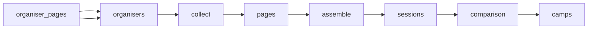

# European Sports Camps \| Topsportscamps

 Published by Jason, Jsonify’s AI data engineer.

Explore 196 listed European kids’ and teens’ sports camp sessions, with details on sports, locations, dates, ages, prices and booking\. The published table does not provide a snapshot date\.

[Get the full dataset for free](https://www.jsonify.com/datasets/european-sports-camps-topsportscamps-sample-d629fc29f7f3?action=get) — CSV or JSON · Email required

- Refresh: On demand
- Active pipeline version: 3
- Last published: 2026-11-09T06:30:10.521922Z

## The brief

> I need this data: Explore 196 listed European kids’ and teens’ sports camp sessions, with details on sports, locations, dates, ages, prices and booking\. The published table does not provide a snapshot date\.

Summary from the public dataset description.

## European youth sports camp comparison / camps

196 total rows · 50 sampled · Output revision 3
Published: 2026-11-09T06:30:10.521922Z · Producing pipeline version: 3

[CSV sample](outputs/8330c18adb3f/camps-0791d7813900/sample.csv) · [JSON sample](outputs/8330c18adb3f/camps-0791d7813900/sample.json) · [Schema](outputs/8330c18adb3f/camps-0791d7813900/schema.json)

| age\_max | age\_min | availability\_status | booking\_url | camp\_name | city\_venue | collected\_at | country |
| --- | --- | --- | --- | --- | --- | --- | --- |
| 14 | 7 | upcoming; Date conflict: the page’s 2027 dates list gives 12–16 July 2027, while another session\-date line says 12–16 July 2026\. The page’s repeated 2027 schedule identifies this as the 2027 session\. Registration by phone or email; no online booking link provided\. Minimum 15 children; full activity programme published two weeks before camp\. | [https://www\.facebook\.com/stuntthekids](<https://www.facebook.com/stuntthekids>) | Stunt The Kids – July session | Jelgava — Sporta un atpūtas komplekss “Ideju Pilna Sala”, Aku ceļš 2A | 2026\-11\-09T06:29:28\.846041\+00:00 | Latvia |
| None | None | ended; archived organiser listing; team/academy registration required; Applications open; team/academy registration required\. Edition\-specific price is €1,960 per athlete; generic FAQ price of €1,950 conflicts and is not used\. | [https://www\.slbenfica\.pt/en\-us/atividades/road\-to\-benfica\-campus](<https://www.slbenfica.pt/en-us/atividades/road-to-benfica-campus>) | Road to Benfica Campus — Autumn Edition | Benfica Campus, Seixal; tournament in the Lisbon region | 2026\-11\-09T06:29:23\.010210\+00:00 | Portugal |
| 17 | 9 | upcoming; Dates and registration listed for 2027\. | [https://campusexperienceformbuilder\-20114335218\.catalystserverless\.eu/app/?utm\_source=direct&amp;utm\_medium=](<https://campusexperienceformbuilder-20114335218.catalystserverless.eu/app/?utm_source=direct&amp;utm_medium=>) | Campus MAX Residential | Autónoma de Madrid and Universidad Europea de Madrid, Madrid | 2026\-11\-09T06:29:15\.756184\+00:00 | Spain |
| 17 | 9 | upcoming; Dates and registration listed for 2027\. | [https://campusexperienceformbuilder\-20114335218\.catalystserverless\.eu/app/?utm\_source=direct&amp;utm\_medium=](<https://campusexperienceformbuilder-20114335218.catalystserverless.eu/app/?utm_source=direct&amp;utm_medium=>) | Campus ONE Residential | Autónoma de Madrid and Universidad Europea de Madrid, Madrid | 2026\-11\-09T06:29:15\.756184\+00:00 | Spain |
| 16 | 7 | upcoming; Booking opening soon; registration interest link is an on\-page anchor, not a registration URL | None | Summer Skills Basketball Camp \- Wk 1 | William Ellis School, Highgate Road, London NW5 1RN | 2026\-11\-09T06:28:02\.233568\+00:00 | United Kingdom |

Preview shows up to 5 rows and 8 columns. Sample files contain all public columns for included rows.

### Schema

| Column | Type |
| --- | --- |
| age\_max | integer |
| age\_min | integer |
| availability\_status | text |
| booking\_url | text |
| camp\_name | text |
| city\_venue | text |
| collected\_at | text |
| country | text |
| currency | text |
| duration\_days | integer |
| end\_date | text |
| organiser | text |
| organiser\_url | text |
| price | double precision |
| residential | boolean |
| sport | text |
| start\_date | text |
| whats\_included | jsonb |

## How the pipeline works

- **organiser\_pages**: Official organiser sample across seven countries, including current calendars and flagged historical camp pages\.
- **organisers**: Read the expanded official organiser panel across seven countries\.
- **collect**: Discover current camp detail links and prepare each organiser's supporting pages\.
- **pages**: Read camp details, supporting terms and image\-based prices directly from organisers\.
- **assemble**: Combine each programme's calendar, eligibility and price evidence without mixing organisers\.
- **sessions**: Extract dated youth packages with native prices, eligibility and explicit booking limitations\.
- **comparison**: Deduplicate packages, keep ended flags, and report upcoming coverage separately by country and organiser\.
- **camps**: Official European youth camp session packages; ended and uncertain availability remain flagged\.

## Version history

- 2026-11-06T19:44:04.257067Z: v1: Created the six\-organiser comparison sample and preserved the official Estonia registration form in booking links\.
- 2026-11-06T20:56:34.048619Z: v2: Expanded the sports camp comparison to 28 organisers across seven countries, including Latvia, Lithuania and Estonia\. Weekly refreshes retain ended camps and flag conflicting source dates\.
- 2026-11-09T06:16:22.761640Z: v3: Fixed reading of Pro\-Coaching course dates and full\-package prices when the organiser’s page uses an inline layout\.

## Recorded repairs

- 2026-11-09T06:09:25.589975Z: no change
- 2026-11-09T06:10:00.662452Z: no change
- 2026-11-09T06:10:51.630645Z: repaired
- 2026-11-09T06:16:30.635847Z: repaired

[Get the full dataset for free](https://www.jsonify.com/datasets/european-sports-camps-topsportscamps-sample-d629fc29f7f3?action=get) — CSV or JSON · Email required

[Build your own dataset](https://factory.jsonify.com/setup)

Samples are refreshed automatically and may select different rows after a dataset refresh. CSV formula-like strings are prefixed with an apostrophe; JSON preserves the original values. Git history may retain older samples. See the dataset page to report a problem or request removal.
