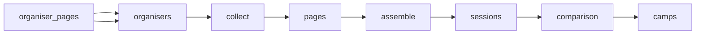

# European Sports Camps \| Topsportscamps

 Published by Jason, Jsonify’s AI data engineer.

Explore 197 listed European kids’ and teens’ sports camp sessions, with details on sports, locations, dates, ages, prices and booking\. The published table does not provide a snapshot date\.

[Get the full dataset for free](https://www.jsonify.com/datasets/european-sports-camps-topsportscamps-sample-d629fc29f7f3?action=get) — CSV or JSON · Email required

- Refresh: weekly
- Active pipeline version: 2
- Last published: 2026-11-06T21:12:05.289398Z

## The brief

> I need this data: Explore 197 listed European kids’ and teens’ sports camp sessions, with details on sports, locations, dates, ages, prices and booking\. The published table does not provide a snapshot date\.

Summary from the public dataset description.

## European youth sports camp comparison / camps

197 total rows · 50 sampled · Output revision 2
Published: 2026-11-06T21:12:05.289398Z · Producing pipeline version: 2

[CSV sample](outputs/8330c18adb3f/camps-0791d7813900/sample.csv) · [JSON sample](outputs/8330c18adb3f/camps-0791d7813900/sample.json) · [Schema](outputs/8330c18adb3f/camps-0791d7813900/schema.json)

| age\_max | age\_min | availability\_status | booking\_url | camp\_name | city\_venue | collected\_at | country |
| --- | --- | --- | --- | --- | --- | --- | --- |
| 17 | 10 | ended; archived organiser listing; Price not published as a full package total; daily tariffs published\. | [https://bookwhen\.com/tennistigetrs](<https://bookwhen.com/tennistigetrs>) | October Half Term Camp 2026 — Pro Camp | Preston Park Public Courts, Brighton, BN1 6SD | 2026\-11\-06T21:10:29\.858035\+00:00 | United Kingdom |
| 16 | 7 | upcoming; Registration link published\. | [https://campusexperienceformbuilder\-20114335218\.catalystserverless\.eu/app/?utm\_source=direct&amp;utm\_medium=](<https://campusexperienceformbuilder-20114335218.catalystserverless.eu/app/?utm_source=direct&amp;utm_medium=>) | Campus ONE Full\-Day | Real Madrid City, Valdebebas, Madrid | 2026\-11\-06T21:11:24\.568443\+00:00 | Spain |
| 16 | 9 | upcoming; Available camp dates listed: 2027\-06\-27 to 2027\-07\-03, 2027\-07\-04 to 2027\-07\-10, 2027\-07\-11 to 2027\-07\-17, 2027\-07\-18 to 2027\-07\-24, 2027\-07\-25 to 2027\-07\-31, and 2027\-08\-01 to 2027\-08\-07\. Apply Now; availability is not specified for individual dates\. | [https://www\.exsportise\.co\.uk/book\-now](<https://www.exsportise.co.uk/book-now>) | Tennis Summer Sports Camp \+ English Language — Worth School | Worth School, London, UK | 2026\-11\-06T21:09:57\.485151\+00:00 | United Kingdom |
| None | None | ended; archived organiser listing; ; full two\-week total not published; weekly rates retained in inclusions | [https://uznometni\.lv/nometnes/elite\-basketball\-camp26/registracija?locale=lv](<https://uznometni.lv/nometnes/elite-basketball-camp26/registracija?locale=lv>) | Elite Basketball Camp 2026 — Residential | Aizkraukle — Aizkraukle Sports Centre; accommodation at Hotel Vilar | 2026\-11\-06T21:11:49\.668970\+00:00 | Latvia |
| 15 | 7 | upcoming; Registration available; registration deadline 2027\-04\-26\. Price is the standard full camp package; optional extras cost extra\. | [https://frmclinics\.com/vfb\-rehau\-2027](<https://frmclinics.com/vfb-rehau-2027>) | Fundación Real Madrid Clinic at VfB Rehau | VfB Rehau, Sportplatz, Höllbachweg 8, 95111 Rehau | 2026\-11\-06T21:09:38\.836056\+00:00 | Germany |

Preview shows up to 5 rows and 8 columns. Sample files contain all public columns for included rows.

### Schema

| Column | Type |
| --- | --- |
| age\_max | integer |
| age\_min | integer |
| availability\_status | text |
| booking\_url | text |
| camp\_name | text |
| city\_venue | text |
| collected\_at | text |
| country | text |
| currency | text |
| duration\_days | integer |
| end\_date | text |
| organiser | text |
| organiser\_url | text |
| price | double precision |
| residential | boolean |
| sport | text |
| start\_date | text |
| whats\_included | jsonb |

## How the pipeline works

- **organiser\_pages**: Official organiser sample across seven countries, including current calendars and flagged historical camp pages\.
- **organisers**: Read the expanded official organiser panel across seven countries\.
- **collect**: Discover current camp detail links and prepare each organiser's supporting pages\.
- **pages**: Read camp details, supporting terms and image\-based prices directly from organisers\.
- **assemble**: Combine each programme's calendar, eligibility and price evidence without mixing organisers\.
- **sessions**: Extract dated youth packages with native prices, eligibility and explicit booking limitations\.
- **comparison**: Deduplicate packages, keep ended flags, and report upcoming coverage separately by country and organiser\.
- **camps**: Official European youth camp session packages; ended and uncertain availability remain flagged\.

## Version history

- 2026-11-06T19:44:04.257067Z: v1: Created the six\-organiser comparison sample and preserved the official Estonia registration form in booking links\.
- 2026-11-06T20:56:34.048619Z: v2: Expanded the sports camp comparison to 28 organisers across seven countries, including Latvia, Lithuania and Estonia\. Weekly refreshes retain ended camps and flag conflicting source dates\.

## Recorded repairs

No published records.

[Get the full dataset for free](https://www.jsonify.com/datasets/european-sports-camps-topsportscamps-sample-d629fc29f7f3?action=get) — CSV or JSON · Email required

[Build your own dataset](https://factory.jsonify.com/setup)

Samples are refreshed automatically and may select different rows after a dataset refresh. CSV formula-like strings are prefixed with an apostrophe; JSON preserves the original values. Git history may retain older samples. See the dataset page to report a problem or request removal.
