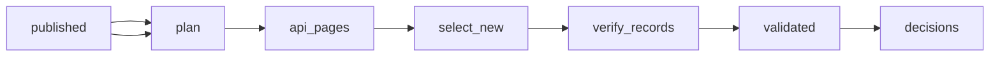

# FDA 510\(k\) Database: Every Clearance Decision, Weekly

 Published by Jason, Jsonify’s AI data engineer.

FDA 510\(k\) database of clearance decisions from the past year: device, applicant, product code, device class, specialty and decision date\. Updated weekly\.

[Get the full dataset for free](https://www.jsonify.com/datasets/fda-510-k-clearance-decisions-77a1978440d2?action=get) — CSV or JSON · Email required

- Refresh: weekly
- Active pipeline version: 2
- Last published: 2026-10-30T09:13:15.117620Z

## The brief

> I need this data: FDA 510\(k\) database of clearance decisions from the past year: device, applicant, product code, device class, specialty and decision date\. Updated weekly\.

Summary from the public dataset description.

## FDA 510\(k\) clearance decisions / decisions

3,155 total rows · 500 sampled · Output revision 2
Published: 2026-10-30T09:13:15.117620Z · Producing pipeline version: 2

[CSV sample](outputs/31779f403f5f/decisions-3183d37be506/sample.csv) · [JSON sample](outputs/31779f403f5f/decisions-3183d37be506/sample.json) · [Schema](outputs/31779f403f5f/decisions-3183d37be506/schema.json)

| applicant | applicant\_city | applicant\_country | applicant\_state | clearance\_type | date\_received | decision | decision\_date |
| --- | --- | --- | --- | --- | --- | --- | --- |
| Tianjin Huahong Technology Co\., Ltd\. | Tianjin | CN |  | Traditional | 2026\-06\-25 | Substantially Equivalent | 2026\-08\-18 |
| GE Medical Systems | Waukesha | US | WI | Traditional | 2025\-11\-28 | Substantially Equivalent | 2026\-08\-13 |
| Tianjin Huahong Technology Co\., Ltd\. | Tianjin | CN |  | Special | 2026\-06\-30 | Substantially Equivalent | 2026\-07\-22 |
| Shenzhen Root Innovation Technology Co\., Ltd\. | Shenzhen | CN |  | Traditional | 2025\-12\-08 | Substantially Equivalent | 2026\-04\-29 |
| Endovascular Engineering, Inc\. | Menlo Park | US | CA | Traditional | 2025\-09\-16 | Substantially Equivalent | 2025\-12\-18 |

Preview shows up to 5 rows and 8 columns. Sample files contain all public columns for included rows.

### Schema

| Column | Type |
| --- | --- |
| applicant | text |
| applicant\_city | text |
| applicant\_country | text |
| applicant\_state | text |
| clearance\_type | text |
| date\_received | text |
| decision | text |
| decision\_date | text |
| device\_class | text |
| device\_name | text |
| fda\_record\_url | text |
| k\_number | text |
| medical\_specialty | text |
| product\_code | text |

## How the pipeline works

- **published**: Previously saved FDA decisions, used to add only new clearance numbers\.
- **plan**: Count decisions in the 52\-week window and plan small API pages\.
- **api\_pages**: Read API pages and retain only the requested non\-personal fields\.
- **select\_new**: Remove saved clearance numbers and allow at most 5,000 published additions per UTC month\.
- **verify\_records**: Check a reproducible random sample of ten new decisions against FDA record pages and report the findings\.
- **validated**: Count skipped records and validate the exact output fields and unique clearance numbers\.
- **decisions**: sink

## Version history

- 2026-10-30T09:04:14.779043Z: v1: Created a private incremental FDA 510\(k\) decision collection with monthly limits and per\-record checks\.
- 2026-10-30T09:10:04.863417Z: v2: Kept decisions with blank product codes or specialties and replaced full FDA page checking with a random ten\-record check\. De Novo decisions remain excluded and counted\.

## Recorded repairs

No published records.

[Get the full dataset for free](https://www.jsonify.com/datasets/fda-510-k-clearance-decisions-77a1978440d2?action=get) — CSV or JSON · Email required

[Build your own dataset](https://factory.jsonify.com/setup)

Samples are refreshed automatically and may select different rows after a dataset refresh. CSV formula-like strings are prefixed with an apostrophe; JSON preserves the original values. Git history may retain older samples. See the dataset page to report a problem or request removal.
