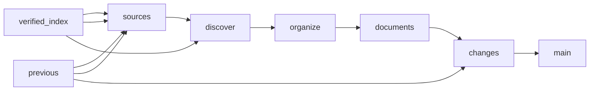

# FDA, EMA and Infarmed GMP Guidance and Warning Letters

 Published by Jason, Jsonify’s AI data engineer.

GMP guidance and warning letters from FDA, EMA, EudraLex and Infarmed, with document dates, source links and change\-comparison fields\. The published dataset contains 416 document records\.

[Get the full dataset for free](https://www.jsonify.com/datasets/fda-ema-and-infarmed-gmp-guidance-and-warning-letters-8099814fc1b9?action=get) — CSV or JSON · Email required

- Refresh: On demand
- Active pipeline version: 4
- Last published: 2026-11-20T10:19:52.736363Z

## The brief

> I need this data: GMP guidance and warning letters from FDA, EMA, EudraLex and Infarmed, with document dates, source links and change\-comparison fields\. The published dataset contains 416 document records\.

Summary from the public dataset description.

## FDA, EMA and Infarmed GMP Guidance and Warning Letters / main

416 total rows · 50 sampled · Output revision 3
Published: 2026-11-20T10:19:52.736363Z · Producing pipeline version: Unknown

[CSV sample](outputs/5bafad016020/main-0d6e4079e367/sample.csv) · [JSON sample](outputs/5bafad016020/main-0d6e4079e367/sample.json) · [Schema](outputs/5bafad016020/main-0d6e4079e367/schema.json)

| agency | captured\_at | captured\_date | change\_basis | change\_type | company | content\_hash | content\_hash\_basis |
| --- | --- | --- | --- | --- | --- | --- | --- |
| Infarmed | 2026\-11\-19T18:05:28\.740874\+00:00 | 2026\-11\-19 | First observation of this document | new |  | 843e736f04c01e13064d92fb00eda3246a9e59cbea4c4289ffa768c79232d2fb | SHA\-256 of complete PDF bytes |
| FDA | 2026\-11\-19T18:05:28\.740874\+00:00 | 2026\-11\-19 | First observation of this document | new | Natural Essentials, Inc\. | d22492342afddfbc8e0e0a6ff3ab6287f7ea70d3133f8cd2d37e88a90ca9bb3d | SHA\-256 of complete normalized document text, excluding website navigation and footer |
| FDA | 2026\-11\-19T18:05:28\.740874\+00:00 | 2026\-11\-19 | First observation of this document | new | Umicore Argentina S\.A\. | be7ed044ef54dfaab2e685c70c2c2d1d55d3cb684572d227ce45c34c8c9d6fd1 | SHA\-256 of complete normalized document text, excluding website navigation and footer |
| FDA | 2026\-11\-19T18:05:28\.740874\+00:00 | 2026\-11\-19 | First observation of this document | new | Shenzhen Benliju Biotech Co\., Ltd\. | af0def15b7700768792e835078342368d6c55d2cc4eaf8fec625e75d071d0bb1 | SHA\-256 of complete normalized document text, excluding website navigation and footer |
| FDA | 2026\-11\-19T18:05:28\.740874\+00:00 | 2026\-11\-19 | First observation of this document | new | Nanjing Hanxin Pharmaceutical Technology Co\. Ltd\. | 4a47f6fe5763d608d3663b83ab2ae19e7cec60d396330f295b925619d9bcc398 | SHA\-256 of complete normalized document text, excluding website navigation and footer |

Preview shows up to 5 rows and 8 columns. Sample files contain all public columns for included rows.

### Schema

| Column | Type |
| --- | --- |
| agency | text |
| captured\_at | text |
| captured\_date | text |
| change\_basis | text |
| change\_type | text |
| company | text |
| content\_hash | text |
| content\_hash\_basis | text |
| date | text |
| date\_basis | text |
| document\_id | text |
| document\_key | text |
| document\_pdf\_url | text |
| document\_type | text |
| first\_seen\_at | text |
| issuing\_office | text |
| last\_modified\_date | text |
| listing\_url | text |
| product\_area | text |
| publication\_date | text |
| revision\_number | text |
| source\_date\_notes | text |
| source\_url | text |
| summary\_or\_violation\_category | text |
| title | text |
| unavailable\_document | boolean |
| url | text |

## How the pipeline works

- **verified\_index**: Optional verified official document index from an interrupted refresh\. Omit for normal live discovery; use an exact captured dataset revision for recovery\.
- **previous**: Last published regulatory snapshot, used only for identity, first\-seen dates and change comparisons\.
- **sources**: Prepare official regulatory sources and read the previous published snapshot for change comparisons\.
- **discover**: Discover current documents in FDA, EMA, European Commission and Infarmed official indexes\.
- **organize**: Deduplicate document identities and interleave source families so bounded runs include balanced source coverage\.
- **documents**: Retrieve documents or retain verified index metadata with explicit unavailable status when the document cannot be acquired\.
- **changes**: Compare full document fingerprints with the last successfully published snapshot and retain original first\-seen dates\.
- **main**: Current official GMP regulatory documents with source traceability and changes since the last published snapshot\.

## Version history

- 2026-11-19T14:19:34.946580Z: v1: Added a reusable official\-source refresh with document links, references, source dates, complete\-document fingerprints and change tracking\.
- 2026-11-19T15:24:04.724917Z: v2: Retains the unavailable Sterisets notice with verified source details, a blank content hash, unknown change status and an explicit unavailable\-document flag so the other documents can refresh\.
- 2026-11-19T15:51:04.940785Z: v3: Improves document metadata processing so the refresh can continue after repeated processing errors\.
- 2026-11-19T17:52:36.003072Z: v4: Retain unavailable documents, including download timeouts, with verified metadata and unknown change status\. Recover interrupted refreshes from a verified index while fetching documents again\.

## Recorded repairs

No published records.

[Get the full dataset for free](https://www.jsonify.com/datasets/fda-ema-and-infarmed-gmp-guidance-and-warning-letters-8099814fc1b9?action=get) — CSV or JSON · Email required

[Build your own dataset](https://factory.jsonify.com/setup)

Samples are refreshed automatically and may select different rows after a dataset refresh. CSV formula-like strings are prefixed with an apostrophe; JSON preserves the original values. Git history may retain older samples. See the dataset page to report a problem or request removal.
